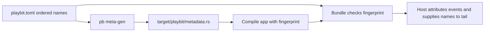

# App trace declarations

Declare ordered event names in `playbit.toml`:

```toml
[trace]
version = 1

[[trace.names]]
name = "app.update"
kind = "span"
description = "Update the view"

[[trace.names]]
name = "app.rows"
kind = "mark"
description = "Visible row count"
```

Names contain 1–48 ASCII bytes: a lowercase initial letter followed by lowercase
letters, digits, underscore or dot. Up to 256 names are allowed. Names must remain
distinct after uppercasing and replacing dots with underscores; descriptions are
at most 512 UTF-8 bytes. Kinds are `span` and `mark`. Omit `[trace]` for an app
without named observations. The complete manifest is bounded to 320 KiB.

`pb build` and `pb run` validate declarations and generate
`target/playbit/metadata.rs` before compilation. Run `pb meta-gen` before direct
Cargo builds. Generated files are ignored and must not be checked in. Name order
defines `u16` constants such as `APP_UPDATE`. A fingerprint in the executable
binds those IDs to the package's declaration catalog; packaging rejects stale,
missing or duplicate metadata. Arbitrary event metadata needs no declaration.



Recording is off by default. Discover a running instance with
`pb session instances SESSION`, then use:

```sh
pb trace start INSTANCE [--clean]
pb trace status INSTANCE
pb trace tail INSTANCE
pb trace tail INSTANCE --since TIMESTAMP
pb trace stop INSTANCE [--clean]
```

`pb run --trace` starts recording the instance it launches, as a convenience for
`pb trace start INSTANCE`. This works with source, bundle, build and deployment
runs. It keeps retained recordings and leaves other instances' settings unchanged.
Recording continues after `pb run` stops watching; use `pb trace stop INSTANCE`
to stop it. The flag starts recording after launch, so earlier startup events
can be absent. Code reload currently recreates the guest's trace scope and resets
its instance override to the profile default; start targeted recording again
after a reload when the profile default is off.

The ID is a canonical base58 session-instance ID, not a session or process ID.
Omitting it selects the profile. Profile start/stop clears instance overrides;
an instance override changes only that live instance and expires with its owner.
These commands connect to existing owners and do not launch an engine or app.
Start appends to retained recordings, and stop preserves them. `--clean` on start
clears recordings before starting; on stop it clears them after stopping. With
an instance ID, it clears only that instance's recordings. Without an ID, it
clears all recordings in the profile. The flag and instance ID can appear in
either order. Only start and stop accept `--clean`, and the running owner
performs cleanup.

Recordings live in `<profile>/traces/global` and
`<profile>/traces/INSTANCE_ID`. Retention has a profile-wide budget of 20% of
current free disk space. When aggregate recording storage reaches that budget,
the owner evicts the oldest trace groups across all instances and the global
recording.

Status acknowledges control state, not receipt of guest events. Tail is a raw
JSON event stream with catalogs, boundaries and relevant loss notices. By default,
tail prints the most recent 10,000 retained events and follows new events. Use
`pb trace tail [SESSION-INSTANCE-ID] --since TIMESTAMP` to select retained and
future events whose timestamp is strictly greater than `TIMESTAMP`; the option
and instance ID can appear in either order. The timestamp must be an unsigned
decimal `u64`, as printed in an event's `timestamp` field. Catalogs and boundaries
needed to interpret the selected events are included. Tail completes successfully
when the recorder stops; Ctrl-C stops reading.

Timestamps increase only within a thread. Buffers from different threads can
arrive out of timestamp order, so `--since` is a timestamp filter, not a lossless
resume checkpoint. Earlier events needed to resolve references can be absent.

```rust,ignore
// Tokens own a timestamp and capture generation; store one in app state to
// end it during a later callback. Tracing errors must not skip application work.
let span = context.trace_begin(trace_names::APP_UPDATE, None,
    br#"{"actor_type":"monster","position":{"x":12.5,"y":8}}"#).ok();
// Perform application work.
let _ = context.trace_instant(trace_names::APP_ROWS, rows.len() as u64, span, &[]);
if let Some(span) = span {
    let _ = context.trace_end(span, br#"{"ok":true}"#);
}
```

Parent references are explicit. Overlapping spans can end in any order and stay
open across callbacks; an open span does not parent unrelated callbacks. The SDK
uses a 16-KiB byte buffer, including metadata, and flushes at capacity thresholds
and registered callback return. Direct `ContextState` callers must call
`trace_flush()` before yielding or normal shutdown. Flushing does not close spans.
A crash can lose the unflushed tail. Stop/restart invalidates old tokens and
batches; it never invents ends or continuous coverage.

Metadata is optional, already-encoded UTF-8 JSON object bytes, up to 4 KiB per
event. Build it only after `trace_enabled()` when construction is expensive.
Oversized observations are refused whole and counted, never truncated. Readers
retain malformed metadata with an error and its exact bytes. Names, labels,
values and metadata are private app data, never anonymous telemetry or AP timing
labels. See the [packed event ABI](../playbit-api/src/abi/README.md#trace-events).

The desktop trace viewer has been removed. A future timeline is separate work.
