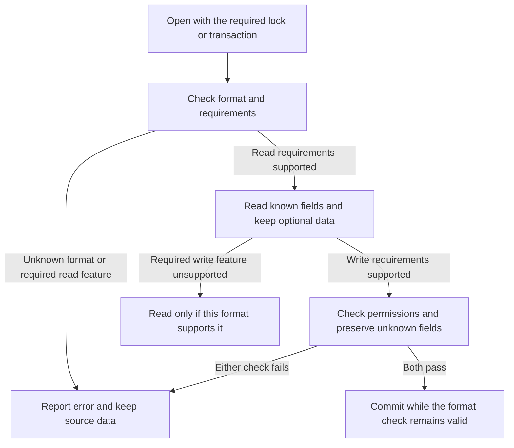

# Compatibility contract

This policy covers supported Playbit data, packages, protocols, schemas and guest
interfaces. Each format or interface specification defines its exact bytes,
features, defaults and limits.

The current specifications and test samples are release candidates. Shipping the
first supported release fixes the exact versions covered by this promise, even
if the product version is below 1.0. The experimental `playbit/docdb` API,
schema generator and data formats are [excluded](../playbit/docdb/README.md).

## Names and meanings are permanent

Before a format or interface is released as supported, remove superseded designs
and their callers together. This cleanup does not permit erasing existing data.
After release:

- Schema names, type and field IDs, field types, and whether a field is single or
  repeated cannot change. A different meaning needs a new name or ID.
- Never reuse or repurpose field tags, syscall opcodes, event kinds, feature names,
  error codes, defaults, hash domains or authenticated meanings.
- Deprecation is permanent. It discourages new use but does not remove an older
  app's established access or free the name or ID for reuse. Authorization,
  consent and explicit user deletion still apply.
- Every added field or argument defines what absence, zero and empty values mean,
  where applicable. Existing values keep their meanings. An absent optional
  field keeps its published default; an unknown enum value must not be interpreted
  as a known value.

Routine additions should need no data migration. An incompatible change needs
an explicit supported migration or an error that leaves the source intact.
A product version, build hash or matching executable does not prove that data
is compatible.

## Formats evolve independently

| Format or interface | What its version describes |
| --- | --- |
| Physical storage | Database files, transaction metadata, tree/hash encoding and crash recovery. |
| Stored records | Record identities, fields, defaults and read/write requirements. |
| Transport | Framing, operations, errors and negotiated peer features. |
| Packages and guest ABI | Package content, required host features, syscall arguments and data layouts. |
| Application schemas | App-defined names, type/field IDs and their meanings. |

For example, a program may understand kvdb's file format but not a newer record
inside it. An AP protocol version does not make that record safe to write. A
package version does not establish that the runtime supports the syscalls its
app uses. Do not tie these versions together through one counter, executable
identity or shared runtime registry.

Prefer compact binary records on client storage and interaction paths where size
and decoding cost matter. Keep central server entities and operation receipts
in JSON for inspection. A server that stores replica bytes or encrypted data
keeps the client's representation without transcoding it.

## Describe requirements before reading the contents

Where compatibility needs a check, the format provides a small description:

| Property | Meaning |
| --- | --- |
| Format identity | A permanent name or ID for the encoding family. |
| Revision | The exact framing/layout version. A larger number does not imply compatibility. |
| Required read features | Features a reader must understand to interpret or use the content safely. |
| Required write features | Features a writer must understand to change the content without losing data or breaking its rules. |

These are properties, not mandatory JSON field names or one universal header.
An enclosing format can supply them. A format whose requirements cannot vary
independently need not store empty lists. Each specification defines its encoding,
limits, defaults and feature names; this document assigns none of those names.

A reader must be able to identify the format and check its requirements with
bounded work before decoding an unsupported body or acting on it. Reject unknown
framing. A missing declaration means no requirements only if the published format
explicitly defines that default. Reject duplicate, malformed or oversized
declarations according to that format's rules.

Feature names describe exact, permanent behavior. They are not minimum product
versions. A revision suffix may identify a particular encoding, but does not
imply support for other revisions. Advertise a feature only when the implementation
supports everything that feature promises.

Bind declarations that affect interpretation, integrity or permissions to the
content through its hash, signature or authenticated encryption, as applicable.
An attacker must not be able to remove a requirement or change the declared
format while leaving an accepted body. Routing may inspect an envelope's format
before authentication; it must not treat that inspection as validation of the
contents or permission to apply them to local state.

## Reading and writing need separate checks

A reader may ignore unknown optional data only where the format allows it. When
a writer saves or rewrites the enclosing content, it must preserve unknown
optional fields, record kinds and package entries. Keep exact bytes wherever
identity, hashing, signatures or encryption depend on them. If an edit cannot
preserve those bytes safely, reject the edit; do not save only the understood
fields and discard the rest.

Unsupported read requirements prevent use of the content. Unsupported write
requirements prevent changes, even when reading succeeds. A read-only path exists
only if that format explicitly supports it. Reject unsupported requirements
before any dependent changes or other effects. An empty requirement list does
not bypass validation, permissions, resource limits or preservation rules.

Keep the format check valid through commit, using an atomic transaction condition
or the appropriate exclusive lock. Before publishing incompatible
requirements, stop older processes from continuing to write. A startup-only check
is insufficient when a process can keep writing through an upgrade. Compatibility
must never broaden access or make local rendering wait for a remote acknowledgment.

## Public AP and guest ABI

AP stays public and independently implementable. Compatibility depends on the
published protocol and peer features, without a private service, build hash or
online schema registry. See the [AP specification](../playbit/src/network/ap/protocol.md).

Prefer scalar syscall arguments. Every ABI data struct starts with its specified
size field. Add fields only at the end; never insert, move, retype or repurpose
existing fields. Preserve their offsets, alignment and meanings.

Guests zero unused scalar argument slots. If a later syscall version uses one
of those slots, zero must keep the default or unspecified meaning defined by the
original interface. Added struct fields also need explicit defaults for older
callers that pass shorter structs. The [guest ABI](../playbit-api/src/abi/README.md)
defines the exact layouts and host features.

## Keep old test data and compiled apps

Each format's implementation keeps its IDs, declarations and compatibility tests
together. At release, save examples of its bytes and compiled guest programs with
source and compiler versions and reproducible build instructions. These fixed
test inputs are often called *fixtures*. Keep them unchanged when adding a new
version. Rebuilding an old app with a new SDK does not test an old compiled app.

The [guest release candidate](../playbit/tests/fixtures/guest-abi-rc2/README.md)
contains compiled C/Rust programs, sources, compiler versions, hashes and commands
to verify or reproduce them. Regression tests use the original binaries. Record
and profile tests likewise use saved bytes rather than generating supposedly old
data with today's encoder.

Tests must cover old data, edits by older writers where supported, rejection of
unknown requirements, and preservation of identity and authentication.

## Migrations and recovery

For a specific migration, keep the source data, save progress in bounded steps
that can resume after interruption, validate the destination and mark completion
atomically. Interrupted work must not look complete. Restoring an old executable
is safe only if it can use the data already written. Do not add a general migration
framework without a concrete need.

Diagnostic trace recordings have a separate reader policy from live guest events
and the app ABI. A tool may reject an unsupported recording while preserving it.
It must not reinterpret the recording as the current format or silently overwrite
it.
