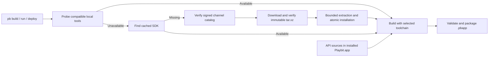

# Developer SDKs

On an arm64 Mac, the installed `pb` can create and build OCaml and Rust Wasm
applications without separately installed developer tools:

```sh
mkdir counter && cd counter
pb init --lang ocaml
pb run
```

Rust is the default for `pb init`; `--lang rust` selects it explicitly. New OCaml
projects contain `src/app.ml`, `playbit.toml`, an icon and `playbit-volumes.json` with empty role declarations.
The starter has Increment and Reset controls. Its in-memory state resets when its
package is replaced. The OCaml API supports logging, event polling, host limits/platform and
quit-on-last-window; column/row, text/button and canvas views; typed pointer, key,
frame and surface input; typed volume-role selection, asynchronous entry resolution and KV reads
and writes; and PCM audio. Packed pixel canvases and audio require a host
advertising their exact capabilities.

## Choosing tools

Source-building `pb build`, `pb run` and `pb publish` accept:

| Selection | Behavior |
| --- | --- |
| `--sdk=auto` (default) | Probe local tools; use compatible tools, otherwise use/download Playbit's SDK. |
| `--sdk=builtin` | Use/download Playbit's SDK for the project's language. |
| `--sdk=system` | Require compatible local tools. Report missing tools/targets without downloading. |

The first SDK download requires network access. Subsequent builds reuse the
selected cache without checking for updates. Explicitly update it with
`pb sdk update ocaml` or `pb sdk update rust`. SDK catalogs are fetched from
`/download/sdk.json` on the installation's website and verified before use.

SDK selection is quiet by default. Use `pb build -v` or `pb run --verbose` to
show toolchain selection details. Download and extraction progress is always shown.

Tool selection is held for the lifetime of `pb run`. A program's syntax/type
errors never cause a compiler change. A corrected source file triggers another
build; failed builds retain the running app.

The Rust SDK includes Cargo, Rust 1.99.0, host libraries, Wasm standard libraries
and the linker. The OCaml SDK includes OCaml 5.3.0, the Playbit compiler fork,
standard libraries and Binaryen 133. Neither SDK installs anything into an existing
Rust/opam installation. Rustup automatic installation is disabled during probing.
Explicit project Rust version requirements must also be satisfied.

The Rust starter builds offline after toolchain acquisition. User-added Cargo
packages may need their usual dependencies and downloads; native build scripts
are outside the zero-install guarantee. Native app toolchains are separate.
OCaml supports `.ml`/`.mli` modules directly under `src/`, linked in dependency
order with `src/app.ml` as the entry. Cyclic module dependencies are rejected.
Package managers, PPX and arbitrary C primitives are outside this driver.

[Touchline](../guests/touchline/README.md) is a seven-a-side OCaml soccer game. It uses a
pixel canvas for the pitch, session presence to assign shirts, and live channels to
exchange player input and match state.

## Builds and installed API

`lang = "ocaml"` selects the managed OCaml driver. Omit `build_cmd`,
`build_artifact`, native build declarations and trace stages for these projects.
Builds publish `target/debug/app.wasm` or `target/release/app.wasm` atomically,
then package `target/{debug,release}/NAME.pbapp` through the normal packager.
Cargo applications and explicitly configured custom build commands remain supported.

Small Playbit API sources and generated primitives ship with Playbit.app, matched
to its runtime. Heavy compiler toolchains are downloaded separately. The OCaml
compiler contains no syscall opcode table. New Rust projects use a generated API
copy under `target/playbit/sdk` so moving Playbit.app does not embed a stale path
in Cargo.toml. `pb meta-gen` also prepares this copy for direct Cargo builds.

## Guest crash reports

`pb run` streams guest logs and crash reports to stderr. For a running app instance,
use `pb logs SESSION --instance ID` to read its retained report. Wasm traps include
guest stack frames with demangled function names. When the packaged guest contains
DWARF debug information, frames also include source filenames and line numbers;
no environment variable is required on the host. Rust development builds normally
include debug information; for release builds, set `debug = 1` or `debug = 2` in
the guest's `[profile.release]` and preserve its debug sections during packaging.
Stripped guests still report Wasm function names or indices and offsets.

Crash reports share the existing 256-entry / 64 KiB retained log budget. A report
can displace earlier logs, which readers report as dropped entries. Reports larger
than 64 KiB end with an explicit truncation marker. Modal error notices retain
their separate 4 KiB display limit.



## SDK cache and verification

SDKs live in `~/Library/Caches/Playbit/SDK`, shared across projects/profiles.
Selections are scoped by channel and language; installations use canonical base58
BLAKE3 addresses. A filesystem lock serializes installation. Active builds retain
read leases; updates keep the previous selection and reclaim older unleased SDKs.
An interrupted download/extraction is discarded on the next installation attempt.

Catalogs are Ed25519-signed envelopes over the exact base64-decoded payload bytes.
The payload binds channel, sequence and artifact compatibility/size/address. Archive
bytes must match their BLAKE3 address before extraction. The extractor admits only
regular files/directories under `sdk/`, rejects links/collisions/traversal, and
limits archives to 1 GiB compressed, 4 GiB expanded and 50,000 entries. SDK downloads
and probes belong to CLI build work, never the rendering or guest-turn path.

Language bindings, starter templates and compiler-specific tests live under
[`playbit/sdk/`](../playbit/sdk/README.md). The maintained counter example is in
[`guests/counter-ocaml/`](../guests/counter-ocaml/README.md); packaging uses that
same source for `pb init --lang ocaml`.
