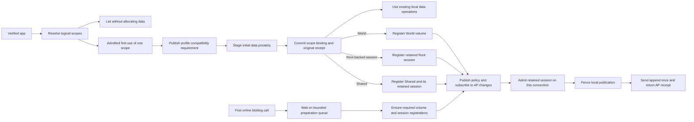
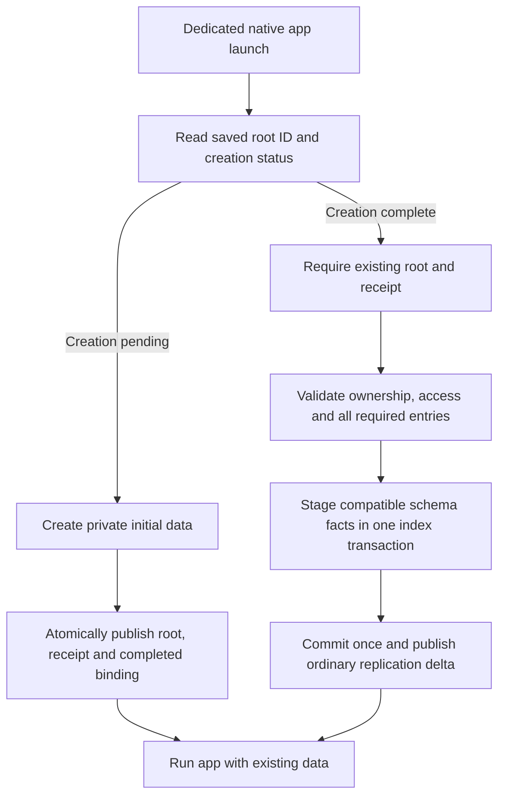

# Automatic app scopes and root initialization

A verified `(publisher, app_id)` identifies an app. Its default World address is
stable across builds. The host resolves six lazy scopes:

| Scope | Shared between sessions | Identity inputs beyond the app |
| --- | --- | --- |
| World | Yes | None |
| Shared | No | Session |
| User | Yes | Account |
| User-session | No | Account and session |
| Local | Yes | Account and local profile |
| Local-session | No | Account, profile and session |

`playbit-volumes.json` declares initial data by `root`, `session`, `user`,
`user-session`, `local` and `local-session`. Missing roles are empty. World
normally permits public Read; private and Shared declarations inherit the
host-selected owner and cannot grant additional readers. User scopes belong to
the current account, independently of the app publisher. An explicit Root or
User override keeps the selected volume's actual permissions.

Listing a logical slot creates no volume. The first admitted data or File
operation initializes only that scope. Original seed data is published with its
receipt and local binding; subsequent opens retain edited data and never reseed.
Shared retains the original session build's initializer through code updates.
Missing backing for a known scope is unavailable, rather than a fresh empty scope.
In the app-level list, an uninitialized scope is unavailable until a local app
import supplies its initializer. Retained ordinary sessions alone do not supply
that app-level import. Existing materialized scopes and session root overrides
remain available under their existing permissions.

New World roots enable AP database replication. First use publishes their
registration and credentials. Root-backed sessions register with their original
identity. AP can read these databases; public and participant permissions still
govern app access. Scope bindings and the original initialization receipt travel
in encrypted account records and credential recovery catalogs.

Fresh sessions using the default World address synchronize Shared when the app
explicitly declares a `session` initializer, including an empty declaration.
Omitting that declaration preserves World-backed session behavior. Shared's
first creation retains the original initializer receipt, credentials
and explicit session binding atomically before publishing through ordinary
encrypted replication. Authorized peers and recovered devices import that same
backing; they never run its initializer. World stays a distinct address and is
not created merely to share Shared data.

The browser supports `session-volume.v1` for apps that require only Shared.
A local example profile gets its own session. A Shared invitation opens its
existing replica with the supplied capability. Both paths use the same signed
app identity and Session address as native hosts. A local example without a
Session declaration uses its own explicit sandbox Root.

User, User-session, Local and Local-session remain on their original device and
stay excluded from replication and recovery. Existing local-only Shared data
and roots created without AP replication retain that policy; they are not
implicitly uploaded or reseeded. This change does not migrate bloblog data.

Local scopes require `local-app-scopes.v1`; hosted scope publication additionally
requires `hosted-app-scopes.v1` in both profile descriptors. The synchronized
Shared binding requires `shared-session.v1`, also enforced independently on
account invitations. Older clients refuse unsupported profiles before writing
them. Local creation, reopening and ordinary database edits do not wait for AP.

Bloblogs are online-only. Their operations require completed registration and
current authority. The first remote call for a volume/session on each connection
waits on the bounded network worker for registration, initial replication and
session admission. Preparation is cached for that connection; append still
fences local publication before sending. A failed or uncertain append is never
replayed automatically.

## Ordinary root lifecycle

An app's root declaration describes initial data and the schema the app knows.
It does not describe the current contents of a user's volume. The declaration
is bounded to 64 KiB, 64 entries and 64 seeded objects. Declarations that control
permissions use a closed JSON format; unknown fields must not be treated as
optional metadata.

`LocalStore::initialize_root` creates a root with an identity already saved by
the caller. It stages the index, databases and blobs privately, then publishes
the catalog, credentials and a record of the original declaration (the receipt)
together. Retrying the same creation request accepts only the original declaration
fingerprint.
It never reapplies seeds to an already published root. Personal volume creation
uses the same mechanism with a distinct purpose.

`LocalStore::open_initialized_root` opens a root created by this profile. It
requires the existing root, original receipt, expected owner and purpose, and
current access. A different template fingerprint does not invalidate that
historical receipt. Root names, entry names, permissions, object edits, deleted
objects and blob contents remain user data.

Opening establishes compatible schema declarations for existing object
databases by stable entry, type and field IDs. Established names, value types
and cardinalities cannot change. Deprecation is permanent; an older declaration
can omit newer fields without removing them or reversing deprecation. All
schema facts in a volume share its index database, so declarations for several
databases commit atomically. A conflict or denied access leaves every schema
unchanged. Changes use ordinary live replication without waiting for a remote
acknowledgment.

New databases and blobs require an explicit data operation. Opening neither
creates a newly declared entry nor restores a deleted one. A declaration that
requires a missing entry or a different database kind/protocol fails explicitly.
Names are resolved by stable entry ID, so renaming an entry does not break
reopening.

The native wrapper uses `prepare_app_root` to keep the same saved root ID
through interrupted first launch and later application updates. Once creation
is complete, missing data is an error, not permission to initialize again.
Explicit existing-root launches in the CLI and managed engine continue opening
the selected volume without applying a template; their new-root paths use
creation. Opening or updating an ordinary existing session does not replay root
initialization.
