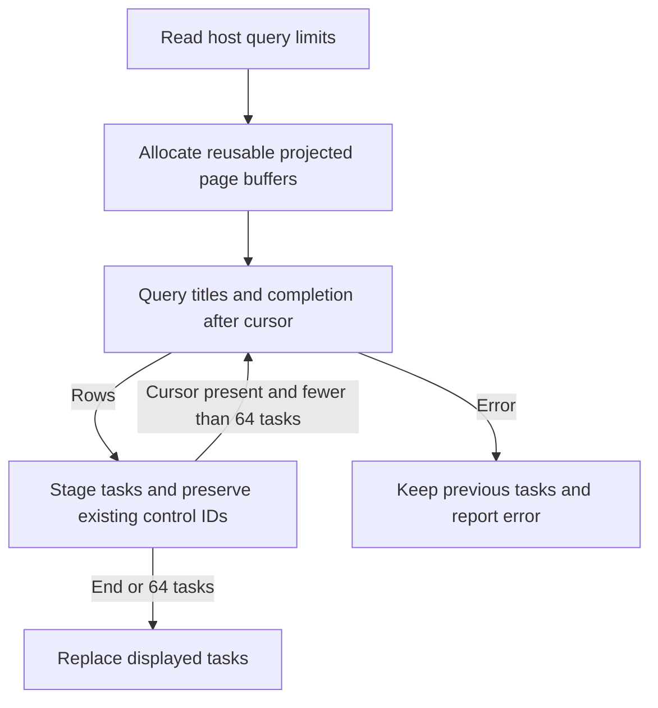

# TODO example

Client source is available to repository members during beta. The owner plans
to make this repository public with the real v1 release.

A small native task list: add a task, edit its title, and mark it complete. The
app reads and writes its session’s Shared data. Its UI handles at
most 64 visible tasks and retains drafts when an edit fails.

The shared native/Wasm app discovers the host's query record and value-byte
limits. It reuses one projected page buffer and follows continuation cursors
until the list ends or 64 tasks are loaded. Short pages can result from byte
limits as well as record limits. An eight-record / 8 KiB host uses 8 KiB of query
byte storage; the default desktop host uses 512 KiB, enough for 64 titles of up
to 8,192 bytes. Object/field/value arrays are sized to the admitted page count.
Volume metadata is sized from a bounded discovery call.

Refresh publishes its new rows and control IDs only after all requested pages
succeed. A later-page failure retains the previous tasks and reports the error.
Pages are individual queries, not a shared database snapshot; committed-change
events trigger another refresh. New titles are limited to the smaller of 8,192
bytes and the host value-byte ceiling minus one byte for the completion Boolean.
The list retains its 64-task bound independently of host page size.

The `session` declaration in `playbit-volumes.json` seeds each new session’s
Shared data on first access. Reopening keeps saved tasks. Synchronization of
these automatic scopes is deferred; this increment runs them locally.
