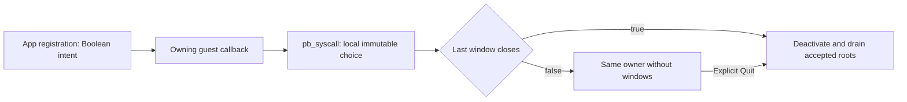
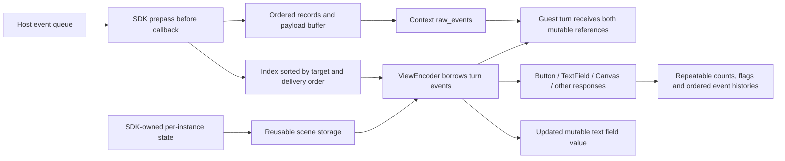

# playbit-api

The Rust SDK for Playbit apps. Apps can execute as
cooperative native code or Wasm guests. Both use the same typed operations and
semantic UI vocabulary; the host owns identity, authorization, storage and
presentation. `pb init` references the version-matched installed SDK.

Use safe [`Context`](src/context.rs) methods from Rust, or the inline wrappers
in [`playbit/sys/abi.h`](include/playbit/sys/abi.h) from C. The current operation
registry is [`abi/syscall.rs`](src/abi/syscall.rs). Full pointer, output,
resource-limit and error rules are in the [operation ABI](src/abi/README.md).
See the [syscall reference](syscalls.md) for every opcode, argument and result.

The default features re-export the experimental document database crate as
`playbit_api::docdb`. Its API and data formats remain outside Playbit's supported
compatibility contract.

```rust
use playbit_api::docdb::{Doc, RNG, SyncHelper};
```

ABI-only consumers can use `default-features = false` to omit the document model.

## App registration and lifecycle

With the `guest` feature, export one Rust registration:

```rust
#[unsafe(no_mangle)]
fn playbit_app() -> playbit_api::App {
    playbit_api::app(State::new(), State::turn, true)
}
```

The turn method takes `(&mut self, &mut Context<'_>, &mut ViewEncoder<'_>)`.
The SDK owns each instance's typed state until destruction. The third argument
is explicit Boolean last-window intent: `true` begins Quit when the last window
closes; `false` retains the existing execution owner without windows. The SDK
declares it through `Context::quit_on_last_window` before guest turns. The local
choice is immutable; a conflicting declaration returns `Conflict`. Hosts without
a guest declaration explicitly default to Quit. Explicit user Quit always closes
admission and drains accepted work, including finite completion dependencies.



Native hosts borrow an explicit context during init/turn callbacks and retain the
C lifecycle descriptor until its single destroy callback. Wasm instances have
private memory, export `memory` and `pb_main: () -> ()`, and import only
`playbit.pb_syscall: (i32, i64, i64, i64, i64, i64, i64) -> i64`. Native calls add
the borrowed context pointer before those scalars. Typed Rust and C wrappers
perform the packing; unused slots are zero. Native pointers are caller-owned;
Wasm pointers are checked offsets, never native addresses.

## Data and completion

Use the SDK's begin/take operations for data I/O. Begin copies bounded inputs and
returns a per-instance `OperationHandle`; the guest yields while the host executes
accepted work. Readiness identifies the exact generation and operation. Take
copies a retained result into caller-owned storage and returns promptly. A short
output keeps the result; success or a terminal error consumes it. The host bounds
pending operations, bytes, input queues and completion dependencies.

Volume handles and operation handles belong to the instance and generation; never
persist or transfer them. Available volume names/tags do not grant access. Data
operations enforce current Wasm grants and exact captured target/session bindings.
Known mutation acknowledgment does not imply rollback after a later failure.
A failed exchange can leave a mutation's outcome uncertain; do not automatically
repeat it. Shared sessions do not share guest state or execution identity.

Append-only logs use the same lifecycle. Resolve a provisioned log with
`begin_resolve_entry`/`take_resolve_entry`, then call
`begin_bloblog_append(log, &append_id, &[payload])` and collect its AP durable receipt with
`take_bloblog_append`. Read with `begin_bloblog_read(log, cursor)` and
`take_bloblog_read`. The returned page borrows your byte buffer and contains
entries, an opaque cursor and `more`. Keep the cursor, drain additional pages
while `more`, and resume after `DataChanged` when caught up. Reuse a buffer sized
to `abi::bloblog::MAX_PAGE_BYTES`; entry IDs allow deduplication after replica
replacement. Retain the 16-byte append ID and payload to resolve uncertain results
by an explicit repeat; the runtime never resubmits. Cached pages work offline,
but an exhausted cache requires AP. See the [bloblog syscall contract](syscalls.md#append-only-blob-logs).

Local scene submission, logs, cached metadata and last-window intent perform no
storage or network I/O. Submit complete semantic scenes using `ui::ViewEncoder`;
platform hosts render them beside the guest and deliver bounded input events.
The turn callback receives `&mut Context` and `&mut ViewEncoder`. The SDK owns and
reuses scene storage for each app instance. The encoder borrows that storage and
the current turn's indexed UI events. Interactive constructors return
element-specific responses that borrow the encoder:

```rust
view.column_start();
if view.button(1, "Save", ButtonStyle::Primary, false).was_clicked() {
    context.log("Save clicked");
}
view.column_end();
view.submit(context)?;
```

`submit(context)` resets the encoder for another frame and retains its buffer's
capacity, including when submission fails. Returning from a turn with an unfinished
frame also retains the allocation; the next turn starts empty. Rust's exclusive
borrow keeps scene encoding separate from context operations without runtime borrow
checks. Encoding panics on invalid elements, nesting or wire lengths; host submission
remains fallible. Standalone scene producers retain a `ContextState`, call its
`view()` method and consume that encoder with `finish()` to take the encoded bytes.

Before each registered app callback, the SDK snapshots queued events and indexes
UI events by target. `context.raw_events()` returns every event in delivery order,
including system events, generation and original payloads. Reading either raw
events or element responses does not consume them. The snapshot is replaced at
the next turn; the SDK reuses its allocations. Each snapshot stops at the host's
queue count and byte limits. Deferred notifications admitted during the prepass
that exceed those limits stay queued for the next turn. Direct native ABI callbacks retain
a `ContextState` and pass it to `Context::from_raw(raw, &mut state)`; direct Wasm
callers use `Context::guest(&mut state)`. This state retains both events and scene
storage. Both constructors return `Result<(Context, ViewEncoder), Error>` after
preprocessing input.
Malformed input fails before the registered app callback. Unknown optional
advisory events are skipped within the same count and byte budgets. An unsupported
mandatory kind stops polling: known events before it are delivered once, then the
registered wrapper returns or traps `Unsupported`. Direct callers must check
`context.event_status()` after handling the snapshot and return its error to the
host. See [event requirement classification](src/abi/README.md#event-requirement-classification).

Buttons and checkboxes expose `was_clicked()` and `click_count()`. Clicks on other
controls do not clear either result. Use the count when each repeated activation
must take effect. Pop-up and context menus expose `clicked_items()`, including
submenu actions; segmented controls expose `clicked_segments()`. Both iterators
preserve every activation in delivery order, including repeated IDs. `was_clicked()`
reports whether any member was activated during the turn.

Text and autocomplete fields expose `events()`, yielding `TextEvent::Changed`
and `TextEvent::Submitted` in delivery order with every intermediate, repeated and
empty value. `Changed { text, edits }` retains the complete committed value and,
when available, the exact native edit operations. Each `TextEdit { start, end,
inserted_len }` replaces the half-open range `start..end` with `inserted_len`
bytes. All coordinates are UTF-8 **bytes**, relative to the native value immediately
before that operation. For insertion, `start == end` is the insertion point; for
deletion, `inserted_len == 0`. Replacements carry both. Multiple-caret operations
retain their native order, and IME updates become one edit when committed.

`edits` is `Some(iterator)` when the native host captured exact ranges. It is
`None` when the platform supplied only a snapshot (for example browser native
undo/redo, autofill, or an input event without a corresponding native range).
Hosts never infer locations by comparing strings. An empty iterator describes a
snapshot retry with no new native mutation. Undo groups on macOS report their
recorded replacement span. Use `text` as the authoritative value: a guest can
transform its field, and retry/reconstruction can deliver a snapshot independently
of the native edit history. Event queries remain repeatable in either direction.

```rust,ignore
if let TextEvent::Changed { text, edits: Some(edits) } = event {
    for edit in edits {
        // Inserted bytes occupy this range in this operation's resulting value.
        println!("replace {}..{} with {} bytes", edit.start, edit.end, edit.inserted_len);
    }
}
```

`was_changed()` and `was_submitted()` remain true once the respective
event occurs in a turn, regardless of later events. `changed_text()` and
`submitted_text()` provide the latest value of each kind; an empty string remains
`Some("")`. Canvas `events()` preserves all pointer, key and frame input, including
press/release pairs and repeated frames.

`text_field` takes `value: &mut String` and applies the latest delivered edit or
submission before encoding the field. The string and the submitted scene therefore
contain the same updated text without another render. The string's capacity is
reused. Validate the draft before saving; use `submitted_text()` or `events()` when
the submitted value matters independently of later edits.

Queries describe delivered input even when the newly encoded element is disabled.
All queries are repeatable through the end of the turn, including after submitting
a scene. The next turn starts with a new snapshot. Use `raw_events()` when ordering
across different controls or system events matters.



## Private app tracing

Declare ordered span/mark names in `[trace]` in `playbit.toml` and use generated
name constants. `Context::trace_begin(name, parent, metadata)` returns an owned
span token that can survive callbacks; `trace_end(token, metadata)` can end spans
in any order. `trace_instant(name, value, parent, metadata)` emits an observation.
Metadata is optional UTF-8 JSON object bytes with arbitrary keys, up to 4 KiB.
Trace failures must not skip application work.

The SDK buffers complete events in 16 KiB and registered apps flush on callback
return. Direct context users call `trace_flush()` before yielding. Recording is
off by default; `trace_enabled()` gates expensive metadata construction. Capture
generations prevent old tokens and batches from entering a later recording.
Readers report missing endpoints and loss without synthesizing completion.
See [app trace declarations](../docs/app-trace-declarations.md) for declarations,
CLI start/stop/tail, bounds, privacy and generated names.

## Window appearance and canvases

`ViewEncoder::theme` sets semantic colors before the scene root. On macOS,
`ThemeColor::WindowBackground` paints the whole guest window, including its
host-drawn titlebar. To control the window decorations, declare
`ui.window.style.v1` in `required_host_features` and call `window_style` before
the scene root. Each accepted scene supplies its own style. Omitting it restores
the host's usual window decorations and appearance. `TRANSPARENT_TITLEBAR`
reveals the scene beneath the native title and buttons. `FULLSIZE_CONTENT` on
its own extends the drawable area while AppKit paints its titlebar over it.
Session windows show the host's Copy Session Link button in the upper right,
including over a whole-window canvas. Set `WindowStyle::HIDE_SESSION_BUTTON`
to hide it. The Window menu still offers Copy Session Link.

The macOS AppKit renderer advertises window size constraints for native and Wasm guests.
A raw scene callback in a headless embedding cannot enforce this feature.
To require it, declare `ui.window.size-constraints.v1` in
`required_host_features`. Call `window_size_constraints` once before the root
of each scene that needs limits. This 16:9 window allows content widths
from 320.5 to 1280 dp.

```rust
use playbit_api::ui::WindowSizeConstraints;

view.window_size_constraints(WindowSizeConstraints {
    min_width: 320.5,
    max_width: 1280.0,
    aspect_ratio: 16.0 / 9.0,
    ..Default::default()
});
```

`min_width`, `min_height`, `max_width`, and `max_height` are independent
binary32 bounds in device-independent points (dp) on the window's content
area before layout padding. A zero bound leaves that edge unrestricted.
`aspect_ratio` is content width divided by height. Set it to `0.0` for free resizing within the bounds.
Omitting the command releases all guest size constraints. The host fits the
current window to new limits and enforces them during dragging. AppKit receives
fractional bounds and may round the resulting frame to whole points. System
window controls, the available display, and fullscreen can also limit the size.
The `WindowStyle::RESIZABLE` flag controls user resizing of the guest view.
While displaying the app log or recovery guidance, Playbit can temporarily
override the guest bounds, aspect ratio and resize flag to keep the text
readable. Closing the log in a healthy app restores its current scene policy.

`ViewEncoder::canvas` accepts a `CanvasFrames` value and draws an inline
canvas with a transparent background. Use `ViewEncoder::canvas_with_options`
to set an extent or clear color. Static
canvases redraw when their scene changes and retain pointer/key input without
scheduling animation. Continuous canvases request display-driven frame events
while visible; the host retains at most one pending frame input. Micro Kart
opts into continuous frames. A frame event addressed to a static or replaced
Canvas is rejected by the current scene's input validator.

On macOS, use `CanvasExtent::Viewport` for the padded content area or
`CanvasExtent::Window` to cover the window edge to edge, including beneath
visible window controls. Declare `ui.canvas.viewport.v1` or `ui.canvas.window.v1`
respectively. Place the canvas at the scene root, optionally wrapped in a context
menu. Read its new dimensions from `SurfaceChanged` on resize. The host clips
the last submitted canvas while the guest prepares its next scene.
`ViewEncoder::viewport_canvas` draws a padded viewport canvas with a transparent
background and the supplied frame mode.

For example, a game can use the same background for the window and canvas,
retain native window buttons, and hide the title. This example uses
`ui.window.style.v1`, `ui.canvas.window.v1`, and `ui.canvas.clear.v1`.

```rust
use playbit_api::ui::{
    CanvasExtent, CanvasFrames, CanvasOptions, Color, ThemeColor, ThemeOverride, WindowStyle,
};

let background = Color(0x171a20ff);
view.theme(&[ThemeOverride { role: ThemeColor::WindowBackground, color: background }]);
view.window_style(WindowStyle::STANDARD | WindowStyle::HIDDEN_TITLE);
view.canvas_with_options(7, width, height, CanvasOptions {
    frames: CanvasFrames::Continuous,
    extent: CanvasExtent::Window,
    clear_color: Some(background),
}, &items);
```

The Canvas command payload is four little-endian u32 values (width, height,
flags, item count), an optional Display P3 RGBA clear color, and ordered tagged items.
Flag bit 0 requests continuous frames, bit 1 selects the padded viewport, bit 2
selects the whole window, and bit 3 includes the clear color. Every item has
six little-endian u32 values: kind (0 rectangle, 1 text, 2 pixels), x, y, width, height and
Display P3 RGBA color. A text item adds font size, bold (0/1), UTF-8 byte count and those
bytes. Text uses the host UI font, aligned at the top left and clipped to its
rectangle; glyph metrics may differ between hosts. Font size is 1–96 points,
and a run contains at most 4,096 UTF-8 bytes. C0/C1 controls and Unicode line and
paragraph separators are rejected. Empty runs are allowed.

`CanvasItem::Pixels(CanvasPixels)` requires the package feature
`ui.canvas.pixels.v1`. Its color field is reserved and must be zero. After the
common item header, three little-endian u32 values give source width, source
height and byte count, followed by tightly packed, row-major sRGB RGBA8 pixels
with straight alpha. The byte count must equal source width × source height × 4.
Both source dimensions are 1–4,096 pixels. Destination bounds scale the source
with nearest-neighbor sampling. Mac and iPhone support this feature; other hosts
reject a requiring package before execution and reject unsupported submissions.

All canvases in one scene share a limit of 4,096 items, 64 KiB of text and
32 MiB of packed pixels, within the 64 MiB scene submission limit.
Coordinates and nonzero dimensions must fit inside the canvas. Inline and
padded viewport canvases support up to 4,096 logical units per edge. Window
canvases support up to 16,777,216 logical units per edge so that large displays
and zoomed-out windows remain drawable. Missing/unknown kinds or modes, malformed UTF-8, noncanonical
flags and trailing bytes are invalid. SDK, native/Wasm hosts, UIKit and web hosts
use this same shape for the features they advertise.
