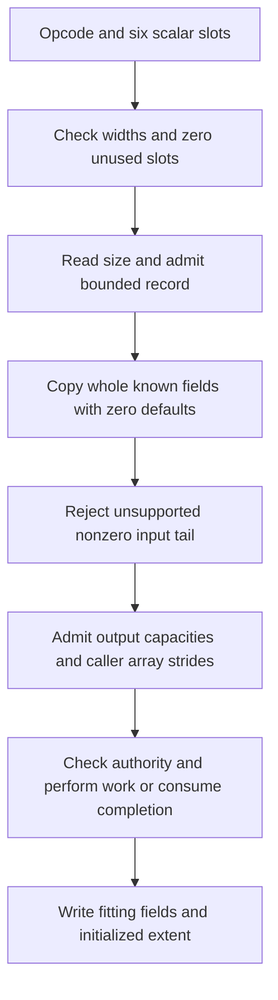
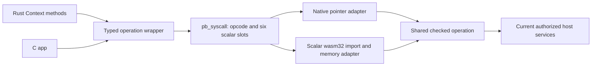
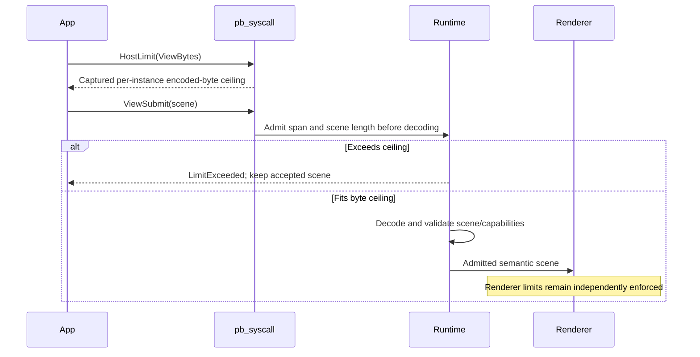
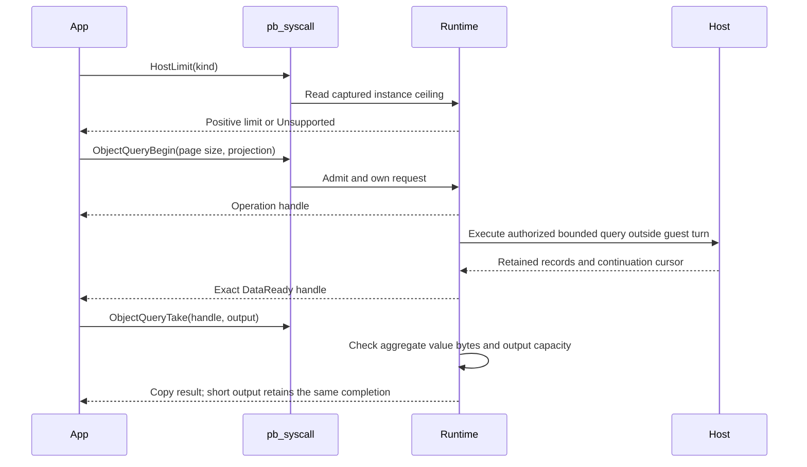
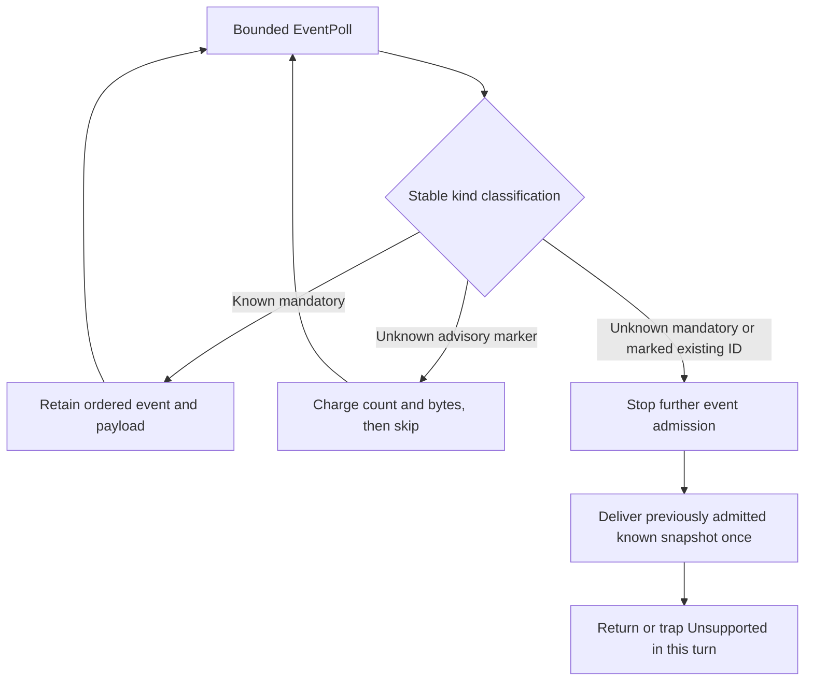
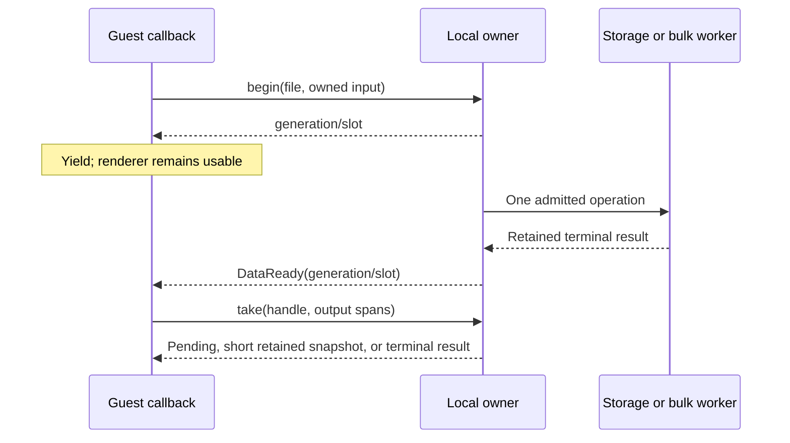

# Operation ABI

Archipelago defines and ships its own C headers in `playbit-api/include/`.
The installed path `<playbit/sys/abi.h>` refers to this repository's operation ABI;
it does not require or include headers from the separately shipped Playbit engine.
The native SDK combines these headers with `playbit/include/`, so including
`<playbit/engine.h>` requires only the SDK's own `include/` directory.

Apps use typed operation wrappers over `pb_syscall`. C wrappers are in
[`include/playbit/sys/abi.h`](../../include/playbit/sys/abi.h); the Rust SDK
provides safe `Context` methods. Native calls use the host context and ordinary C
pointers. [`invocation.rs`](invocation.rs) and the C header lower calls to the single `pb_syscall` import in the `playbit` module. Unknown opcodes return
`Unsupported`, allowing apps and runtimes to evolve independently. The Wasm context token stays local to the SDK;
authority belongs to the calling instance.

The invocation helpers preserve the full `i64` syscall result. Typed operation
wrappers return signed `i64` status or documented scalar results. Negative values
are errors; single-handle operations return a positive handle directly, without
an output pointer. Error codes and callback results remain 32-bit. The exception is
`pb_clock_read(context) -> u64`. The clock takes no scalar arguments, with all
six slots zero, and returns monotonic nanoseconds directly through all 64 bits
of the scalar `i64` result. It always succeeds with a live context; the timestamp
is never narrowed or interpreted as a status code.

## Published layouts and host features

Wasm guests import `pb_syscall` from the `playbit` module. The interface uses the
calling convention described above; permission checks remain independent.
Required host features use exact names from the [operation registry](syscall.rs),
such as `object.schema.read.begin` and `object.schema.read.take`. Discovery names
supported operations; permission checks still apply. New optional semantics
need a separate feature name. Never reuse an opcode
number, record field or feature name.

Prefer scalar slots to descriptors when the six slots suffice. Handles cross as
packed `u64` scalars, IDs as fixed byte spans. SDK handle and ID wrappers have no
independent wire layout. `Context` is opaque. Begin/Take remains asynchronous.
Guests set unused scalar slots to zero. Future changes must preserve their
all-zero default/undefined meaning when assigning those slots.

Every ABI data record starts with `size: u32, written: u32`. The caller sets
`size` to its accessible byte capacity and sets output `written=0`. The host
preserves `size`. On success, `written` is the end offset of the last complete
supported field it initialized. Read a field only if it ends at or below
`written`. Unknown tail bytes stay untouched and outside `written`. Errors after
output checks leave `written=0` and other output bytes unchanged, except for
documented required counts on `BufferTooSmall`. These probes do not consume
the result.

Published fields keep their names, types, widths, offsets and meanings. Append
new fields at or beyond the previous **full struct size**, including tail padding.
Native pointer layouts and wasm32 offset layouts differ. Frozen C/Rust layout
manifests record field names, types, offsets, alignment and full struct size.
Regenerating expectations from the current `sizeof` does not check older layouts.

The host reads the four-byte size before other fields. Before effects, it checks
alignment, byte arithmetic, the published minimum size and the full claimed
memory span. The 4 KiB record limit excludes referenced payloads and arrays,
which have separate bounds. A size ending inside a field returns
`InvalidArgument`. Missing appended fields use zero/default values. Unknown input
tail bytes must be zero; otherwise the host returns `Unsupported` before effects.
Implicit padding has no meaning. Native readers copy complete fields into
zero-initialized locals, never borrowing the newest struct layout from a shorter
caller record.

The host checks output storage before mutating data, creating a capability or
consuming a completion. If required baseline fields do not fit, it returns
`BufferTooSmall` without consuming the result. It writes only whole supported
fields. Missing optional tail fields cannot prevent a baseline result.

For record arrays, caller stride is the byte distance between elements,
separate from element `size`. Before effects, the host checks `count * stride`,
alignment, nonoverlap and that each element fits its stride. Output callers set
each element's `size` and `written=0`. The host traverses by caller stride, never
its own `sizeof`. Records that grow independently must not be nested by value:
flatten scalar members or point to separate size-prefixed records. This includes
buffers, text, ranges, metadata and groups of handles.

The boundary adds no worker, queue, timer or network dependency. Record and
array admission stays within existing call/query limits and the local readiness
and startup budgets. Layout tests do not establish UI or timing qualification.

Variable results use caller-owned arrays and byte storage with
pointer/capacity/count descriptors. Output descriptors, arrays and borrowed
input spans must be disjoint as specified by each operation. Empty spans permit
a null pointer.
Native pointers must stay valid until the scalar call returns; no operation retains
them. wasm32 adapters validate offsets, alignment, arithmetic and nested spans
against guest memory before accessing data.

# Asynchronous data

Schema, object, file, KV and bloblog I/O use Begin/Take (creation names its Take `Poll`).
Begin copies validated nested inputs and returns an operation handle; no guest
pointer survives that call. Backend work runs outside the guest turn. Resume on
the exact ready event, then Take the retained completion. Pending and short
outputs retain the operation; terminal success or error consumes it. Take never
repeats I/O. Outputs must be disjoint within a call; Take may reuse input storage
from an earlier Begin. Failed exchanges must not replay uncertain mutations.

# Last-window intent

Rust app registration requires an explicit third Boolean argument:
`playbit_api::app(State::new(), State::turn, true)`. The SDK declares it before
callbacks using `Context::quit_on_last_window`. C callers use
`pb_quit_on_last_window(ctx, intent)`: opcode `0xe`, canonical u32 `0` or `1` in
slot `a`, every other slot zero. This local metadata operation does no I/O.
A repeated equal declaration succeeds, including during accepted-work draining;
a changed declaration returns `Conflict`, and other scalars return `InvalidArgument`.

True begins Quit after the last window closes. False closes the interface while
retaining the same execution owner. Hosts explicitly default to true before any
declaration. Explicit Quit always deactivates, closes admission and drains finite
accepted work; windowless ownership does not promise work surviving app Quit.

# Host resource limits

`Context::host_limit(HostLimit::QueryRecords)`, `QueryValueBytes` and `ViewBytes` query the
instance's fixed ceilings. C uses the inline `pb_host_limit(ctx, PB_LIMIT_*)`
wrapper over opcode `0xd`, with the kind in scalar slot `a` and the remaining
slots zero. The result is a positive `i32` ceiling or a negative status; unknown
kinds return `Unsupported`. There are no new public C exports, guest imports or output records.
A runtime that does not implement this opcode also returns `Unsupported` through
the existing dispatch boundary; limit discovery does not require 1:1 linking.

`QueryRecords` bounds the requested page size, even for IDs-only queries.
`QueryValueBytes` counts aggregate logical values across the page: text and byte
lengths, one byte per bool, eight per integer/float, 32 per reference and 40 per
file metadata value. It excludes descriptor/record framing, scratch and other app
allocations. Results can contain fewer rows to meet store resource constraints.
Apps still honor the returned cursor and `BufferTooSmall` counts. Capability
discovery separately establishes whether the host supports `object.query.begin` and `object.query.take`.

Embedders override `Host::query_limits()`. The runtime validates and captures the
limits before app callbacks; they cannot change within an instance. Requested
row counts are checked before host query execution. A host must also bound its
own workspace and output construction before allocation; runtime result
validation rejects over-budget aggregate payload before copying to app memory.
Desktop and web keep 64 records / 1 MiB. Bounded embedding fixtures exercise
eight records / 8 KiB; this is not a total heap or physical latency qualification.

`ViewBytes` bounds the entire encoded `ViewSubmit` input, including framing.
Embedders select `Host::view_bytes_limit()`; the runtime captures a positive bound
at instantiation and rejects larger inputs before decoding or retaining a scene.
Rejection leaves the last accepted scene and its bytes unchanged. Desktop uses 64 MiB; web retains its 1 MiB host limit. Embedding fixtures
also exercise an 8 KiB ceiling. Renderer
node/text/feature limits and total memory remain separate constraints. C uses `PB_LIMIT_VIEW_BYTES` (kind 3).

The optional window style command (`VIEW_WINDOW_STYLE`, 27) has ID zero
and one little-endian `u32` bitmask. It may appear once before the scene
root, in either order with the theme, and requires `ui.window.style.v1`.
Its bits select titlebar (0), closable (1), minimizable (2), resizable (3),
transparent titlebar (4), hidden title (5), full-size content beneath the
titlebar (6), bright appearance (7), dark appearance (8), and hiding the
Copy Session Link button (9). Session windows show the button by default,
including over whole-window canvases. Transparent
titlebars imply full-size content. With neither appearance bit set, the native
window follows the system appearance. Both appearance bits together or any
unknown bit make the scene invalid. Zero requests an undecorated window.
Omitting the command restores host window defaults on that scene.

The optional `VIEW_WINDOW_SIZE_CONSTRAINTS` command (28) requires
`ui.window.size-constraints.v1`. It has ID zero and may appear once before
the root, in any order with theme and window style. The 20-byte payload stores
minimum width, minimum height, maximum width, maximum height, and aspect ratio
(content width divided by height), in that order. All five values are IEEE 754
binary32 in little-endian order. Bounds use device-independent points (dp) on the
native content rectangle before layout padding. A zero bound removes that
bound and a zero ratio releases the ratio lock. Omitting the command from
an accepted scene releases all guest constraints.

Fractional bounds are valid. Each bound must be finite and in [0, 2²⁴],
and each specified minimum must fit its maximum. For ratio validation, an
omitted maximum counts as 2²⁴. A positive ratio must be at least
`min_width / max_height` and, when a minimum height is set, at most
`max_width / min_height`. Quotients are rounded to binary32. Negative,
infinite, NaN and infeasible values invalidate the entire scene. An unsupported host
rejects the command. The previous accepted scene survives either rejection.

The canvas command (`VIEW_CANVAS`, 22) starts with four little-endian `u32`
fields for width, height, flags and item count. Bit 0 requests display-driven
frame events. Bit 1 selects the padded content viewport and requires
`ui.canvas.viewport.v1`. Bit 2 selects the entire drawable window and requires
`ui.canvas.window.v1`. Full-window extent implies full-size content and a
transparent titlebar on decorated windows. Both extents require a root canvas,
optionally wrapped in a context menu. Canvas and pointer coordinates use logical
units from the canvas origin. During resize, the host clips the last accepted
scene while delivering the new extent through `SurfaceChanged`. For window
extent the host rounds a fractional logical edge up to cover the last visible
pixel, and clips drawing to the actual window bounds. Setting both
extent bits or any unknown flag makes the scene invalid. Zero extent bits keep
ordinary inline layout.

Widths and heights are positive. The maximum logical edge is 4,096 for inline
and padded viewport canvases and 16,777,216 for window canvases. All items fit
inside these dimensions. Pointer coordinates are bounded by the addressed
canvas and may equal its right or bottom edge. Pixel source images remain
limited to 4,096 pixels per edge and 32 MiB in aggregate per scene.

Bit 3 adds a little-endian `u32` Display P3 `0xRRGGBBAA` clear color after
the item count, before the ordered items. It requires `ui.canvas.clear.v1`.
The host paints that color over the canvas bounds before drawing the items,
including when the list is empty. An absent clear color leaves the canvas
transparent. Clear color and extent are independent of frame demand.

# Object queries

`pb_object_query` accepts a volume handle and `PBQuery`: type ID, optional
exclusive `after` ID, a positive row limit within the host ceiling, and optional projection of 1–256 distinct
field IDs. Flags distinguish an absent cursor/projection. Empty explicit
projections, duplicate fields, unknown flags and nonzero reserved fields are
invalid. Omit the projection for an IDs-only query.

`PBPage` returns object records, field records, values and byte storage in separate
arrays. Ranges index those arrays; they never contain host pointers. Objects
have strictly increasing IDs and the requested type. A projected record includes
only requested fields. A field not stored is omitted; a stored tombstone has
`present=0`. An empty stored value list has `present=1` and a zero-length range.
Field ordering carries no meaning.

Pages contain at most 64 complete objects and 1 MiB of logical value payload;
hosts may advertise and enforce smaller per-instance ceilings.
The local store additionally bounds query scratch to 16 MiB and each object to
4,096 values. Selected cells are bounded before decoding; unrequested fields are
not loaded. A page may end early to meet resource bounds. Its continuation cursor
is the last returned ID and excludes that ID from the next query. A record that
cannot fit returns `LimitExceeded`; no field or value is silently truncated.

Output capacity does not influence page selection. Retrying after `BufferTooSmall`
is a new read with fresh authorization and a fresh snapshot. Intervening edits
may change required counts or the page. Current session access, provisioning,
personal-volume consent, revocation and object ACLs are checked on each call.
TODO requests title and completion fields together; Shared Note uses an IDs-only
query for object lookup.

# Available volumes

`pb_volumes` returns volume records, tag ranges and text. Handles are opaque
generation/slot pairs. A handle keeps its identity while its volume remains
available. Removing a volume makes the handle stale; regranting it produces a new
handle. Reordering volumes or changing rights cannot redirect a handle. Rights
downgrades apply immediately and host operations independently recheck current
authorization. Apps refresh available volumes on `DataChanged` and handle denied
or stale operations between events.

# Events and text input

`pb_event_poll` takes a caller-sized `PBEvent` and a separate payload span. A
nonnegative result gives the payload length. If that length exceeds capacity,
the host leaves the payload and queue unchanged and sets `written=0`. Otherwise
it writes the header and payload and consumes exactly one event. `WouldBlock`
means the queue is empty.

`pb_event_poll_deadline` takes the same outputs and an absolute deadline in
the monotonic nanoseconds returned by `pb_clock_read`. A queued event returns
immediately. Otherwise the call waits until an event arrives or the deadline
expires. On timeout it returns `WouldBlock`. Zero checks the queue immediately.
`UINT64_MAX` waits indefinitely. A timer queue in guest code can pass its
earliest deadline on each poll and dispatch all due timers after checking the
clock. Add `"event.poll.deadline"` to the package's `required_host_features`
to enable waiting. The running instance advertises the capability when enabled.
Without this declaration, deadline polls return `Unsupported`.

In the Rust SDK, handle the callback's initial `context.raw_events()` snapshot
before calling `context.poll_event_deadline(deadline_ns, &mut bytes)` for new
events. `context.clock_read()` provides the clock. The poll returns a typed
event borrowing `bytes`, `PollError::BufferTooSmall(required)` for a size
probe, or `PollError::Host(Error::WouldBlock)` when the deadline expires.

`TextChanged` carries a little-endian `u32` edit count, that many packed
12-byte edits (`u32 start`, `u32 end`, `u32 inserted_len`), then the complete committed
UTF-8 value without a length prefix. The value is at most 262,144 bytes; there are
at most 256 edits, so the event payload limit is 265,220 bytes. The shared queue
retains its 256-event/1-MiB bounds, including metadata. `Submit` remains plain
UTF-8 and is limited to 262,144 bytes.

For edits with a native source range, hosts reject mutations that would exceed
the value limit while preserving the previous draft and pending-edit capacity.
Oversized snapshot-only values fail admission and remain available for replacement.

Each edit replaces the half-open native byte range `start..end` with
`inserted_len` bytes, relative to the native value preceding that edit. Insertion
has equal endpoints; deletion has zero inserted length. Multiple operations
retain their native application order. Exact ranges come from editing operations,
not string comparisons. A count of `0xffffffff` denotes unavailable native edit
details and is followed immediately by the UTF-8 snapshot. A zero count is a
snapshot with no new native mutation, such as a delivery retry. The full value is
authoritative even when guest transformations or reconstruction mean it differs
from the previous guest scene. Malformed lengths, inverted/out-of-bounds extents,
invalid UTF-8, and final insertion endpoints inside a codepoint are rejected.

It addresses an enabled text field or autocomplete field in the current scene. Marked text stays platform-local until committed;
`Submit` is the explicit submission action. Hosts preserve native selection and
pending text across unrelated scene updates and reject stale/disabled targets.
Operation-ready event payloads contain a packed 8-byte generation/slot handle;
the packed scalar payload carries no size/written record header.

## Event requirement classification

Event IDs 1–19 are frozen and mandatory. Their payloads and completion semantics
are unchanged; none may carry `OPTIONAL_EVENT_KIND_BIT` (`0x80000000`).

| IDs | Required semantics |
| --- | --- |
| 1 (`Started`) | Instance lifecycle |
| 2, 3, 11–14 (`Click`, `Submit`, `Pointer`, `Key`, `Frame`, `TextChanged`) | Admitted user input and requested frame delivery |
| 4–6, 10, 15, 17 (`DataChanged`, `PresenceChanged`, `UpdateAvailable`, `Wake`, `SurfaceChanged`, `VolumesChanged`) | Existing data, environment and execution notifications |
| 7–9, 16 (`ObjectCreationReady`, `FileCopyReady`, `FileSelectionReady`, `DataReady`) | Operation completion |
| 18–19 (`ChannelMessage`, `ChannelStatus`) | Ordered channel data and terminal state |

Future unknown IDs with that high bit set are optional **advisory** notifications.
The ID with that bit removed must not reuse an existing ID. Baseline consumers
may skip these events after checking the header and payload length bound.
Consumers count skipped events against the same event and byte limits, including
queue overhead, as known events. The SDK preserves the order and payloads of
known events before and after a skip. The marker cannot make completion, lifecycle,
authority, revocation or lost-stream behavior optional.

An unknown unmarked ID, or a marked existing ID, produces `Unsupported` and stops
polling. The Rust SDK keeps known events already read for one callback.
Registered native/Wasm wrappers deliver that batch, then return the error or
trap in the same turn. If no known event came first, context construction
returns `Unsupported` immediately. That context never polls again. Direct
`Context` users must process the batch and check `context.event_status()` before
returning to the host. Direct C callers must stop at an unsupported mandatory
kind. An unsupported event neither consumes a completion nor acknowledges a
mutation.

A new mandatory event requires guest opt-in through the operation or capability
that needs it. The host's capability list cannot establish guest support.
Baseline events and future optional advisory notifications need no general
supported-event declaration.

# Asynchronous schemas

`pb_schema_establish_begin` validates and owns all nested type, field and name
inputs before returning an operation handle. `pb_schema_read_begin` captures
the scoped volume. Neither performs storage I/O. Their matching take operations
return `WouldBlock` until the exact operation is ready. Schema-read short outputs
change only required counts and retain the same snapshot for another take.
Terminal results consume the handle. The Rust SDK exposes
`begin_establish_schema`/`take_establish_schema` and
`begin_read_schema`/`take_read_schema`.

Read delivery checks current grants. A known successful Establish receipt remains
available after a mount is withdrawn; it never permits repeating an uncertain
mutation.

# Object creation

`pb_object_create` accepts a volume handle, type ID, and an array of `PBFieldInput`.
Each field has an ID, a presence flag, and an array of typed values. Duplicate
fields and malformed nested values are invalid. The fixed result is the object
ID. The adapter admits that output and every nested input before checked creation
publishes data; invalid output cannot leave behind an empty object.

`pb_object_create_begin` admits asynchronous creation with all initial fields and returns a
scoped operation handle. Its matching poll returns `WouldBlock` while pending;
terminal success or failure consumes the handle. File-copy and file-selection
operations share the bounded handle allocator but cannot use each other's
handles. Consumed slots are reused with an incremented per-slot generation.

All capability handles are positive 63-bit values: the slot occupies the low
32 bits and the per-slot generation occupies the high 31 bits. Slots are local
to one guest thread; the instance epoch is separate. Exhausted generations retire
the slot instead of wrapping. Language wrappers expose no separate struct layout.

# Asynchronous files

`volume.list` transfers a fresh owned directory File for each admitted root.
Its caller-buffer header includes a coherent u64 revision. The published 80-byte
volume prefix includes an opaque 16-byte grant ID and Playbit/host-filesystem
backing flags. The current record is 88 bytes, with `role:u32` appended at offset
80. A missing tail has role 0 (explicit mount); complete current output has
`written=84`. The original Root flag retains its meaning. Role values are 1 Root,
2 Session, 3 User, 4 User-session, 5 Local and 6 Local-session. Unknown roles,
duplicate automatic roles or automatic roles on non-Playbit backings are invalid.
The `automatic-volumes.v1` host feature declares support for typed lazy scopes.
A package that needs only Shared can require `session-volume.v1` and declare
a `session` initializer. It gets the typed Session volume of its current
session, with the same identity, initializer and access rules on each host.
This feature grants no access to World or the account and device scopes.
The Rust SDK exposes `Volumes::volume(VolumeRole)` and
`take_volume_file(VolumeRole)`; the latter transfers the selected File root.

`volume.observe(revision)` arms one notification for a newer revision;
VolumesChanged carries that revision as eight little-endian bytes. A full event
queue preserves the watch until space becomes available. Discovery itself
only copies cached metadata and reserves alias handles; it performs no I/O and
does not materialize unused automatic scopes. An admitted asynchronous data or
File operation performs any required first-use initialization outside rendering.
The SDK's `Volumes` releases unclaimed roots; `take_file` transfers a selected
root to the application. File, FileList, and operation handles use the same central table and scalar
encoding as volume handles.

`file.open.begin` owns a relative byte path and returns an operation. Its Take
transfers a directory, immutable reader, or private writer. Read accepts an
offset and at most 65,536 bytes, including zero; Write owns an offset and at most
1 MiB of bytes, including zero. Write completion acknowledges staging only.
Explicit normal Close seals the handle and publishes; Close with DISCARD and
SDK destruction never publish uncommitted contents. Close Take returns a
publication outcome, an error code, and an optional owned recovery reader.

The guest yields and resumes from DataReady with the exact operation handle.
WouldBlock and BufferTooSmall preserve the same retained completion; a short
read changes only count. Invalid output spans and wrong-kind handles cannot
inspect or consume it. Current authority is rechecked before byte/capability
delivery. An accepted normal Close retains a truthful receipt after revocation,
with any recovery capability withheld.

FileList captures immutable names/kinds. Next advances only after successful
Take; a short buffer or disposal leaves its position unchanged. Synchronous
list Close invalidates pending Next with Closed while worker cleanup continues.
File disposal and operation disposal consume no ordinary operation slot.
Disposal suppresses result delivery without canceling accepted writes or Close.
The SDK keeps bounded cleanup metadata across callbacks and never retains a
native Context pointer. Custom callback owners attach the same FileResources
to every live Context and flush it after their work; App does this automatically.
`Context::poll_event_deadline` also flushes the attached resources before it waits.

# Authenticated field completions

`pb_object_field_read_authenticated_begin` owns the volume/object/field request
and returns a generation-bound operation handle. The host performs one authorized
atomic read on its data worker. `DataReady` identifies that operation.
`pb_object_field_read_authenticated_take` copies only retained memory, including
values, opaque revision and provenance from the same snapshot. It rechecks current
read authority. `WouldBlock` and `BufferTooSmall` retain the operation; short output
publishes required counts only. A fresh read requires a distinct Begin. Terminal
success/error consumes the operation, and an invalid destination does not consume
it. Native hosts and Wasm grants use the existing common data executor and limits;
a host lacking authenticated storage returns `Unsupported` explicitly.

# Trace events

`trace.record` (opcode `0xf`) takes these scalar arguments:

| Slot | Type | Meaning |
| --- | --- | --- |
| a | Byte pointer | Packed event bytes |
| b | u32 | Byte length, at most 65,536 per call |
| c | u64 | Nonzero recording generation supplied by `TraceConfig` |
| d | u64 | Cumulative producer loss count within that generation |
| e/f | | Zero |

Producer loss must not decrease within a generation. An empty event buffer can
report loss without publishing an event.

The host consumes the input before returning and keeps no guest pointer. Native
and Wasm guests share the encoding helpers and wire definitions in
[trace.rs](trace.rs), with matching C layouts in
[abi.h](../../include/playbit/sys/abi.h). Decoding and validation live in the host
tracing implementation.

Concatenate events directly, with no batch prefix. Each event has this fixed
40-byte header followed by `metadata_len` bytes and zero padding to an 8-byte
boundary. This packed input has no per-event `size` or `written` fields. All
integers are little-endian. There is no terminating NUL.

| Offset | Width | Meaning |
| --- | --- | --- |
| 0 | 8 | Nonzero unique monotonic timestamp/event ID |
| 8 | 8 | Referenced timestamp, zero for no reference |
| 16 | 8 | Unsigned INSTANT value, zero for START/END |
| 24 | 4 | Reference thread ID, guests must use zero today |
| 28 | 4 | Metadata byte length, at most 4,096 |
| 32 | 2 | Declared name ID for START/INSTANT; zero for END |
| 34 | 1 | START=1, END=2, INSTANT=3 |
| 35 | 5 | Reserved zero |

START and INSTANT may reference a parent. END requires its matching START's
nonzero timestamp. A present same-thread reference must be earlier than the
event's timestamp. No earlier record must have arrived: ingestion retains no
active span tree or history. Unknown kind, nonzero reserved/padding bytes,
incorrect name kind or malformed extent rejects the entire batch before
publication. Nonzero guest reference thread IDs return Unsupported. Zero selects
the emitting thread when a reference exists; with no reference both fields are
zero. The host supplies stable guest thread ID 1 and a fresh execution incarnation
across reloads; guests cannot select their instance or source attribution.

Each thread's SDK clock state uses `max(clock_now, last_timestamp + 1)` and stays
alive across flushes and callbacks. Exhaustion is an explicit failure. Clock
adjustments can advance ahead of physical samples and affect derived duration.
`clock.read` (opcode `0x10`, all slots zero) always returns monotonic nanoseconds
directly as `u64` with a live context. Wasm currently requires this host transition
for each emitted event. There is exactly one tracing syscall.

Host event kind 20 (`TraceConfig`, target zero, eight-byte generation) supplies
the current recording generation through existing event delivery at callback
entry when it changes. Zero disables recording. It adds no wake source, timer or
registration syscall. SDK span tokens contain the timestamp and this generation.
The host gate remains authoritative even if a paused guest has an old snapshot.

Every submission is consumed on success or error: never retry it. Structural
failure publishes nothing; bounded queue admission can drop whole events and
accounts for them. SDK loss counts describe refused emissions; recording losses
also include host admission. A 16-KiB per-guest buffer flushes complete events at
thresholds and callback return without blocking on recorder progress. Registered
apps flush automatically; direct SDK users flush explicitly before yielding.
No end credit or nesting limit is attached to an open span. Stop closes admission
without waiting for paused guests; stale batches cannot enter a later capture.
Unflushed tails, missing endpoints, crashes and retention gaps remain incomplete.

Metadata validity is a caller contract: UTF-8 JSON objects with arbitrary keys,
including nested objects/arrays. The host checks byte bounds, not JSON syntax.
Readers expose malformed metadata and retain its bytes instead of treating it as
absent or failing the entire recording. Event and metadata share one loss and
retention unit. All app observations remain private data.

# Audio

Audio capabilities own immutable PCM sounds. Each sound supports independent
playback instances identified by a caller-chosen u32. Asynchronous audio opening
uses the shared capability table and `DataReady` events. `audio.open.begin`,
`audio.open.take` and `sound.open.pcm` return their positive handles directly in
the signed 64-bit syscall result. The central table checks resource kind,
generation and rights for audio and sound handles before mixer commands are
queued. Position, gain and stereo balance apply to a single sound-instance pair.
The exact scalar slots, PCM encoding, timing, limits and lifecycle are in the
[syscall reference](../../syscalls.md#audio).

No packed scene or durable record contains audio commands. Hosts execute them
through a local per-execution endpoint, so scene coalescing cannot duplicate or
discard playback. Headless and web hosts do not advertise these operations.

## Secure random bytes

`random.fill` (opcode `0x14`) takes a writable byte pointer in slot a and a u32
length in slot b, with c..f zero. `pb_random_fill` and Rust `Context::random_fill`
fill at most 64 KiB from the cryptographically secure platform RNG. Native hosts
use `getrandom::fill`; browsers use WebCrypto `getRandomValues`. The whole buffer
is filled before success (zero). Empty output does not dereference the pointer or
request entropy. Excess length returns `LimitExceeded`, invalid nonempty spans
return `InvalidArgument`, and entropy failure returns `Unavailable` after zeroing
the admitted output. Discard output on error. No insecure fallback is permitted.
Capability discovery reports `random.fill`; older hosts return `Unsupported`.
