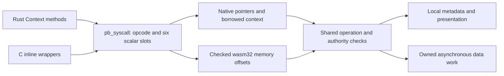
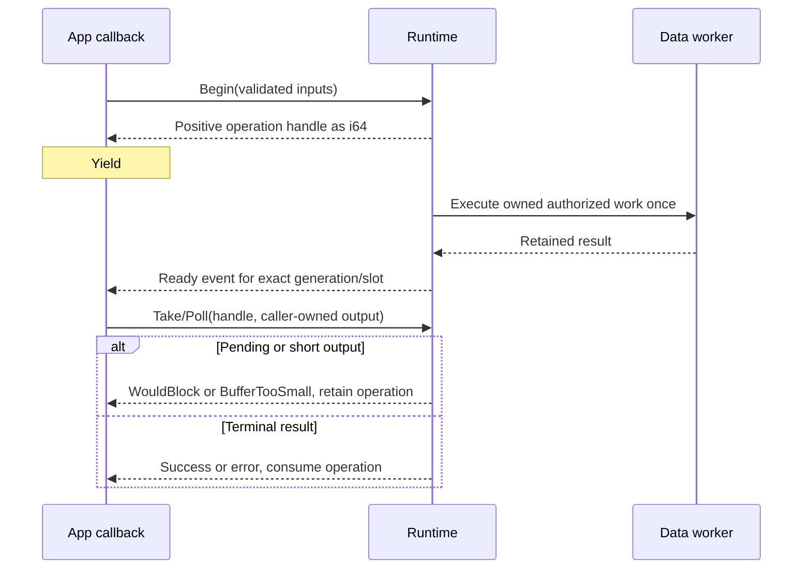
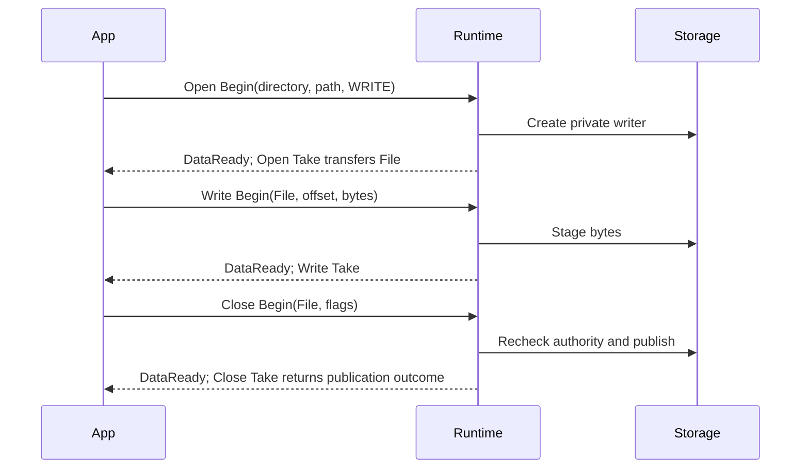
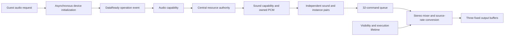

# Syscall reference

Playbit apps use one scalar syscall with typed C wrappers and safe Rust
`Context` methods. This reference lists every operation in the current
[registry](src/abi/syscall.rs), its arguments and its behavior. The
[C header](include/playbit/sys/abi.h) defines the records and wrappers; the
[slot layout](src/abi/dispatch.rs) defines scalar admission. See the
[operation ABI](src/abi/README.md) for additional buffer and host-limit details.

## Calling convention

Native callers borrow the instance's `PBContext*`:

```c
int64_t pb_syscall(
    PBContext* context, uint32_t operation,
    uint64_t a, uint64_t b, uint64_t c,
    uint64_t d, uint64_t e, uint64_t f);
```

wasm32 apps import `pb_syscall` from module `playbit`, without the context
parameter:

```c
__attribute__((import_module("playbit"), import_name("pb_syscall")))
int64_t pb_syscall(
    uint32_t operation,
    uint64_t a, uint64_t b, uint64_t c,
    uint64_t d, uint64_t e, uint64_t f);
```

The Wasm signature is `(i32, i64, i64, i64, i64, i64, i64) -> i64`.
Apps export `memory` and `pb_main: () -> ()`. Wasm wrappers use
`pb_guest_context()` locally; the host binds authority to the calling instance.
Native syscalls are valid only on the owning thread during init/turn callbacks.
Except for `clock.read`, calls outside that context return `Conflict`.
`clock.read` requires a valid context and always succeeds. Destroy callbacks
cannot issue syscalls.

In the tables below, arguments occupy consecutive slots starting at `a`.
Every remaining slot must be zero. `u32` scalars and wasm32 pointers must be
zero-extended; nonzero high bits are invalid. Native pointers have the target
address width. Arguments marked `u64` or `H` use all 64 bits. Unknown opcodes
return `Unsupported`.

Pointer notation describes the addressed record, not a serialized request.
Inputs are read-only and borrowed for the duration of the call. Output pointers
must address writable, properly aligned caller-owned storage. Descriptors,
output arrays and input spans must obey the operation's nonoverlap rules,
including nested inputs. Empty spans permit null pointers; required fixed
records do not. Wasm adapters validate offsets, alignment, arithmetic and nested
spans against guest memory. No syscall retains a caller pointer.



### Results and buffers

Unless stated otherwise, success returns zero and writes the named output.
The C/Rust invocation helpers preserve the full `i64` syscall result. Typed
operation wrappers preserve that signed 64-bit result (`PBSysResult` in C).
Single-handle operations return the positive handle directly. Error enums,
record error fields and non-syscall callbacks remain 32-bit. The exception is
`clock.read`, which returns monotonic nanoseconds directly as `u64`.
It always succeeds with a valid context and has no status result. For other
operations, negative results are status codes:

| Code | Status |
| --- | --- |
| -1 | `NotFound` |
| -2 | `AccessDenied` |
| -3 | `InvalidArgument` |
| -4 | `Internal` |
| -5 | `Unavailable` |
| -6 | `WouldBlock` |
| -7 | `Unsupported` |
| -8 | `StaleHandle` |
| -9 | `LimitExceeded` |
| -10 | `Conflict` |
| -11 | `BufferTooSmall` |
| -12 | `Busy` |
| -13 | `Closed` |
| -14 | `DestinationDeleted` |
| -15 | `Uncertain` |

Every ABI data record starts with `size:u32, written:u32`. The caller sets
`size` to its accessible byte capacity and initializes output `written=0`. The
host preserves `size`. On success, `written` is the end offset of the last
complete supported field it initialized. Read only fields ending at or below
`written`. Append fields after the previous full struct size, including
tail padding. Missing appended input fields default to zero; nonzero unknown
input tails fail before effects. The 4,096-byte record limit excludes referenced
payload storage.

Variable outputs use flat `data/capacity/count/stride` members for record arrays
and `data/capacity/count` members for byte storage. Set each element's `size` and
`written=0`. Traverse by caller stride, the byte distance between elements.
`PBRange` contains an offset and count into the matching array or byte storage.
On `BufferTooSmall`, the host reports required counts and clears `written` in
checked output records; payload and other metadata stay unchanged. Other errors
also clear `written` after output checks succeed. The host rejects capacities
above an operation's ceiling even if the result would be smaller. Allocate
within those ceilings for the workload.

Metadata calls such as `volume.list` observe a fresh snapshot on retry.
Take/Poll retries inspect the same completion without repeating work.
`event.poll` uses its own nonnegative size-probe convention, described below.

### Identities and handles

`PBId` is a raw 16-byte array. Handles are scalar u64 values. A table argument
marked `H` is the complete handle packed as:

```c
uint64_t handle = ((uint64_t)generation << 32) | (uint64_t)slot;
```

Handles are local to one guest thread. Do not persist or transfer them. Slots
occupy the low 32 bits; per-slot generations occupy the high 31 bits, making
every valid handle a positive signed 64-bit value. Closing a handle frees its
slot and increments its generation. An exhausted generation retires the slot.
The instance epoch used by host notifications is separate. Removing a
volume invalidates its handle; regranting it produces a new handle. Reordering
volumes cannot redirect handles, and current rights still apply to each use.

`PBEntryHandle` contains a volume handle, a stable 15-byte entry ID and a zero
reserved byte. Schema, object and KV calls take a pointer to this record.
Bloblog calls use the volume handle scalar and a fixed 15-byte entry ID span.
`PBFileReference` has the same fields and identifies a named blob entry for
stored references, copy, and selection. `PBFileHandle` and `PBFileListHandle`
are separate owned capabilities represented by the packed handles above.
Resolve an entry by name before using it; renaming it does not change its ID.
Identity alone grants no access. The host checks the entry kind and current
entry permissions in addition to volume rights.

## Instance, UI and environment

| Opcode | Capability | C wrapper | Slots starting at a |
| --- | --- | --- | --- |
| `0x001` | `capabilities` | `pb_capabilities` | `PBCapabilities* output` |
| `0x002` | `log` | `pb_log` | `u8* text, length:u32` |
| `0x003` | `ui.submit` | `pb_view_submit` | `u8* scene, length:u32` |
| `0x004` | `event.poll` | `pb_event_poll` | `PBEvent* event, u8* data, capacity:u32` |
| `0x005` | `identity.read` | `pb_identity` | `PBIdentity* output` |
| `0x013` | `session.read` | `pb_session` | None |
| `0x163` | `session.info` | `pb_session_info` | `PBSessionInfo* output` |
| `0x006` | `startup.read` | `pb_startup_arguments` | `PBArguments* output` |
| `0x007` | `volume.list` | `pb_volumes` | `PBVolumes* output` |
| `0x009` | `update.defer` | `pb_update_defer` | `generation:u64` |
| `0x00a` | `presence.read` | `pb_presence` | `PBParticipant* output, capacity:u32, stride:u32, u32* count` |
| `0x00b` | `wake.after` | `pb_wake_after` | `delay_ms:u32` |
| `0x00c` | `host.platform` | `pb_host_platform` | None |
| `0x00d` | `host.limit` | `pb_host_limit` | `kind:u32` |
| `0x00e` | `lifecycle.quit-on-last-window` | `pb_quit_on_last_window` | `intent:u32` |
| `0x012` | `volume.observe` | `pb_volumes_observe` | `revision:u64` |
| `0x015` | `event.poll.deadline` | `pb_event_poll_deadline` | `PBEvent* event, u8* data, capacity:u32, deadline_ns:u64` |

- **capabilities** returns supported registry names, not opcode/name pairs.
  `PBCapabilities` holds name ranges and UTF-8 bytes, with capacities of at most
  256 names and 32 KiB. Discovery is advisory; an operation can still fail.
- **session.read** starts or reuses live membership in the current session and
  returns a positive app-generation token. A roster-only guest calls this once
  at startup. Membership arrives asynchronously.
- **session.info** returns local metadata for the guest's current session.
  Initialize the output with `PB_RECORD_INIT(PBSessionInfo)`. The v1 record
  occupies 64 bytes. Its four little-endian 32-bit fields are `size`, `written`,
  `flags` and `reserved`. The 32-byte `internal_id` at offset 16 matches the
  public ID in `PBIdentity`. When flag `PB_SESSION_HAS_KEY_SECRET` (bit 0) is
  set, the 16 bytes of `key_secret` at offset 48 hold the invitation seed.
  Encode it as a big-endian integer in Bitcoin base58, left-padded with `1`
  to 22 characters, to form the code in `/s#CODE`. The all-zero seed is valid.
  C guests can call `pb_session_code(&info, output)` with a
  `char output[PB_SESSION_CODE_CHARS + 1]` buffer. It writes a NUL-terminated
  string and returns its length, zero when the session lacks a key secret.
  With no key secret, the host clears bit 0 and zeroes those 16 bytes. V1
  hosts clear all other flag bits. Readers ignore unknown output flags to
  permit future extensions. The `reserved` field must be zero. Success returns zero, and
  `NotFound` means this context has no session. Hosts without this operation
  return `Unsupported`.
- **log** appends raw UTF-8 diagnostic text. Each turn admits at most 256 entries
  and 64 KiB of text; empty messages still consume an entry.
- **ui.submit** replaces the accepted UI with one complete semantic scene,
  encoded by `ui::ViewEncoder`. Malformed scenes, unsupported features or
  lengths above the instance's `ViewBytes` ceiling fail without replacing the
  accepted scene. Scene bytes are a UI format, separate from syscall records.
- **event.poll** returns the payload byte count and fills `PBEvent` with
  generation, kind and target. If the count exceeds capacity, the payload and
  queue stay unchanged and the host sets `written=0` in the event record.
  Otherwise it consumes exactly one event.
  `WouldBlock` means the queue is empty. Capacity is at most 265,220 bytes, and the
  caller-sized event output is required even for a size probe.
- **event.poll.deadline** uses the same event record, size probe and result. It
  waits until an event is available or the absolute deadline from `pb_clock_read`
  is reached. A queued event wins, even at an expired deadline. An empty queue
  at expiry returns `WouldBlock`. A deadline of zero polls immediately and
  `UINT64_MAX` waits indefinitely. Finite deadlines are in monotonic nanoseconds.
  Declare `event.poll.deadline` in the package's `required_host_features` to
  select an execution mode that supports waiting. Capability discovery reflects
  this choice. An instance without the capability returns `Unsupported`, even
  for a zero deadline. Guest code can keep timers ordered by expiry, poll with
  the earliest deadline, and run all due timers after each return. Submitting
  a scene before waiting makes it available for presentation during the wait.
  On native instance destruction, a suspended poll returns `Closed` so the
  callback can release resources and return to its caller.
- **identity.read** returns the host-verified generation, account, device and
  instance IDs, plus a 32-byte session ID when present. `flags` bit 0 means
  service identity, bit 1 means session present; reserved members are zero.
  The optional tail at byte 104 contains a 256-byte `display_name` field. Read
  it when `written >= 360`. Sizes 104–359 give `written=104` and preserve every
  byte from offset 104 onward. The name contains UTF-8 up to the first zero byte or the
  end of the field. Unused bytes are zero. An empty or absent field means the
  name is unavailable. Use the IDs for identification and the name for display.
  Reread on `IdentityChanged`. The `display-names.v1` host feature declares the
  identity and participant name fields and their change notifications.
- **startup.read** returns at most 32 name/value pairs in `PBArguments`, with
  at most 32 KiB of output bytes. Names contain 1–128 bytes of lowercase ASCII
  letters, digits, `.`, `_` or `-`; values are at most 4 KiB each.
- **volume.list** returns up to 256 admitted roots, 16,384 tag ranges and
  1 MiB of text storage, with a coherent `revision:u64` in `PBVolumes`.
  Each 80-byte `PBVolume` contains its volume handle, ID, name/tag ranges,
  rights, flags, a fresh owned directory `PBFileHandle`, and a 16-byte grant ID.
  Rights are read=1, write=2, schema=4. Flag bit 0 marks the app root;
  `flags & 0xff00` is Playbit=0x100 or host filesystem=0x200.
  Discovery copies cached metadata and reserves aliases without I/O. Dispose
  every returned File that is not transferred to another owner. Names, tags,
  persistent IDs and grant IDs alone confer no authority.
- **volume.observe** arms one coalesced watch after a discovered revision.
  A newer revision produces `VolumesChanged`; a full event queue retains the
  watch. Refresh discovery and rearm using its returned revision. No polling
  timer or relationship to the data-change revision is required.
- **update.defer** names the generation carried by `UpdateAvailable`.
  A generation that is no longer the pending update returns `Conflict`.
- **presence.read** reads the cached roster. The first read after `session.read`
  may be empty. Read again on the first and subsequent `PresenceChanged` events.
  The result has at most 1,024 participant records containing account,
  device, instance and 32-byte build IDs. The 256-byte `display_name` tail at
  byte 88 uses the same encoding as `PBIdentity` and is available when
  `written >= 344`. An element size of 88–343 gives `written=88` and preserves
  every byte from offset 88 onward. Changing a member's name also raises
  `PresenceChanged`. Channel messages carry the sender IDs. Look up the current
  name in presence when displaying a message.
- **wake.after** replaces the instance's one pending wake with a delay from
  1,000 through 86,400,000 ms. It also removes an expired, unconsumed Wake event.
  Delivery may be late during suspension or busy work. The wake does not survive
  instance replacement or process restart and does not grant data access.
- **host.platform** returns a platform value directly: Other=0, macOS=1, iOS=2,
  Web=3, ESP32=4. This describes the host, independently of the app's target.
- **host.limit** returns a positive per-instance ceiling directly. Kinds are
  QueryRecords=1, QueryValueBytes=2 and ViewBytes=3. Unknown kinds return
  `Unsupported`. Limits are fixed for the instance; discover operation
  availability separately. Query value bytes exclude record framing and scratch.
- **lifecycle.quit-on-last-window** declares immutable Boolean intent: 1 starts
  Quit after the last window closes; 0 retains the same owner without windows.
  Other values are invalid. Repeating the same declaration succeeds; changing
  it returns `Conflict`. Hosts default to Quit before a declaration. Explicit
  user Quit always deactivates and drains finite accepted work.

### Events

Event kind numbers are Started=1, Click=2, Submit=3, DataChanged=4,
PresenceChanged=5, UpdateAvailable=6, ObjectCreationReady=7, FileCopyReady=8,
FileSelectionReady=9, Wake=10, Pointer=11, Key=12, Frame=13, TextChanged=14,
SurfaceChanged=15, DataReady=16, VolumesChanged=17, ChannelMessage=18,
ChannelStatus=19, TraceConfig=20, WindowPointer=22, WindowKeyboard=23,
WindowScroll=24, WindowGesture=25 and WindowGamepad=26. Packed event
payloads use little-endian integers and binary32 floats.

`PBEvent.object_id` at offset 24 is the originating guest window. It is
initialized when `written >= 28`. Zero indicates an event without a known
window. A window's ID survives scene submissions and focus changes. Creating
a replacement window allocates a new ID. `target` identifies a semantic control
or named canvas when applicable.

`IdentityChanged` (`PB_EVENT_IDENTITY_CHANGED`, kind `0x80000015`) is an
advisory notification with target zero and an empty payload. A guest can read
the current name at startup, then reread `identity.read` on this event to
update an open badge. Each read returns the latest local snapshot.

`TextChanged` carries a little-endian `u32` edit count, up to 256 packed
`{u32 start, u32 end, u32 inserted_len}` edits, then the complete committed UTF-8
value (up to 262,144 bytes). Each edit replaces the half-open byte range
`start..end` in the preceding native value. Equal endpoints denote insertion;
zero inserted length denotes deletion. The full event limit, including metadata,
is 265,220 bytes. Count `0xffffffff` denotes unavailable native ranges and is
followed directly by the value; zero denotes a snapshot with no new mutation.
Native locations are never inferred from string differences. Marked text remains
platform-local until committed; Submit is the separate plain-UTF-8 submission
(up to 262,144 bytes). See the [text event codec](src/abi/text.rs). `SurfaceChanged` has target zero and a
16-byte payload: logical width and height (`u32`), finite positive pixel scale
(`f32`) and input bits (`u32`: pointer=1, keyboard=2, touch=4).
Dimensions describe the padded content viewport by default. A root canvas
using `ui.canvas.window.v1` receives the full drawable window dimensions.
`VolumesChanged` has target zero and an eight-byte `revision:u64` payload.
`Frame` carries elapsed display time as a little-endian `u32` in microseconds.

#### Window input

Declare `ui.input.v1` in the package's `required_host_features`. Submit view
command 29 with target zero and one `u32` mask before the root. The bits are
pointer 1, keyboard 2, scroll 4, gesture 8 and gamepad 16. Each submission sets
the whole mask. Omission sets it to zero. Native controls continue to act and
raise semantic events. The host delivers raw events from the guest's content
area. Key and gamepad events belong to the active guest window. A terminal
event can finish an admitted sequence after the mask changes.

Raw input starts with a 20-byte source record containing occurrence time in
monotonic nanoseconds, `u32 client_id`, `u32 device_id`, `u16 modifiers`
and two zero bytes. Client ID zero denotes local input. Device IDs identify
input devices or device classes within the host. They can be zero if unknown.
The coordinate origin is the top-left of the guest window's content, with x
increasing right and y increasing down. A pointer event targeting a canvas
also carries canvas-local coordinates. Drag coordinates can extend beyond
the canvas or window content.

| Kind | Bytes | Payload after the source |
| --- | ---: | --- |
| WindowPointer | 56 or 92 | `u32` contact ID, four bytes for phase, kind, changed button and click count, `u16` flags and button mask, six floats for x, y, dx, dy, canvas x and canvas y. Pen adds nine floats for pressure, tangential pressure, normalized x/y tilt, twist in degrees, contact width/height, altitude and azimuth in radians. |
| WindowKeyboard | 60 | Two `u16` codes for the logical and physical key, then four bytes for pressed, repeat, text length and reserved zero. Eight `u32` Unicode scalar slots follow. Unused slots are zero. |
| WindowScroll | 44 | Kind, phase, `u16` flags, then x, y, horizontal delta, vertical delta and third-axis delta. Unit flags distinguish logical units, lines and pages. |
| WindowGesture | 48 | Kind, phase, two reserved zero bytes, then center x/y, pan dx/dy, relative scale and relative clockwise rotation in radians. |
| WindowGamepad | 36 | Phase, reserved zero, `u16` control, scalar value and paired x/y. Axes are normalized to [-1, 1] with up positive. Buttons and triggers use [0, 1]. |

Keyboard codes are consecutive from `None = 0` through `Fn = 128`.
On keyboards that report a standalone Fn transition, the event identifies
the Fn key on both press and release. The source modifier mask describes
which modifiers are held at the time of the event.
Use `Key::COUNT` or `PB_KEY_COUNT` when indexing a table. Use committed
`TextChanged` for editor drafts. Platform and device capabilities determine
which raw details can be observed. The SDK types define the flags and phases.
[Rust payloads](src/abi/input.rs) · [C payloads](include/playbit/sys/abi.h)

Existing apps using named canvas command 22 still receive Pointer (11) and
Key (12) for their canvases. Pointer is four `u32` values for canvas x/y,
phase (move=0, down=1, up=2, cancel=3) and primary button state. Key is two
`u32` values for the physical key (left=1, right=2, up=3, down=4, space=5)
and the pressed flag. Named canvases and display frames keep the released
command 22 encoding. The first explicit window input mask switches that guest
instance to window input. Later submissions that omit the mask disable raw
input while allowing pending releases to finish.

## Asynchronous completion contract

All operations below begin by copying validated inputs into owned work and
returning a `PBOperationHandle`. Begin success means admission. It does not
mean storage work is complete. Each instance has at most 64 pending operations
across all kinds. Backend work executes outside the guest callback.

Yield and resume on the matching ready event. Its target is zero and its payload
is eight little-endian bytes: `slot:u32, generation:u32`.

| Operation family | Ready event |
| --- | --- |
| Object creation | `ObjectCreationReady` (7) |
| File copy | `FileCopyReady` (8) |
| File selection | `FileSelectionReady` (9) |
| Entry resolution, schemas, object reads/edits/queries, authenticated fields, File/FileList operations, KV, bloblog | `DataReady` (16) |

Take/Poll copies one retained completion; it never repeats I/O.
`WouldBlock` retains pending work, and `BufferTooSmall` retains the completed
snapshot while publishing required counts. Retry with valid, larger storage.
After handle/kind and output admission, terminal success or error consumes the
operation and its queued readiness hint. Wrong-kind or stale handles and invalid
output storage cannot inspect or consume another completion. Consumed slots are
reused with a new generation, so the old handle remains stale.

Read delivery checks current authority. Successful mutation collection
acknowledges accepted, locally durable work; it does not await remote
acknowledgment or confer new read access. Disposal revokes delivery while
accepted work finishes. Failure can leave a mutation outcome uncertain: do not
automatically replay it, and do not interpret disposal as rollback.



## Entry resolution

| Opcode | Capability | C wrapper | Slots starting at a |
| --- | --- | --- | --- |
| `0x106` | `entry.resolve.begin` | `pb_entry_resolve_begin` | `volume:H, u8* name, length:u32` |
| `0x107` | `entry.resolve.take` | `pb_entry_resolve_take` | `operation:H, PBEntryHandle* output` |

Resolve a named entry in a readable volume. Paths contain 1–4096 UTF-8 bytes in at most 64 components of at most 255 bytes,
with no control characters, empty path segments, `.` or `..` segments.
Take returns the retained entry capability. A name lookup does not create an
entry or broaden its permissions.

## Schemas

| Opcode | Capability | C wrapper | Slots starting at a |
| --- | --- | --- | --- |
| `0x102` | `object.schema.read.begin` | `pb_schema_read_begin` | `PBEntryHandle* entry` |
| `0x103` | `object.schema.read.take` | `pb_schema_read_take` | `operation:H, PBSchema* output` |
| `0x104` | `object.schema.establish.begin` | `pb_schema_establish_begin` | `PBEntryHandle* entry, PBSchemaTypeInput* types, count:u32, stride:u32` |
| `0x105` | `object.schema.establish.take` | `pb_schema_establish_take` | `operation:H` |

Read requires read rights; establish requires schema rights on the object
database entry. Establish owns all nested type/field/name inputs. Declarations
must agree with existing identities and type constraints. Its Take returns
only status.

Schema limits are 256 types, 256 fields per type, 4,096 total fields, 255 bytes
per name and 1 MiB of aggregate name storage. `PBSchema` returns flat type and
field arrays plus UTF-8 byte storage. Flags are deprecated=1 for types/fields
and repeated=2 for fields. Value kinds use `PB_TEXT` through `PB_FILE`; only
references have a nonzero `reference_type`. Reserved and unused members are zero.
Type and field IDs are nonzero and distinct across the schema. Names must
contain non-whitespace text and no control characters.

## Objects

| Opcode | Capability | C wrapper | Slots starting at a |
| --- | --- | --- | --- |
| `0x114` | `object.create.begin` | `pb_object_create_begin` | `PBEntryHandle* entry, PBId* type_id, PBFieldInput* changes, count:u32, stride:u32` |
| `0x115` | `object.create.poll` | `pb_object_create_poll` | `operation:H, PBId* output` |
| `0x130` | `object.read.begin` | `pb_object_read_begin` | `PBEntryHandle* entry, PBId* object, PBId* fields, count:u32` |
| `0x131` | `object.read.take` | `pb_object_read_take` | `operation:H, PBObject* output` |
| `0x132` | `object.edit.begin` | `pb_object_edit_begin` | `PBEntryHandle* entry, PBId* object, PBFieldInput* changes, count:u32, stride:u32` |
| `0x133` | `object.edit.take` | `pb_object_edit_take` | `operation:H` |
| `0x134` | `object.query.begin` | `pb_object_query_begin` | `PBEntryHandle* entry, PBQuery* query` |
| `0x135` | `object.query.take` | `pb_object_query_take` | `operation:H, PBPage* output` |

Create/edit require write rights; read/query require read rights, with current
object authorization enforced by the host. Creation atomically publishes the
object and all initial fields, then Poll returns its ID. Empty initial fields
are allowed. Edit requires at least one change and leaves unmentioned fields
unchanged. Its Take returns only status. Read selects 1–256 distinct field IDs
and returns the type ID, fields, values and bytes in `PBObject`.

### Field values

`PBFieldInput` supplies an ID, a value array, a count and a canonical
`present` flag. `present=0` deletes the field and requires zero values;
`present=1` sets its values and permits an empty list. Changes contain at most
256 distinct field IDs and 4,096 total values, sharing a 1 MiB logical payload
ceiling. Malformed nested inputs fail before mutation.

| Kind | Value | Members used in PBValueInput |
| --- | --- | --- |
| 1 | Text | `data/length`, UTF-8 bytes |
| 2 | Boolean | `scalar`, 0 or 1 |
| 3 | Integer | `scalar`, signed 64-bit bits |
| 4 | Float | `scalar`, finite IEEE-754 binary64 bits |
| 5 | Bytes | `data/length` |
| 6 | Reference | `id1` volume ID, `entry_id` database ID, `id2` object ID |
| 7 | File | `id1` volume ID, `entry_id` blob ID |

Unused members and reserved bytes must be zero. References identify data without
granting access. A file value references a blob entry; create/edit can set that
reference, while file-content replacement uses the file-write operations.
Output `PBValue` uses the same scalar/identity fields and a byte range instead
of an input pointer. Unstored fields are omitted; stored tombstones have
`present=0`. A stored empty list has `present=1` and zero values.
Field ordering carries no meaning.

### Queries

`PBQuery` supplies a type ID, optional exclusive `after` ID, positive row
limit and optional projection. Flags are after-present=1 and projection-present=2.
An absent cursor has a zero ID; an absent projection has zero count. A present
projection contains 1–256 distinct field IDs. Unknown flags, nonzero reserved
fields and malformed projections are invalid. Omit projection for IDs only.

Query limits come from `host.limit`; the shared maxima are 64 objects and
1 MiB of logical value payload per page. `PBPage` returns object records,
field records, values and byte storage in separate arrays. Ranges index those
arrays. Objects have increasing IDs and the requested type; projected fields
belong to the requested projection. `has_next` and `next` identify the next
exclusive cursor: when present, `next` is the last returned ID. Pages may end
early to meet resource bounds; no individual record is silently truncated.
Output capacity does not determine page selection.

Maximum output capacities are 64 objects, 16,384 fields, 211,136 values and
1 MiB of bytes, together below the 16 MiB query storage budget.
Take retries retain the selected page. To obtain a fresh snapshot, start a new
query. Subsequent pages are separate operations with current authorization.

## Authenticated field reads

| Opcode | Capability | C wrapper | Slots starting at a |
| --- | --- | --- | --- |
| `0x136` | `object.field.read-authenticated.begin` | `pb_object_field_read_authenticated_begin` | `PBEntryHandle* entry, PBId* object, PBId* field` |
| `0x137` | `object.field.read-authenticated.take` | `pb_object_field_read_authenticated_take` | `operation:H, PBAuthenticatedField* output` |

Requires read rights. Begin obtains one authorized atomic snapshot of values,
opaque 32-byte revision and provenance. Take returns retained metadata/values
from that snapshot, with capacities of at most 4,096 values and 1 MiB of bytes.

Metadata state is absent=0 (all metadata zero), tombstone=1 or values present=2
(possibly empty). Provenance is unproven=0, application edit=1 or rekey writer=2;
a rekey writer is not the original author. Principal kind is none=0, human=1 or
service=2. Unproven results have zero principal/device IDs. Present metadata
identifies the volume, entry, object, type and field. Revision bytes are not a
timestamp or sequence. An absent or tombstoned field succeeds with zero counts.

## Files

| Opcode | Capability | C wrapper | Slots starting at a |
| --- | --- | --- | --- |
| `0x116` | `file.copy.begin` | `pb_file_copy_begin` | `PBFileReference* source, PBFileReference* destination` |
| `0x117` | `file.copy.poll` | `pb_file_copy_poll` | `operation:H, u8[15]* output` |
| `0x122` | `file.select.begin` | `pb_file_select_begin` | none |
| `0x123` | `file.select.poll` | `pb_file_select_poll` | `operation:H, PBSelection* output` |
| `0x124` | `file.read.begin` | `pb_file_read_begin` | `file:H, offset:u64, length:u32` |
| `0x125` | `file.read.take` | `pb_file_read_take` | `operation:H, u8* output, capacity:u32, u32* count` |
| `0x126` | `file.write.begin` | `pb_file_write_begin` | `file:H, offset:u64, u8* bytes, length:u32` |
| `0x127` | `file.write.take` | `pb_file_write_take` | `operation:H` |
| `0x150` | `file.open.begin` | `pb_file_open_begin` | `directory:H, u8* path, length:u32, mode:u32` |
| `0x151` | `file.open.take` | `pb_file_open_take` | `operation:H` |
| `0x152` | `file.status.begin` | `pb_file_status_begin` | `file:H` |
| `0x153` | `file.status.take` | `pb_file_status_take` | `operation:H, PBFileStatus* output` |
| `0x154` | `file.close.begin` | `pb_file_close_begin` | `file:H, flags:u32` |
| `0x155` | `file.close.take` | `pb_file_close_take` | `operation:H, PBFileCloseResult* output` |
| `0x156` | `file_list.open.begin` | `pb_file_list_open_begin` | `directory:H, flags:u32` |
| `0x157` | `file_list.open.take` | `pb_file_list_open_take` | `operation:H` |
| `0x158` | `file_list.next.begin` | `pb_file_list_next_begin` | `list:H` |
| `0x159` | `file_list.next.take` | `pb_file_list_next_take` | `operation:H, PBFileListEntry* output` |
| `0x15a` | `file_list.close` | `pb_file_list_close` | `list:H` |
| `0x15b` | `operation.dispose` | `pb_operation_dispose` | `operation:H` |
| `0x15c` | `file.dispose` | `pb_file_dispose` | `file:H` |

**Copy** requires source read and destination write rights. Source and destination
must be distinct blob entries. Poll returns the destination's 15-byte entry ID.
Copying contents does not copy permissions. **Selection** returns `PBSelection`:
`present=1` and a currently readable scoped blob reference, or `present=0` and a
zero reference for cancellation. Reserved fields are zero. Selection grants no
new access; unsupported hosts return `Unsupported`.

**Open** resolves a relative byte path from an owned directory. Valid modes are
READ=1, DIRECTORY=2, WRITE=4, and WRITE|EXCLUSIVE=12. Paths have at most 4,096
bytes and 64 components, each at most 255 bytes; empty, dot, dot-dot and NUL
components are invalid. Host paths need not be UTF-8. Volume paths must be valid
UTF-8. Writers start with empty private contents; successful Open may create
missing parents. No file contents publish until normal Close.

**Read** accepts an offset and 0–65,536 bytes, addressing up to 256 MiB for
immutable bundle files. EOF produces an empty result;
short Take changes only `count`, preserving the retained completion. **Write**
accepts an offset and 0–1 MiB of copied input. The supported extent is 64 MiB.
Zero-length writes do not extend the file. Write Take acknowledges private
staging; it does not publish the file.

**Status** returns the 32-byte `PBFileStatus`, including its size/written header:
`kind:u32, flags:u32, file_size:u64, modification_time:i64`.
Kinds are File=1, Directory=2, Symlink=3, Other=4.
Flags are SIZE_VALID=1, MODIFICATION_TIME_VALID=2, CONTENTS_IMMUTABLE=4.
Unavailable fields are zero. Times are signed Unix microseconds, rounded down;
unrepresentable times are unavailable. Private writers and recovery readers have
no modification time. A directory has no valid byte size.

**Close** seals admission for the File and follows accepted operations in order.
Flags are normal=0, SYNC=1 (writers only), or DISCARD=2. Normal Close publishes
complete writer contents; SYNC additionally requests the backend's durability
sequence. DISCARD and File disposal never publish private writer contents.
Close Take returns the 24-byte `PBFileCloseResult`, including its size/written
header: `error:i32, publication:u32, recovery:PBFileHandle`. A collected result
is distinct from its embedded close error. Publication is NOT_PUBLISHED=0, PUBLISHED=1,
PUBLICATION_UNKNOWN=2, or PUBLISHED_DURABILITY_UNKNOWN=3. A failed unpublished
writer may transfer one owned immutable recovery reader; zero means absent.
Accepted Close retains its truthful result after revocation, but recovery
capabilities and contents require current authority.

**FileList** captures names and kinds at Open; flags must be zero. Next returns
`PBFileListEntry { size:u32, written:u32, outcome:u32, kind:u32,
name_data:u8*, name_capacity:u32, name_count:u32 }`, with END=0 or
ENTRY=1. Names are byte strings without a terminating NUL. Only successful Take
advances the cursor; short output and operation disposal leave it unchanged.
List Close invalidates pending Next with `Closed` while cleanup completes.
Opening a captured name later performs a fresh lookup; capture does not pin
that name to the same entry.

File, FileList and operation disposal release ownership without an ordinary
operation slot. Accepted writes and Close still finish in source order; disposing
an operation suppresses delivery rather than cancelling its admitted work.
Current authority is checked again before byte or capability delivery.



## Key-value databases

| Opcode | Capability | C wrapper | Slots starting at a |
| --- | --- | --- | --- |
| `0x140` | `kv.keys.begin` | `pb_kv_keys_begin` | `PBEntryHandle* entry, PBKvQuery* query, u8* after, length:u32` |
| `0x141` | `kv.keys.take` | `pb_kv_keys_take` | `operation:H, u8* output, capacity:u32, u32* count` |
| `0x142` | `kv.read.begin` | `pb_kv_read_begin` | `PBEntryHandle* entry, u8* key, length:u32, PBKvRead* query` |
| `0x143` | `kv.read.take` | `pb_kv_read_take` | `operation:H, u8* output, capacity:u32, u32* count` |
| `0x144` | `kv.put.begin` | `pb_kv_put_begin` | `PBEntryHandle* entry, u8* key, length:u32, u8* value, value_length:u32` |
| `0x145` | `kv.put.take` | `pb_kv_put_take` | `operation:H` |
| `0x146` | `kv.delete.begin` | `pb_kv_delete_begin` | `PBEntryHandle* entry, u8* key, length:u32` |
| `0x147` | `kv.delete.take` | `pb_kv_delete_take` | `operation:H` |

These operate on an ordinary named KV entry. Keys/read require read rights;
put/delete require write rights. Keys are binary, 1–511 bytes. A supplied value
or requested read chunk is at most 60 KiB (61,440 bytes); an empty put value is
valid. Put replaces the value, and put/delete Take return status.

The root members are `root_level:u32` plus a 32-byte `root_digest`. A present root has level
0–255; an absent root requires every root member zero. `has_root` is canonical
0 or 1 and reserved fields are zero. `PBKvQuery` requests 1–64 keys with an
optional root and exclusive `after` key. A nonempty cursor requires a root.
`PBKvRead` supplies offset, a 1–61,440-byte limit and optional root;
a nonzero offset requires a root. Stored values are bounded to 4 MiB.

Use the returned root for later pages/chunks. If backing content changes, the
continuation conflicts rather than mixing roots. Keys/read Take write a packed
little-endian frame into the scalar byte span. Short output changes
only `count` and retains the completion. The [Rust KV codecs](src/abi/kv.rs)
validate and decode these frames.

| Frame | Fields in order | Maximum bytes |
| --- | --- | --- |
| Keys page | `present:u8, level:u8, digest[32], key_count:u32, cursor_len:u16`, then `key_count` records of `key_len:u16, value_len:u64, key[key_len]`, then `cursor[cursor_len]` | 33,895 |
| Value chunk | `level:u8, digest[32], total:u64, offset:u64`, then payload bytes | 61,489 |

Keys are strictly increasing; a zero-length cursor means no next page. A page
can contain no keys but still have a cursor after bounded tombstone scanning. The
page's `present` describes root presence. An absent root has zero level/digest,
no keys and no cursor. Chunk payload length is the frame length minus 49 bytes.

## Append-only blob logs

| Opcode | Capability | C wrapper | Slots starting at a |
| --- | --- | --- | --- |
| `0x170` | `bloblog.append.begin` | `pb_bloblog_append_begin` | `volume:handle, u8* log[15], PBBloblogBlob* blobs, count:u32, stride:u32, u8* append_id[16]` |
| `0x171` | `bloblog.append.take` | `pb_bloblog_append_take` | `operation:handle, u8* data, capacity:u32, u32* count` |
| `0x172` | `bloblog.read.begin` | `pb_bloblog_read_begin` | `volume:handle, u8* log[15], u8* cursor, length:u32` |
| `0x173` | `bloblog.read.take` | `pb_bloblog_read_take` | `operation:handle, u8* data, capacity:u32, u32* count` |

Resolve a provisioned bloblog entry by name with `entry.resolve`. Read requires
Read permission and append requires Write, plus the corresponding volume rights.
Append requires service database replication, as does existing bloblog storage;
it does not grant access to private log internals or replication checkpoints.
Native, hosted Wasm and browser guests use the same limits and completion model.

Append admits 1–128 blobs, including empty payloads. Each `PBBloblogBlob` is
`size:u32, written:u32, data:u8*, length:u32`, with native C pointer alignment.
Its baseline size is 24 bytes on native 64-bit targets and 16 bytes on wasm32.
Each caller supplies its accessible record size and array stride separately;
stride padding is not a field. Unknown input tails must be zero. Input `written`
has no semantic meaning; initialize it to zero. A payload is at most
32 KiB, and `4 + sum(59 + payload_length)` must not exceed 64 KiB. All payloads
and the caller's 16-byte append ID are validated and copied before begin returns
its operation handle. Append take returns at most 104 UTF-8 cursor bytes without
a terminator, after AP durably commits the complete batch. Each invocation sends
at most one publication. Offline admission returns `Unavailable`; lost responses
or unresolved commit results return `Uncertain`. Keep the ID and exact ordered
payloads to resolve uncertainty with an explicit repeat. Within the authenticated
account, volume and log, the same ID and payload return the original logical
success; changed payloads return `Conflict`. Different IDs create distinct batches.
This release-candidate ABI uses the previously unused sixth scalar slot. The ID
pointer must be nonzero; older five-slot calls fail rather than append locally.

Read takes an opaque cursor from a prior page, or length zero to start at the
beginning. Cursors belong to one volume and log. A cursor from a different
replica incarnation replays from the beginning; use entry IDs to deduplicate.
The entry's origin clock is separate from its local arrival position. A cursor
returned by append starts before that batch, so reading from it includes the
new entries and any concurrent arrivals without a gap. A replayed append may
return a replay-from-start cursor so it cannot skip the original batch.

Read take writes a frame of at most 65,645 bytes. Integers are little-endian:
`cursor_length:u32, cursor bytes, more:u8, count:u32`, followed by each
`log[15], id[16], clock:u64, nonce[16], payload_length:u32, payload bytes`.
The entry batch retains the 64-KiB/128-entry bounds. `more` is 0 or 1; a true
value requires a nonempty page. Preserve the returned cursor even for an empty
page. A nonempty cached page succeeds even offline. The next read past its tail
returns `Unavailable` when AP is unreachable. Online tail reads fetch bounded AP
pages to an observed remote boundary; empty success requires that observation.
`more=false` means no further locally available page, not global finality.
After reaching the end, read again on `DataChanged`; do not poll for freshness.
`BufferTooSmall` sets only the required `count` and retains the same completion.
The output byte span and scalar count must be disjoint. Other errors leave both
unchanged. The page is a fixed pointer-free byte encoding of these exact
operations, not an addressed ABI record. Different page semantics require a
separate feature; they cannot be introduced by extending this frame implicitly.

Rust exposes `Context::{begin_bloblog_append,take_bloblog_append,
begin_bloblog_read,take_bloblog_read}`. Begin append accepts `&[u8; 16]` and `&[&[u8]]`;
take methods reuse caller-owned byte slices. The [page codec](src/abi/bloblog.rs)
returns borrowed entries, payloads and cursor without allocating.

## Trace events and monotonic time

| Opcode | Capability | C wrapper | Slots starting at a |
| --- | --- | --- | --- |
| `0x00f` | `trace.record` | `pb_trace_record` | `const u8* bytes, length:u32, generation:u64, lost:u64` |
| `0x010` | `clock.read` | `pb_clock_read` | None; all slots zero; returns `u64` nanoseconds |

The single tracing syscall consumes at most 64 KiB of concatenated event bytes
per call, starting directly with the first 40-byte event header and its inline
metadata and padding. `generation` is the nonzero capture generation supplied by
`TraceConfig`; `lost` is the cumulative producer loss count within that generation.
Slots e/f are zero. The host consumes the bytes on every result, so callers must
never retry a submission. Names are
generated declaration indexes from
`playbit.toml`. Events carry their own unique timestamps, optional references
and inline JSON metadata. The host supplies execution and thread identity.
START/END records are independent and may span callbacks or arrive out of order.
There is no host span stack or automatic closure. See the
[exact packed event contract](src/abi/README.md#trace-events) and
[SDK/control journey](../docs/app-trace-declarations.md).

Bundle contents are discovered through `volume.list` with `VOLUME_BUNDLE` (`0x300`).
Use ordinary read-only asynchronous File operations; bundle volumes do not grant database access.

## Audio

Audio is a local presentation effect. Hosts advertise these operations only
when audio output is available. Packages that require sound declare the exact
capability names below. Unsupported hosts reject admission explicitly. Audio
and sound handles are guest-local generational capabilities: the central runtime
resource authority checks their kind, ownership and lifetime before operations
reach the mixer.

| Opcode | Capability | C wrapper | Slots starting at a |
| --- | --- | --- | --- |
| `0x1a0` | `audio.open.begin` | `pb_audio_open_begin` | `preferred_sample_rate:u32` |
| `0x1a1` | `audio.open.take` | `pb_audio_open_take` | `operation:H` |
| `0x1a2` | `audio.close` | `pb_audio_close` | `audio:H` |
| `0x1a3` | `audio.sample-rate` | `pb_audio_sample_rate` | `audio:H` |
| `0x1a4` | `audio.volume` | `pb_audio_volume` | `audio:H` |
| `0x1a5` | `audio.set-volume` | `pb_audio_set_volume` | `audio:H, volume:f32bits` |
| `0x1a6` | `sound.open.pcm` | `pb_sound_open_pcm` | `audio:H, channel_count:u32, sample_rate:u32, u8* pcm, frame_count:u32` |
| `0x1a7` | `sound.close` | `pb_sound_close` | `sound:H` |
| `0x1a8` | `sound.play` | `pb_sound_play` | `sound:H, instance:u32, gain:u32, start:u64, length:u64, flags:u32` |
| `0x1a9` | `sound.tell` | `pb_sound_tell` | `sound:H, instance:u32, u64* position` |
| `0x1aa` | `sound.seek` | `pb_sound_seek` | `sound:H, instance:u32, position:u64` |
| `0x1ab` | `sound.set-gain` | `pb_sound_set_gain` | `sound:H, instance:u32, gain:u32` |
| `0x1ac` | `sound.set-balance` | `pb_sound_set_balance` | `sound:H, instance:u32, balance:f32bits` |
| `0x1ad` | `sound.stop` | `pb_sound_stop` | `sound:H, instance:u32` |

`audio.open.begin` requests one audio output capability per execution without
waiting for device initialization and returns its positive operation handle.
`audio.open.take` returns the positive audio handle; `sound.open.pcm` returns
the positive sound handle. All three return negative errors through the signed
64-bit syscall result and use no handle output pointer. Preferred sample rate
zero selects the 48,000 Hz default; other preferences must be 8,000–192,000 Hz. Wait for the
ordinary `DataReady` operation event before retrying a pending
`audio.open.take`. Take returns `WouldBlock` while pending; terminal success or
error consumes the operation. `operation.dispose` abandons a request and
reclaims its resources. Halting or retiring the execution also abandons pending
audio initialization; late completion cannot create a usable capability.
`audio.sample-rate` reports the negotiated output rate.
`audio.volume` and `audio.set-volume` get and set the master amplitude multiplier,
a finite float from 0.0 to 1.0. The two raw scalar queries return their nonnegative
value (sample rate or IEEE 754 float bits), or a negative error status; SDK
wrappers expose typed results. Operations that do not return handles or queried
values return ordinary status codes through the same signed 64-bit result.

A `Sound` is immutable PCM data owned by its `Audio`. Opening PCM copies signed
16-bit little-endian samples into host storage; each frame contains one mono
sample or two interleaved samples ordered left, right. `frame_count` counts
frames, not individual channel samples or bytes: the borrowed input length is
`frame_count * channel_count * 2`. Source sample rates may be 8,000–192,000 Hz;
the mixer resamples mono or stereo sources into stereo output. Each execution
retains at most 16 sounds and 1 MiB of PCM, including closed sounds awaiting callback reclamation.
Closing a sound immediately revokes it and stops all its playback instances;
closing its audio capability also revokes the sounds it owns. Retired slots are
reused with incremented generations, so closed handles remain stale. Audio
resources are not durable.

A `SoundInstance` is the pair of a sound capability and an arbitrary caller-chosen
u32 identifier. Two different identifiers play the same sound independently;
the identifier is unrelated to mixer array indexes. Playing the same pair again
replaces and restarts its playback, resetting stereo balance to center. Up to
eight playback instances may exist, including ones that have finished. Finished
instances remain queryable at their end position until stopped. Stop destroys
the pair and releases its capacity; controls on an unknown pair return
`InvalidArgument`.

Start, length, tell and seek use nanoseconds within the source sound. Start and
length are rounded down independently to source PCM frames. Length zero, or a
positive length shorter than one frame, is invalid. Start must precede the
sound's end and the entire selected segment must fit within the sound.
`SOUND_LOOP` (`1`) repeats the selected segment; unknown flag bits are invalid.
Seek selects an absolute source position within that playback segment, including
its end. Tell reports source progress rendered into output buffers, rounding the current
source frame up to a whole nanosecond so that seeking to a told position restores
that frame. It is not a physical audibility clock and excludes device latency.
To select all frames of a sound, use the ceiling of
`frame_count * 1,000,000,000 / sample_rate` for length.

Gain is an amplitude multiplier encoded as an integer divided by 65,536:
0 silences the playback, 32,768 halves its amplitude, and 65,536 (`0x10000`)
preserves its original amplitude. Values above 65,536 are invalid. Changing gain
preserves playback position. Stereo balance is a finite float from -1.0 (left)
through 0.0 (unchanged stereo) to 1.0 (right). Moving left attenuates the right
channel; moving right attenuates the left. Balance never amplifies a channel.
The mixer saturates overlapping samples to PCM16.

At most 32 commands await the device callback. Invalid arguments, stale handles,
full queues and unavailable devices return explicit errors before admission;
queue, playback-instance or PCM capacity exhaustion returns `LimitExceeded`.
A successful playback command means accepted local work, not proof of physical
sound output. Cleanup remains admissible after device failure so stale loops
cannot be restored later.

The host suspends sound when an app is hidden or backgrounded. Queued one-shots
are discarded across suspension. Looping instances retain their position,
gain and balance and resume only if not stopped or closed while suspended.
Closing, halting, replacing or destroying an execution stops its sounds and
releases its audio resources. Audio bypasses retained views and coalesced scene
delivery.



## Cryptographically secure randomness

| Opcode | Capability | C wrapper | Slots starting at a |
| --- | --- | --- | --- |
| `0x014` | `random.fill` | `pb_random_fill` | Writable bytes in a, length in b; c..f zero; at most 64 KiB |

`pb_random_fill(ctx, bytes, length)` (`random.fill`, opcode `0x14`) synchronously
fills the entire caller-owned output from the host's cryptographically secure
platform RNG: the OS source on native hosts, WebCrypto `getRandomValues` in browsers.
It returns zero on success. No guest-provided seed, PRNG fallback, account or volume
permission is involved. The ordinary live callback context rules still apply.

The maximum is `PB_MAX_RANDOM_BYTES` / `MAX_RANDOM_BYTES` (65,536 bytes) per call.
Larger requests return `LimitExceeded` before touching output or requesting entropy.
Zero length succeeds without accessing the pointer or entropy source. Nonempty
output must be a valid exclusive writable span; malformed spans return
`InvalidArgument`. Slots c through f must be zero. Entropy failure returns
`Unavailable` and zeroes the admitted output, including any partially filled prefix.
Callers must discard output on any error; zeroes are never a randomness fallback.
Older hosts return `Unsupported`; apps requiring this call declare `random.fill`
in their required host features or inspect capability discovery.

Rust: `ctx.random_fill(&mut bytes)?`. OCaml: `Playbit.random_fill bytes`, raising
`Host_error` on failure. These are local synchronous operations with no retained
buffer, background worker, network call or persistence.
