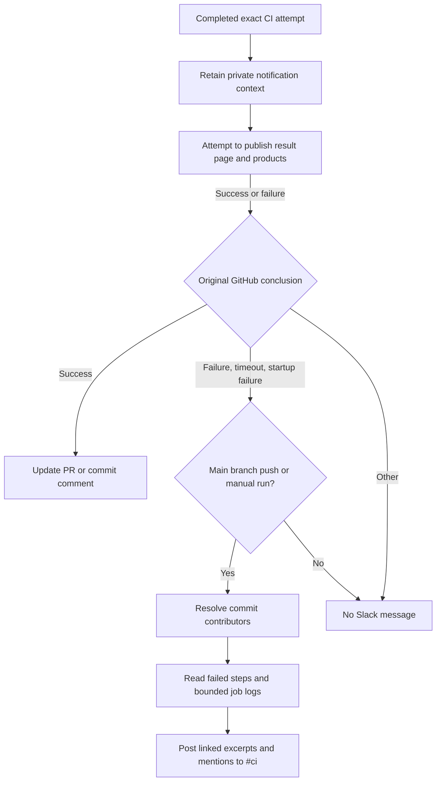
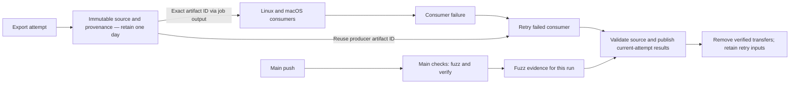

# Client CI results

`provenance.py` records the immutable source, triggering head, run and attempt
before building. `results.py` reports completed `playbit` and main-only
`main checks` runs, publishes allowlisted client products through `publish.py`,
and links the result on the PR
or commit only for successful runs. Slack receives failures, timeouts and startup
failures only for `main` branch pushes and manual runs, with each failed step
linked and its first two diagnostic lines. Successful, cancelled, skipped and
neutral runs, PRs and feature branches are silent in Slack. All completed runs
retain their result pages.
Operational workflows and deployment are private.

For a main push, the `plan` job also runs `release_range.py` and retains
`release-ci-range-ATTEMPT` for 90 days. Its single `range.json` binds the actual
push `before`/`after` range to the checked-out source, run and producer attempt.
The release gate uses that range to recompute main-only path filters and fuzz
selection. The parent of HEAD is insufficient for a multi-commit push. Failed-job
retries retain the successful plan's original range artifact; a new full attempt
records its own. This metadata stays on GitHub and is not a client product or a
replacement for original job results.

Run `python3 -m unittest discover -s playbit/ci -p 'test_*.py'` from the repository
root. These tests need no service source, cloud account or credentials.

The reporting environment supplies `GITHUB_REPOSITORY`, `GH_TOKEN`, `CI_RUN_ID`,
`CI_RUN_ATTEMPT`, `CI_RESULTS_BUCKET` and ordinary AWS CLI region/credentials.
Notifications additionally use `SLACK_WEBHOOK_URL`. The original GitHub
conclusion stays in the private reporting context to distinguish notification
outcomes from normalized public statuses. Never put credential values
in source, command arguments or public artifacts. Run `results.py prepare`,
`results.py publish`, then `results.py notify`, each with the same local JSON
context path; notify can also report a publication failure after prepare.

A trusted workflow runs this code after either CI workflow finishes; it never executes
PR code or downloaded products. Public products contain no source, profiles or
logs. Transfer archives and API pagination are bounded. Every source/run/attempt
has immutable results and any published products or evidence at
`https://ci.playbit.app/`; reruns use new attempt paths. Verified publication
removes transferred products and fuzz evidence.
The immutable `public-build-inputs-{attempt}` and `build-provenance-{attempt}`
artifacts remain private on GitHub for their one-day retention period. Export
passes the uploader's exact artifact ID through its job output, so failed consumers
reuse the successful producer's input when retried. Rerunning export creates new
artifacts without overwriting inputs an earlier report may still be reading.
After inputs expire, rerun the whole workflow. For `playbit` runs, reporting
selects the latest build provenance no later than the reported attempt; run ID,
triggering head and tested-source checks still apply. Fuzz provenance remains
strictly bound to its current attempt.
Reporting retries use stored provenance, refresh the HTML result page and update
the existing GitHub comment. Products and JSON evidence remain immutable.
Failure notifications read the exact attempt's jobs and at most 16 MiB of log
text per failed job. GitHub's second-resolution step timestamps select each
step's output; overlapping failed-step boundaries are explicitly unavailable.
ANSI/runner framing and generic exit-code messages are removed;
the first diagnostic block supplies two nonempty lines, or the last two useful
lines are used. Missing logs are explicit and do not suppress the notification.
Each scanned line is limited to 4,096 characters and each excerpt line to 500;
log scanning avoids a second retained line list. Up to 1,000 failed-step/job
entries are reported, splitting into messages of at most 35,000 characters.
Raw logs and contributor metadata never enter public result pages.

Main branch notifications mention the triggering commit's author, co-authors and
committer. GitHub resolves co-author trailers through its authors connection,
in batches of 100 commits with at most 100 authors per commit. Contributor text
is limited to one quarter of the message allocation; unavailable or oversized
lookups produce explicit feedback. The three mapped Playbit members use Slack
member IDs for actual mentions; other accounts retain their GitHub usernames.
Unassociated git identities display their names, without guessing accounts.

Web outputs remain experimental pending Phase 6 qualification.

The `main checks` workflow runs fuzzing and proofs on pushes to `main`, in a
separate run from build and deployment. Its fuzz evidence is published under
that run's ID; the `playbit` run publishes build products. Deployment no longer
waits for the proof suite.

`fuzz.py` handles bounded archive packing, HTTPS restore, unprivileged target
execution and corpus compaction before collection. `fuzz_results.py` validates
transfers, renders per-target evidence and promotes successful main-run corpora
through the serialized reporter. Its
bootstrap command creates the explicit empty baseline exactly once. Same-repo
fuzz evidence carries its own checkout provenance, independently of build export.
PRs never receive AWS credentials. Failure bundles are public
synthetic test inputs, not logs or profiles. See `playbit/fuzz/README.md` for the
input, archive, transfer and process limits.

PR #206 exposed this on September 22, 2026: attempt 1 passed the macOS unit,
renderer and build checks, then artifact creation failed with `ENOTFOUND`.
Attempt 2 failed before testing because it requested `public-build-inputs-2`
although export had succeeded on attempt 1. Reporting had also removed the
attempt-1 input. The artifact-ID handoff and retention fixes address the deterministic retry
failure; they do not claim to prevent DNS outages. Regression tests cover partial
rerun publication, exact provenance rejection, artifact retention and workflow
producer/consumer handoff, and isolation from future producer attempts. This CI-only change has no app-runtime or UI impact;
source transfer keeps the existing 256-MiB archive bound and one-day retention.
