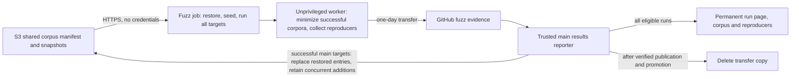

# Playbit fuzzing

This standalone cargo-fuzz workspace covers the runtime, app ABI, AP and local IPC codecs, store, packages and kvdb. It
does not build as part of the stable root workspace. All thirteen targets share one
instrumented dependency build. Its native-runtime feature links the real C ABI
implementations retained by sanitizer coverage in the SDK. Corpus/crash archives
are each capped at 7 MiB of input bytes so thirteen pairs and ZIP overhead remain
within the existing 256-MiB transfer budget. The host fixture is available only through
Playbit's existing `test-support` feature and cannot access files, the network,
or native presentation.

- `trace_decode` checks packed guest event/batch validation, variable metadata
  extents, trusted event attribution, app catalogs, segment/block framing and
  control status. Valid checksummed seeds reach the outer decoder; direct payload
  mutation reaches event validation independently of the checksum.
- `local_ipc` checks validated rkyv request/reply access, including cursor and log
  hooks, mutated valid archives, truncation, misalignment, frame prefixes,
  fragmented reads and receive-credit limits. Valid archive fixtures use the
  production serializer. This target does not dispatch operations, materialize
  unadmitted requests/replies or qualify operation-level resource admission.
- `package_contract` checks canonical bundles, bounded display metadata, manifest
  text, generated trace declarations, Wasm/Mach-O metadata sections and
  revalidation of mutated package fields. No filesystem operations.
- `store_contract` checks bounded invitation text/envelopes, schema evolution,
  field merges, ACLs, recipient delta projection, deterministic blob sealing and
  compact client/account-record framing, read/write requirements and opaque preservation.
- `ap_codec` checks frames, testing HELLO, named-database replica events and scoped terminals, plus
  operation JSON validation and native WebSocket stream packet admission. Seeds include every operation kind and wire event kind.
- `decode_view` sends arbitrary bytes through the scene and nested-menu decoders.
- `abi_reader` selects up to 32 Reader operations from the input, in arbitrary
  order, including continued reads after errors and finishing/resetting a reader.
  It checks that cursors remain bounded and monotonic between resets, and that
  admitted surface-event payloads encode back to exactly the input bytes.
- `wasm32_memory` checks scalar-ABI nested field/value/schema records, pointer/count bounds,
  output overlap, allocation limits and fuel admission. It also admits object
  output descriptors/arrays and checks that required-count publication changes only
  those three counts. Seeds include valid values and nested/output aliases; no VM,
  storage or host mutation occurs in this decoder target.
- `wasm_operations` invokes the two production scalar syscall imports through compiled
  Pulley wrappers. Inputs select an operation, six scalar arguments, and initial
  guest memory. Each call resets 2 MiB of memory and fresh deterministic authority,
  pending operations, resources, and an update. It checks queue/log/handle invariants,
  unchanged memory on errors other than count-only `BufferTooSmall`, and that
  rejected mutations never reach the host. The wrapper is compiled once per thread;
  no filesystem, network or presentation is available.
- `kvdb_encoding` exercises arbitrary storage headers, flag validation, metadata and clocks,
  plus valid compact/full value round trips.
- `kvdb_wire` checks arbitrary and corrupted sync streams against both protocol
  state machines.
- `kvdb_db_ops` checks database operations against a model and verifies canonical
  tree structure after every operation with the production verifier.
- `kvdb_sync_pair` checks convergence after interleaved edits and synchronization, verifying both trees after each operation
  and each completed exchange.

Install nightly Rust and cargo-fuzz, then run from the repository root:

```sh
python3 playbit/fuzz/seed-corpus.py
cargo +nightly fuzz build --fuzz-dir playbit/fuzz --target aarch64-apple-darwin --debug-assertions
cargo +nightly fuzz run --fuzz-dir playbit/fuzz --target aarch64-apple-darwin --debug-assertions decode_view -- -max_total_time=1800
cargo +nightly fuzz run --fuzz-dir playbit/fuzz --target aarch64-apple-darwin --debug-assertions abi_reader -- -max_total_time=1800
cargo +nightly fuzz run --fuzz-dir playbit/fuzz --target aarch64-apple-darwin --debug-assertions local_ipc -- -max_total_time=1800 -max_len=1048576
cargo +nightly fuzz run --fuzz-dir playbit/fuzz --target aarch64-apple-darwin --debug-assertions wasm_operations -- -max_total_time=1800
cargo +nightly fuzz run --fuzz-dir playbit/fuzz --target aarch64-apple-darwin --debug-assertions wasm32_memory -- -max_total_time=1800
cargo +nightly fuzz run --fuzz-dir playbit/fuzz --target aarch64-apple-darwin --debug-assertions kvdb_encoding -- -max_total_time=1800
cargo +nightly fuzz run --fuzz-dir playbit/fuzz --target aarch64-apple-darwin --debug-assertions kvdb_wire -- -max_total_time=1800
cargo +nightly fuzz run --fuzz-dir playbit/fuzz --target aarch64-apple-darwin --debug-assertions kvdb_db_ops -- -max_total_time=1800
cargo +nightly fuzz run --fuzz-dir playbit/fuzz --target aarch64-apple-darwin --debug-assertions kvdb_sync_pair -- -max_total_time=1800
```

Select the actual host target on other machines. CI explicitly uses
`aarch64-unknown-linux-gnu`, since the prebuilt cargo-fuzz executable can otherwise
select its own musl target. ASan and debug assertions stay enabled in both local
and CI runs; each CI target runs for 60 seconds. Corpus, crash artifacts, build
outputs and the standalone lockfile are ignored. Generate seeds with `seed-corpus.py`;
never add generated `corpus/` files to Git.

`seed-corpus.py` provides valid nested scenes, exact record/depth limits, all
Reader selectors, every scalar syscall, invalid scalar arguments, and result buffers. Fuzzing mutates those
seeds and also generates malformed input. A clean run is evidence for the tested
inputs, not a proof that every decoder path or VM/JIT behavior was covered.

## Persistent CI corpora and failure inputs

The main-only `.github/workflows/main-checks.yml` workflow fuzzes pushes that
change a fuzzed input. It restores the shared corpus from `ci.playbit.app`, adds the generated seeds, and runs all twelve
targets for 60 seconds each, even if an earlier target fails.
Each target has a 180-second process deadline; exceeding it kills its process
group and records a timeout. A nonzero target result still fails the job.
The worker logs starting distinct-input counts and bytes. Before collecting a
successful target, it logs the on-disk counts and bytes and minimizes coverage
into a separate temporary directory with libFuzzer's `-merge=1` operation (the
same operation as `cargo fuzz cmin`). The original directory survives compaction.
Each merge has a 60-second process-group deadline and a 2-GiB libFuzzer RSS limit.
The minimized corpus must fit the archive limits below; a merge failure or an
oversized result fails collection. Reproducers are collected after merging,
including failures discovered by a merge child even if its parent exits zero.

The trusted results reporter archives each same-repository run's corpora,
reproducer inputs, dependency lockfile, versions and exact checkout identity in
S3, then adds downloads to that run's results page. It also reports interrupted
or missing evidence; absence of an upload does not establish absence of crashes.
The reporter never runs downloaded code or inputs. Fork outputs remain excluded.

Only successful targets from main pushes contribute to the shared baseline.
The reporter replaces the baseline entries that the main run restored with its
compacted corpus, while
retaining entries added to the shared baseline since that restore. This preserves
discoveries from overlapping runs without adding discarded baseline entries back.
If that combination exceeds the archive limits, the reporter keeps that target's
baseline unchanged and emits a warning in the log and job summary requesting
compaction. Other targets and run publication still complete; the skipped corpus
remains in the immutable run archive. The promotion receipt also records that
run as processed, so reporting retries do not reapply it after later compaction.
Corpora are keyed by target, not commit or lockfile.
Inputs are synthetic test data; do not introduce real profiles, credentials, or
customer data into these publicly downloadable bundles.



The corpus and reproducer archives use SHA-256 filenames (with the libFuzzer
artifact kind preserved for reproducers). The manifest records archive hashes,
lengths and input counts; `result.json` hashes all published files. Starting
counts include generated seeds and are deduplicated by content. Saved counts for
successful targets describe the minimized corpus. Targets that fail before
collection retain their on-disk corpus when it fits the archive limits.
To reproduce, use the exact checkout, resolved `Cargo.lock`, toolchain versions,
target triple and command displayed on the failure page. No source or raw build
logs are added to the report.

Limits: 1 MiB per input, 16,384 corpus inputs and 7 MiB expanded corpus per
target, 16 reproducer inputs and 7 MiB expanded reproducers per target, 24 MiB
per compressed archive, 64 KiB metadata and 1 MiB lockfile. Thus thirteen targets
retain at most 182 MiB expanded input data per run; the existing outer transfer
limit is 256 MiB. The worker admits at most 65,536 files / 64 MiB per working
corpus before a run or merge, allowing growth and generated seeds above the
archive budget. The 1-MiB per-input check also applies to this working corpus.
Process merges and bundles sequentially. Each HTTPS request has a 30-second
deadline; the complete restore step has a four-minute deadline. Archive collection
errors fail CI and mark the affected bundle unavailable while preserving other
bundles, especially crash inputs. Storage failures never silently reset a corpus.
These are bounded CI operations, not application startup/rendering changes or
runtime performance qualification. Historical S3 snapshots have no expiry.

See [the CI runbook](../../service/infra/ci/README.md) in the private repository
for bootstrap, reporting retries and active-corpus compaction.
