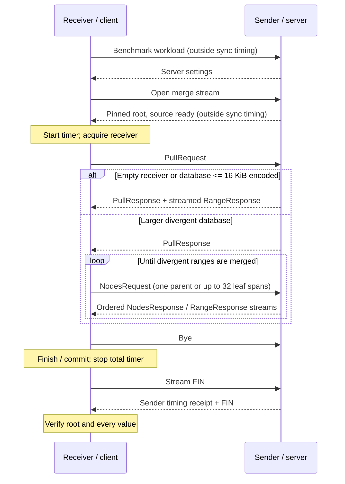

# kvdb sync benchmark

The `sync` example isolates kvdb's pull/merge path, using either direct byte
transfer in one process or a real QUIC connection between two processes/machines.
It does not change the sync protocol. The intended journey is initialization and
catch-up of a small replica, targeting 50–500 ms on a representative network.
Measure protocol turns as well as time: a cold receiver should need one request
and a streamed snapshot response; a small catch-up should need only a few turns.
The current protocol streams cold snapshots and small divergent databases in
one response flight. Larger catch-ups may still require multiple discovery turns.

## Running

```sh
cargo build --release --locked -p kvdb --features redb --example sync
target/release/examples/sync --keys 32 --changes 3 --samples 20
target/release/examples/sync --medium fsync --keys 32 --changes 3 --samples 20
```

On the source machine:

```sh
target/release/examples/sync --quic
# Optionally: --bind 0.0.0.0:4433 --medium fsync
```

The server prints JSON with its listening address and a temporary `server.der`
certificate path. Copy that public certificate to the client through a trusted
channel, then run:

```sh
target/release/examples/sync --quic --pull-from SOURCE_IP:PORT \
    --cert /path/to/server.der --keys 32 --changes 3 --samples 20
```

Use the server's reachable address in place of `0.0.0.0`. For a local test, use
`127.0.0.1` and the printed certificate path directly. Remote use needs a reachable
UDP port. Certificates are regenerated on server restart; the private key stays
in memory. TLS validates the copied certificate and fixed benchmark server name.
There is no client authentication. The server serves synthetic fixtures only.

Each connection supplies its workload; server-side workload flags are rejected.
`--medium memory|fsync` selects each process's own storage backend independently.
Defaults are 10,000 keys, min(1,000, keys) changes and 10 samples per case. Limits
are 100,000 keys, changes <= keys, and 1–1,000 samples. Zero keys/changes are valid.
The server handles one connection at a time, with one bidirectional stream at a
time. Protocol/control operations have a 120-second deadline; idle transport
expires after 30 seconds. QUIC windows match native AP: 512 KiB per stream and
2 MiB connection receive/send budgets. This is not an AP server or load generator.

## Workload and output

Every run performs these three cases in order, each with one discarded warmup:

- `cold`: a fresh empty destination each time; 16-byte keys and 300-byte values.
  This means an empty database, not a cold OS page cache.
- `equal`: identical replicas left over from cold sync.
- `catchup`: overwrite evenly spaced keys with generation-stamped 1,024-byte
  values. Each iteration changes the same set again and retains the destination.
  This exercises several branches, but is not an exhaustive worst case.

Fixture creation, source mutations and verification are outside timing. Every
transfer, including warmups, verifies the pinned source root, each key/value and
applied count. Both backends use 512 KiB database caches and file staging. The
memory backend is nondurable. The first catch-up warmup grows selected values;
measured catch-ups overwrite values at the same size.

Output is JSON Lines: connection details followed by one record per case, with
raw samples and nearest-rank p50/p95/p99/max. Small sample counts do not qualify
p99. `total_ns` starts before receiver acquisition and ends after `finish()`;
`protocol_and_apply_ns` stops before finish, and `finish_ns` includes branch
repair, commit and CPU-clock observation overhead, not just fsync. Local mode
also times sender acquisition and processing. QUIC records TLS handshake time
separately; each merge's source-ready exchange, receiver staging-file creation
and fixed buffer allocation precede its timer. Sender elapsed/thread CPU and the
client's final-receipt time are separate observations.



`wire.requests` and `wire.responses` count actual kvdb bytes and logical frames,
independently of QUIC read/write fragmentation. For this protocol,
`requests.pull + requests.nodes` counts request/response turns; each node
request can contain up to 32 subtree descriptors. `responses.ranges` counts
streamed leaf frames. `Bye` has no response. Response frame count is not
round-trip count: a single branch response can contain many frames.

QUIC samples also report RTT, path MTU, UDP datagrams/bytes and lost packets from
Quinn's connection statistics. They include ACKs and the final control receipt;
delayed ACKs can cross sample boundaries. They are not exact per-sync packet
captures. Neither a kvdb frame nor a stream write corresponds to one UDP packet.
Thread CPU time includes any QUIC work scheduled on that process's current-thread
runtime. Local mode includes both sides' CPU work.

`--diagnostic-staging` adds per-operation staging count/time/max observations.
These are nested timings with observer overhead: compare separate runs and do
not sum them into total or interpret wall time as CPU time.

Observe load before and during timing, especially on shared machines. Record
hardware, power/thermal state, medium on both ends, build, command, RTT, loss,
concurrency and sample count. Avoid compilation during measurements. Loopback
uses kernel shortcuts and does not establish WAN performance; use another host
or an external network emulator for latency/loss experiments. This benchmark
omits AP framing/authorization, engine scheduling, live pub/sub and UI work; it
cannot qualify their end-to-end budgets in `docs/internal/performance.md`.

## Current catch-up mechanism

Pull protocol version 1 uses three optimizations, without changing stored data,
LWW conflict resolution, tombstones or commit semantics:

1. **Cold snapshot.** An empty receiver gets sorted stored entries immediately
   after the pull response, without requesting each tree level. Large values
   and large databases stream through the existing staging/merge path. No whole
   database buffer is allocated, and each operation retains its ordinary bounds.
2. **Small ranges.** A differing database/subtree whose encoded entries fit in
   16 KiB is sent directly. The sender probes entry sizes up to the threshold;
   it does not read values into a probe buffer or maintain extra tree metadata.
   The receiver skips identical entries, and still resolves local-only entries
   and conflicts within the precise range. Matching branch hashes are skipped
   only when the local and remote range ends also match.
3. **Ordered leaf batches.** A request names one parent or up to 32 adjacent
   divergent leaf spans. The sender streams all responses in order without
   another request between siblings. Output drains across response boundaries
   into the caller's existing write buffer. The receiver starts the next batch
   only after draining this one, preventing two full writers from deadlocking.
   Parents remain serial: this keeps resolver calls globally ordered and avoids
   holding/reordering sibling values. Consequently this is bounded batch
   pipelining, not arbitrary concurrent tree traversal.

The request limit is `12 + 32 * (4 + KEY_SIZE_MAX)` bytes (16,492 bytes with
511-byte keys). The sender retains at most 32 descriptors; the receiver retains
at most 31 outstanding spans plus the active span, in addition to its existing
256-branch discovery bound. Values remain streamed one at a time. Each response
frame retains the existing size limit and each output call emits at most 256 KiB.
Snapshot/range streams have no aggregate entry-count limit because leaves are
not accumulated; individual frames remain bounded. A response cannot switch
between node and range framing halfway through a span.

The threshold trades extra bytes for fewer discovery turns. It is deliberately
independent of packet size. Dense catch-up in a large tree can still require
many turns because parent discovery is serial; the benchmark reports this
rather than treating 32-way batches as a general one-RTT guarantee. Future
threshold tuning should compare sparse/dense workloads, RTT and bandwidth,
including extra bytes / available throughput versus discovery time saved.
Higher-level engine changes remain separate.

[Noms pull](https://github.com/attic-labs/noms/blob/master/go/datas/pull.go) is a
useful precedent for batching missing hashes and bounding bytes as well as
counts. This implementation preserves ordered responses to avoid its need for
a separate chunk-reordering map.

Coalesce already-ready work into bounded writes and let QUIC packetize and pace
it. Literal [Nagle waiting](https://www.rfc-editor.org/rfc/rfc896.html) holds small
sends while data is unacknowledged, which can add latency to this interactive
protocol. No artificial batching timer is needed. QUIC streams carry ordered
bytes and packet size depends on the path; its minimum supported UDP payload is
1,200 bytes, not a guaranteed 2,048-byte application payload. See
[RFC 9000 sections 2 and 14](https://www.rfc-editor.org/rfc/rfc9000.html#section-14).
The locked Quinn defaults start at 1,200 and probe up to 1,452 bytes; this
benchmark reports the actual path MTU. AP and QUIC headers further reduce data
per packet. A large stream write can still fill multiple packets efficiently.

Protocol tests cover tombstones, concurrent local writes through prepared sync,
identical hashes with different range bounds, fragmented/truncated input, invalid
batches/ranges and abort/retry. Keep origin clocks, resolver order, snapshot
consistency and atomic durable finish as required invariants. Compare bytes, turns, CPU and
finish latency separately on empty/equal/sparse/dense workloads. Fast unidirectional
mirror results do not prove correctness for divergent bidirectional replicas.
