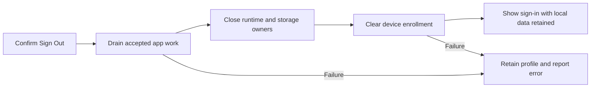

# iPhone host

Requires iOS 18 or newer on iPhone 13 or newer. Qualify the minimum OS separately from current-device runs.

The standalone Swift model test commands below run correctness checks by default.
Append `--benchmark` when running their timing cohorts on a reference device.
CI does not run benchmarks; default test output contains no timing results.

The public UIKit host runs the same v3 `Engine`, Wasm guest, kvdb records and local blob cache as the desktop. iPhone execution uses Wasmtime Pulley. The shell shows retained sessions above the New Session action, with account/recovery access at the top; guest views use native controls. Session invitations remain visibly pending remote availability. Closing the UI does not delete the session or its data.

The ordinary build supports runtime `public` and `testing` channels. Sign-in and
Account have an Environment menu; Testing remains visible in native navigation.
`PLAYBIT_CHANNEL` overrides the remembered choice at launch and accepts only those
exact names. Invalid explicit or remembered state prevents opening an account;
choose an environment to recover. Selection is remembered in the installation's
UserDefaults, independently of the replaceable application bundle.

Public uses `Library/Application Support/<bundle-id>`; Testing uses the separate
`<bundle-id>-testing` directory. Channel markers, identities, data, caches, logs
and recovery Keychain namespaces remain separate. Switching waits for admitted
actions and saved editor drafts, closes the old runtime on its existing worker,
then opens the selected profile. It does not clear either enrollment. A failed
shutdown keeps the previous selection and reports the error. The process panic
sink rebinds only after the old runtime owners have retired.
Process tracing cannot change profiles in place. Switching explicitly disables
it before any new account data opens and reports this in diagnostics; restart
Playbit to record in the newly selected channel. Old trace files remain in their
own profile, and a channel change cannot continue recording into them.

The typed `pb_ios_open` bridge receives the explicit channel (0 Public, 1 Testing)
and holds profile admission through runtime teardown. Unknown values or a
conflicting marker fail before account initialization. Standalone Swift lifecycle
tests cover pending work, remembered choice and shutdown failure; Rust bridge
tests cover separate durable identities/data. The opt-in packaged
`testReleaseChannelSelectionIsRememberedWithoutEnrollment` requires a fresh
isolated app identifier and runner `PLAYBIT_CHANNEL_QUALIFICATION=1`; it sends
no email. Simulator results do not establish signed Keychain, ordinary testing
AP/web sign-in, physical-device or startup/input performance qualification.

Build both native compositions with `sh playbit/platform/ios/build-rust.sh aarch64-apple-ios`,
then build the `Archipelago` Xcode scheme. The script stages the lightweight provider
library, app library and version metadata together under `Generated`. For a simulator,
use `aarch64-apple-ios-sim`. Normal builds exclude the qualification initializer and
starter bundle. The app target embeds the signed `playbit-file-provider.appex`.

Public accounts appear as one Playbit location in Files and document pickers, with
owned personal volumes as top-level folders;
iOS asks the user to turn on each new location. Blobs are ordinary files and databases
are canonical `.pbdb` identity references. Opening a reference checks authority and
selects that exact database in Playbit, including entries beyond a browser page.
App roots and Testing profiles expose no drives. The extension owns a separate
replica per account/domain in its private container, with credentials handed off through a protected
App Group; Files does not depend on a running app. Offline
access covers metadata and bytes already cached in that replica. See
[process ownership, lifecycle and push transport](../../../docs/internal/file-provider.md).

Both targets require the company App Group. Debug uses `group.app.playbit.debug`;
Release/Distribution use `group.app.playbit`. The containing app has APNs capability,
with sandbox tokens for development and production tokens for Distribution. Inspect
profiles and signed entitlements for both targets before packaging. Distribution
requires profiles updated for the App Group/APNs capabilities and the extension ID;
creating a candidate does not authorize a TestFlight upload.

`ProviderAccountTests` exercises the actual ledger and shared-lock behavior on iOS.
The opt-in `ProviderFilesTests` requires an isolated account, a peer-created personal
volume, `PLAYBIT_PROVIDER_EMAIL` and `PLAYBIT_PROVIDER_DRIVE` in the test runner's
environment. On a fresh profile, transfer its account key to the runner's protected
`Documents/playbit-live-recovery-key.txt`, never a command argument; the test consumes
that file and uses ordinary secure sign-in UI. `PLAYBIT_PROVIDER_FILE` selects an
expected file. These checks must run against the signed package on a physical iPhone;
a passing ledger/unit test does not qualify Files, APNs or extension memory limits.

The Rust library build emits `playbit-version.xcconfig` beside `libplaybit.a`.
Copy it to `Generated/Version.xcconfig` alongside the selected library, as the
qualification and distribution scripts do. The host derives its complete
`PlaybitVersion` metadata from that file. Debug and Release also derive their
numeric marketing version from it. Distribution pins the TestFlight marketing
version to `0.1.0`; only its Apple build counter increases, so builds appear as
`0.1.0 (N)` independently of the Cargo release version. IPA verification enforces
this pin. Change that policy explicitly when preparing an App Store release.

The host uses one UIKit window scene. Scene connection owns window creation and
cold invitation delivery; scene URL, foreground and background callbacks handle
subsequent links and the existing runtime resume/suspend path. Multiple windows
are disabled. `testSceneLaunchResumesAndReceivesColdAndWarmURLs` exercises the
ordinary Release app without seeding an account or sending sign-in email. Run it
alongside `testBackgroundInvitationResumesBeforeRuntimeRequest` and
`testAutomaticSignInKeepsLocalNavigationAvailable` on current iOS and iOS 18
when changing lifecycle handling. URL delivery queues runtime resume before the
invitation request, since Safari can deliver a link before the scene foreground
callback. Also exercise Safari's Open in Playbit action on the physical device;
XCTest's direct URL launch does not reproduce every Safari callback ordering.

The default identifier is `playbit.engine` for Release and
`playbit.engine.debug` for Debug; pass `ARCHIPELAGO_APP_ID` to Xcode to
override it. The host defaults to the Playbit company team `KBJTKLMMGM`.
Review any new identifiers before registering them or allowing Xcode to create
them. Xcode compiles `../macos/icon.icon` for Release and
`../macos/icon-debug.icon` for Debug, including App Store and device variants.

Open an invitation in Safari and choose **Open in Playbit**. The app retains it through email/code sign-in, private-key recovery, and cancellable downloads. Account sign-in and private-key recovery are separate: save the account key explicitly during setup, and supply it to unlock an existing backup. Email authentication alone does not unlock encrypted data. Personal volumes remain unavailable until mounted for the session. Authorized updates preserve the session, mounts and shared data; provisioning failures expose a retry action.

For device qualification, use the normal package and a received invitation. Verify pending and resumed joins, recovery, update consent, and background/foreground transitions through the actual UI. The initializer checks below are supporting runtime regressions; they do not prove the packaged recipient journey.

## Phase 1 execution checks

The explicit `phase1-qualification` Cargo feature and `PHASE1_QUALIFICATION` Swift condition permit `--phase1-qualify` to create a fresh local account, ordinary root, and session from a packaged source-built starter. The fixture initializes TODO's named database, schema and seed records using `guests/todo/playbit-volumes.json`. It runs only on an empty qualification profile. No Mac profile or credential copy is used. Seeded control fixtures use an isolated offline transport. The `todo-sign-in` check instead launches an empty profile without the seed, connects to real AP TLS, and checks automatic sign-in and Back without sending mail.

```sh
SIMULATOR_ID=<iPhone-simulator-UDID> playbit/platform/ios/qualify.sh simulator todo
SIMULATOR_ID=<iPhone-simulator-UDID> playbit/platform/ios/qualify.sh simulator todo-sign-in
SIMULATOR_ID=<iPhone-simulator-UDID> playbit/platform/ios/qualify.sh simulator todo-controls
SIMULATOR_ID=<iPhone-simulator-UDID> playbit/platform/ios/qualify.sh simulator todo-surface
SIMULATOR_ID=<iPhone-simulator-UDID> playbit/platform/ios/qualify.sh simulator todo-sessions
SIMULATOR_ID=<iPhone-simulator-UDID> playbit/platform/ios/qualify.sh simulator todo-consent
SIMULATOR_ID=<iPhone-simulator-UDID> playbit/platform/ios/qualify.sh simulator todo-consent-pending
SIMULATOR_ID=<iPhone-simulator-UDID> playbit/platform/ios/qualify.sh simulator todo-logs
SIMULATOR_ID=<iPhone-simulator-UDID> playbit/platform/ios/qualify.sh simulator todo-logs-failure
SIMULATOR_ID=<iPhone-simulator-UDID> playbit/platform/ios/qualify.sh simulator todo-text
SIMULATOR_ID=<iPhone-simulator-UDID> playbit/platform/ios/qualify.sh simulator todo-invitation
SIMULATOR_ID=<iPhone-simulator-UDID> playbit/platform/ios/qualify.sh simulator ui-gallery
SIMULATOR_ID=<iPhone-simulator-UDID> playbit/platform/ios/qualify.sh simulator micro-kart
IOS_DEVICE_ID=<connected-iPhone-UDID> ARCHIPELAGO_APP_ID=<registered-company-qualification-ID> playbit/platform/ios/qualify.sh device todo
IOS_DEVICE_ID=<connected-iPhone-UDID> ARCHIPELAGO_APP_ID=<registered-company-qualification-ID> playbit/platform/ios/qualify.sh device micro-kart
```

Simulator runs generate a fresh identifier. Device runs require an explicitly
selected, registered company qualification identifier; review any new identifier
before registration. Use a fresh qualification app/profile for tests that need
an empty store. Keep the phone connected and unlocked. TODO tests create and
complete a task through actual UIKit input and Wasm execution, terminate the
process, then verify the same session identity and completed task after relaunch.
Micro Kart tests drive the actual Wasm simulation through native touch and timed
frame events, checking its changing distance and saving before/after screenshots.
This is a single-kart rendering/input experiment; multiplayer is Phase 9.

The invitation check also opens native sign-in, verifies empty/partial/complete/invalid
email action states, then leaves the form with the invitation retained. It sends no
mail; authenticated enrollment and code/resend checks require a real AP account.

### File API save and restart

`qualify.sh device shared-note` runs `testSharedNoteFileSaveSurvivesRestart`
using the same device and signing variables above. It saves Unicode text through
Shared Note, checks the readback and UTF-8 byte count, backgrounds the app,
restarts it, replaces the file with shorter text, and restarts again. Screenshots
record the saved and reopened file. This is an offline device correctness check,
not a production sync or performance check.

To run the same test in the ordinary app against an existing isolated account,
set the runner variable `PLAYBIT_LIVE_FILE_SESSION` to a retained Shared Note
session. That path does not seed a profile. Verify the resulting file on a second
connected device to establish production synchronization.

### Database documents and native editing

The database-browser fixture uses `--phase1-qualify --phase1-database-browser`.
`testDatabaseBrowserEditsOfflineAndRetainsSavedValue` and
`testDatabaseBrowserCreatesAndEditsObjectRecordOffline` exercise KV and typed
object editing through UIKit, then reopen the saved data after process restart.
Use a fresh isolated app identifier when first creating this fixture.

`testDatabaseReferenceOpensFromFilesCold` opens the fixture's real `Settings.pbdb`
from Files with Playbit closed and checks the database and containing browser.
Run it on a simulator with only the intended Playbit build installed: all builds
register the same document type. Give that build a unique `CFBundleDisplayName`
and pass the same name as runner variable `PLAYBIT_DOCUMENT_APP_NAME` (prefix
with `TEST_RUNNER_` when invoking `xcodebuild test`). This checks document
association and coordination; it does not qualify File Provider domains, cloud
synchronization, physical devices, or startup/input latency.

### Sessions navigation and layout

`testNamedSessionsKeepRootDistinctionsAndIdentityAfterRestart` checks the bottom
list and New Session action, full session identities, distinct root labels and
restart. `testSessionsLargeTextAndLandscapeKeepActionsReachable` checks the
largest accessibility text size, native landscape scrolling and sheet cancellation.
Both use the explicit qualification fixture; neither is a performance benchmark.
Run these three-session checks in a fresh app identifier, separately from tests
that initialize a different fixture. Qualification preserves existing app data
on relaunch; it does not replace a one-session fixture with three sessions.
Use a full-screen XCTest capture for landscape because app-cropped captures may
use the wrong orientation.

The signed-in Account screen shows the display name, email and account ID,
with separate recovery access and a confirmed Sign Out action. Sign-out drains
accepted app work before closing the runtime and removing this device's
enrollment. Local sessions, pending synchronization, blobs and recovery data
stay on the device. Failure retains the profile and reports an error. Signing
in to another account uses the existing explicit replacement decision.
The account ID uses canonical base58. Its row shows a shortened value with `…`
and copies the full ID when tapped, displaying “✓ Copied” for two seconds.



`qualify.sh simulator todo-account` checks name editing, recovery failure
feedback, canceled/confirmed sign-out, retained TODO data and manual sign-in
after restart. This synthetic offline profile is unenrolled; runtime bridge
tests separately check enrolled credential removal and pending-write retention.
It does not establish live account switching or physical-device latency.
`testAccountLargeTextAndLandscapeKeepsSignOutReachable` checks scrolling and
cancellation at the largest accessibility text size in landscape.
`testAccountIDCopiesBase58AndRestoresTruncatedRow` verifies the encoding,
temporary feedback and full clipboard value through native text-field Paste.

`testInvitationLinkRequiresAgreementAfterBackingOutOfReview` uses an isolated,
enrolled Testing profile awaiting the current agreement. Set the test runner
variable `PLAYBIT_AGREEMENT_QUALIFICATION=1` for this profile. The test opens an
invitation by URL, backs out of agreement review, verifies the invitation still
requires assent, then accepts the agreement for that test account.

`testLiveSessionsNavigation`, with runner variable `PLAYBIT_LIVE_SESSION`, checks
an existing enrolled isolated account in the ordinary package. It opens Account
and its recovery controls, returns, opens/cancels New Session, and opens
the exact retained TODO. It neither exports a key nor changes recovery setup.
It launches into Sessions independently of the preceding test, and checks that
the original session identities and order survive navigation while allowing new
sessions to arrive from another device. Isolated fixture tests check exact lists.
The `Sessions bottom layout` signpost measures only the added alignment/footer
callback, excluding inherited UIKit layout and physical presentation.

`SIMULATOR_ID=<UDID> playbit/platform/ios/qualify.sh simulator todo-session-editing`
checks native drag reordering, restart, actual session/app/root details, Live Share
presentation and dismissal, canceled/confirmed Leave, and reopening another
session. The fixture contains three retained sessions. Leave and order are local
metadata operations; they do not delete account capabilities or shared volumes.

`todo-consent-details` checks the same Editing Session screen with an available
personal volume. It saves read-only access, discards an unsaved write grant,
saves read/write, restarts, revokes access and restarts again. The displayed grant
and full session identity must remain correct. It also runs XCTest's complete
accessibility audit on the read-only details and populated chooser. These automated
checks supplement actual VoiceOver navigation; they are not VoiceOver or latency
measurements. Run with either `qualify.sh simulator todo-consent-details` or
`qualify.sh device todo-consent-details`, using the device variables above.

For the ordinary app and a real isolated account, run
`testSessionDetailsShowsSavedPersonalAccessAndRevocation` with runner variables
`PLAYBIT_LIVE_SESSION` and `PLAYBIT_LIVE_VOLUME_NAME`. The same assertions use
that exact retained session and eligible personal volume without seeding data.

`testLiveSourceUpdateRequiresNewPersonalConsent` also takes
`PLAYBIT_LIVE_RETAINED_TASK` (a completed TODO), `PLAYBIT_LIVE_INITIAL_HEADING`
and `PLAYBIT_LIVE_UPDATED_HEADING`. Run the source watcher for that exact session.
The test saves Read for the current build, then writes runner
`Documents/playbit-live-consent-ready`. After observing that marker, change the
actual Rust heading and let the normal watcher build/update. The test requires
an explicit update-review state, edits the old guest while blocked, checks that
the candidate starts Off, cancels a write grant, explicitly saves Off, and verifies
the updated heading and edited task after restart. Separately verify the old and
candidate build grants, full task records, immutable session bindings and other
pinned sessions through another connected replica. Read the candidate build ID
from the owner's update result: an unopened replica may still retain an older
local build. Capture files stay outside Git. The 180-second operator wait is a
failure deadline, not a performance measurement.
The completed-task prerequisite waits for the peer's edit to arrive before the
source-update marker is written. A failed adoption capture records the retained
guest and its error; a subsequent successful restart does not make adoption pass.
Backgrounding before restart/end allows ordinary lifecycle handling to flush
admitted recording buffers. Recording uses explicit controls and remains off
until selected.

`testLiveLeaveAndRejoinRetainsSharedData` exercises the ordinary installed package
with runner variables `PLAYBIT_LIVE_SESSION`, `PLAYBIT_LIVE_INVITATION`,
`PLAYBIT_LIVE_RETAINED_TASK` (an already completed TODO), and `PLAYBIT_LIVE_TASK`
(a distinct task to create on the peer). The test leaves and restarts, then writes
`Documents/playbit-live-left` in the test runner's container. After observing that
marker, create the new task through another participant's actual UI and write
`Documents/playbit-live-peer-done` in the runner's container. The test checks that
the session stays absent, rejoins through the original invitation, retains old
data, completes the new task, and restarts with the same identity. Check that
completion reaches the peer. The marker wait has a 180-second safety deadline;
test durations include operator/network waits and are not input benchmarks. Use
an isolated account and keep the invitation, logs and screenshots outside Git.

Local store supporting measurements are opt-in, optimized, and never CI:

```sh
cargo test --offline --release -p playbit benchmark_session_list_projection_and_durable_mutations -- --ignored --nocapture
```

This compares the previous catalog read with retained-list projection and times
durable order/leave/reopen at 4/128/256 rows (1,000 samples each). It excludes
UIKit, IPC and physical presentation; actual device qualification is separate.

### Live sign-in and app catalog

`Phase1Tests/testLiveSignInListsApps` uses ordinary AP enrollment with no
seed or injected transport. It is skipped unless the XCTest runner receives
`PLAYBIT_LIVE_EMAIL` and `PLAYBIT_LIVE_APP` (`publisher:app_id`). Use an isolated account with
a published app and a fresh app identifier. This check sends real mail;
do not include it in unattended CI. It checks authentication, Back from recovery,
the real app row and Cancel. It does not acknowledge a recovery backup,
unlock private data or launch the app.

Build the Release scheme with `build-for-testing` and an isolated
`ARCHIPELAGO_APP_ID`, then set the two variables in the generated `.xctestrun`
file's `ArchipelagoUITests.EnvironmentVariables` dictionary. Run:

```sh
xcodebuild -xctestrun "$XCTESTRUN" \
    -destination "platform=iOS Simulator,id=$SIMULATOR_ID" \
    -resultBundlePath "$RESULT" -parallel-testing-enabled NO \
    -only-testing:ArchipelagoUITests/Phase1Tests/testLiveSignInListsApps \
    test-without-building
```

The runner creates `Documents/playbit-live-code-requested` after requesting a
code. Read the newly delivered message, including Spam/Junk; never reuse an older
code. Within 180 seconds, supply exactly its six ASCII digits, without a newline,
in `Documents/playbit-live-code.txt` in that runner's data container (find it with
`xcrun simctl get_app_container "$SIMULATOR_ID" "$RUNNER_BUNDLE_ID" data`). Create
the file with mode 0600. The test deletes it immediately after reading and removes
both files on completion. Keep the result bundle and logs private: XCTest may
record typed credentials. Record actual From and authentication headers, mailbox
placement, and receive time separately; SES acceptance alone is not delivery proof.

`testLiveRecoveryPreparationRemainsUnsavedAcrossBackAndRestart` uses the same
delivered-code procedure with `PLAYBIT_LIVE_EMAIL` alone. Use a fresh isolated
account without an existing recovery backup. It verifies real AP preparation,
stable secret identity across Back/restart, and no saved acknowledgment. On that
same installed app, run `testLivePreparedRecoveryControls` with runner variable
`PLAYBIT_LIVE_RECOVERY_READY=1` to check the acknowledgment switch and Save button.
Its explicit visual attachments crop the controls below the credential. Neither
test copies the secret, submits Save, or proves recovery from a backup.
For a physical device, use destination `platform=iOS,id=$IOS_DEVICE_ID` and
`xcrun devicectl device copy to --device "$IOS_DEVICE_ID" --source "$CODE_FILE"
--destination Documents/playbit-live-code.txt --domain-type appDataContainer
--domain-identifier "$RUNNER_BUNDLE_ID"` to supply the delivered code.

### Live backup, invitation and source update

These opt-in tests use normal Release packages, actual AP traffic and isolated
accounts; they are not unattended CI checks. Keep credentials and result bundles
outside Git. In a direct `xcodebuild test` invocation, prefix runner variables
with `TEST_RUNNER_`; in an `.xctestrun`, use their unprefixed names.

- `testLiveSaveRecoveryBackup`, with `PLAYBIT_LIVE_SAVE_RECOVERY=1`, requires
  explicit authorization to save the isolated account's prepared key. It writes
  `Documents/playbit-live-recovery-key.txt` in the runner container with mode 0600
  and complete file protection. Copy that file to the approved private backup
  location, verify its permissions, then supply
  `Documents/playbit-live-backup-exported` to the runner within 180 seconds.
  Only then does the test acknowledge the backup through the actual UI. It also
  completes the initial display name and verifies that no backup retry remains.
- `testLiveInvitationAndSourceReload` requires an already signed-in,
  recovery-ready account and runner variables `PLAYBIT_LIVE_INVITATION`,
  `PLAYBIT_LIVE_SESSION`, `PLAYBIT_LIVE_TASK` and
  `PLAYBIT_LIVE_UPDATED_HEADING`. Run `pb run --release` from external source on
  Mac, pass its invitation/session and a unique task name, then start the test.
  After the iPhone adds/completes that task and it appears on Mac, change the
  source heading to the requested value. The test observes the ordinary update,
  checks the completed task, and restarts the app to verify session/data retention.
  Its 180-second coordination deadline is not a latency measurement.
- `testLiveBackgroundParticipantResumesSourceUpdate` uses an already joined
  `PLAYBIT_LIVE_SESSION`, its completed `PLAYBIT_LIVE_RETAINED_TASK`, a new
  `PLAYBIT_LIVE_TASK` and `PLAYBIT_LIVE_UPDATED_HEADING`. It opens that session,
  presses Home and writes the observed XCTest application state into runner
  `Documents/playbit-live-backgrounded`. After reading that marker, quit the
  Mac GUI while retaining its engine and source watcher, then edit the heading.
  Verify the watcher's update result before supplying runner
  `Documents/playbit-live-resume` within 180 seconds. The phone returns, adopts
  the update, retains the earlier task, adds/completes the new task and restarts
  into the same session. Before reopening the Mac GUI, use `pb objects` to
  verify the new completed task in local storage. This checks background and
  foreground behavior; XCTest/debugger attachment can inhibit OS suspension,
  so actual suspension needs separate qualification. Coordination waits and
  XCTest durations are not performance measurements.
- `testLiveSuspendedPeerCatchUp` covers actual OS suspension with a running
  guest. It uses the same session, heading, retained-task and new-task variables.
  Build the Release runner with `build-for-testing` and install the runner before
  launching the already enrolled, recovered app independently with `devicectl
  device process launch`. Do not use XCTest `launch()` for that initial process:
  debugging can inhibit suspension. The test activates the existing process,
  opens TODO, presses Home and requires `runningBackgroundSuspended`.
  Read runner `Documents/playbit-live-suspended`, add the new task on the Mac
  peer, then supply `Documents/playbit-live-resume`. The test rechecks suspension,
  activates the phone, observes the task, completes it and verifies restart
  persistence. Verify the completed task returns to Mac through live replication.

  Run this test with `test-without-building` and a copy of the generated
  `.xctestrun` that uses the installed artifacts. In its `ArchipelagoUITests`
  dictionary, set `UseDestinationArtifacts` to true,
  `TestBundleDestinationRelativePath` to `PlugIns/ArchipelagoUITests.xctest`,
  and `UITargetAppBundleIdentifier` to the installed isolated app identifier.
  Keep `TestHostBundleIdentifier`; remove `TestBundlePath`, `TestHostPath` and
  `UITargetAppPath`. Put the unprefixed runner variables in `EnvironmentVariables`.
  This prevents an installation from replacing the process being observed.
  Its 30-second state and 180-second operator deadlines are correctness checks,
  not suspension/catch-up performance measurements. No test fixture or injected
  transport replaces the ordinary runtime, OS lifecycle or AP changesets.
- `testLiveRestoreRecoveryBackup` uses a **fresh app identifier**,
  `PLAYBIT_LIVE_RESTORE_RECOVERY=1`, `PLAYBIT_LIVE_EMAIL` and the same session,
  heading and task variables. Use the delivered-code procedure above; copy the
  saved key into the runner's `Documents/playbit-live-recovery-key.txt` before
  supplying the email code. The test first submits a validly formatted wrong key, verifies rejection and
  no private sessions, then restarts to confirm the backup remains locked and
  preserved. It enters the saved key through native recovery UI, checks that an
  existing name does not require another save, and opens the
  recovered session with its completed task. It deletes the runner's key copy
  after reading it; retain the approved external backup.

Recovery form failure/retry and duplicate-admission checks run without UIKit:

```sh
. scripts/macos-env.sh
swiftc -target "$(uname -m)-apple-macosx$MACOSX_DEPLOYMENT_TARGET" -O playbit/platform/ios/Host/Identifier.swift playbit/platform/ios/Host/RecoverySetup.swift playbit/platform/ios/Tests/RecoverySetupTests.swift -o /tmp/recovery-setup-tests
/tmp/recovery-setup-tests
```

On a reference Mac only, pass `--measure` for 10,000 bounded setup cycles after
100 warmups (1 KiB secret, 4 KiB error, preparation failure/retry and save failure).
This measures form state logic, excluding UIKit, storage, AP and presentation.
CI runs correctness checks without that flag; device interaction qualification
is separate.

The runner builds optimized Rust and Swift artifacts. Starter preparation uses
`pb init`, `pb build --release`, and `pb bundle --release`
in an external temporary source directory using the complete packaged Mac kit
and its installed SDK. TODO uses the installed starter; UI Gallery and Micro
Kart replace its `src/app.rs` entry point. Its isolated
desktop engine has IP networking denied and is stopped afterward. Only the
bundle enters the iOS package; no desktop profile or volume credentials do.

Evidence stays under `target/phase1-ios/`: bundle identity, artifact hashes, XCTest results, screenshots, and runtime diagnostics. Initialization timings are emitted as `Playbit local initialization: … ms` in the app's diagnostic output. These measure local opening plus any fresh fixture initialization; they are not remote-bootstrap measurements or tuned capacity limits.

The TODO control check exercises disabled Add, native typing, Add/Return,
checkbox activation/cancellation, and draft/focus retention through scene replies.
The consent checks seed four ordinary, empty personal volumes only in the explicit
qualification build. They use real runtime requests to save Read, discard an
unsaved Write escalation, revoke access and retain the guest draft. The pending
check holds one real response and its existing delivery credit for three seconds;
it checks disabled editing/Save and navigation after a late result. That fault
delay is compiled out of normal builds and is not performance evidence. No desktop
profile, credentials or private fixture data enters the package.

The production chooser uses reusable native segmented-control rows, validates the
complete snapshot (including the protocol's null never-consented state), and never
saves a partial/oversized list. Errors retain the draft. Ordinary saves update live
VM contexts without an update check; only explicit update consent retries the same
blocked build. `app.playbit` / `PersonalConsent` signposts distinguish snapshot,
cell construction, choice, save round-trip and callback work; they do not measure
physical display presentation. Run the bounded model/regression benchmark with:

```sh
. scripts/macos-env.sh
swiftc -target "$(uname -m)-apple-macosx$MACOSX_DEPLOYMENT_TARGET" -O playbit/platform/ios/Host/Identifier.swift playbit/platform/ios/Host/PersonalVolumeAccess.swift playbit/platform/ios/Tests/PersonalVolumeAccessTests.swift -o /tmp/personal-volume-tests
/tmp/personal-volume-tests
```

The log check creates real TODO messages, verifies repeated lines, returns to the
retained draft and pastes the copied messages through UIKit. **App → Logs** uses a bounded native table
with complete wrapped messages, explicit overwritten-line counts and Copy. Local
owner changes refresh the visible screen; it does not poll or request a remote
database pull. Errors retain the previous snapshot and offer Retry. Maximum-size,
live-peer, physical-device and scrolling performance remain separate qualification.
The failure check writes 32 real TODO log messages, then stops that guest through
the ordinary runtime after its snapshot arrives. It checks the visible pinned
error footer, retained rows, failed retry and successful session reopening. The
one-shot stop hook is present only in qualification builds; it does not replace
runtime responses or alter normal session lifetime. Inspect the pinned footer
in the captured screen. Run this check separately from latency cohorts.
`app.playbit` / `GuestLogs` signposts measure response and cell configuration, not
layout completion or physical presentation. `Logs error` includes bounded error
preparation, retry-button setup and table invalidation. Check snapshot validation separately:

```sh
. scripts/macos-env.sh
swiftc -target "$(uname -m)-apple-macosx$MACOSX_DEPLOYMENT_TARGET" -O playbit/platform/ios/Host/Identifier.swift playbit/platform/ios/Host/LogSnapshot.swift playbit/platform/ios/Tests/LogSnapshotTests.swift -o /tmp/log-snapshot-tests
/tmp/log-snapshot-tests
```

Saved session rows show bundle names. Repeated names show a unique session-ID
prefix, and include the volume label when their roots differ. Missing local
bundles are explicit. Row selection retains the complete session identity;
malformed/oversized snapshots preserve the previous list. Names are read from
bounded bundle headers on the existing host worker; UIKit callbacks do no file I/O.
Run the label, identity and capacity checks with optimizations:

```sh
. scripts/macos-env.sh
swiftc -target "$(uname -m)-apple-macosx$MACOSX_DEPLOYMENT_TARGET" -O playbit/platform/ios/Host/Identifier.swift playbit/platform/ios/Host/SessionArtwork.swift playbit/platform/ios/Tests/SessionArtworkTests.swift -o /tmp/session-artwork-tests
/tmp/session-artwork-tests
swiftc -target "$(uname -m)-apple-macosx$MACOSX_DEPLOYMENT_TARGET" -O playbit/platform/ios/Host/Identifier.swift playbit/platform/ios/Host/SessionListSnapshot.swift playbit/platform/ios/Tests/SessionListSnapshotTests.swift -o /tmp/session-list-tests
/tmp/session-list-tests
```

Its timings cover Foundation-decoded label construction, not UIKit or device
presentation. `app.playbit` / `Session row labels` signposts cover the same
callback boundary. Native Dynamic Type, VoiceOver, touch navigation and retained
session reopening still require packaged qualification.
The `todo-sessions` package check seeds three ordinary sessions using the same
source-built TODO: two share Production and one uses Development. It checks
native labels, navigation by complete identity and retained sessions after restart.

Invitation entry uses a native sheet. Invalid input stays editable, and Cancel
discards the entry draft and suppresses late navigation. A successfully previewed
invitation is retained by the runtime; dismissing the sheet does not undo that
durable preview or grant personal-volume access. Input is limited to the existing
32 KiB invitation maximum. Whitespace normalization happens only on explicit Open,
not during every native edit or selection callback.

```sh
. scripts/macos-env.sh
swiftc -target "$(uname -m)-apple-macosx$MACOSX_DEPLOYMENT_TARGET" -O playbit/platform/ios/Host/Identifier.swift playbit/platform/ios/Host/InvitationInput.swift playbit/platform/ios/Tests/InvitationInputTests.swift -o /tmp/invitation-input-tests
/tmp/invitation-input-tests
```

These timings measure bounded input validation, not UIKit rendering or physical
presentation. Run packaged `todo-invitation-entry` and `todo-invitation-cancel`
checks for invalid-input retention and cancellation during a delayed real preview.
`todo-invitation` exercises native paste, successful preview and retained pause
after restart. Physical-device IME, VoiceOver and interactive dismissal remain
separate qualification checks.

The + action opens New Session. Signed-in accounts can select one of their
published apps; the runtime verifies the signed build and supplies the session’s six logical data scopes.
The native sheet keeps short lists near the bottom safe area under a centered
instruction, with a system Close button and the design's Join Session glyph.
Large text and longer lists scroll; explanatory/error text wraps without being
pinned over the actions. Disabled or unpublished entries explain why they cannot start. Refresh, Next page
and First page use explicit AP list requests and retain only one 32-entry page.
Failed reads retain the displayed page. Join Session remains available while
loading; signed-out accounts can sign in or enter an invitation. Closing during
creation does not undo a session that was already created, and cannot navigate
over a subsequently opened screen. No personal volume is granted by this sheet.
Published app names and 40-point artwork load through bounded AP display requests;
the app identifier remains secondary when it differs from the app name. Missing artwork retains the same text alignment.
One background network request writes a disposable 32-entry display cache and
returns only small name/build/error fields through the Engine owner. The existing
serial artwork worker reads/decodes cached bytes; images never enter owner/UI
JSON. Refresh replaces the page and retires old results; closing stops admission.

```sh
. scripts/macos-env.sh
swiftc -target "$(uname -m)-apple-macosx$MACOSX_DEPLOYMENT_TARGET" -O playbit/platform/ios/Host/Identifier.swift playbit/platform/ios/Host/AppPage.swift playbit/platform/ios/Tests/AppPageTests.swift -o /tmp/app-page-tests
/tmp/app-page-tests
```

This verifies page capacity, unavailable states, complete identities and advancing cursors. `todo-new-session` checks native signed-out
navigation, its accessibility audit and retained local sessions. Also run
`testNewSessionLargeTextScrollsAndClosePreservesSessions` for the largest native
text size, Close and interactive sheet dismissal.

`testLocalAPCatalogNamesArtworkRefreshAndDismissal` is an opt-in
packaged test against a real loopback AP fixture: four published app identities, two named
TODO, one disabled and one without artwork. It checks names, labels, disabled
selection, refresh, retained sessions and native accessibility. Set runner
`PLAYBIT_LOCAL_CATALOG=1`, set `PLAYBIT_CATALOG_PUBLISHER` from the fixture’s identity, and install the isolated authenticated fixture profile
before running; it does not seed or authenticate an account itself. Qualification
builds alone accept `qualification-ap.json` in that profile, containing a loopback or private LAN IPv4
`address` and DER `certificate` byte array. Ordinary builds have no such transport
override. Captures and keys belong outside source control. This fixture does not
qualify sign-in/recovery, AP1 delivery, app launch, physical-device behavior
or concurrent UI performance; those remain required separate checks.

For two-channel packaged Mac–physical-iPhone qualification, run AP's
`channel-qualification NEW_PRIVATE_DIRECTORY PRIVATE_LAN_IP SHARED_NOTE_BUNDLE`
example. It creates separate enrolled accounts, joins the same session through AP,
and retains the Mac IPC owner. Copy only its closed `iphone/` test profile into
the isolated container's `Library/Application Support/playbit.engine.testing/qualification/NAME`
directory, choosing a new NAME for each run so existing profiles remain intact.
Use `testLiveSessionChannelsAndRootData` with runner variable
`PLAYBIT_LIVE_CHANNEL_SESSION` from `fixture.json` and
`PLAYBIT_LIVE_CHANNEL_PROFILE=NAME`; keep the Mac guest open. The latter uses
the qualification-only `--phase1-profile NAME` argument. Add a local-network
usage description to the qualification package's Info.plist for physical devices.
The test exchanges live previews and waves, verifies root-file changes in both
directions, then restarts to check membership refresh, persistent data and no
message replay. Before starting, enter `Mac channel preview` in the Mac draft.
When the Mac receives the iPhone preview and first wave, send the Mac preview
and a wave. After `iPhone root record` appears and the wave count reaches three
(the phone's readback acknowledgment), save `Mac root record` from the Mac.
All certificates and account keys remain in the private fixture.

Additional operator-run catalog checks use the same transport and installed
profile. Set `PLAYBIT_CATALOG_ROOT_SESSION` to an existing initialized TODO
session. With `PLAYBIT_LOCAL_CATALOG=8`,
`testLocalAPCatalogEightPagesAndSessionLaunch` checks 256 published apps with
ascending app IDs catalog-001–catalog-256, 32 entries per page, Refresh/First, disabled IDs 3 and 5, and a 256-byte last label. It launches ID 1 and verifies a new task after reopening
the new session, then records a suspension checkpoint. The fixture must
initialize the schema/data before publication; this does not test CLI declarative root initialization.
With `PLAYBIT_LOCAL_CATALOG=stop`, `testLocalAPCatalogLossRetainsPreviousPage`
waits for the live page, writes `catalog-stop-ready` to the test runner's
Documents directory, and waits up to 120 seconds. Stop only the owned local AP,
then write `catalog-stopped` in that directory. The test verifies failed Refresh
retains all row/session identities and reachable feedback. Finally, with the
same retained profile and stopped AP, `PLAYBIT_LOCAL_CATALOG=offline` enables
`testLocalAPCatalogUnavailableKeepsSavedSessionUsable`: retry/Close, offline TODO
editing and restart persistence. These tests are skipped without their explicit
runner environment. Their orchestration deadlines are not performance budgets.

`PLAYBIT_LOCAL_CATALOG=races` enables
`testLocalAPCatalogStaleSelectionCloseDuringCreateAndEmpty` against the four-entry
fixture. Its operator coordinator acknowledges five checkpoints in the test
runner's Documents directory: disable, enable, hold, release and empty. Disable
the selected app through AP after listing; hold record storage while
creating, close the sheet and then release; finally delete the four fixture
apps through AP. The test checks explicit stale-selection failure, exactly
one usable retained session without late navigation, and an empty catalog that
preserves Join and saved sessions. Checkpoint deadlines are 60 seconds; they are
not latency evidence. Fault control belongs to the isolated fixture, never the
production service or an ordinary app build.

The text check exercises UIKit selection, Copy/Cut/Paste and selection retention
through checkbox updates. It does not establish IME composition or VoiceOver.
Editors keep their UIKit identity, selection and marked composition; committed
text uses the shared TextChanged event. Input admission across all retained session controllers is bounded to 32 requests
and 2 MiB, with one local request in flight per controller. Click flushes dirty enabled editors
first and is discarded if that draft delivery fails. Revision acknowledgments
protect newer edits even when their text equals an earlier submitted value.

The basic gallery check runs the source-built `ui-gallery` guest through UIKit.
It verifies text retention across button/checkbox actions, independent checkbox
state, disabled controls and action feedback. It uses the explicit local fixture;
it does not qualify authenticated sharing, physical-device latency or web.

The invitation check copies the fixture session's invitation through UIKit,
opens it through the ordinary paste dialog, pauses, restarts the process, and
resumes observation. The signed-out fixture must return to Sign in without
joining or replacing its session. It checks local lifecycle and clipboard
behavior; authenticated AP readiness and recipient joins need separate runs.

Run the deterministic admission/revision regressions without a simulator:

```sh
. scripts/macos-env.sh
swiftc -target "$(uname -m)-apple-macosx$MACOSX_DEPLOYMENT_TARGET" playbit/platform/ios/Host/Identifier.swift playbit/platform/ios/Host/GuestInput.swift playbit/platform/ios/Tests/GuestInputTests.swift -o /tmp/guest-input-tests
/tmp/guest-input-tests
swiftc -target "$(uname -m)-apple-macosx$MACOSX_DEPLOYMENT_TARGET" playbit/platform/ios/Host/Identifier.swift playbit/platform/ios/Host/GuestInput.swift playbit/platform/ios/Host/EngineHost.swift playbit/platform/ios/Host/LogSnapshot.swift playbit/platform/ios/Host/GuestScene.swift playbit/platform/ios/Host/AppPage.swift playbit/platform/ios/Host/PersonalVolumeAccess.swift playbit/platform/ios/Tests/SceneBridgeFixture.swift playbit/platform/ios/Tests/EngineHostTests.swift -o /tmp/engine-host-tests
/tmp/engine-host-tests
swiftc -target "$(uname -m)-apple-macosx$MACOSX_DEPLOYMENT_TARGET" playbit/platform/ios/Host/Identifier.swift playbit/platform/ios/Host/GuestScene.swift playbit/platform/ios/Tests/SceneBridgeFixture.swift playbit/platform/ios/Tests/GuestSceneTests.swift -o /tmp/guest-scene-tests
/tmp/guest-scene-tests
```

In Instruments, `app.playbit` / `GuestInput` signposts separate local request
completion and scene application. Scene application ends before layout/display
presentation; these intervals alone do not establish the input-to-render-ready
budget. Physical-device IME, selection/clipboard, accessibility, 1/32/64-row and
four-session p99/resource qualification remain required. Invitation readiness
observes the local owner change cursor; the owner receives complete states over
AP. Pause persists before acknowledgment, and Resume observes without joining.
Packaged invitation interaction qualification remains open. Account-key restoration
runs on the background worker. Packaged recovery, cancellation and reconnect
qualification remain open.

Per the September 13 platform decision, iPhone controls use UIKit's native
appearance and behavior: UITextField, UIButton and system checkbox symbols.
Desktop-specific Figma geometry, custom glyph assets and Inter styling are not
applied to iOS controls. Native Dynamic Type, focus, press and disabled rendering
remain owned by UIKit. Shared guest control kinds and event semantics remain
unchanged; desktop theme wrappers do not override native iOS appearance.


The embedded runtime owner watches Engine's completion descriptor and arms only
explicit guest/reconnect deadlines. Incoming AP changes refresh retained guest
state and notify UIKit to read a local frame; they do not initiate a database
pull. The session catalog observes the same local change cursor. Ordinary view
appearance does not start synchronization; account catch-up resumes once after
actual process suspension. The explicit update action remains a user request.

The host admits at most 32 requests and 4 MiB of request payload storage,
including callbacks awaiting delivery. Request IDs correlate out-of-order
completion; the owner shares local IPC readiness and guest workers. Only one
response waits for the main thread, bounded to 4 MiB encoded. Its delivery credit
is released after the callback. Network/guest execution and completion collection
continue while UIKit is busy. A fatal bridge failure stops observation and fails
pending callbacks once; previously dispatched actions are never retried.

The UI embedding owner lives in `ui::embedded`. Management prepares the session
with `pb_ios_prepare_session`; `pb_ios_open_app` then returns a new session-instance
ID before the guest starts. `pb_ios_app_frame`, `pb_ios_app_input`,
`pb_ios_app_logs` and `pb_ios_quit_app` address that exact 32-byte ID. Two Opens of
one session have independent drafts and execution; Quit deactivates only its
selected owner and drains accepted work. UIKit retains a known Open receipt while
initial data is Pending and reads its Frame after real completion notices. Ordinary
Sessions navigation retains the chosen controller/instance and its draft. The App
menu offers explicit Quit, stops new input/frame admission, finishes already
queued host input and waits for the local accepted-work barrier before returning
to Sessions. Reopening after Quit creates a fresh owner using committed data.
Management APIs carry no local guest scene or execution control.

Named control entry points, `pb_ios_app_input`, `pb_ios_complete_background`, `pb_ios_wake`,
`pb_ios_delivery_ready`, and `pb_ios_resume` return owner steps containing an
optional ID-tagged response, a change cursor and an optional deadline. The Swift
host remains the sole serialized owner. `pb_ios_suspend` cancels an unfinished
transfer before collecting inactive completions, preserving paused invitations.

Guest inputs use `pb_ios_app_input`: session-instance ID and event data arrive as byte spans,
with scalar kind/target fields. Swift retains `Data` until the synchronous bridge
call returns; Rust copies it into the existing owner queue. No JSON request or
byte array is constructed for input. All controls use named C entry points and
typed Swift enum cases. Text crosses as bounded UTF-8 spans and is copied before
return. Session ordering uses at most 256 raw 32-byte IDs; personal-volume
selection uses at most 128 raw 16-byte IDs with separate 0/1 write flags.
The generic JSON request entry point is removed. Replies expose borrowed typed
fields and local scenes. TextChanged payloads are capped at 265,220 bytes,
including edit metadata; Submit values are capped at 256 KiB. The existing
32-request/4-MiB aggregate host admission limit still applies.

Run the actual TODO bridge and shared-reader regressions after building its Wasm:

```sh
sh scripts/prepare-apps.sh
cargo rustc --locked --lib --crate-type cdylib --release --target wasm32-unknown-unknown -p todo
cargo test --locked -p playbit --lib platform::ios
cargo test --locked -p playbit ui::embedded
```

The EngineHost fault fixture deliberately blocks main-thread callback delivery
while a real dispatch descriptor event runs on the worker. It also checks
capacity rejection and a poisoned, still-readable completion channel. Its fake
C bridge does not establish runtime/device behavior or latency.

A reusable lower-level diagnostic exercises the actual TODO and bridge:

```sh
cargo test --locked --release -p playbit benchmark_todo_bridge -- --ignored --nocapture
```

It reports 1,000 inputs each at 1/32/64 rows, from FFI request entry through the
parsed, correlated response. Caller encoding/descriptor setup, response-delivery
acknowledgment, UIKit and display presentation are excluded. Running this on a
Mac uses Engine's native execution backend and does not qualify iPhone Pulley
performance. The separate `engine` ignored benchmark
`benchmark_idle_embedded_owner_advance` measures only idle scheduler overhead.

The `todo-profile` qualification case opens the production display-name form
with a synthetic unlocked offline profile. It verifies local validation, save,
restart persistence and Back discarding an unsaved draft. This fixture does not
prove email enrollment, recovery, live AP delivery or physical-device behavior.
Run `SIMULATOR_ID=<installed-iPhone-UDID> sh playbit/platform/ios/qualify.sh simulator todo-profile`.
A saved name syncs across devices through the encrypted account replica. The account publisher also sends the name to AP for its readable account profile.

Session artwork uses the actual bundle icon, decoded by the same restricted
PNG/JPEG/SVG decoder as desktop. A separate serial queue reads the local bundle
header/icon and produces a 120×120 premultiplied RGBA image for the 40-point native row. It
never acquires the Engine owner lock or performs network work. One pending
completion bounds memory even while UIKit is busy; cache entries are shared by
build identity and retired when no longer present. Missing local builds wait
for runtime availability. Invalid artwork reports a diagnostic while the session
remains usable. No-artwork bundles keep the native row's reserved image space.

Trace stages `ios.artwork.read` and `ios.artwork.decode` are background software
spans. `ios.artwork.apply` and `ios.artwork.ready` use the native callback probe
format: the instant event's numeric `value` is the elapsed duration in nanoseconds,
and its timestamp marks the completion observation. Ready starts when
a new available build appears in the applied status and ends after updating its
visible cells; it includes queueing but does not measure physical presentation.
The limits and device/concurrent-work cohorts are in the internal performance contract. Cache and
decoder correctness tests run in CI; device timing qualification runs separately.

`testNamedSessionsKeepRootDistinctionsAndIdentityAfterRestart` checks the
named-session artwork journey and retained identity after restarting. Device
timing and concurrency qualification remain separate.


## Portable app surface notifications

The window owner sends the shared `SurfaceChanged` event after initial layout
and on geometry changes. Its 16-byte C ABI payload contains whole logical content
width/height, the window screen's pixel scale and touch/keyboard input bits.
The viewport is the scroll view bounded by safe areas and the keyboard; subtract
16-point outer insets and the host status/update rows above the guest. Guest
content height and scroll offset do not determine the reported viewport.

The owner retains one admitted value (at most 32 bytes of Swift state), suppresses
duplicates and retries rejected admission after existing queue progress/layout.
Surface requests use the same 32-request/2-MiB aggregate input cap and existing
serial worker. There is no timer, worker, data query or second request queue.
Opening/reloading and changing the resolved build reset the admitted value.
Suspended, hidden, opening and quitting controllers do not send geometry.

Row/column changes reuse the existing `UIStackView` and its identified controls.
The shared TODO therefore changes composer orientation while preserving the
native text field, first responder, selection and editor revision. The
`todo-surface` qualifier rotates with a focused draft, continues typing without
retapping, adds/completes a task and verifies it after process restart. It uses
an isolated offline profile and the ordinary compiled TODO; no account or schema
is copied from a Mac profile. Full-screen attachments avoid XCTest's clipped
application screenshots during landscape rotation.

Run the Foundation-only payload/admission tests with:

```sh
. scripts/macos-env.sh
swiftc -target "$(uname -m)-apple-macosx$MACOSX_DEPLOYMENT_TARGET" playbit/platform/ios/Host/Identifier.swift playbit/platform/ios/Host/GuestInput.swift playbit/platform/ios/Tests/GuestInputTests.swift -o /tmp/playbit-guest-input-tests
/tmp/playbit-guest-input-tests
```

The <8-ms local input/readiness budget remains applicable. Simulator correctness
and screenshot results do not establish physical iPhone latency or presentation.
The Mac resize timing miss recorded with the initial surface implementation is
also unresolved; iOS producer support does not close that gate.


### Guest scene boundary

Rust validates the scene wire format before lending typed fields to UIKit.
Invalid control IDs, structure/depth, strings or Canvas bounds show
"The app scene is invalid. The previous view is retained." and stop frame
requests. Reopening accepts a fresh valid scene. Swift copies the validated
native fields, including Canvas text and frame policy, before reply destruction.
There is no intermediate JSON scene or second Foundation scene parser.

Run the native field and lifetime regressions with:

```sh
swiftc -O playbit/platform/ios/Host/Identifier.swift playbit/platform/ios/Host/GuestScene.swift playbit/platform/ios/Tests/SceneBridgeFixture.swift playbit/platform/ios/Tests/GuestSceneTests.swift -o /tmp/guest-scene-tests
/tmp/guest-scene-tests
```

Earlier Foundation snapshot-admission timings describe the removed JSON
projection and do not qualify this typed boundary. The 4,096-item Canvas
rendering gate remains open. Native copy cost, UIKit reconciliation, input
delivery and physical presentation need current operator measurements.

`SIMULATOR_ID=<UDID> sh playbit/platform/ios/qualify.sh simulator micro-kart-invalid-scene`
installs a fresh isolated app identifier, opens the real Micro Kart guest,
probes the production Rust decoder with a zero-width Canvas after the first
valid scene, checks the
visible error and retained canvas, then relaunches without injection and drives
the actual game. The injection is compiled only with `PHASE1_QUALIFICATION`;
ordinary products have no malformed-scene option.

Distribution builds use the provisioned shared Keychain group `$(AppIdentifierPrefix)playbit`
for account-key synchronization with macOS. Use the same authorized prefix on both
platforms. Debug and ordinary Release configurations leave the capability disabled.
The local account key and recovery metadata always live together in `profile.kvdb`;
Keychain is an optional backup accessed by the account worker. Eligible sign-in and
recovery forms perform one lookup to fill untouched fields; the user must submit
sign-in or recovery. Missing or unavailable saved accounts leave manual entry usable.
