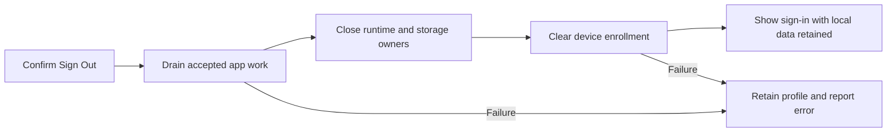

# iPhone host

Requires iOS 18 or newer on iPhone 13 or newer.

The public UIKit host runs the same v3 `Engine`, Wasm guest, kvdb records and local blob cache as the desktop. iPhone execution uses Wasmtime Pulley. The shell shows retained sessions above the New Session action, with account/recovery access at the top; guest views use native controls. Session invitations remain visibly pending remote availability. Closing the UI does not delete the session or its data.

## Build the host

Build both native compositions with `sh playbit/platform/ios/build-rust.sh aarch64-apple-ios`,
then build the `Archipelago` Xcode scheme. The script stages the lightweight provider
library, app library and version metadata together under `Generated`. For a simulator,
use `aarch64-apple-ios-sim`. Normal builds exclude the qualification initializer and
starter bundle. The app target embeds the signed `playbit-file-provider.appex`.

The default bundle identifier is `playbit.engine.debug` for Debug and
`playbit.engine` for Release. Set `ARCHIPELAGO_APP_ID` when building with your
own identifier. For device builds, configure signing for both the app and File
Provider extension using your team's identifiers, shared App Group and APNs
entitlements. Xcode compiles the macOS icon sources for the iOS app.

The Rust build emits `playbit-version.xcconfig` beside `libplaybit.a`. The
build script copies it to `Generated/Version.xcconfig` for the selected
library. The host reads its complete `PlaybitVersion` metadata from that file.

## Accounts, sessions and Files

The ordinary build supports runtime `public` and `testing` channels. Sign-in and
Account have an Environment menu; Testing remains visible in native navigation.
`PLAYBIT_CHANNEL` overrides the remembered choice at launch and accepts only those
exact names. Invalid explicit or remembered state prevents opening an account;
choose an environment to recover. Selection is remembered in the installation's
UserDefaults, independently of the replaceable application bundle.

Public uses `Library/Application Support/<bundle-id>`; Testing uses the separate
`<bundle-id>-testing` directory. Channel markers, identities, data, caches, logs
and recovery Keychain namespaces remain separate. Switching waits for admitted
actions and saved editor drafts, closes the old runtime on its existing worker,
then opens the selected profile. It does not clear either enrollment. A failed
shutdown keeps the previous selection and reports the error. The process panic
sink rebinds only after the old runtime owners have retired.
Process tracing cannot change profiles in place. Switching explicitly disables
it before any new account data opens and reports this in diagnostics; restart
Playbit to record in the newly selected channel. Old trace files remain in their
own profile, and a channel change cannot continue recording into them.

The typed `pb_ios_open` bridge receives the explicit channel (0 Public, 1 Testing)
and holds profile admission through runtime teardown. Unknown values or a
conflicting marker fail before account initialization.

Public accounts appear as one Playbit location in Files and document pickers, with
owned personal volumes as top-level folders;
iOS asks the user to turn on each new location. Blobs are ordinary files and databases
are canonical `.pbdb` identity references. Opening a reference checks authority and
selects that exact database in Playbit, including entries beyond a browser page.
App roots and Testing profiles expose no drives. The extension owns a separate
replica per account/domain in its private container, with credentials handed off through a protected
App Group; Files does not depend on a running app. Offline
access covers metadata and bytes already cached in that replica.

The host uses one UIKit window scene. Scene connection owns window creation and
cold invitation delivery; scene URL, foreground and background callbacks handle
subsequent links and the existing runtime resume/suspend path. Multiple windows
are disabled.

Open an invitation in Safari and choose **Open in Playbit**. The app retains it through email/code sign-in, private-key recovery, and cancellable downloads. Account sign-in and private-key recovery are separate: save the account key explicitly during setup, and supply it to unlock an existing backup. Email authentication alone does not unlock encrypted data. Personal volumes remain unavailable until mounted for the session. Authorized updates preserve the session, mounts and shared data; provisioning failures expose a retry action.

The signed-in Account screen shows the display name, email and account ID,
with separate recovery access and a confirmed Sign Out action. Sign-out drains
accepted app work before closing the runtime and removing this device's
enrollment. Local sessions, pending synchronization, blobs and recovery data
stay on the device. Failure retains the profile and reports an error. Signing
in to another account uses the existing explicit replacement decision.
The account ID uses canonical base58. Its row shows a shortened value with `…`
and copies the full ID when tapped, displaying “✓ Copied” for two seconds.



Distribution builds use the provisioned shared Keychain group `$(AppIdentifierPrefix)playbit`
for account-key synchronization with macOS. Use the same authorized prefix on both
platforms. Debug and ordinary Release configurations leave the capability disabled.
The local account key and recovery metadata always live together in `profile.kvdb`;
Keychain is an optional backup accessed by the account worker. Eligible sign-in and
recovery forms perform one lookup to fill untouched fields; the user must submit
sign-in or recovery. Missing or unavailable saved accounts leave manual entry usable.

## Local checks

The simulator fixtures build sample apps from source and run their UI tests
with isolated profiles. Export `SIMULATOR_ID` to the UDID of a booted iPhone
simulator, then run these commands from the repository root.

```sh
sh playbit/platform/ios/qualify.sh simulator todo
sh playbit/platform/ios/qualify.sh simulator shared-note
sh playbit/platform/ios/qualify.sh simulator ui-gallery
```

The TODO check verifies that a saved task survives process restart. Shared
Note writes Unicode text through the file API and reads it back. The gallery
exercises native UIKit controls. The simulator fixture uses its own app
identifier and seeds data only in an empty profile.

Run the Rust bridge tests after building the TODO fixture:

```sh
sh scripts/prepare-apps.sh
cargo rustc --locked --lib --crate-type cdylib --release --target wasm32-unknown-unknown -p todo
cargo test --locked --release -p playbit --lib platform::ios
cargo test --locked --release -p playbit ui::embedded
```

## Portable app surface notifications

The window owner sends the shared `SurfaceChanged` event after initial layout
and on geometry changes. Its 16-byte C ABI payload contains whole logical content
width/height, the window screen's pixel scale and touch/keyboard input bits.
The viewport is the scroll view bounded by safe areas and the keyboard; subtract
16-point outer insets and the host status/update rows above the guest. Guest
content height and scroll offset do not determine the reported viewport.

The owner retains one admitted value (at most 32 bytes of Swift state), suppresses
duplicates and retries rejected admission after existing queue progress/layout.
Surface requests use the same 32-request/2-MiB aggregate input cap and existing
serial worker. There is no timer, worker, data query or second request queue.
Opening/reloading and changing the resolved build reset the admitted value.
Suspended, hidden, opening and quitting controllers do not send geometry.

Row/column changes reuse the existing `UIStackView` and its identified controls.
The shared TODO therefore changes composer orientation while preserving the
native text field, first responder, selection and editor revision.

Run the Foundation-only payload/admission tests with:

```sh
. scripts/macos-env.sh
swiftc -target "$(uname -m)-apple-macosx$MACOSX_DEPLOYMENT_TARGET" playbit/platform/ios/Host/Identifier.swift playbit/platform/ios/Host/GuestInput.swift playbit/platform/ios/Tests/GuestInputTests.swift -o /tmp/playbit-guest-input-tests
/tmp/playbit-guest-input-tests
```

### Guest scene boundary

Rust validates the scene wire format before lending typed fields to UIKit.
Invalid control IDs, structure/depth, strings or Canvas bounds show
"The app scene is invalid. The previous view is retained." and stop frame
requests. Reopening accepts a fresh valid scene. Swift copies the validated
native fields, including Canvas text and frame policy, before reply destruction.
There is no intermediate JSON scene or second Foundation scene parser.

Run the native field and lifetime regressions with:

```sh
swiftc -O playbit/platform/ios/Host/Identifier.swift playbit/platform/ios/Host/GuestScene.swift playbit/platform/ios/Tests/SceneBridgeFixture.swift playbit/platform/ios/Tests/GuestSceneTests.swift -o /tmp/guest-scene-tests
/tmp/guest-scene-tests
```

Session artwork uses the actual bundle icon, decoded by the same restricted
PNG/JPEG/SVG decoder as desktop. A separate serial queue reads the local bundle
header/icon and produces a 120×120 premultiplied RGBA image for the 40-point native row. It
never acquires the Engine owner lock or performs network work. One pending
completion bounds memory even while UIKit is busy; cache entries are shared by
build identity and retired when no longer present. Missing local builds wait
for runtime availability. Invalid artwork reports a diagnostic while the session
remains usable. No-artwork bundles keep the native row's reserved image space.
