# Native engine embedding

Native and Wasm apps use typed source wrappers over `pb_syscall`, with an
explicit native context, u32 opcode and six u64 slots. Data operations use bounded
Begin/Take and readiness events. Handles contain u32 generation and u32 slot,
packed into one u64 argument. See the
[operation ABI](../../../playbit-api/src/abi/README.md).

**Scope:** local and connected engine embedding and native macOS execution are
implemented. `connected-engine` supplies authentication and AP replication without
a Wasm executor. The portable Mac launcher supplies account/session setup UI;
custom hosts supply their own UI. The existing iOS product still selects its Wasm
host; a separate native iOS example has not been qualified.

Portable Mac launchers delegate default profile and environment selection to the
runtime. `pb_mac_run_portable` accepts null with zero profile length to request
that selection; an explicit profile remains isolated. `PLAYBIT_CHANNEL` selects
public/testing and invalid values fail before sign-in. The source launcher no
longer chooses a fixed home profile independently of the linked runtime. The
local-only `pb_mac_run` continues to require a dedicated explicit profile.

Trusted engine management and app lifecycle interfaces remain separate from
this syscall dispatch boundary.


A trusted native host can open `playbit::engine::Services`, use its typed store
API and deliver committed-change notifications through its own event loop.
`Services::open` does not construct a VM, AP connection, process or IPC endpoint.
The shared engine composes these services with package validation, networking
and completion delivery. Interactive execution belongs to its renderer/embedding
owner.

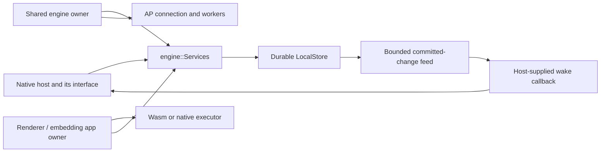

Build and test the independent command-line host from the repository root:

```sh
sh playbit/platform/native/build-engine-host.sh
target/native-services/engine-host /tmp/playbit-native-fixture
```

Use a new, dedicated profile directory. Enter `t` followed by Return to toggle
its one checkbox value and `q` followed by Return to quit. Reopen the same
profile to read the durable value. This fixture uses only synchronous writers
on the owner thread, so its notification flag is drained after each command;
there is no background producer blocked behind stdin. The test exercises two
independent profiles, notifications, durable reopen and closure with pending work.

The build script selects `local-store` for the library and links the caller
and its tests directly against that artifact. Ordinary workspace tests also
exercise the host, but unify development features and cannot establish the
absence of VM/network dependencies. Inspect the independent normal dependency
graph with:

```sh
cargo tree --locked -p playbit --no-default-features --features local-store -e normal
```

The callback must be bounded and nonblocking, schedule later work, and never
reenter storage synchronously. Drain at most the feed's per-turn limit, clear
coalesced readiness before draining, and handle closure or gap status explicitly.
A host with background writers must wake its event loop rather than rely on the
probe's synchronous stdin loop. Retire workers and release all store `Arc`s
before closing a profile; the last owner controls storage lifetime.

## Connected engine services

Select `connected-engine` to use `engine::connected::Connected` without an app
executor, renderer or process transport. It composes the same `Remote`, credential
recovery, publisher and subscriptions used by the existing product. Run network
methods on a network owner thread, independently of the UI and native app turns.
`open` performs no network request. Explicitly sign in or synchronize a retained
profile before expecting connected state.

The host supplies a coalesced wake and calls `advance` on readiness. Drain
`take_notices` to observe durable incoming changes and replica failures. After an
error, retain its message and inspect `wake_after` for a bounded reconnect retry;
never replace this with a periodic synchronization timer. `stop_handle` can wake
a blocked network operation from the host thread. Collect the admitted operation
before joining/dropping, because a late enrollment response can contain issued
credentials that must be persisted.

The AP publisher owns the store's sole committed-change receiver and its existing
internal Unix readiness socket pair. This is not an IPC listener. A host must not
take that receiver; it observes its own local edits directly and incoming changes
through replica notices. `Services::create_session` retains the corresponding
Wasm package for other devices to execute without constructing a VM locally.
Executor-specific admission remains the responsibility of the app host.

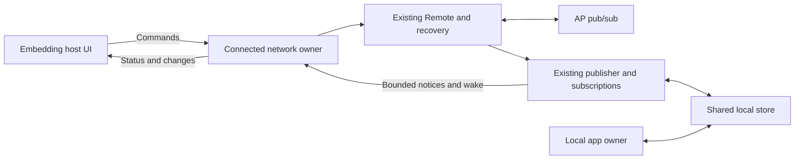

Check the independent composition:

```sh
cargo clippy --locked -p playbit --lib --no-default-features \
  --features connected-engine --no-deps -- -D warnings
cargo tree --locked -p playbit --no-default-features \
  --features connected-engine -e normal
```

The private real-AP test `service/ap/tests/connected_engine.rs` enrolls this owner,
creates a TODO session, joins it with the ordinary Wasm engine, and checks edits
in both directions through live subscriptions. It uses isolated profiles and a
local test AP. Build the TODO Wasm fixture, then run it from `service/ap/` with
`cargo test --locked --test connected_engine`.

Native app hosts can use `engine::native::Apps::attach_session` with the retained
session ID, matching package, native callback descriptor and connected blob
transport. The host vouches that its trusted callbacks implement that package.
Attachment checks the package ID and current root admission before callbacks.
Each turn revalidates the retained binding and refreshes personal-volume consent;
root denial stops execution without replaying queued input. Feed incoming replica
notices into `Apps::received` on the serialized app owner. Local commits invalidate
other attached readers directly, including commits made before a callback fails.

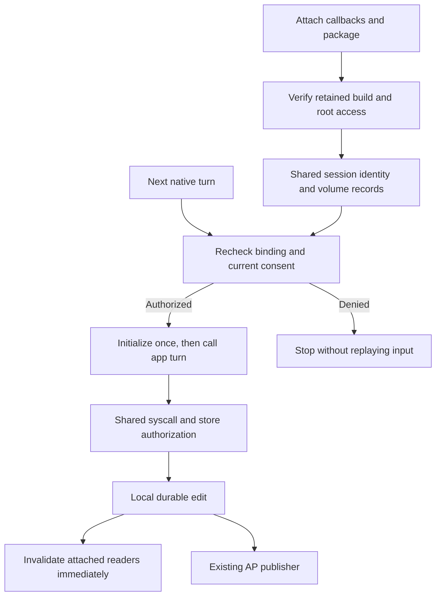

The installed native Mac launcher uses this session attachment API with standard
sign-in, recovery and session-selection UI. Build apps with `pb build --native`
as described below. The integration test executes the real native TODO callbacks
and the Wasm TODO in the same AP-backed session; packaged UI and latency checks
remain separate qualification work.

## AppKit-owned host UI

On macOS, build and launch the separate custom UI example:

```sh
sh playbit/platform/native/build-engine-ui.sh
target/native-services/LocalLists.app/Contents/MacOS/LocalLists /tmp/playbit-local-lists
```

Supply an absolute, dedicated profile directory. The window opens two independent
engine profiles in its `first` and `second` subdirectories. Toggle either checkbox,
quit, and reopen the same directory to recover both values. AppKit owns the window,
controls and event loop; the linked Playbit library selects only `local-store`.
There is no app executor, Playbit renderer, networking or IPC service.

The example reuses the tested Rust embedding fixture through a private C bridge
in `engine-ui/host.rs`. Its `fixture_*` symbols are host-specific implementation
details, not additions to the public app syscall ABI. All store writers run on
this example's main thread. Its wake callback coalesces a later main-queue turn;
that turn clears readiness, drains bounded committed changes, reads the durable
value and updates the controls. Each profile admits one outstanding UI edit.
Shutdown disables queued users before releasing the profiles. Hosts introducing
background writers must supply a thread-safe scheduling callback of their own.

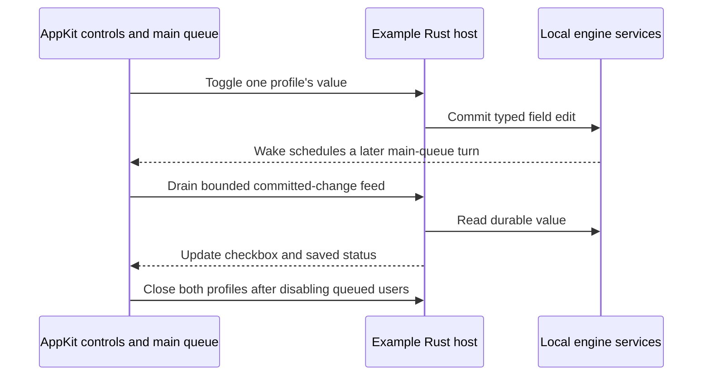

The executable writes JSON timing records to stdout: edit action entry through
commit, notification delivery, readback and control layout; startup main entry
through the first display request. Neither measures physical presentation.
The build runs the fixture's independent-profile, persistence, teardown and wake
rearming tests against the same separately built release library. Retain measured
GUI and artifact evidence outside the checkout.

## Compositions

| Feature | Concrete caller |
| --- | --- |
| `local-store` | Trusted local engine embedding; desktop durable backend |
| `network` | AP protocol/client consumers, including the AP service |
| `native-runtime` | Cooperative native executor and scoped C app operations |
| `wasm-runtime` | Wasmtime execution and runtime conformance/fuzz callers |
| `app-host` | Connected Wasm supervisor with in-process ownership |
| `process` | CLI, engine executable, MCP and other Unix process tools |
| `native-ui` | Shared native presentation/input types |
| `desktop-ui` | Shared GPUI scene renderer, controls and text input; no app executor |
| `desktop` (default) | Existing Mac product |
| `ios` | Existing iOS library and UIKit bridge |
| `artwork` | Package artwork decoding/rendering |

These are current compositions, not a promise that every combination runs on
every target. The local store still uses desktop filesystem persistence. Native
app execution and the local C engine/app APIs are described below. Host-driven AP orchestration independent of the Wasm supervisor remains subsequent
work. This Rust probe is a
trusted host with direct management access; it is not the scoped portable app API.

## Runtime host ownership

`runtime::host::Host` does not require `Send`. `NativeInstance` is bound to the
thread that constructs it; callbacks, syscalls and destruction run there. A host
can directly retain `Rc` state or the single-owner flash database. Do not move
an active instance or pass its context to another thread. The native entry rejects
foreign-thread calls before locking or accessing app state.

The desktop engine's worker constructor accepts `Box<dyn Host + Send>` because
it transfers that host to its worker. It creates and retains runtime state on
that worker. Callers supplying a host directly on its final owner thread need
no transfer capability. This is a Rust ownership constraint; the C ABI is unchanged.

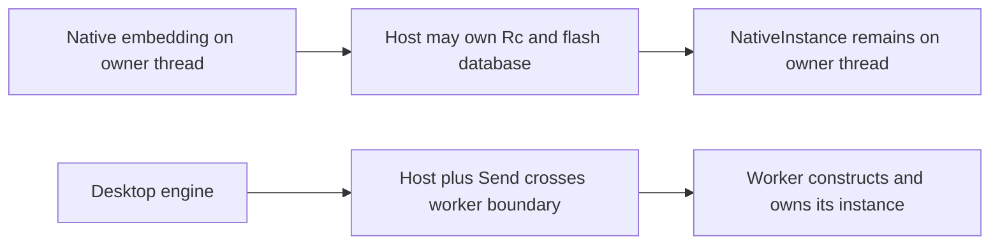

## Host-owned app completion

The connected Wasm supervisor also accepts host delivery:
`Engine::open_with_wake(profile, callback)`. The callback can run on any worker
thread. It must be bounded, nonblocking and nonpanicking, and only schedule a
later owner turn. It must not call back into or drop the engine synchronously.
`EmbeddedOwner::advance(..., completion=true, ...)` then collects existing
bounded result mailboxes. Clear the host's own scheduled flag before advancing;
publication during collection must schedule another turn. Arm `Step::wake_after`
for actual guest deadlines or already-ready work, never a periodic freshness
check. Serialize engine/owner calls on the host's worker or event-loop thread.

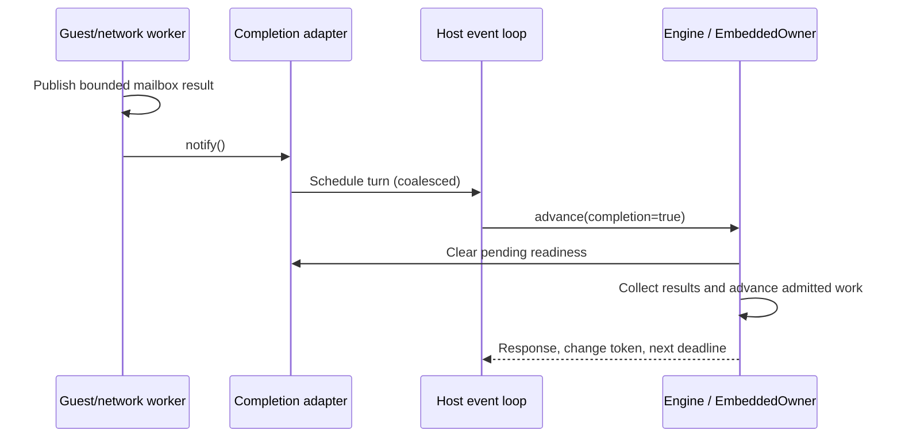

Callback mode creates no completion socket; `completion_socket()` and `wake_fd()`
return `None`. Existing Unix process/iOS owners use `Engine::open`, register the
returned socket and follow the same collection path. Connected store publication
still has an internal Unix feed adapter, and this supervisor still constructs
Wasm/network machinery. The services-only composition above remains the way to
embed local data without those dependencies.

On shutdown, stop submitting requests and call `poll_shutdown()` once, then
again on each completion wake until it returns `true`. Keep the engine alive
while it returns `false`: enrollment must finish saving issued credentials.
This method never waits on a descriptor. It establishes return of background
network ownership, not a general guest-worker join. `shutdown(bound)` is the
blocking Unix process adapter and explicitly rejects callback mode.

Dropping the engine disables its completion callback and waits for an executing
callback before releasing its captures. Retained worker senders cannot invoke
or retain those captures after engine destruction returns. Keep the host event
loop resources valid through destruction, and cancel any already-queued host
turn before releasing its engine reference; callback retirement cannot retract
a task the host itself already queued.

## Native app runtime probe

These independent consumers link the selected release library without Cargo's
workspace dev-dependency feature unification. Run from the repository root:

```sh
sh playbit/platform/native/build-engine-host.sh
sh playbit/platform/native/build-runtime-probe.sh
# Optional optimized CPU diagnostic; excluded from ordinary tests:
target/native-runtime/runtime-probe --ignored --nocapture
```

The engine host opens local services and persists edits without app execution.
The runtime probe links an ordinary C17 app and a Rust SDK app through the scalar C syscall entry. It exercises two instances, event delivery, a checkbox scene,
callback failure and destruction, malformed outputs, and callback thread checks.
With `native-runtime,local-store`, the durable consumers use the production
`InProcessHost` around `DataHost`. Guest callbacks Begin, return and Take on
exact readiness events; the fixture driver waits outside callbacks. They cover
schema bootstrap, projected pagination, C/Rust checkbox commits, explicit peer
invalidation, accepted edit/readback drain after deactivation and durable reopen.
Idle frames retain their prior snapshot. `DataHost` owns the same
principal-bound local operations used by the connected Wasm host, independently
of that host's AP-backed file transport.
The C compiler checks the installed header; the probe compares its record layouts
with Rust. The scene is decoded and inspected in memory; no window is created.

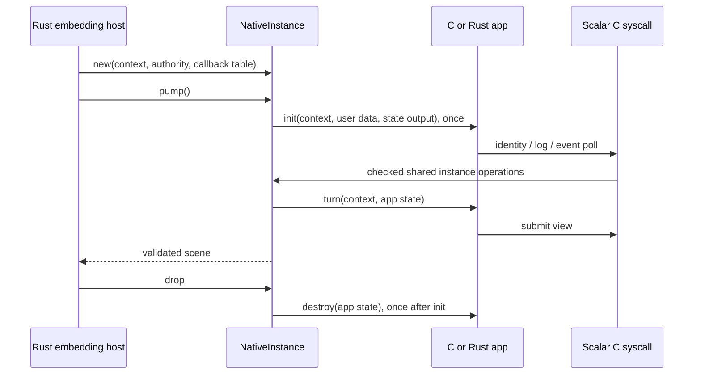

`native-runtime` selects the cooperative executor with no VM, network, process
transport, renderer or desktop storage backend. Native callers share the process
and must return cooperatively; they have no Wasm trap or fuel isolation. The host
owns the instance and its thread. Raw pointer allocation validity and lifetime
are explicit C obligations; structural range checks do not make arbitrary native
pointers safe. The safe Rust context borrows a valid callback context and slices.

This is phase 3 work in progress. Implemented operations are log, identity,
event polling, view submission, wake scheduling, update deferral, available-volume
enumeration, schema read/establishment, object create/read/edit, paged queries,
capabilities, startup arguments, presence, bundle File reads and file
reads/writes, pending creation/copy/selection, and authenticated field reads. Result fields/values and bytes occupy
caller-owned arrays; a short result reports required counts without changing the
arrays. Typed Rust methods borrow inputs/results without request encoding or SDK
allocation. All registered native operation adapters are present. Production Wasm and web apps
use the single scalar dispatch import, `pb_syscall`. The universal byte-envelope transport has been
removed. Native window composition and project scaffolding are described below.

The original control probe uses synthetic authority and volatile C state. The
data probe uses dedicated temporary profiles. The C app can establish its own
Boolean schema, create its initial object and discover it after reopening; the
Rust SDK probe also establishes all schema value types and pages projected data.
Both use the shared checked persistent operations. Neither creates a native
window or provisions an ordinary portable app.
The operator timing tests report volatile/durable turns and small/maximum
metadata reads separately.
Durable timing includes read/commit/readback through validated CPU scene; both
exclude the renderer, scanout, OS launch and competing workloads.

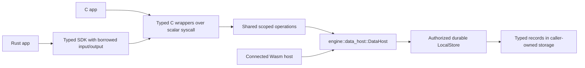

The environment probe reads the same host-supplied context through C and the Rust
SDK, including per-instance resources and changing participants. It checks empty
and maximum-sized results, independent instances, short retries and rejected
output aliasing. Bundled files are discovered through `volume.list` with `PB_VOLUME_BUNDLE`
and read using the asynchronous File API.

The file probe validates C and Rust begin/take against a controlled memory host,
then sends durable writes through `InProcessHost` onto production `DataHost`
workers. The guest callback never commits storage itself. C and Rust writes
survive store reopen; mount and current-principal denials preserve acknowledged
content. It checks 1-MiB writes, 64-KiB retained read chunks, stale/unsupported
access, malformed outputs and host results. In-process owners have independent
interactive-read, ordered-mutation and bulk-read lanes. Connected reads use the
existing blob transport; local cached reads use the authoritative store. These
consumer tests do not qualify uncached remote transfer or device storage.

The pending-operation probe drives C and Rust begin/poll pairs against a
controlled local host. Pending work is bounded to 64 operations per instance;
ready events carry a generation-scoped handle decoded by `Event::operation()`.
Use those notifications to schedule polls. A canceled selection is
`Completion::Ready(None)`; it never grants a mount. Terminal polls consume their
handles and queued readiness notices, while WouldBlock retains them. Fixed
outputs must be admitted before any start or consumption. These adapters do not
install workers, open a native picker, or make an unsupported host advertise
creation/copy/selection capabilities.

Authenticated field reads return values, revision and provenance from one host
snapshot, with separate absent/tombstone/present states. A size retry does not
reuse old authorization or cached metadata. Unproven fields have no author;
rekey provenance names a rekey writer, never the original editor. The conformance
host tests these semantics and malformed snapshots; production data hosts still
return Unsupported because they do not advertise verified field reads. These
regression checks are separate from any cryptographic verification performed by
a capability-providing host.


## Wasm C/Rust ABI conformance

Run `sh playbit/platform/native/build-wasm-probe.sh` from a checkout with Rust's
`wasm32-unknown-unknown` target and LLVM 22 or newer, with `clang` and `wasm-ld`
on PATH.
The script builds both fixtures independently and executes them through the
Wasmtime Pulley interpreter against an import observer. The ordinary test suite
leaves this compiler-dependent test ignored; the script explicitly runs it.
The macOS CI job installs LLVM and LLD and runs this script before the workspace
tests. The hosted Linux web job independently compiles the fixtures using
`sh playbit/platform/native/build-wasm-probe.sh --build-only` and LLVM 23.
The web scalar-binding tests consume these C and Rust fixtures, so they also
require this preparation when run locally.

All 40 operation wrappers must lower to the single scalar import with identical argument bits,
including high-bit u32/u64 values, pointer offsets and flattened handles. The
observer verifies that rejected context/reserved-handle calls never reach it.
The safe Rust `Context::guest(&mut state)` adapter returns a context and encoder;
its event prepass and typed operations are also exercised. Record size, alignment
and field offsets from both compilers must match
the 205 entries in `wasm-probe/layout.tsv`. No generator participates in the build.

This test does no engine work and dereferences no guest arguments. Its marker
pointers/counts exist only to check lowering, not to model valid app requests.
It does not qualify host memory validation, guest authority, native/Wasm UI parity
or board performance. Production Wasm and web callers use these same scalar imports.

The script also compiles `memory-app.c` and `memory-app.rs` and runs them through
the checked Wasm operation adapters on native Wasmtime and Pulley. These apps
use actual C records and safe Rust SDK methods for identity, object creation and
editing, with returned-ID checks. Production adapters and packaged apps use the scalar imports; this compiler
probe separately checks their C/Rust lowering and memory contracts.

For the new boundary's CPU timing, run:

```sh
cargo test --locked --release -p playbit --features native-runtime --lib \
  runtime::wasm::operations::tests::named_import_creation_cpu_timing \
  -- --ignored --nocapture
```

This measures 1,000 calls with a 4-KiB field against a controlled in-memory host,
after 100 warmups. Compilation, storage, networking and rendering are excluded.

`result-app.c` and `result-app.rs` extend the compiler probe to the qualified
metadata and data imports: capabilities, startup arguments, participants, volumes,
object fields, file chunks/write/readback and packaged resources. The Rust
consumer validates them through the safe SDK. Both consumers run on native
Wasmtime and Pulley against a controlled host; no durable-store or UI qualification
is implied.

For the 4-KiB object-read CPU baseline, use the same optimized test command with
`runtime::wasm::operations::result_tests::named_object_read_cpu_timing`. It measures
1,000 imports after 100 warmups, including a cloned host snapshot, output admission,
record/byte copies and return. Storage, networking and rendering remain excluded.

`schema-app.c` and `schema-app.rs` establish and read a schema through the same
qualified imports, checking reference identity and repeated/deprecated flags.
They run on both backends as part of `build-wasm-probe.sh`; the Rust consumer
uses borrowed safe SDK declarations and result views.

`query-app.c` and `query-app.rs` consume a projected two-object page and verify
its continuation cursor and global field/value ranges. The same script executes
both independently compiled modules on native Wasmtime and Pulley.

`pending-app.c` and `pending-app.rs` start and complete object creation, file copy
and selection, checking scoped handles and result identities through all six
imports. The compiler probe uses controlled immediately ready results; the Wasm
boundary tests separately exercise WouldBlock, readiness, invalid outputs,
cancellation, revocation and exactly-once consumption on both backends.

`authenticated-app.c` and `authenticated-app.rs` read values, revision and
provenance from one controlled snapshot. With these consumers, the compiler
script exercises every named operation on native Wasmtime and Pulley. Production
callers use the same scalar dispatch boundary. Keep regression/UI
qualification separate from these compiler-controlled fixtures.

## Trusted C engine host

[`playbit/engine.h`](../../include/playbit/engine.h) exposes the concrete local
services composition to a native C host. It is distinct from the scoped app
operations in `playbit/sys/abi.h`. Build and exercise a pure C executable:

```sh
sh playbit/platform/native/build-c-engine-host.sh
```

The script builds a static library with only `local-store`, links the C compiler's
output directly against it, and compares C/Rust record layout measurements. Its
two temporary profiles are printed and retained. The probe creates local volumes,
drains notifications, closes with pending changes, and reopens durable identity
and metadata; it also tests independent profiles, wrong-thread calls, reentry and
invalid outputs. Its timing report is CPU/local-storage evidence, not UI latency.
The link map is `target/native-c-engine/link.map`.

Hosts that attach native app callbacks must marshal asynchronous data-worker
wakes to their owner event loop. Wake may overlap another wake; retain thread-safe
notification state through close. Guest callbacks run only when the owner advances
them. The C app probe uses a coalesced condition wake and no worker polling.

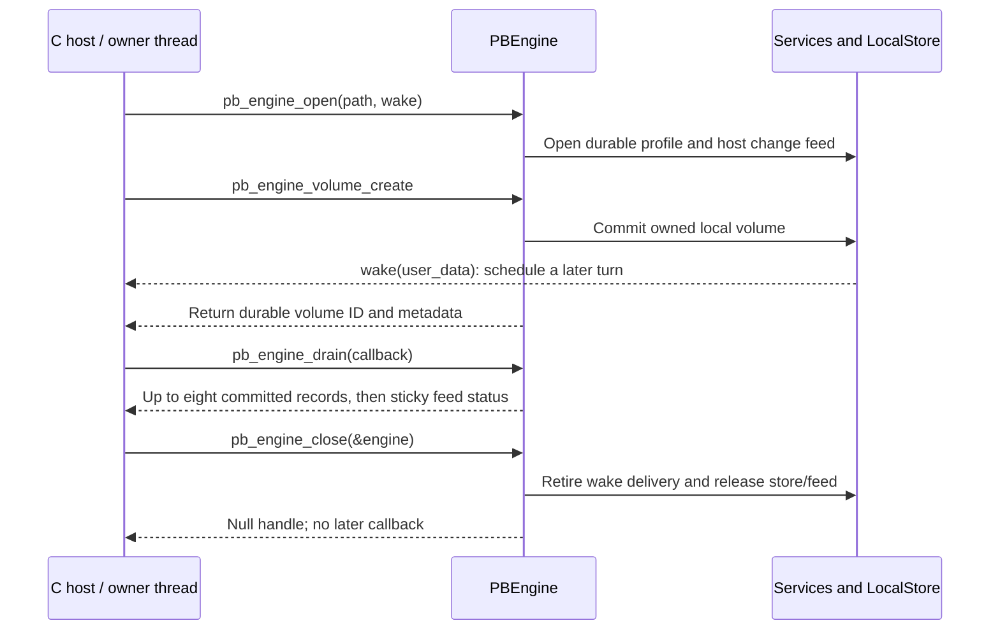

Keep the engine on its opening thread. Wake and change callbacks must not unwind;
only schedule later work from wake. Clear the host's scheduled flag before draining.
The same-engine calls attempted from either callback return `PB_CONFLICT`.
Drain status distinguishes an empty queue from a gap or closed feed; recover a gap
by reading durable state. Drained payloads keep their budget credits until their
callbacks finish, and `remaining` excludes that consumed batch. No polling timer,
extra queue, worker, socket or helper is introduced.

All input/output storage obeys the header's native borrowing contract. Structural
checks cannot validate arbitrary native addresses. A successful close consumes the
handle, so copies become invalid; synchronize destruction with all uses and retain
callback data through close. A failed open leaves the output unchanged; native
internal invariant failures follow the engine's crash policy. Local metadata
operations are not AP enrollment/publication, remote durability or app execution.
The local native app composition below adds scoped app execution. The native
window remains the next composition step.


## C host with native apps

Build the engine and scoped native executor into one C executable:

```sh
sh playbit/platform/native/build-c-native-host.sh
```

[`playbit/native.h`](../../include/playbit/native.h) adds attach, detach, input,
advance and readiness to the engine handle. The host owns its event loop and
renderer; the app receives the same scoped `PBContext` and named operations as
other native apps. `engine::native::Apps` supplies the corresponding Rust owner.
No VM, IPC endpoint, background worker or network connection is created.

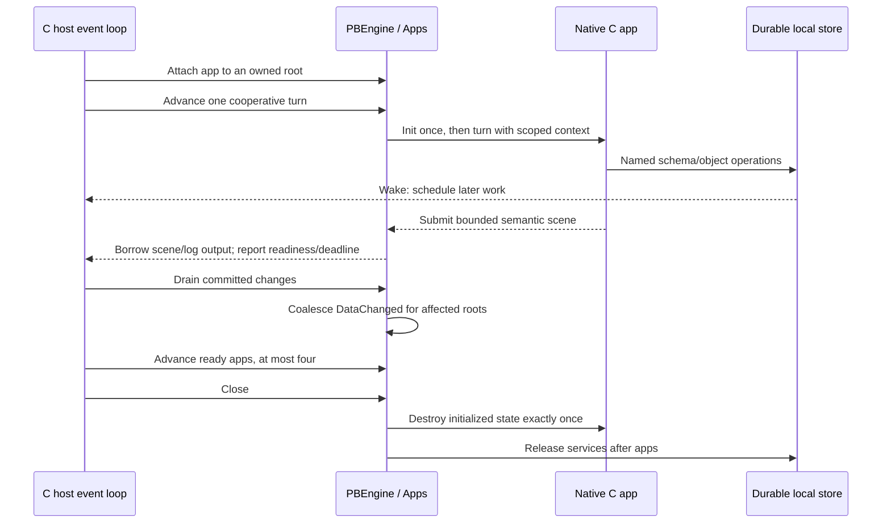

Each engine admits four apps, each retaining the existing bounded runtime state
and at most one accepted semantic scene. Encoded output is borrowed during its
callback and released after that turn. Input must name an enabled control in the
current scene and the live generation; system-event injection is rejected. The
host serializes turns and arms actual app deadlines. Clear coalesced host readiness
before draining; then advance ready apps and schedule another turn if necessary.
A full input queue drains before a deferred data notification is retried. New feed
gaps trigger one refresh; repeated sticky status never makes an idle app spin.

A failed callback halts that generation without replay, even if it committed data
before returning an error. Detach or close destroys its initialized state once.
Close suppresses wake delivery, destroys apps while reentry is excluded, and then
releases storage. Callback code and user data must remain live through destruction.

The probe links a C host and C app directly against the static library. Its only
Rust helper generates fixed packed scene fixtures and compares C/Rust record
layouts; it is not part of the running host. Four apps share durable data in one
engine while a second engine remains independent. The probe checks failed init,
callback reentry, rejected outputs/inputs, capacity/stale handles, committed-change
scheduling, destruction and exact data reopen. It measures 1,001 commit/feed/scene
turns with four active apps. This is CPU/storage evidence, not a graphical window
or physical presentation result. Profiles and the link map are retained.

This local composition has an owned root and no session, package resources or AP
transport. Unsupported capabilities fail explicitly. The native Mac composition below demonstrates shared Mac/Wasm window parity.


## Shared Mac renderer

`desktop-ui` builds `playbit::ui::desktop` independently of the engine, Wasm and process
features. Both desktop Wasm windows and the native-window composition use this
module. Controls, theme/font
constants, text editing/accessibility and canvas pointer/frame semantics have one
implementation.

`scene::Scene` owns bounded controls, text drafts and stable accessibility IDs.
The host owns the accepted `ViewNode`, generation/session identity and delivery
failures. Apply an accepted view with its actual text `InputAck`, then render by
borrowing that view. A `SendInput` callback receives typed input and optional draft
revision; the separate control activation callback lets the host flush retained
drafts and admit a click with its transport's existing failure handling. Neither
callback chooses an engine or opens a transport. A new scene or unrelated button
response must not acknowledge an unaccepted local text edit.

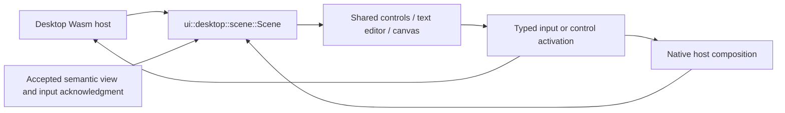

Selecting `desktop-ui` alone builds the renderer. Native Mac apps built with
`pb build --native` compose it with services and the native app owner.

## Shared TODO application source

`guests/todo/src/app.rs` owns the example's state, typed operations and responsive
scene. `lib.rs` registers the app with `playbit_api::app`. The SDK supplies the
Wasm entry point and native init/turn/destroy callbacks, with one owned allocation
per native instance. The runtime receives the callback descriptor and root
declaration without interpreting TODO schema fields.

```sh
sh scripts/prepare-apps.sh
cargo rustc --locked -p todo --lib --crate-type cdylib --release --target wasm32-unknown-unknown
cargo test --locked -p todo --tests
```

The parity tests compare the same source through both adapters on 1/32/64-row
roots, including edits, rejection and durable reopen. A separate four-instance
native test exercises shared data and independent drafts through local services.
Native app builds use the standard `pb build --native` workflow below.


## Native Mac host ownership

`ui::desktop::native::run` accepts a worker-side preparation callback returning one to
four `Launch` records: a title, an owned root and a native C app descriptor. Its
unsafe contract requires the caller to retain callback code/user data through
worker teardown. Provisioning and app registration belong to the caller; the host
does not select a program or alter its declaration. Hosts with their own UI can
use `engine::native::Apps` or `playbit/native.h` directly. Install a panic policy
before starting engine work. Ordinary app projects use the installed launcher
through `pb build --native`.

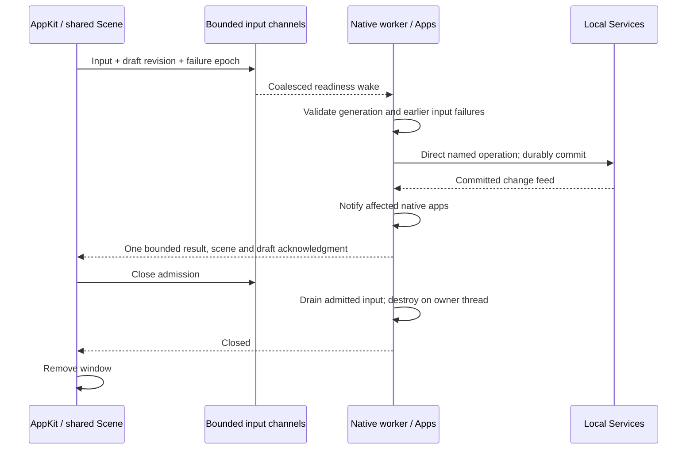

One worker serializes all app callbacks. Eight queued inputs per
app, each at most 64 KiB, bound aggregate input payloads to 2 MiB for four apps.
One pending result applies backpressure on the worker. Each app retains its
accepted scene for input validation; the UI receives one owned scene copy. Recent
logs are capped at 256 lines/64 KiB per window and available from the Window menu.
Input and store readiness wake the worker; only actual app deadlines use a timed
wait. Canvas animation follows display callbacks with one outstanding frame.

Window close drains admitted input before destroying the app and acknowledging
closure. Application quit closes input admission and waits for the worker's drain
result before AppKit approves termination. Drain failures remain visible and
prevent termination. Native apps must cooperate and return from callbacks; slow
callbacks or storage can delay quit. Effectful inputs invalidated by an earlier
failure are reported, never replayed automatically.


## Host platform from portable apps

`Context::host_platform()` queries the runtime host. An app compiled once for
wasm32 can therefore identify the native Mac or iOS runtime that executes it:

```rust
use playbit_api::context::{Context, HostPlatform};

fn is_mac_host(context: &mut Context<'_>) -> Result<bool, playbit_api::abi::syscall::Error> {
    Ok(context.host_platform()? == HostPlatform::MacOs)
}
```

C uses `int32_t pb_host_platform(PBContext *)`: nonnegative `PB_PLATFORM_*` on
success or a negative status on failure. Wasm lowers it to opcode `0xc` through
`playbit.pb_syscall`, with zero argument slots; authority remains the import caller.
Capability discovery includes `host.platform` on native, Wasm and web hosts.
The web host reports `Web` even when its OS is macOS or iOS. `Other`
is an explicit platform classification; it is not a failed call. The safe SDK
rejects invalid enum values as an internal error.

This identifies the host platform, not its surface size, input facilities or
memory capacity. Those require their own supplied host state.


## Query limits for portable apps

`Context::host_limit(HostLimit::QueryRecords)` returns the instance's maximum
requested page size; `QueryValueBytes` returns the aggregate logical value payload
ceiling. C calls the inline `pb_host_limit(ctx, PB_LIMIT_QUERY_RECORDS)` or
`PB_LIMIT_QUERY_VALUE_BYTES` wrapper. Both use opcode `0xd` through the existing
`pb_syscall`; unknown kinds return `Unsupported` without adding ABI symbols.

Embedders select smaller limits with `Host::query_limits()`, captured before app
callbacks. Oversized row requests fail before host query work. Oversized host
results fail before output copies. Hosts must separately admit their workspace
before allocating results; these limits do not claim to bound total heap use.
Desktop/web keep 64 records and 1 MiB. Bounded embedding fixtures exercise eight
records and 8 KiB. Discover support for `object.query.begin` and `object.query.take` separately, page through the
returned cursor, and honor `BufferTooSmall` rather than assuming every row fits.
See the [ABI contract](../../../playbit-api/src/abi/README.md#host-resource-limits)
for byte accounting and failure semantics. TODO adapts its query buffers and
paging to these limits. `HostLimit::ViewBytes` (C: `PB_LIMIT_VIEW_BYTES`) reports
the complete encoded-scene limit. Embedders select it with `view_bytes_limit()`;
Embedding fixtures exercise 8 KiB and desktop/web use 1 MiB. Scene-byte admission
precedes decoding; renderer feature, node and text limits remain separate.

## Surface changes and responsive layout

Mac native/Wasm windows and the iOS host deliver `EventKind::SurfaceChanged` (C:
`PB_EVENT_SURFACE_CHANGED`) through the existing event queue, initially and when
viewport size, pixel scale or input facilities change. Target is zero and
`object_id` identifies the originating guest window. Decode
its exact 16-byte payload with `Surface::decode(event.data)`; retain the returned
value in app state. There is no geometry polling or new syscall. An embedding
host supplies the same event through its existing app-input function.

```rust
use playbit_api::{abi::syscall::{Error, EventKind}, context::{Event, Surface}};

fn update_surface(current: &mut Option<Surface>, event: Event<'_>) -> Result<(), Error> {
    if event.kind == EventKind::SurfaceChanged {
        if event.target != 0 {
            return Err(Error::InvalidArgument);
        }
        *current = Some(Surface::decode(event.data)?);
    }
    Ok(())
}
```

Width and height are whole logical units available to app content. The default
viewport excludes host chrome and padding. A root canvas with
`CanvasExtent::Window` receives the full drawable window dimensions.
`pixel_scale` is physical pixels per logical unit and
must be finite and positive. Zero dimensions mean no visible area. `inputs`
contains only `Surface::POINTER`, `KEYBOARD` and `TOUCH` bits. The C `PBSurface`
layout is four little-endian words: width, height, IEEE 754 binary32 scale bits,
input bits. Copy/decode bytes rather than casting potentially unaligned event
storage to a struct pointer.

The shared Mac renderer measures the selected extent after layout, independent
of scroll content, and retains only its last admitted surface. Failed admission
leaves it unsent for a later eligible layout. Recovery and app replacement reset
the remembered value. Existing input queue bounds and error behavior apply.
The TODO keeps its draft and task controls while arranging input/Add vertically
below 480 logical units and horizontally otherwise. A surface change does not
query or edit data.
The app uses the wide layout before its first surface event.

The iOS host measures its safe-area/keyboard-bounded scroll viewport, subtracts
the status/update rows and outer insets, and supplies touch/keyboard input bits.
It retains the native editor when a container changes between row and column.
The web host reports its guest content viewport and browser input capabilities.
Surface events do not promise delivery before the first app turn: the Mac host
needs an initial view to lay out. The measured four-window resize path currently
exceeds the <8-ms readiness target; ordinary task clicks remain below it in the
recorded workload.

## Standalone Mac C SDK

`playbit/mac.h` supplies `pb_mac_run` for one statically linked app using the
shared Mac renderer and a dedicated local profile. It takes bounded UTF-8
profile/title strings, a single ordinary Root declaration (the source role map is projected by the probe builder), and a
`PBApp` callback table. Call on the process's main thread. App callbacks execute
on the existing native worker. The host creates a random root once per profile;
reopening preserves its ID and user edits and establishes compatible schema
additions in existing databases. Missing required entries, incompatible schema
changes or unrelated preexisting volumes are errors. See
[root creation and reopening](../../../docs/root-initialization.md).

This entry owns the standalone application's AppKit lifecycle: ordinary Quit
joins the worker, destroys app state, and exits the process. Use `atexit` for
final process cleanup; do not rely on code after the call running on normal quit.
Admission/startup failures can return a `PBStatus`. App/storage errors after
launch use the host's error window. For embedding into an existing app with its
own UI and event loop, use `playbit/engine.h` and `playbit/native.h` instead.

Build the arm64 macOS 15+ SDK on an arm64 Mac:

```sh
sh playbit/platform/native/build-sdk.sh
```

The output `target/native-mac/sdk/` contains C headers, licenses, and
`aarch64-apple-darwin/{libplaybit.a,link.json}`. Link the archive plus the system
framework/library arguments from `link.json`; its `minimum_os` applies to the
consumer too. This concrete SDK includes local persistence and the Mac renderer,
with no VM, process transport or implicit AP connection.
The installed archive is capped at 64 MiB separately from the 512-KiB app-source
budget. It is not copied into source projects.

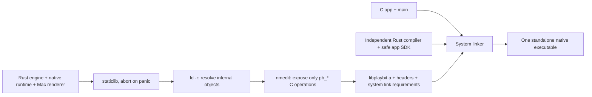

The SDK's Rust implementation symbols, including its standard-library allocator
and panic machinery, are private. The app and SDK retain ownership of their own
allocations across the C boundary. Consumers do not link an engine `.rlib` or need
the engine's Rust compiler version. The builder uses Xcode's `ld`, `nmedit`, and
`libtool`; it does not require an additional LLVM installation.

These are low-level SDK conformance probes; ordinary app builds use
`pb build --native`. Build the signed probe consumers with Python 3.11 or newer
and already-installed stable and nightly Rust toolchains. Supply a standard Cargo
app project with `Cargo.toml` and `playbit-volumes.json`. Run `pb meta-gen`
first when the app includes generated trace constants. The builder uses the
app's library path, including the `src/app.rs` layout created by `pb init`, and its
exported `playbit_app` registration. The library path and source files must live
inside `src`. The source tree must be self-contained and compile against
`playbit-api` without other Cargo dependencies. The destination must be new and
outside the checkout, app project and SDK:

```sh
python3.11 playbit/platform/native/mac-probe/build.py /path/to/app-project /tmp/playbit-sdk-probes
/tmp/playbit-sdk-probes/c-app.app/Contents/MacOS/c-app /tmp/c-sdk-profile
/tmp/playbit-sdk-probes/rust-stable.app/Contents/MacOS/rust-stable /tmp/rust-sdk-profile
/tmp/playbit-sdk-probes/rust-nightly.app/Contents/MacOS/rust-nightly /tmp/rust-sdk-profile
```

The builder copies the public app SDK and supplied project's source tree, title
and root declaration, then denies checkout reads and outbound IP while
compiling/linking. The Rust app is compiled as its own crate with each toolchain
and linked to the supplied C SDK. The project owns its schema and seed workload;
the builder preserves its declaration. A later compatible declaration may add
schema fields without replacing the profile's data or its original seeds.

The C consumer uses the public headers and a synthetic checkbox fixture. It
checks failed admission before launch and exactly one initialization/destruction
at normal process exit. Its UI fixtures are generated from the public app SDK;
query/read/edit calls use Begin/Take and render an Opening state or a disabled
Updating checkbox until readiness. Idle frames do no storage I/O. All linker
warnings are errors.

The Mac package includes this SDK at `Playbit.app/Contents/Resources/native-sdk`.
Both debug and release app packages carry the optimized static library. Set
`PLAYBIT_NATIVE_SDK` when running the probe builder to test an installed copy
instead of `target/native-mac/sdk`. The SDK is a sealed bundle resource; desktop
startup does not load it.

New `pb init` projects include a native Cargo target:

```sh
pb build --native --release
open "target/release/my-app.app" # use the app name from playbit.toml
```

`pb build --native` prepares the installed launcher and SDK before running Cargo;
the application has no build script. Root initialization and trace declarations
come from `playbit.toml`. Generated Rust, the compiler response file, and the
matching release Wasm package live under `target/playbit/`. The response file
links the SDK only into the final native binary and preserves Cargo flags.
The paired Wasm command runs in its own target directory before native Cargo
starts. A failed paired build preserves the previous executable. The CLI discovers
its adjacent SDK or uses `PLAYBIT_NATIVE_SDK`; `pb sdk-path` exposes that installed
path for other build systems. These commands do not start an engine. The
source volume namespaces the default profile. `pb build --native [--release]`
runs `[native].build_cmd` or `[native.release].build_cmd`, then packages the linked
executable as a locally signed `target/debug/<Name>.app` or
`target/release/<Name>.app` with the configured name/icon and licenses.
`pb bundle --native [--release]` packages without compiling. Both are local CLI
operations and do not start the engine. First launch signs in and creates
or joins a session; later launches retain it. The paired portable package is uploaded
for ordinary Playbit runtimes, never executed by the native host. See
[native app development](../../../docs/developing-apps.md#native-mac-apps) for profile/update rules.
`scripts/test-packaged-workflow.py --native` checks both generated build paths and failed
build retention, copying the package outside the checkout before denying source
reads. It does not launch or qualify GUI interaction.

### Connected native Mac ownership

Rust embedding hosts can use `ui::desktop::native::run_connected` with
`native-runtime,connected-engine,desktop-ui`. Its preparation callback receives the
connected engine on the network thread; it must enroll or restore the profile and
select retained sessions. Return `SessionLaunch` records containing each session
ID, its exact distributable `Package`, and the corresponding trusted callbacks.
The application then runs on an independent app worker and displays network
status in the window. This API does not supply sign-in or session-selection UI.
The installed Cargo launcher calls `pb_mac_run_portable`, the C entry point for
this connected composition with standard account/session UI. `pb_mac_run` remains
the explicit local host for embedders that want local services only.

The app owner uses `Connected::notifications()` to drain the existing replica
mailbox independently of network requests. Use only one notice consumer and have
the connected wake callback schedule both owners. `Notifications::drain` rearms
readiness before reading, so a long network call cannot suppress subsequent app
wakes. `Connected::advance` returns whether it actually completed an operation;
an idle wake is not evidence that a previous failure recovered.

For a Rust host that wants the standard account and session setup UI, use
`ui::desktop::native::run_portable(profile, portable::Portable { package, declaration,
app })`. Supply the exact Wasm package implemented by the callbacks: it is retained
for distribution to ordinary Playbit runtimes, never compiled or executed by the
native host. A fresh profile signs in, saves or restores its account key, then
creates or joins a session. The host prints its session ID/invitation and reopens
that retained session on later launches. Exact build mismatches are errors; this
host cannot hot-swap its compiled callbacks for deployment updates. The generated
Cargo launcher uses this same path through the C ABI. See
[native app development](../../../docs/developing-apps.md#native-mac-apps) for
sign-in and same-session instructions.


The connected Mac footer offers **Retry sync** after a failed operation. It runs
one explicit synchronization on the network owner while local editing continues.
Repeated clicks do not accumulate operations. The control disappears while the
explicit request runs and after success; a renewed failure remains visible and
can be retried. This does not add periodic pulls for initialized replicas.
