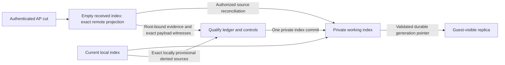
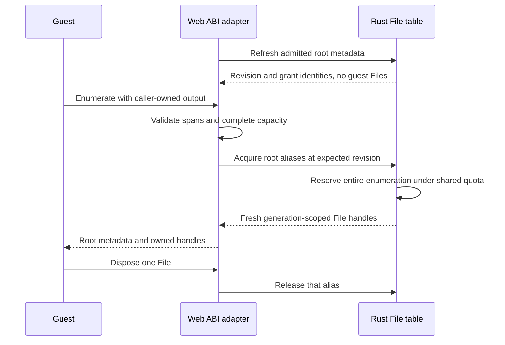

# Web storage and full sync

The runtime worker owns each append-only OPFS database journal, two transaction
spools and two full-sync staging files. All temporary files are cleared before
reuse. They are never a second published database. A transaction's pending map
contains keys and file locations; values are copied in 4 KiB pieces. Commit
writes the existing length/count/entries/checksum/trailing-length journal frame
through the same 4 KiB buffer, coalescing adjacent headers, keys and values,
prepares the bounded index and flushes before returning success. Recovery checks
complete batches incrementally and removes an incomplete final batch.

Full-sync Rust callers use `OpfsStaging` and owned snapshot readers. The reader
retains an immutable location in the append-only journal after its transaction
ends, until the reader is dropped. `pb_sync_step` processes up to 256 KiB input;
`pb_sync_output` drains up to 256 KiB of sender output. Drain output even when
`pb_sync_done` is true, then deliver the terminal message and finish. Aborting
or failing a transfer discards its pending transaction and releases staging.
Ordinary `get`/`next` calls retain their existing 2 MiB materialized-result limit;
streamed sync uses length/range/pinned-reader operations and preserves kvdb's
maximum key/value sizes and logical wire frame limit.

The worker has a 128 MiB bookkeeping ledger with 2,560-byte charges per retained
key/reference, including snapshots and pinned readers. It admits at most 96
journal handles, 32 transactions/read pins combined, two writers and one prepared
sync with an entry spool and journal. Capacity errors occur before publication. Journal batch size is
bounded by its existing unsigned 32-bit length field; it is not a RAM allocation.
These conservative charges bound admission, not actual JavaScript engine RSS.
The complete worker/tab must still pass the 256 MiB and responsiveness limits
in a browser run.

The diagnostic operator `qualify.mjs` waits for committed TODO initialization and
visible updates; input acknowledgments can contain Pending scenes. It reports
admission separately from committed DOM/layout timing. `--profile` instruments
the actual async backend and OPFS phases through accepted-work completion, using
a copied host method table and bounded diagnostic counters. Profile timings are
intrusive diagnostics. Neither mode establishes physical presentation or loaded
platform qualification. Failure deadlines never replay an uncertain mutation.

Run the affected checks from the repository root:

```sh
sh playbit/platform/web/build.sh release
node --test playbit/platform/web/src/*.test.mjs
node playbit/platform/web/tests/projected-query.mjs target/wasm32-unknown-unknown/release/playbit.wasm
node playbit/platform/web/tests/opfs-stream.mjs
node playbit/platform/web/tests/streaming-sync.mjs target/wasm32-unknown-unknown/release/playbit.wasm
```

The journal tests use native file handles implementing the synchronous OPFS
surface; the sync test runs the actual Rust Wasm host and production bridge.
They cover maximum legal values, the 10,000-record/4 MiB fixture, interrupted
writes, checksum recovery, snapshot lifetime, bounded admission and fragmented
sync/cancellation. They do not establish web OPFS durability, UI behavior,
network performance or loaded web browser memory. Host authorization's ordinary
metadata materialization and whole-volume coherent adoption remain separate
caller requirements; this transport/backend change does not establish them.

Prepared volume receipt has two private indexes: a working copy retaining local
facts, and an initially empty received index. Synchronization compares against
the received index and also reconciles delivered changes into the working copy.
Namespace evidence binds the exact received root, scope, source token and policy
revision. A subsequent index transfer invalidates that evidence even when the
replicated root is unchanged.

Qualified publication atomically records accepted payloads, exact exclusions of
locally provisional denied sources, and current controls in the working index.
Retained-payload accounting is validated before adding payloads. An explicit
authority-only receipt can exclude a denied local source but cannot confirm a
namespace event or certify its normalized assignment. All of this state remains
private until the durable OPFS generation pointer is published.



Personal storage registration (`pb_register_personal`) opens one volume's three
databases without granting guest access. `pb_selection_catalog` checks explicit
session/grants against current policy without changing running authority.
`pb_select_personal` applies selected grants, including withdrawals during a
prepared synchronization. The runtime saves withdrawals before the next guest
operation; additions wait for prepared data, fresh authority and an atomic
comparison with the saved consent. Network preparation does not hold guest admission.

Web root Files use the shared Rust ownership table and its 512-File ceiling,
including private root helpers. Metadata refresh retains the volume-list revision
and opaque grant identities without creating guest handles. The JavaScript ABI
adapter validates the complete caller output and capacity before acquiring fresh
aliases for every root. Probes and failed enumeration transfer no handles.
Disposing one alias leaves other aliases and the helper intact. Reload drains the
previous table and starts a new generation. Explicit operation disposal abandons
result delivery while retaining accepted I/O ownership and quota through its
terminal completion. Completed notifications are removed; disposal never replays
a mutation or erases a failed mutation from the close guard.

Volume observation retains one revision registration and at most one queued
notification. Registering an older revision catches up immediately; registering
again replaces an unconsumed notice. Queue exhaustion retains the registration
until event consumption makes space. Refresh and notification use the admitted
metadata snapshot without storage I/O or polling, and shutdown discards these
notifications before draining accepted work.

Personal selections carry their persisted incarnation into root admission.
Withdrawal or a changed incarnation revokes prior aliases immediately, including
when multiple account changes arrive before the next metadata refresh. Physical
replica replacement preserves the logical root grant. Storage authorization is
checked separately by the operation using the current volume.



For real OPFS registration timings, use an isolated web browser profile. The
release build bundles the benchmark beside the app, under `target/web/tests/`:

```sh
python3 -m http.server 8787 --bind 127.0.0.1 --directory target/web
```

Open that local origin and run in its developer console:

```js
const probe = new Worker('/tests/storage-registration.js', { type: 'module' });
probe.onmessage = ({ data }) => console.log(data);
probe.postMessage({ samples: 1000 });
```

The worker uses a random temporary OPFS directory and removes it afterward. It
reports raw samples and p50/p95/p99/max for asynchronous handle acquisition,
synchronous host registration, their combined duration, and instrumented I/O.
Each sample registers three new databases; host instances rotate at the
30-personal-volume limit. Each database retains its durable flush. Root/session
setup and Wasm compilation are outside these intervals. This component probe
does not qualify UI admission, input, presentation, AP traffic or peak memory.

## Web sign-out (R24)

Explicit sign-out and a fresh email sign-in discard the previous web account,
including unsynchronized data. `web-account.ts` coordinates document-lifetime
shared Web Locks, reloads tabs, and deletes Playbit IndexedDB databases, OPFS
profiles, Web Storage and Cache Storage. A non-secret cleanup marker survives an
interrupted SharedWorker/reload; new pages resume cleanup before opening storage.
Only the current invitation URL and the initiating email survive a fresh sign-in.
Code resend remains within that sign-in and preserves its pending authentication
key. Server and native data are not deleted.

Run `node --test playbit/platform/web/src/*.test.mjs`. For a real web browser check, build with
`sh playbit/platform/web/build.sh` and serve `target/web` with `/s` mapped to
`index.html` (as production does). Use a dedicated localhost origin with no valuable data.
Open `/tests/browser-account.html`, prepare the four databases/10 MiB fixture,
open `/?app=todo&profile=cleanup-todo` in a second tab, then select sign-out in
the fixture. It must report zero retained Playbit stores/files/caches and the
other tab must return to the invitation/sign-in screen. Also run "Start fresh
sign-in with invitation" in a single tab: it must reload the document, delete
prior data and retain its fragment/new email. Navigating to the same fragment
URL is not a document reload and would deadlock cleanup on the page's own lock.
Timing is reported,
not asserted in CI. Do not include the test harness in deployment packages.
