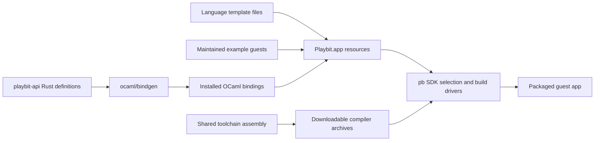

# Language SDK sources

Each language has a directory containing its Playbit integration. Compiler
toolchains are downloaded separately from the bindings shipped in Playbit.app.
See [developer SDKs](../../docs/developer-sdks.md) for the installed workflow.

| Directory | Contents |
| --- | --- |
| `ocaml/` | Bindings, Rust AST generator, starter template files, compiler setup and integration tests. |
| `rust/template/` | Cargo configuration and starter template files. The Rust API lives in `playbit-api/`. |
| `toolchains/` | Shared archive assembly, catalog signing and functional qualification tools. |

Example applications live in `guests/`. The Mac resource staging step copies the
maintained guest source and root initializer into each installed starter:
`guests/counter-ocaml` for OCaml and `guests/little-list` for Rust. Keep application
code there instead of maintaining another copy in a template.

SDK selection, caching and build drivers live in `playbit/src/bin/pb/sdk/`.
Shared browser syscall adapters remain in `playbit/platform/web/src/`; the OCaml
browser scenario and its runners live in `ocaml/tests/`. The independent wasm32
ABI layout fixture lives in `playbit-api/tests/wasm-layout/`.

Shared SDK tools do not depend on service code. All language SDK sources,
examples and ABI fixtures are included in source publication through their
containing client directories.
