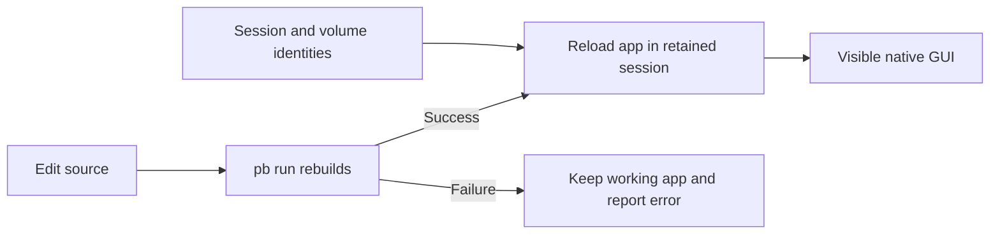

# Developing with the installed SDK

The `pb init` starter builds a Rust library from `src/app.rs`. Cargo's dependency
path points to `Playbit.app/Contents/Resources/playbit-api`; keep that installation
in place while developing. Install Rust's `wasm32-unknown-unknown` target if it is
missing. App development needs the installed tools and SDK, not Playbit's source
checkout, a web server, or an AP deployment.

## App execution and UI

The starter registers its state constructor and event callback with
`playbit_api::app`. The callback receives `&mut Context` and `&mut ViewEncoder`,
processes events, starts or collects bounded data operations, and submits a scene.
The SDK retains scene storage per instance; app state only holds the app's data.
The SDK pre-processes events before the callback; query responses such as
`view.button(...).was_clicked()` or iterate `context.raw_events()` when delivery
order across controls matters. Use `click_count()` for repeated button/checkbox
activations, `clicked_items()` or `clicked_segments()` for every menu/segment
activation, and a text field's `events()` for all edits and submissions. Boolean
queries remain true for that control through the end of the turn. The encoder
borrows that turn’s input; submitting it retains the scene buffer for reuse.
Read the starter before replacing it: its event loop, asynchronous operations,
schema and trace declarations form a working example.

Use the semantic controls in the installed `ui` module; they render as native
controls. Check the available layout and image methods in that source rather
than importing another GUI framework. Keep event targets stable across redraws.
Do not reset text drafts when a data-change event arrives.

The registration's last Boolean is last-window intent: `true` quits when the
last window closes; `false` keeps the execution owner alive without windows.
Explicit Quit always stops execution. This is not an automatic restart or
hosting service. Durable progress belongs in a volume if work must catch up
after the app starts again.

## Build, reload and resume

`pb run` prepares metadata, compiles and packages, opens a session, and watches
source/artifact filesystem events. Use its stderr for build errors and app logs.
Its stdout is a stream of JSON results, including the session identity and
successful updates. Leave the watcher running throughout ordinary edits.
Initial creation and execution work offline. Updating a development session,
including `pb run --session`, currently requires sign-in and AP access. If an
update reports that requirement, retain the working session and explain it;
do not claim hot reload succeeded or silently create replacement sessions.

`pb build` prepares, compiles and packages without opening a session. `pb bundle`
only packages existing artifacts. Prefer these tools to direct Cargo commands:
they generate ignored metadata beneath `target/playbit/`. If using Cargo
directly, run `pb meta-gen` first and after cleaning or changing trace declarations.
Do not edit generated metadata. Keep `playbit.toml` trace names and stages aligned
with instrumentation.

For scripts that save a session before opening it, use `pb session create
APP.pbapp [--volume ID]`. It prints the session metadata as JSON and works
offline without launching the app. Omit `--volume` for fresh private data,
or pass an existing root to preserve its data. Open the returned `id` with
`pb session join`.

Ctrl-C ends watching but retains the session and its data. From the same source,
`pb run --session SESSION` resumes that development session. `pb session join
SESSION` opens it without recompiling and follows guest logs on stderr after
printing launch JSON on stdout. Ctrl-C detaches without quitting the app.
`pb join` accepts the same arguments and the `--new-instance`, `--background`
and `--detach` flags. `--background` still follows logs; `--detach` returns after
launch without following. `--volume` selects the root and is not
how personal data is mounted.

## Personal data

`pb run --mount VOLUME_ID` mounts a personal volume read/write for the new
session. Use `--mount VOLUME_ID:r` for read-only access; repeat the flag for
multiple volumes. Supplying mounts replaces that session's personal selection.
Omit the flag on `--session` resume to preserve saved mounts. Hot reload retains
them. `pb session volumes SESSION` reports eligible volumes and saved grants;
the GUI personal-volume chooser can change or revoke them. Session invitations
do not share another person's personal mounts.
Running native instances retain their original access ceiling. Revocations
apply immediately; newly added volumes or write access require quitting and
reopening the app. Select the needed mounts before the first launch when possible.

The app discovers its available volumes through `Context::available_volumes`.
Use IDs and the `root` and `personal` roles, along with display names and rights.
Use the root volume for all persistent application data, including session-specific
records organized by the app. Sessions create no volume, database or namespace.

`Context::session()` and `Session::channel(context, name)` provide encrypted live
pub/sub channels. Keep handles in app state across callbacks. Wait for subscription
completion through DataReady and `take_channel`; publish completion acknowledges
an AP attempt, without promising delivery or storage. Read typed ChannelMessage
and PresenceChanged events in the guest loop. Names contain 1–223 UTF-8 bytes;
there are at most 16 handles per instance and 32 KiB per message. Channels have
no history, offline send queue or replay. Reconnect restores subscriptions;
interrupted sends can report `Error::Uncertain`. Persistent data always uses the
root volume and its ordinary permissions.

For a name badge, call `Context::identity` and use the returned record's
`display_name()` at startup and on `IdentityChanged`. A roster-only app calls
`context.session()?` once at startup to start or reuse live membership, then
reads the cached roster with `context.presence(&mut rows)`. The first read can
be empty while joining. Reread on the first and subsequent `PresenceChanged`
events and use each participant's `display_name()?`. Names are optional and
can change. Key the roster by participant IDs.

## Verification tools

Use `pb session instances SESSION` to identify the running GUI owner. Read
the scene with `pb frame` and capture the actual rendered window with
`pb screenshot SESSION window.png --instance INSTANCE`. Use `pb input --help`
for keyboard transitions and pointer gestures in canvas-local coordinates.
Playbit MCP exposes `playbit_gui` with `instance-list`, `key-input`,
`pointer-input` and `screenshot` operations. Its screenshot response contains a
PNG image. Read guest diagnostics with `pb logs`. Reopen the retained session to verify persistence. Test failures
and cancellation relevant to the app, and distinguish verified behavior from
anything needing unavailable platform capabilities.
