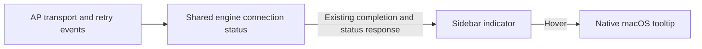
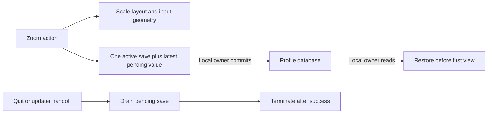

# Playbit native shell

The sessions/data shell presents retained sessions managed by the public local
`playbit-engine`. Preparation returns session metadata and launches an independent
local app process. Each app owns its guest execution, renderer, private editor,
logs, recovery and finite Quit; the shared engine owns authoritative storage,
account services and replication. Library navigation does not quit an app.
Text input reuses the native GPUI text adapter. TODO uses native text and checkbox
controls; games use the portable canvas.

Each view keeps its presentation and UI behavior together:

| Module | Owns |
| --- | --- |
| `shell_view` | Main window, navigation, focus, and overlays |
| `sidebar_view` | Session and volume lists and sidebar controls |
| `ap_status` | Passive AP connection indicator, hover label, and native tooltip |
| `application_browser` | App and session columns, participant and instance inspectors, and the shared log pane |
| `session_view` | Session launch, sharing and log observation |
| `session_log_view` | Log rows, display history, clearing, and scrolling |
| `welcome_view` | New session launcher for recent apps, bundled examples and project templates |
| `session_dialog` | Presentation and keyboard focus shared by the New Session and Join Session dialogs |
| `join_dialog` | Session ID and invitation entry, validation, and lookup progress |
| `new_session` | App review, device-local directory permissions, and session launch |
| `invitation_view` | Invitation consent and opening progress |

`log` supplies event-driven log updates without depending on the UI. `session`
performs background sharing and shutdown operations; their UI callbacks live in
`session_view`. `worker_response` decodes engine replies, `host_updates` applies
them, and `startup` sets up the application and local engine. Shared control
helpers and colors live in `shell_controls` and `theme`.

Build/package with `playbit/platform/macos/package.sh` from the repository root.
Use the same `PLAYBIT_PROFILE` for the engine, CLI and shell.

The sidebar's AP indicator shows Live for an open authenticated transport,
Connecting during establishment and automatic retry backoff, and Offline when
no attempt is active or scheduled. Its tooltip names the configured endpoint.
Synchronization progress remains separate: Live does not certify replication
catch-up or remote durability. The spinner rotates its geometry before applying
the fixed downward inner shadow and light drop shadow.



Account recovery prepares a key automatically only when the account needs new
recovery setup. Select the read-only key or use Copy account key, save it
somewhere safe, then choose “I’ve saved my account key.” Copying alone does
not acknowledge saving. Closing before acknowledgment retains the same key for
the next visit; an existing recovery backup is preserved. Preparation failures
offer an explicit retry while local apps remain usable.

For packaged engine/TODO measurements, run from the repository root:

```sh
python3 scripts/benchmark-local.py --app target/release/Playbit.app \
    --rows 32 --sessions 4 --samples 1000 --idle-seconds 300 --trace
```

The benchmark creates an isolated temporary profile, denies outbound IP traffic,
observes five minutes of idle operation, then toggles real TODO checkboxes through
IPC. It retains raw measurements outside the repository and verifies the observed
committed scene against stored data. Input ACK is a separate interval; scenes
stay in the GUI process. Idle evidence includes CPU/I/O/wakeup deltas,
RSS snapshots and trace coverage; allocation counts and continuous peak RSS are
not measured. Short idle intervals are useful smoke tests but do not qualify the
five-minute CPU budget. Repeat without `--trace` to compare instrumentation cost.
These measurements exclude physical input/display and connected AP traffic.
Scene observations include helper/decode overhead; engine resource snapshots
do not establish GUI peak RSS or cross-process commit correlation.

## UI scale

View → Zoom In/Out adjusts scale by 25 percentage points; Actual Size restores
100.00%. The supported range is 50.00–200.00%, including fractional percentages.
`profile.kvdb` stores a four-byte little-endian integer in ten-thousandths of a
scale factor: 10000 means 100.00%, and 12345 means 123.45%. Missing settings use
100.00%; invalid lengths and out-of-range values are errors.

`settings/ui-zoom/management` belongs to Playbit. Guest preferences use
`settings/ui-zoom/app/<root-id>` so build changes retain an app's scale. Values
are local to the selected profile, without account replication or live updates
between app processes. An explicit profile reset clears them.

Startup restores scale before displaying the app. Local rendering updates before
storage completes. Saves retain one active write and one latest pending value;
normal quit and updater handoff drain that value. A failed save is reported and
can be retried by changing scale or quitting again.

Playbit's Sessions minimum content size is 500×300 points multiplied by
`max(1, scale)`. Increasing that minimum grows an undersized window; decreasing
it does not shrink the window. Native traffic-light clearance remains available
below 100%. Custom UI uses logical dimensions; macOS-owned UI retains system size.


