# Playbit AP protocol

This is the public contract for `playbit::network::ap`. The source is
source-available under the repository license. Remote service implementation,
credentials, infrastructure and operator procedures are private.

The native `ap-protocol` Cargo feature exposes framing, authentication schemas,
typed service requests and replica envelopes without selecting a transport,
TLS provider or desktop store. The `network` composition adds the existing QUIC
client and includes `ap-protocol`. Native products use QUIC; WebSocket is only
the web fallback when QUIC/WebTransport is unavailable. Device callers must
bound memory used by connections, streams and frame buffers within the device
budget; the wire maxima below are protocol limits, not memory reservations.

## Service compatibility

The first supported release uses **AP protocol 1**. The version number is carried
in the DIRECT flags byte and is independent of Playbit release numbers, source
revisions and storage formats. Clients and AP must use the same version.
Existing baseline operations retain their meaning. Adding an optional operation,
optional reply metadata or an explicitly selected feature
does not change this protocol version. There is no version range, per-client
dialect, automatic downgrade or source/build equality requirement.

Session registration and session metadata require the application identity.
This also applies to bundled apps, whose session registration runs in the
background. Rollback must preserve compatible code and data; a protocol match
alone does not establish persisted-record compatibility. Account enrollment and
saved credentials are unchanged.

Check frame type, destination and protocol version **before interpreting any JSON**.
An incompatible protocol version ends only that operation with ERROR (type 200), flags 4,
source `service`, authenticated instance destination and diagnostic UTF-8 text.
This error cannot identify the operation before its request envelope has been
validated. Clients keep credentials and local data. The error does not authorize
retrying a mutation.

Baseline requests retain flat `op` and `operation_id` fields. The optional
`required_features` array lists the exact features needed by the request; absence
means `[]`. These requirements never change the operation's meaning or permissions.
To add behavior, define explicit typed operation fields and include them in the
saved identity used to detect duplicate mutations. Feature requirements may be
excluded from that identity only because they do not change the operation's meaning.

Accept at most 262,144 request bytes, 64 top-level fields, an operation name of
1–64 ASCII bytes (`a-z`, `0-9`, `_`), and 16 distinct required feature names of
1–64 ASCII bytes (`a-z`, `0-9`, `.`, `_`, `-`). Parse borrowed raw field values
before operation-specific decoding. Reject duplicate top-level fields, including
`op`, `operation_id` and `required_features`. Check canonical 16-byte operation
identity before returning a correlated response. Unknown operations or required
features fail before typed payload decoding, transfer or mutation work. Supported
payloads reject unknown fields and invalid values. Unknown semantics cannot
silently broaden permissions or alter mutations.

Every failed JSON reply has stable string `code` and diagnostic `error` text.
Codes are `unsupported_operation`, `unsupported_feature`, `invalid_request`,
`operation_conflict` and `operation_failed`. `operation_conflict` rejects reuse
of an operation ID with different meaningful arguments without a side effect.
`incompatible_protocol` names the stream-level flags-4
ERROR classification. Unknown future codes still fail the operation, granting
no credential deletion, authority or retry rights. Valid envelopes receive their
original `operation_id` even when refused. Malformed/ambiguous envelopes terminate
without execution. Unknown optional reply metadata is ignored; typed denials
and mandatory replica events retain strict validation. Denial evidence is valid
only with the baseline `operation_failed` code. An unknown or different code
cannot justify saving a denial that restricts later access.

### Authenticated discovery

`describe { operation_id }` is a mandatory, read-only baseline operation on the
existing authenticated connection. Its extensible `data` shape is:

```json
{
    "protocol": 1,
    "operations": ["describe", "sync_database"],
    "features": [],
    "algorithms": {
        "kvdb_pull": "kvdb.pull.v1",
        "kvdb_delta": "kvdb.delta.v1",
        "replica_events": "ap.replica.v1"
    },
    "limits": {
        "frame_bytes": 1048576,
        "request_bytes": 393216,
        "required_features": 16,
        "feature_name_bytes": 64
    }
}
```

The operation list is illustrative; AP advertises all its supported operations
(at most 64 unique names). `features` contains at most 64 unique optional feature
names. A complete reply is at most 16 KiB. Algorithms name mandatory baseline
encodings, independently of optional features and database record read/write
support. `kvdb.pull.v1` is the existing pull protocol 1, `kvdb.delta.v1` its
independent committed-delta format 1, and `ap.replica.v1` the existing event
format 1. Additive optimizations preserve these algorithms. Pull admits its
own discriminator before interpreting pull fields. Replica events admit their
version and kind before payloads; unknown mandatory events terminate/recover without
acknowledging their sequence.

Use optional operations/behaviors only after their exact name is advertised and
the request explicitly selects the behavior. Absence means unavailable. Baseline
operations need no discovery round trip. Native `ApConnection::describe` and
web `ApConnection.describe` lazily cache one bounded result per authenticated
connection; reconnect discards it. Discovery uses existing operation admission
and deadlines, never a freshness poll, new worker or local-render dependency.
Clients creating a Shared volume with the Session participants ACL require both
`shared-session.v1` (the binding) and `session-participants-acl.v1` (the ACL
subject) in discovery and in `register_session.required_features`. Discovery is
checked before sending the registration. If either feature is absent, the client
retains the pending registration and local data and reports that the session
needs an updated sync service. Root-backed registrations without
`shared_volume_id` remain baseline operations and need no discovery round trip.
The Shared binding independently requires `shared-session.v1` in central-record
admission.

`world-replica.v1` admits the `world_replica` exchange for a hosted
publisher World. Each request includes an authenticated session and build, the
app-derived World ID, and a `request` object tagged by `kind`. AP checks the
registered session, the publisher's ownership, the provisioned build, current
participant revocations, and the caller's ordinary World Read permission.
Individual reads and changes also require the current entry permissions.
Shared participant rights apply only to the Shared volume.

- `open` returns `{"volume": Volume | null}`. The descriptor comes from the
  World index. An absent or inaccessible World leaves the Shared invitation usable.
  A provisioned World awaiting its first index or revocations upload returns the
  initial-database synchronization wait. The client keeps that session's World
  inaccessible and retries with bounded backoff while Shared stays usable.
- `sync` carries `database_id`, `direction` and an optional `entry_scope`.
  `subscribe` also accepts an optional `entry_scope`. They use the same
  snapshot, receipt, event and checkpoint framing as ordinary replicas.
  Selected controls retain their entry and history filters.
- `publish` carries `database_id` and a bounded committed delta. The service
  validates the current writer and each change before committing it.

Projected kvdb trees derive their Merkle master with BLAKE3 context
`app.playbit.world-replica.v1` and the 16-byte World ID, followed by the
ordinary per-database derivation. AP translates authorized logical records
between the publisher tree and this public tree, preserving clocks and
tombstones. A full projected pull computes the public root on the pinned source
and streams the ordinary sorted snapshot range when roots differ. A full
projected push requests the sender's range and stages only logical differences
against AP's pinned source. Both paths use the ordinary bounded value frames.
This exchange transmits no owner database, peer or file secret.
The original database exchange remains available to separately credentialed
clients. Bloblog pages and appends use the ordinary scoped Bloblog operations.

Advertisement never replaces authorization. AP relays opaque client replica
bytes unchanged; transport support does not imply record read/write support.
Record and package specifications define their own required feature names.

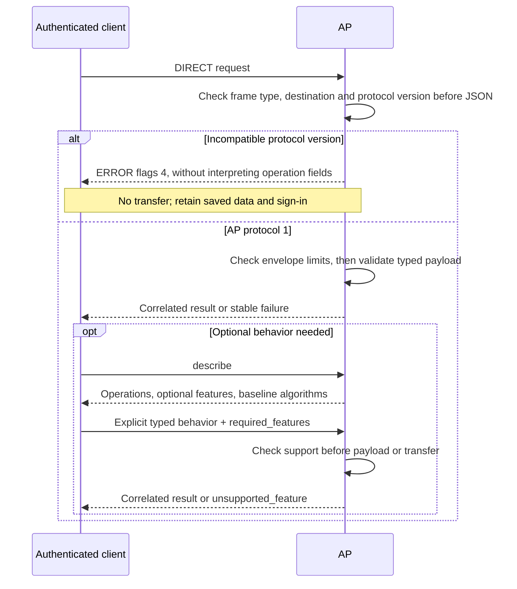

Fixed protocol examples are in `playbit/tests/fixtures/ap-baseline.json`. Run
`node playbit/tests/ap-conformance.mjs` to test an independently implemented peer
using the public contract without `service/`. Native and web tests use the
same cases. These are candidate test inputs until the first supported release
fixes its baseline.

## Shared identity and credential ownership

`ap-identity` exposes the same `ClientIdentity` used by the native `network`
composition, without Quinn, Tokio or a desktop store. It imports the host's
persisted Ed25519 seed, preserves the private serde identity shape, validates
preissued key/SPKI pairs and produces the ordinary signed CSR through
`certificate_request`. Registration request framing remains in `ap-protocol`.
The host must maintain secure platform entropy while executing cryptography.

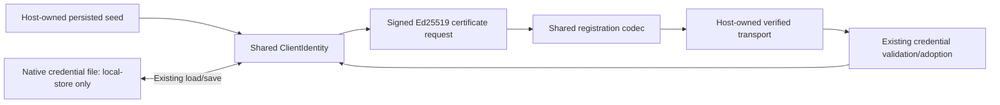

File loading/saving is compiled only with `local-store`; its owner-only file,
atomic replacement and sync behavior are retained. An embedding host supplies its
own protected persistence and enrollment UI. Serialization is not encryption,
and enabling the feature supplies neither secure storage nor an authenticated
account. No device-specific identity format or fallback identity is introduced.

## Incremental native frame reception

`receive::FrameReader` is available with `ap-protocol`, independently of Quinn,
Tokio, TLS and the desktop store. The native QUIC reader uses it as well. Create
one reader per operation with that operation's maximum body length. Fill the
span returned by `buffer()`, call `advance(count)` with actual progress, and call
`finish()` after completion or EOF. Pending I/O retains the reader; cancellation
must drop both reader and operation. It consumes exactly one frame, leaving the
next frame's bytes on the stream.

Before header admission the reader retains eight bytes and no payload allocation.
Admission includes the aligned source/destination names, enforces the total wire
maximum, and checks the body against the caller's bound before allocating one
wire buffer. Invalid admission or progress counts poison the reader. Completion
uses `Frame::decode` for type, destination and padding checks and temporarily
holds both encoded and decoded bytes, as the previous native receiver did.
Hosts must account for that overlap and bound concurrent readers, read quanta
and deadlines. The protocol maximum is not a device reservation.

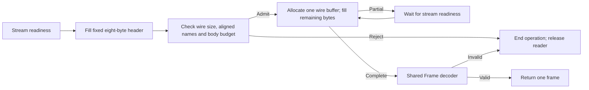

## Transport and framing

The desktop/iOS clients negotiate `pb.ap` over certificate-verified QUIC. Web clients
prefer WebTransport (`h3`), path `/`, on the same AP. When WebTransport is absent
or cannot establish within three seconds, they use secure WebSocket at the same
hostname and path (seven-second establishment deadline). Negotiate subprotocol
`playbit-ap-2`, using HTTP/1.1 Upgrade or HTTP/2 extended CONNECT (RFC 8441).
Transport selection precedes authentication; rejected credentials or operations
never trigger a different transport. One account/device connection
carries independent reliable bidirectional streams. Authenticate on the first
stream before opening operation streams. TLS early data is disabled. No runtime
operation contacts a separate storage, email or management endpoint.

A planned AP shutdown closes QUIC with application code `0x1000b7f`
(`APPLICATION_ERROR_RESTART`). Native clients treat only this application close
as recoverable transport loss: reauthenticate and restore existing subscriptions
using the bounded reconnect backoff. Reason text is diagnostic and grants no
retry authority. Other application close codes, including generic code zero,
authentication rejection and local cancellation remain terminal. Recovery does
not bypass authentication, replica authorization or explicit personal-data consent.
When establishing the replacement connection, QUIC `CONNECTION_REFUSED` can
mean the old endpoint is still draining. Initial connection establishment and
reconnection retain their bounded backoff for this exact transport refusal.
It does not authorize retrying an authenticated operation or any other protocol
or authentication rejection.

All integers below are unsigned little-endian unless stated otherwise. Each AP
frame has this layout; lengths count bytes, not characters:

| Offset | Length | Field |
| --- | --- | --- |
| 0 | 4 | Total frame length, including header, names and padding |
| 4 | 1 | Frame type |
| 5 | 1 | Flags (request) or status (authentication response) |
| 6 | 1 | Source name length |
| 7 | 1 | Destination name length |
| 8 | source length | Source bytes |
| next | destination length | Destination bytes |
| next | 0–15 | Zero padding to the next multiple of 16 |
| aligned offset | remaining | Body |

Total length is at most 1,048,576 bytes. Each name is at most 255 bytes. A complete
frame must include its aligned body offset, even for an empty body. Reject
truncation, length mismatch, nonzero padding and unknown types 9–199. Types
200–255 are error/reserved-error frames. DIRECT, PUBLISH and SUBSCRIBE require a
nonempty destination. Transport fragmentation never changes frame boundaries.

Types: HELLO=0, REGISTER=1, DIRECT=2, PUBLISH=3, SUBSCRIBE=4, KEY_CHALLENGE=5, KEY_PROOF=6, ONBOARDING=7, AGREEMENT=8, ERROR=200.
`mod.rs` owns the codec, `operation.rs` owns the typed service schema and
`replication.rs` owns replica envelopes. These are executable parts of this
contract, including each operation's required fields and validation bounds.

### WebSocket stream mapping

One binary WebSocket message is one stream packet: a one-byte kind, a four-byte
little-endian stream ID, then its body. Stream zero is reserved for connection CREDIT. Client-created IDs increase
strictly and never repeat during a connection. Only the client opens streams;
the first carries ordinary AP authentication. At most 1,024 streams may be live.
AP framing above is unchanged and can span multiple DATA packets.

| Kind | Value | Body and effect |
| --- | --- | --- |
| OPEN | 0 | Empty; creates a bidirectional stream with 32,768 bytes of credit in each direction. |
| DATA | 1 | 1–16,384 bytes, consuming both stream and connection send credit. |
| FIN | 2 | Empty; ends the sender's byte stream after preceding DATA. The other half remains usable. |
| STOP | 3 | Empty; reader cancellation asks the peer to discard unsent bytes and send FIN. |
| CREDIT | 4 | Four-byte positive byte count, returned as received bytes are consumed. Available credit must never exceed 32,768. |

The `playbit-ap-2` subprotocol replaces the unreleased stream-only mapping;
peers must select it before authentication. There is no implicit fallback to the
old mapping. Each connection starts with 2 MiB of credit in each direction.
CREDIT on stream zero replenishes consumed or discarded connection bytes and
must not raise available connection credit above 2 MiB. Cancellation returns
connection credit for discarded input but does not reopen a canceled stream.
Peer CREDIT cannot acknowledge local queued reservations. Senders track queued
reservations separately from bytes handed to the socket and not yet acknowledged,
at both stream and connection scope. Only the latter may replenish peer credit.
Unsent queued output refunds its local reservation exactly once on cancellation;
sent output remains charged until peer credit arrives, including after FIN.

Writers suspend when either credit is exhausted. Each direction's aggregate credit is
2 MiB; each stream retains at most 256 queued fragments. The web client also caps
WebSocket buffered output at 2 MiB, failing explicitly on exhaustion. Server
output rotates among ready streams. Retire a stream after both FINs and local
buffer/handle cleanup; crossed control packets for retired IDs can be discarded.
Reject future IDs, repeated OPEN/FIN, malformed packets, oversized messages and
credit violations by closing the connection. Text messages are not AP packets.
Connection closure fails pending operations and retires every subscription;
existing account recovery must reauthenticate before resubscribing. TLS is
mandatory and retains ordinary platform trust. AP sends a WebSocket protocol
PING every 30 seconds and closes if PONG is absent after ten seconds; this is
transport liveness, with no application polling. TCP head-of-line blocking can
increase network latency; local edits and rendering never wait for remote ACKs.

The bounded native client (`ap::websocket::Client`, available with
`ap-protocol`) admits 1,024 streams with lazily allocated byte rings capped at 32 KiB each.
Coalescing input avoids fragment descriptors. Connection credit bounds unread
payload to 2 MiB; retained ring capacity can be larger and is accounted separately.
Stream metadata is compile-time bounded to 128 KiB. The driver supplies
one 16,389-byte output buffer and sends each emitted packet in order before
producing another; on socket failure it closes the client. The core has no
output queue, socket, timer, TLS provider or authentication state. OPEN, STOP,
CREDIT and FIN emission rotates among ready streams. Credit becomes available
only after consumption and emission of the corresponding CREDIT packet.

A local release discards unread bytes and requests STOP/FIN, retaining its slot
until both directions finish. The driver must own liveness/cancellation deadlines;
a peer that never finishes cannot cause unbounded replacement streams. EOF does
not implicitly release an application handle. Protocol failure closes all slots.
Host tests use the actual AP server and verified local TLS. Embedding hosts
remain responsible for trusted time/roots, runtime entropy, network recovery and
concurrent memory admission. The stream core allocates only on admission, performs
bounded synchronous work, and leaves event-driven socket scheduling to its host.

## Bounded native saved-identity exchange

With `ap-websocket` and `ap-identity`, `websocket::transport::Authentication`
owns a fresh, already verified connection and exclusively borrows its saved
`ClientIdentity`. It sends the ordinary HELLO on stream 1 and keeps its sending
side open until a complete successful reply arrives. Rejection preserves
credentials and closes the connection immediately; it does not wait for remote
FIN, because AP leaves rejected authentication streams open for enrollment.
This path does not enroll. Enrollment needs its own explicit host interaction.

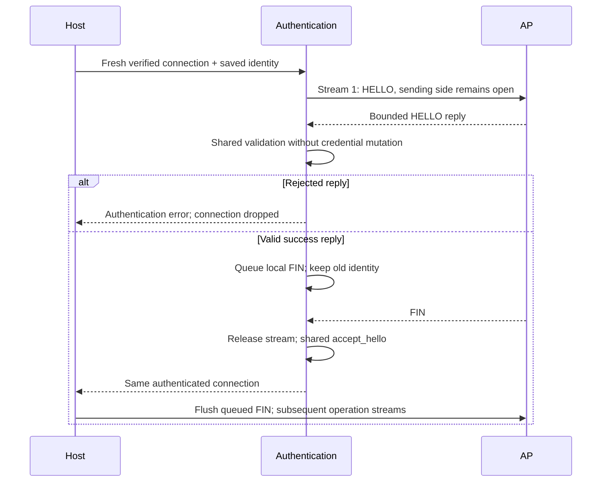

A request or reply body may occupy at most 4 KiB in this client. Request size is
checked before cloning; the shared frame reader admits the reply header before
payload allocation. It rejects truncated frames, bytes following the frame,
invalid envelopes and unsuccessful statuses before adopting a renewed token.
This operation budget does not change the protocol's token shape or other clients'
limits. Authentication buffers peak below 14 KiB of payload allocations, including
encoded/decoded overlap, in addition to the transport's stream ring, packet,
WebSocket and TLS buffers. Hosts must account for all of those allocations.

Each `advance` performs one bounded connection turn, at most one bounded write
and one stream read. The transport turn and write each have the existing 32-KiB /
32-I/O-call quantum. Drive on readiness or `continue_now`; combine `wants_write`
with TLS readiness and refresh TLS progress after the call. The host owns the
absolute authentication deadline, secure entropy and cancellation. Drop the
exchange on timeout, cancellation or host TLS failure. Exchange errors drop its
connection; success transfers that connection back without closing it. Further
advances on a completed or failed exchange return closed. Drop the completed
exchange to release its exclusive identity borrow before persistence.

The local service test exercises this exchange through actual verified TLS and
then performs accepted and wrong-owner-rejected operations on the same connection.
It also checks an invalid saved token returns `AuthenticationRequired` without
waiting for remote FIN or losing the saved identity. Closing the client's sending
side before the answer can make AP terminate on EOF before delivering rejection.

## Protected identity envelope

`ap::sealed_identity` supplies the encrypted record for hosts without a keychain.
It accepts prepared and issued `ClientIdentity` records. The host owns the wrapping
key, stable 16-byte device/app context, secure nonce generation, atomic persistence
and unlock interaction. The wrapping key must be a secret 256-bit key, not a
password or a value stored alongside the ciphertext. A passphrase host must first
use a separately selected password KDF. No host unlock policy is selected here.

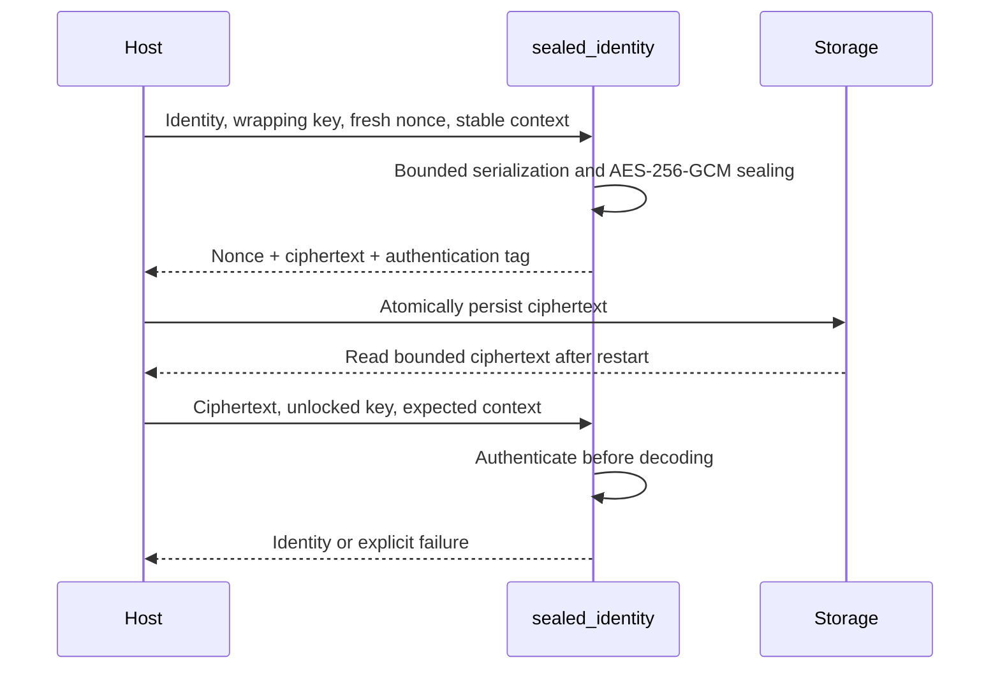

The encoding is a 12-byte nonce followed by encrypted JSON and a 16-byte tag.
Plaintext is limited to 16 KiB; the envelope ceiling is 16,412 bytes. Serialization
writes directly into bounded scratch. Opening admits length before copying and
verifies AES-256-GCM with domain-separated context as associated data before JSON
decoding. Wrong key/context, changed ciphertext and changed nonce/tag fail.
Plaintext scratch is zeroed on success and error; the returned identity owns its
ordinary key buffers. This does not promise that all process memory is erased.

Every seal requires a nonce never previously used with that wrapping key. Generate
it from a secure source, including retries; do not reconstruct a counter from a
possibly rolled-back SD record. This envelope provides neither anti-rollback nor
storage atomicity. A successfully reopened identity is not proof of AP enrollment
or current authorization. Other profile secrets, including the device signing
seed and volume keys, must also be protected by the host; encrypting this one
record cannot protect plaintext copies elsewhere.

## Bounded native enrollment

The same native feature composition provides `transport::RegistrationRequest`
and `Authentication::register`. Both require a host-prepared private key; they
will not silently generate a replacement. Prepare `ClientIdentity::from_seed`
and protect that identity before requesting delivery, so a lost response can be
retried with the same key. `has_private_key` reports presence only, not validation,
entropy quality or protected persistence.

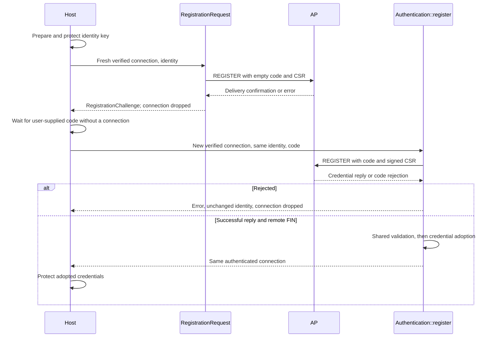

`RegistrationRequest::advance` returns a `RegistrationChallenge` only after shared
delivery validation. Production delivery leaves `automatic_challenge` empty;
only an explicitly configured development AP can supply one. The adapter never
chooses or submits that code automatically. Failure, completion or dropping the
request releases its connection, and the user wait holds no socket. Do not wait
for remote FIN: the AP keeps that stream open for possible confirmation.

`Authentication::register` prepares the same Ed25519 CSR and REGISTER body as the
native QUIC client. Wrong code, account-disabled and malformed replies use the
shared registration errors and preserve the prepared identity. Complete success
still requires remote FIN without trailing bytes before adopting credentials and
returning the connection. A failed exchange is terminal; retry explicitly on a
fresh verified connection with the same host-persisted key.

Both enrollment phases use the existing 4-KiB request/reply body budget and the
same bounded first-stream I/O as saved-token authentication. Field-length and
total-size admission precedes request encoding; reply-header admission precedes
allocation. CSR signing uses the existing bounded Ed25519 implementation; its
crypto/key allocations and host identity storage are additional to the request/
reply payload budget. Hosts retain secure entropy, drive TLS/socket readiness,
set absolute deadlines and cancel by dropping the exchange. There is no polling,
credential-file I/O, new worker, desktop-store or QUIC dependency in this adapter.

The local real-service test performs delivery, wrong-code rejection, successful
enrollment, saved-token reconnection and owner/foreign-owner operation checks
through the bounded verified TLS/WebSocket client. Embedding hosts supply
credential protection and enrollment UI, and qualify their own networking.

### Bounded native publication on an existing connection

`websocket::transport::Publication` borrows an already authenticated connection,
a typed publication request and its payload. It supports `PublishReplica`,
`PublishAccount`, using shared request, payload-framing,
service-response and acknowledgment validation. Keep a committed-change record
alive and borrow `record.bytes()` through this operation so its feed credits
remain charged through transmission/acknowledgment. The adapter never copies the
whole payload or starts a worker, timer, TLS handshake or identity operation.

Each turn performs one bounded connection advance, at most one packet-sized write
and one read. It emits the request, the shared-codec data header and then the
borrowed payload; it half-closes after sending all bytes. Replies have a 4-KiB
body ceiling admitted from their header. Success requires a correlated successful
response with a valid `PublicationAck` followed by FIN, without trailing bytes.
A service error returns immediately even while payload credit is exhausted and
the peer has not sent FIN. Other malformed or truncated replies fail explicitly.

The host owns an absolute deadline covering the whole operation and secure TLS
progress. Drive on socket readiness or `continue_now`, combining `wants_write`
with refreshed TLS readiness. `connection_mut` permits bounded work on unrelated
streams between publication turns; one stream's backpressure does not authorize
polling. Drop cancels and retires the publication stream, as do operation errors.
Retirement remains subject to the shared STOP/FIN slot-lifetime contract: drive
queued control output and enforce cancellation/connection deadlines. Releasing a
stream does not by itself close the authenticated connection. Do not close or
retire this operation's stream through another owner.

A failed/cancelled publication has an uncertain remote commit outcome; it does
not imply rollback. The host owns durable source state, recovery status and any
explicit replay decision. No automatic retry or claim of current synchronization
is made by this adapter. Request encoding is bounded to a 4-KiB body; retained
encoded control data and reply decode overlap are additional to the leased
payload and the existing TLS/WebSocket/stream buffers. This is host protocol
integration, not device memory or latency qualification.

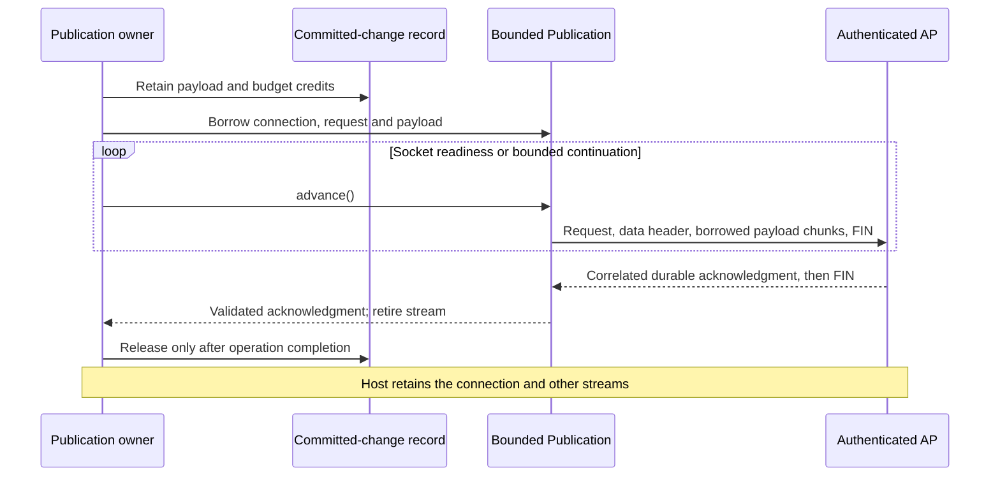

### Bounded native subscription on an existing connection

`websocket::transport::Subscription` borrows an authenticated connection and a
`SubscribeReplica` request. It emits the normal request and validates its
correlated service response and `SubscriptionAck` within a 4-KiB body ceiling.
It keeps the sending side open for explicit checkpoint controls. The first stream
is reserved for authentication and cannot be used for this operation.

Every `advance` runs one existing connection quantum, at most one bounded write
and one read, yielding at most one `SubscriptionItem`. The acknowledgment is
followed by owned event bytes whose outer service frame and borrowed
`ReplicaEvent` envelope have been validated. No entire stream is buffered. The
constructor's event-body limit includes the 52-byte envelope header and must lie
between that header size and `MAX_EVENT_BYTES`. Receipt of a 32-KiB
payload therefore needs an event-body ceiling of `32 * 1024 + 52`. Admission from
the eight-byte AP frame header precedes payload allocation.

Stop advancing while a consumer owns a delivery: apply it or explicitly discard
it as part of recovery before accepting another. `FrameReader::finish` transiently
holds wire and decoded buffers; allow conservatively twice `(event_body_limit +
528)` bytes for those spans, plus typed/control objects, allocator overhead and
existing TLS/WebSocket buffers. The shared stream client separately retains up to
four 32-KiB input windows. There is no additional delivery queue, thread or timer.
This is allocation accounting, not aggregate device heap qualification.

`checkpoint()` queues at most one unsent control after acknowledgment. The host
uses it only at explicit initialization/recovery boundaries, never for periodic
freshness. Once sent, another control can be queued; the host owns correlation
with its recovery state. Receipt of `CaughtUp` does not itself advance durable
progress or mutate a cursor. All envelopes, including duplicates and checkpoints,
remain subject to the shared `Cursor` before the host advances after application.
A checkpoint cannot substitute for the initialization snapshot or gap recovery.

Gap/revocation envelopes are delivered once, then their stream is retired.
Malformed/oversized frames, unexpected FIN and drop also retire it. There is no
automatic reconnect, resume, recovery or assertion of synchronization. Other
streams remain usable unless the connection itself fails; the owner must still
drive pending STOP/FIN output and enforce cancellation/liveness deadlines.
`connection_mut`, `continue_now` and `wants_write` follow the publication adapter's
readiness contract. Retain verified TLS and secure entropy throughout operation.

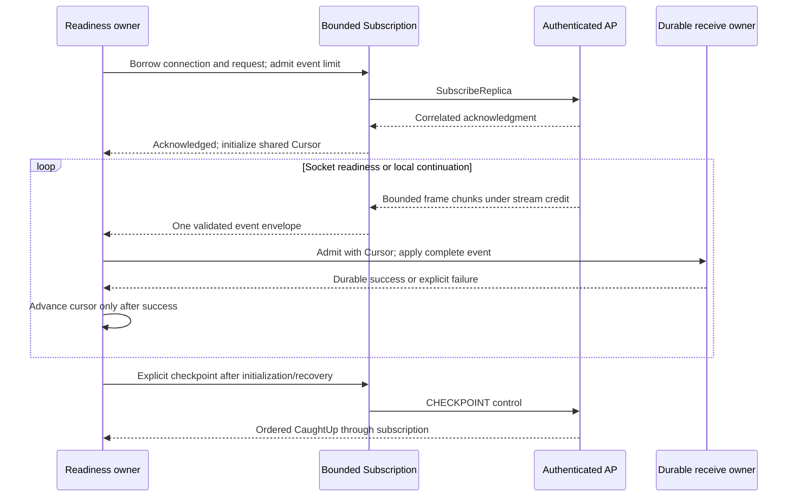

## Authentication reply timing envelope

Every HELLO, REGISTER and KEY_CHALLENGE reply, including rejection and testing
HELLO, carries this mandatory body envelope. Requests keep their declared
payload shape. The credential/status descriptions below refer to the payload
**after** this envelope has been validated and stripped.

```
u16 timing_json_length (little endian)
timing_json_length bytes: operation-private timing array
remaining bytes: binary authentication payload
```

The complete body is at most 4 KiB and timing JSON is 2–1024 bytes. An empty
array `[]` means unavailable detail. Timing entries follow the same eight-stage,
canonical u64 duration contract as service replies. Reject old/unwrapped bodies,
invalid lengths, malformed JSON and private/unknown stage fields before
credential adoption. Frame flags remain the authentication status; source and
destination remain empty. Native QUIC and web readers admit the 4-KiB bound
from the frame header, then check the envelope before payload interpretation.

The AP starts a fresh owned flow and measurements for **each attempted frame**.
It wraps timings only when sending the current reply; cached enrollment records
hold only the credential payload. A retry can therefore return byte-identical
credentials with its own measurements. Mail duration appears only when that
attempt actually invokes delivery. Conditional authentication-record writes
use `ap.durable_merge`; this is duration of that attempt, not evidence that a
conditional write won. Neither operation success nor durability is inferred
from timings. Rejection and timeout retain their existing product semantics.

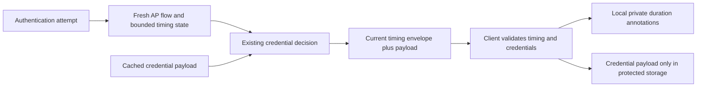

Native clients retain the initiating flow across each request/write/reply
interval (`ap.request_code`, `ap.code_sign_in`, `ap.key_challenge`,
`ap.key_sign_in`, `ap.saved_identity`, `ap.testing_hello`). Edges carry only
body-byte counts and locally minted tokens. Web decoding copies only the
credential payload, so saving a typed array cannot retain the timing prefix in
its backing buffer. This changes no transport selection: native uses QUIC;
WebSocket remains web fallback.

## Ordinary authentication

HELLO requests have flags 0, empty source/destination, and the saved bearer token
as their body. A token contains account ID (16 bytes), instance ID (16 bytes),
expiry (8-byte Unix seconds), and HMAC-SHA256 (32 bytes): 72 bytes total. The
signature covers the first 40 bytes. Tokens expire after 30 days. A successful
HELLO response has status 0 and a renewed token. Status 2 means invalid (including
malformed, tampered or expired tokens), with an empty credential payload and no authenticated
principal. Clients also recognize missing=1 and revoked=3. A failed ordinary
HELLO permits enrollment on that same authentication stream.

The `authentication` module (`ap-identity`) owns the shared native reply decisions.
The transport caller supplies verified AP frames after decoding the mandatory timing envelope, and owns deadlines/persistence.
`accept_hello` returns either `Authenticated` or `RegistrationRequired`; the
latter requires an explicit host policy and a declared missing/invalid/revoked
status. Unknown statuses, wrong frame type or nonempty names are errors. A VALID
reply requires a saved instance ID **before** replacing a renewed token. Every
rejected reply preserves the existing identity. A permitted registration decision
clears only the token and instance ID, as the native flow previously did.

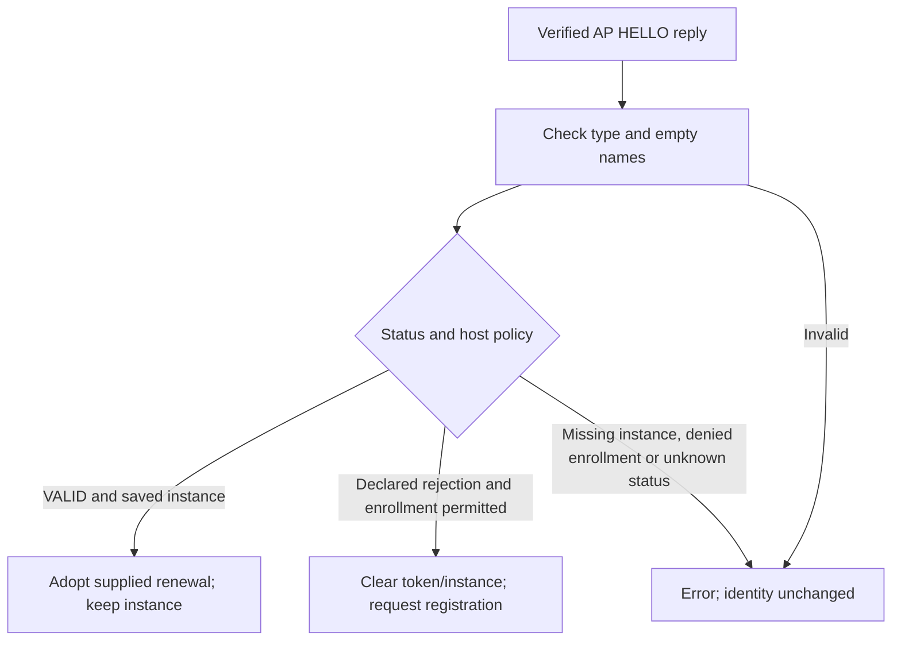

Registration delivery, ordinary credential adoption and explicit testing HELLO
also use shared handlers. They preserve the existing status and credential-shape
checks; testing is never inferred from a failed ordinary login. Hosts still must
save accepted credentials in protected storage and must not treat structural
parsing alone as authentication.

REGISTER flags are zero. Authentication creates no agreement receipt. A host
obtains the user's decision for the authenticated account through the separate
AGREEMENT exchange. Source and destination names are empty. The body is:

```
u16 email_length, u8 instance_name_length, u8 code_length,
email UTF-8 bytes, instance-name bytes, code bytes, PKCS#10 DER CSR bytes
```

Email is trimmed and lowercased, at most 254 UTF-8 bytes, with an `@` and no
whitespace. Instance name is nonempty. A request without a code starts/resends
verification. The code has six ASCII decimal digits, expires after ten minutes and
allows five attempts, including incorrect attempts. Each email permits five
sends/hour and a 60-second cooldown; each source IP permits 30 requests/hour.
Leading zeroes are significant: submit exactly six ASCII digits. Grouping such
as `123–456` is presentation only; separators, whitespace and eight-digit codes
are rejected. These are email verification codes, not TOTP/MFA. Five-minute
delivery guidance does not change expiry or schedule an automatic resend.
Malformed code fields are rejected before verification; every admitted guess
spends an attempt, including a correct code or exact-CSR retry. An empty code
with a CSR is invalid. Clients and AP must cut over together after draining
outstanding challenges through their full ten-minute lifetime; mixed formats
are unsupported.
Codes are never returned over AP. A resend within cooldown reports success only
if provider acceptance for the current challenge has been durably recorded.

REGISTER response status 0 means delivery confirmed; status 4 means delivery
unconfirmed. Both have an empty four-byte registration header. Provider acceptance
does not prove inbox delivery. Status 2 means invalid challenge; status 3 is
account disabled. Keep the entered form and permit an explicit retry after the
cooldown when delivery is unconfirmed.

Submitting a code includes a signed Ed25519 CSR. The AP verifies its proof of
private-key possession and issues its own certificate extensions. New account
ID is `BLAKE3(raw Ed25519 public key)[0..16]`; an existing verified email retains
its account ID. Instance ID is `SHA256(SPKI)[0..16]`, represented by canonical base58 text in the response. A successful REGISTER response has status 1 and body:

```
u8 token_length, u8 instance_id_length, u16 ca_certificate_length,
token, instance_id ASCII base58, CA certificate DER, instance certificate DER
```

The shared `registration` codec is available with `ap-protocol`, without Quinn,
Tokio, TLS, key generation or profile storage. `request` admits field widths and
total wire length before allocating. `Response::parse` checks the REGISTER type,
empty names and all length-derived ranges, then borrows the four fields from the
received frame. A structurally valid response is not authentication success:
callers still interpret status, validate credentials and explicitly adopt owned
copies. The native client uses these same codecs for email, account-key and
testing enrollment; no alternate host registration format is introduced.

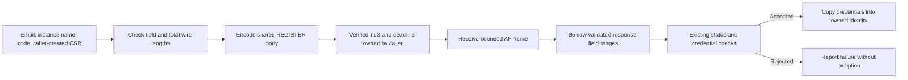

Enrollment saves the exact successful credential payload and binds the code to
that CSR before acknowledging. Retrying that code/CSR before expiry returns the
same credentials, including after restart, wrapped in fresh attempt timings. A different CSR cannot reuse the code.
Account authentication transfers no session, volume, blob or recovery private key.
Ordinary authorization still applies to every operation.

The AP allows 15 seconds to open the authentication stream and 15 seconds for
the exchange. Native clients use a five-second connection deadline and a
15-second authentication deadline. Invalid framing/CSR or an operation before
authentication terminates the exchange without accepting service streams.

### Account-key authentication

An account key is 16 uniformly random bytes from the client CSPRNG, encoded as
literal `a` followed by exactly 22 Base58 characters using the session-code
alphabet and leading-zero padding. The prefix selects this type/version; it
consumes none of the 128 random bits. Decoders reject overflow and other versions.
The seed is never submitted to AP. HKDF expansion does not increase its entropy.

Derive an Ed25519 signing seed with HKDF-SHA256, salt
`app.playbit.account-key.v1`, info `app.playbit.account.signing.v1`, output 32 bytes.
Derive the AES-256-GCM backup key independently with the raw account ID as salt,
info `app.playbit.account.backup.v1`, output 32 bytes. The account-record encryption
and lookup derivations below are separate again. Effective seed security is 128 bits.

KEY_CHALLENGE has flags 0 and empty source/destination. Its body is:

```
u16 identity_length, u8 instance_name_length, u8 selector,
identity bytes, instance-name UTF-8 bytes, PKCS#10 DER CSR bytes
```

Selector 0 performs an explicit email lookup: identity is 1–254 normalized UTF-8
email bytes. Selector 1 identifies an account directly: identity is exactly 16
raw account-ID bytes. Other selectors are rejected. Name is 1–255 UTF-8 bytes;
CSR is 1–4096 bytes. Automatic Apple sign-in uses selector 1, independent of
optional cached display email. Testing-enrollment endpoints require selector 0
with an explicit team email; they do not broaden their enrollment policy.
AP replies with KEY_CHALLENGE, flags 0, empty names, and a fresh random 32-byte
nonce. Unknown accounts or accounts without a registered key receive the same
challenge shape.
On the same stream, send KEY_PROOF with flags 0, empty names, and the 64-byte
Ed25519 signature over the exact concatenation:

```
"app.playbit.account.login.v1\0", nonce, complete KEY_CHALLENGE request body
```

AP consumes the pending challenge before verifying, permits only one key attempt
per connection, and retains the ordinary authentication deadline. Thirty key
attempts per source IP per hour are allowed. Success returns the ordinary
REGISTER status 1 credentials; a wrong key or unknown account returns status 2.
No email is sent. A fresh attempt uses a fresh connection/challenge. Clients then
unlock the encrypted catalog locally using the entered seed.

`put_credential_vault` requires `public_key` (64 lowercase hex characters) and
`signature` (128 lowercase hex characters). The signature covers:

```
"app.playbit.account.backup.write.v1\0", raw account ID (16),
raw operation ID (16), expected_revision (u64 LE), ciphertext ASCII
```

The first vault CAS stores its public key and ciphertext atomically. Subsequent
writes must verify under that same key; email authentication cannot replace it.
Revision and operation identity retain the existing conflict/replay rules.

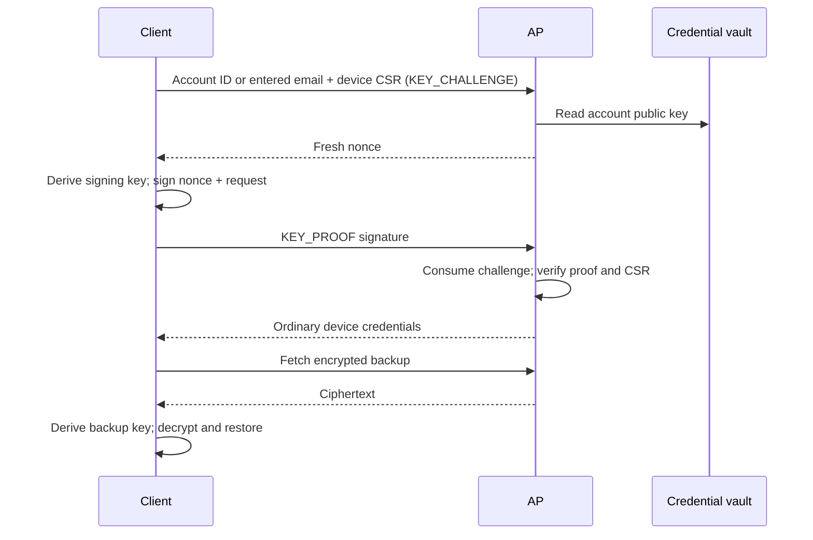

## Testing HELLO extension

The client codec and testing service implement this extension. Deployment and
qualification are tracked separately; protocol support is not evidence that an
endpoint has passed those gates.

The testing request flag is exactly `0x01`; combinations with any other flag are
invalid. Source and destination must be empty. The body is:

```
16 raw testing-key bytes, 16 raw namespace bytes, signed Ed25519 PKCS#10 DER CSR
```

The CSR is 1–4,096 bytes; the complete body is 33–4,128 bytes. The namespace must
be nonzero. The key and namespace are binary, not hex strings on the wire. The
CSR establishes the client identity using the same derivations as enrollment.
It cannot request an arbitrary account ID. Repeat the signed CSR on each fresh
connection; an ordinary bearer-token HELLO cannot recover testing authority.

Only a testing AP accepts this flag, after a consistent lookup of a registered,
unexpired, unrevoked key. Unknown/expired keys return HELLO status 2, revoked
keys return status 3, and production returns status 2. All failures have empty
bodies, authenticate no principal, and terminate the authentication exchange.
Malformed lengths, zero namespace, nonempty names, unknown flags and invalid
CSR likewise fail without creating namespace state or accepting operations.
Keys must never appear in errors or diagnostics. The server finishes the terminal
response stream and allows up to one second for peer closure before forcibly
closing the transport; no additional authentication attempt is accepted.

Success returns HELLO status 0 with the same credential body as successful
REGISTER (the four-byte lengths, token, instance ID, CA and instance certificate).
The client generates and retains its ordinary private key. Key authentication
skips only email verification, never identity, TLS, encryption, ownership,
invitation possession, consent or volume/session authorization. Normal enrollment
on the testing AP requires a verified address whose exact domain is `playb.it`.

The authenticated namespace is immutable for that connection and all its streams.
No operation field, source name, destination, logical ID or filesystem path can
select another namespace. Accounts, enrollment/recovery credentials, operation
receipts, app publications, replicas, blobs, subscriptions, routing and caches are all
scoped. Equal logical IDs in different namespaces name independent resources.
Production has no testing prefix or alternate storage path.

## Service operations

Each request opens a stream and sends a DIRECT frame to ASCII `service`, with a
UTF-8 JSON body. `ServiceRequest` in `operation.rs` is tagged by `op` using
snake_case; unknown fields are rejected. Every request carries `operation_id`.
The corresponding `ServiceResponse` echoes it and carries `ok`, `code`, `error`, `denial` and
operation-specific `data`. Never infer success from EOF or connection health.
Identifiers use canonical Bitcoin base58 with the decoded byte widths enforced by that schema; see [identifier text](../../../../docs/identifiers.md).

Native transports share `ap::service`, available with `ap-protocol`. It validates
requests before encoding, checks DIRECT/service reply envelopes, correlates the
operation ID and rejects reported failure before returning response data. Raw
data envelopes retain their payload allocation. Transport owners enforce frame
body limits, deadlines and authenticated connection ownership; these codec
checks do not replace server authorization or operation-specific data validation.

`error` is diagnostic text. It never establishes persistent negative authority.
Only a failed response may carry `denial`, currently a typed
`participant_revoked` record with `account_id`, `volume_id`, and paired optional
`session_id`/`build_id`. IDs use the canonical schema encodings; a denial occupies
at most 384 encoded bytes. A session caller checks its authenticated account,
original requested session/build, and root/session dependency volume, then
rechecks the unchanged stored binding under publication guards before persisting
the denial. Owner-only denials have no session binding. Unrelated or stale
evidence refuses the operation without changing current authority. A successful
response carrying denial evidence is invalid. Web callers refuse failed
operations without turning diagnostic text into authority; qualified capture
and live terminal events continue to establish their current admission.

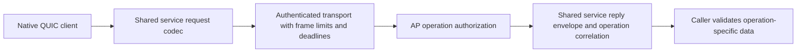

| Family | Operations |
| --- | --- |
| Discovery | describe |
| Registration/content | register_volume, register_session, upload_build, get_blob, resolve_volume_grantee, volume_usage |
| Publisher signing | issue_publisher_certificate, get_publisher_key_status, revoke_publisher_key |
| App publications | get_app, get_build_identity, get_app_display, list_apps, list_app_builds, set_app_build_notes, set_app_enabled, delete_app, publish_app |
| Sessions/invitations | open_session, resolve_session, read_invitation, watch_invitation, advance_session |
| Replicas | provision_replica, sync_database, subscribe_replica, publish_replica, sync_account, subscribe_account, publish_account |
| Private peers | peer_listen, peer_request, peer_reply |
| Blobs | upload_blob, download_blob, publish_bloblog, get_bloblog |
| Credentials/recovery | get_credential_vault, put_credential_vault |
| Account File Provider wake hints | register_file_provider_account_push, invalidate_file_provider_account_push |

Registration records existing local IDs; it never allocates replacement session
or volume identities. Retained mutation identities bind the authenticated account,
operation kind, resource identities, meaningful arguments and concurrency
preconditions. Object property order is irrelevant; meaningful array order and
exact integer values are preserved. An operation replay returns its original
result even after later mutations, without restoring old state. Reusing its ID
with different meaningful contents fails with `operation_conflict`.
Missing `publish_app.notes` means the empty string.
Build IDs are BLAKE3 of the complete `.pbapp`, including metadata, Wasm and assets.
Upload requests declare their bounded content length, followed on the same stream
by exactly those bytes and EOF. Content must validate before acknowledgment.
Registration alone does not acknowledge availability of databases or blobs.
`provision_replica` binds the volume and owner IDs, the `personal` boolean
(permanently false when omitted) and the database key. AP reconstructs the same personal/app role when
admitting replicated metadata; a conflicting provisioning retry is rejected.
Native service-response deadlines default to 60 seconds; an indefinitely idle
subscription is distinct from an unanswered request or stalled transfer.

`register_file_provider_account_push` requires a nonempty hexadecimal APNs
`token` (at most 128 decoded bytes), the containing-app `bundle`
(`playbit.engine` or `playbit.engine.debug`), and `sandbox`. It registers one
account-domain endpoint using the authenticated account identity, including for
an account with no personal volumes. Clients discover this operation through
`describe` before sending; unsupported servers produce an explicit capability
error, without substituting a different domain layout.

`invalidate_file_provider_account_push` takes the same fields and removes only
that exact token/topic/environment endpoint from the authenticated account.
It does not infer invalidation from an empty catalog. Registration and
invalidation return `registered`, which is false after invalidation or when
APNs credentials for the endpoint environment are unavailable. An unconfigured
environment retains registered endpoints for future delivery.

Distinct tokens coexist: an old request completing after client timeout cannot
erase a rotated token. APNs rejection retires the exact retained endpoint
snapshot, so it cannot erase a concurrent replacement. Each account retains at
most 32 endpoints. Pushes coalesce to one account-domain working-set hint per
endpoint. Namespace/blob hints require an owned personal volume with a
provisioned service replica; account-replica publications may signal catalog
changes even for an empty account. Push payloads contain only the File Provider
domain identifier and the working-set container, never
volume names, item identifiers or data. They confer no authority or
delivery/execution guarantee.

`upload_blob` and `download_blob` carry one required `version`: an `address`
with volume and entry IDs, the revision ID, plaintext byte length, and two
32-byte arrays for the plaintext digest and encrypted-envelope key. AP resolves
that complete identity only from accepted canonical source evidence. A raw
revision selector cannot substitute another body. Upload also declares encrypted
`content_length`. Current human and service permissions are checked independently
of retained evidence; Append can upload only the immutable creation body.
Transfer rechecks compare the original entry birth binding as well as the body,
so replacement during transfer cannot reuse an earlier authorization result.

Live publishers upload the exact file versions in each accepted Index delta
before releasing that publication's queue credit. Local saves do not wait for
AP. Bootstrap also drains durable pending files saved before the current
connection. A reader may receive the Index delta first; `download_blob` then
waits for the exact encrypted body, rechecking current authority before sending
it. Upload completion wakes the read directly, without freshness polling.
These waits last at most 60 seconds and are limited to one per account and 16
per AP instance, leaving bulk capacity available for the uploads they need.

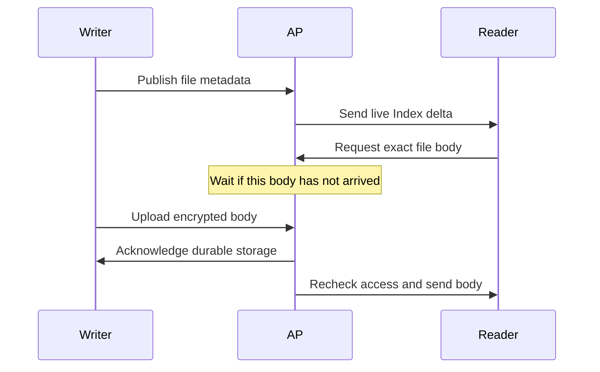

An Index `sync_database` pull ends its kvdb exchange with a separate namespace
acceptance frame, then the final JSON replica receipt. The frame is at most
65,544 bytes: `NSA` plus byte `1`, a little-endian u32 count, and that many
16-byte records sorted uniquely by their 15-byte immutable event IDs. The final
byte carries normalized NAME (bit 0) and PARENT (bit 1) contributions; other bits
must be zero. Births, content edits and deletions carry zero. A combined move
may contribute either field, both, or neither after observed-context normalization. The receipt's required `namespace`
field binds the count, selected-entry scope (or null for a catalog), and BLAKE3
digest of the complete frame. Other transfer kinds carry `namespace` status
`unavailable` and send no acceptance frame. Enforce the evidence limit from the
AP frame header before allocating its body.

A selected Index pull for a qualified retired entry returns its immutable birth
and selected deletion to a participant who currently has both Read and Write on
that entry. The service must retain Read. AP admits the account, session and
revocations under the ordinary selected-entry ordering guards. This projection
contains exactly those two sources and their existing scoped acceptance evidence.
The birth retains all original fields, including its initial permissions. The
projection omits live ACL overrides, history, siblings, and backing records. A client
replaying an offline deletion verifies the same birth and the qualified deletion
that AP selected. A concurrent winner confirms only its own exact event.
This receipt leaves data-access fences intact, including on a later reconnect. An older AP that denies the terminal pull leaves
confirmation pending.

Acceptance is computed from the full pinned canonical Index before projection,
then intersected with source payloads actually delivered to this reader. A
selected head's opaque dependencies are not independently attested. The contribution
bits are computed by that full admission, never inferred from raw register presence
on a selected receiver. NAME/PARENT winners use namespace clock/event-ID order;
CONTENT retains its clock/canonical-value ordering. Receivers
retain evidence only for detached data whose exact projected root matches the
receipt; live reconnect merges may verify and consume the evidence but cannot
qualify the mixed local cut from it. Receipt qualification also requires the
existing authenticated transport, source-cut and policy checks.

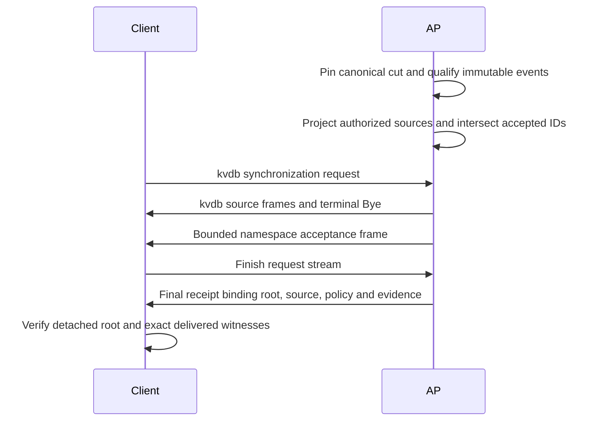

App identity is `{publisher, app_id}`: a certified account ID and the effective
app ID. `issue_publisher_certificate` requires proof from the requested signer
bound to the authenticated account. `get_publisher_key_status` returns signed
status for a publisher/signer; `revoke_publisher_key` permanently revokes a signer
owned by the authenticated publisher. Certificate and receipt formats are defined
in the [package contract](../../package/README.md#authenticated-publisher).

`upload_build` verifies the package signature and current publisher-key status.
`get_build_identity` returns `{app, admission}`, where `admission` is an issuer-signed
receipt for that exact build. A client normally pins its issuer through an independently authenticated AP
connection. The Mac launcher also carries exact-build receipts, an issuer pin and
signed signer status for its bundled examples so they can open offline. That pin
applies only to those exact published builds. Cached bytes or display metadata alone
cannot establish authorship or authorize execution. Current revocation remains
binding even when a retained receipt permits an expired certificate's exact build.

`publish_app` requires the authenticated publisher, an uploaded build with the
same verified app identity and `expected_revision` (zero for first publication).
The selected build, first-publication history and operation receipt commit
atomically, fenced against the exact checked publisher-key state.
`set_app_build_notes` takes the app identity, a published `build_id`, the current
`expected_revision` and a required `notes` string. Only the authenticated
publisher can correct a build's notes. An empty string clears them. The same
32 KiB JSON-escaped text limit applies to publication and correction.
The correction retains the build's original `published_at` and the app's
current build selection. For the current build, `get_app` and
`list_app_builds` both return the corrected text. A successful edit advances
the app revision and notifies subscribers on its publication-history channel.
`set_app_enabled` and `delete_app` also require the publisher and current revision;
deletion requires a disabled app and is permanent. Retained sessions keep their
bindings and data. New ordinary App-following registrations require an active
publication and a previously published build, with availability and signer
conditions checked atomically at registration.

`list_apps` is publisher-account-scoped. App and history pages contain at most
32 records and 128 KiB of record payload, with `next` passed back as `after`.
`get_app_display` names the complete app identity and expected current build;
responses are at most 132 KiB, with a 256-byte name and optional 64 KiB PNG preview
(hex encoded). The upload worker generates the 120×120 preview from the package's
source icon, which may contain up to 1 MiB and 1024×1024 raster pixels. Missing
artwork differs from invalid artwork. Display data grants no execution or data
authority. Catalog refresh is explicit, never a freshness timer.

Fresh automatic sessions using the default World address can synchronize their
Shared (`Session`) scope. An immutable optional `shared_volume` names its existing
app-and-session-derived address. World remains the separate `root_volume`; it is
not registered or given fabricated credentials merely to share session data.
The creator owns the Shared backing and provisions only its database key through
the existing replica operation. The sealed invitation carries its volume and
credentials. Registration, readiness and live policy checks admit that exact
backing using the existing authenticated app/build, permission and revocation
checks. Existing automatic sessions without this binding remain device-local;
they are never uploaded or reseeded implicitly. Explicit World overrides and the
other automatic roles keep their existing support boundaries.

New Shared account records require `shared-session.v1` for reads and writes.
Native profiles and central AP records enforce their own independently scoped
format requirements before writing this binding. Browser Shared imports remain
unsupported and quarantine these authority records. Public app code publication
and update notifications alone grant no access to app data.

Raw PUBLISH/SUBSCRIBE routing has two isolated scopes. Account-private channels
use canonical base58 32-byte destinations. Session channels use flags=1 and the
binary destination `session_id[32] || channel_name_utf8[1..223]`; a bare session ID
addresses its host-managed membership/control channel. No name normalization or
hashing changes the external destination.

The first session frame carries a 64-byte account-bound invitation-possession
proof at the start of its body and an optional 48-byte source (app instance ID,
build ID). An observer of the own channel supplies no source; a participating
instance supplies one. The gateway validates the signature using the session ID
and authenticated account, without consulting root or volume policy. It supplies
the 80-byte source: account, authenticated device, app instance, build. Further
frames retain the exact admitted destination and operation kind. Guests cannot
publish on the own channel. Own-channel subscription bodies may append the
selected app's 32-byte update-channel hash after the proof for code notifications.
After discovering the exact AP feature `session.display-names.v1`, a participating
instance opts into named rosters by appending its UTF-8 account display name
after the optional hash, right-padded with zeros to exactly 256 bytes. A full
256-byte name has no padding. An all-zero field opts in with no current name.
Without a cached advertisement, the host joins immediately with a baseline
subscription and receives the original ID-only roster. Discovery runs independently
on the authenticated connection. Members share the pending request and back off
after a transient failure. An AP that omits the feature continues serving the
baseline roster.

If discovery later advertises the feature, an admitted baseline member can opt in
on its existing stream. It sends SUBSCRIBE with flags=1, its original destination,
empty source, and just the 256-byte padded display name. The AP delivers the
current named roster without a second SUBSCRIBE acknowledgement. A nonempty
opt-in name consumes one rename credit before fanout. The same membership and
routing credit remain active throughout the change. After opt-in,
a participating instance can refresh its name with a SUBSCRIBE frame, flags=1, its
original destination, empty source and its unpadded UTF-8 name (empty to clear).
The AP reads these names over the authenticated transport. Nonempty names must
fit 256 UTF-8 bytes and contain no surrounding whitespace or control characters.
The AP skips refreshes that match the last accepted name on that stream.
Each distinct refresh consumes one account credit before the router
updates or publishes the roster. Each account has a burst of 64 credits (one per
possible routing stream), replenished at 64 credits/second across its connections.
Exhaustion terminates the updating stream. Only named subscribers receive
rename updates. ID-only subscribers retain their queued membership changes
across a burst of renames. Opting in preserves pending app update notifications.
A superseded stream cannot change or remove the replacement member.

A local App follower uses a separate public code observer: a SUBSCRIBE frame with
flags=1, empty source/body and destination equal to the app's 32-byte update hash.
The hash is BLAKE3 of `app.playbit.app-updates.v1\0`, publisher raw16, app-ID byte
length u32LE and app-ID UTF-8 bytes. The service routes this observer only to its
internal `app` topic, with no session ID, possession proof, message key or
membership. It forwards an empty acknowledgment and server-authored
`UpdateAvailable` controls only. Further client input terminates the observer.

An app overview subscribes in the same way to the publication-history address.
Derive its 32 bytes with BLAKE3 `derive_key`, using the context
`app.playbit.app-history.v1` and the app's raw 32-byte update hash as input.
Publishing and changing availability notify both addresses. Editing notes
notifies only the history address. On subscription acknowledgment and each
notification, readers reconcile history through the visibility-checked service
operations. Notifications carry no notes or build data.

Local Exact selections need no remote observer. Local app instance joins, named
channels and publications remain unsupported.

Subscription and publication acknowledgements echo their operation and external
destination with empty source and body. Publication admission establishes a live
delivery attempt, not durability. Application bodies contain a random 16-byte
message ID, 12-byte nonce and AES-256-GCM ciphertext/tag for at most 32 KiB plaintext.
AEAD context is the domain `app.playbit.session.channel.v1`, destination byte
length (u16 LE), exact destination, 80-byte source and message ID. Derive the
32-byte message key with BLAKE3 derive_key context `app.playbit.session.messages.v1`
and the session seed. Application message keys and plaintext remain at participant hosts.

AP own-channel data consists of server-authored initial/changed membership
snapshots and build-update notifications. Membership lists at most 64 app instances
with account/device/instance/build IDs. A roster entry may include
`display_name` as a JSON string. The AP associates this label with the
authenticated member. An absent label means that the name is unavailable.
Own-channel control JSON is bounded to 64 KiB. Observer-only subscriptions add
no member.
Closing the member stream removes the instance. Slow consumers observe terminal
failure/gap. There is no history, offline send queue or publication retry.

Ordinary operation admission is bounded to 128 concurrent handlers/AP and eight
per account across connections; bulk occupies at most 96 globally and two per
account. Capacity errors occur before storage work. Long-lived subscriptions have
separate finite bounds: 32,768 replica subscriptions/AP, 2,048/account, 128/source and 16/account/source,
1 MiB buffered/subscriber and 1,536 MiB aggregate, including in-flight writes.
The service enforces existing authorization before accepting, committing or
projecting data, including current revocations; a cached handle is not authority.

### Operation-private duration annotations

Every `ServiceResponse`, including a rejected operation, has a mandatory
`timing` array. The previous reply shape is removed. Each entry has exactly
`stage` and `duration_ns`; the duration is a canonical unsigned decimal string
in the u64 range, preserving nanoseconds exactly in web JSON readers.
An empty array means no detail is available. Stage identities are exact names:
4–64 ASCII bytes beginning with `ap.` followed by one or more lowercase letters,
digits, dots or underscores. Unknown names are optional annotations; clients
validate and charge them against every budget, then ignore them for local trace
instrumentation. They never become dynamically named trace stages. Missing or
duplicate stage identities, extra entry fields and malformed durations remain
errors before reply adoption. Optional annotations do not change operation,
denial, credential, retry or authorization semantics.

| Static stage | Observed boundary |
| --- | --- |
| `ap.request_read` | Admitted request-frame read |
| `ap.admission_check` | Ordinary handler's immediate capacity decision; no invented queue wait |
| `ap.authority_check` | Live replica authority check |
| `ap.durable_merge` | Completed account/replica merge scopes and conditional authentication-record writes |
| `ap.storage_wait` | Explicit storage-job submission through blocking-worker start |
| `ap.storage_sync` | Completed fsync calls owned by the operation |
| `ap.mail_send` | The current authentication attempt's actual delivery call |
| `ap.operation` | AP-owned operation start through this reply's snapshot |

At most eight distinct entries, including unknown names, fit within 1 KiB of
canonical JSON, including the field name and separator (532 bytes at all eight
known maximum u64 durations). Names are counted after JSON string decoding;
whitespace does not enlarge the canonical allowance. The binary authentication
envelope additionally bounds the actual timing JSON span to 1024 bytes. This metadata
is **inside existing frame limits**, including 4-KiB control replies and the
132-KiB build-display reply; it grants no larger frame or stream credit. The
largest validated display plus maximum timings has a boundary regression.

Measurements belong to one AP-owned operation and its explicitly captured
storage jobs. Completed intervals of the same stage are summed with checked
arithmetic; overflow or concurrent-update contention makes that stage
unavailable. Missing stages are never zero-filled. Stages can overlap or nest,
so their sum is not the operation's wall time. A subscription's initial reply
measures only setup through that reply; later fanout carries no origin token or
measurements from other publishers. A retry starts a fresh AP measurement.

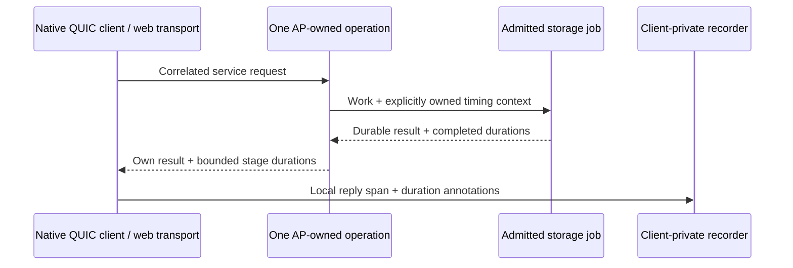

Timing decoders produce a local instrumentation projection and never relay or
rewrite annotations. Service producers emit their own measured stages.
Native clients link recognized timings to a local reply-processing span, on the
owning flow. They are remote durations, not reconstructed remote positions on
the local clock. AP native records remain operator-only. No account identity,
resource name, record contents, subscriber count or stage clock offset enters
the timing projection. Optional client trace metadata is not sent in this
increment; the AP always mints its own operation flow and transfer identities.
Authentication uses the separate bounded binary reply envelope described above. Native product hosts use QUIC; WebSocket remains the web
fallback when QUIC is unavailable.

## Replica event framing

After the subscription acknowledgment, ordered AP frames carry replica bodies:
version byte 1, kind byte, two zero bytes, epoch (16 bytes), sequence (u64), policy
revision (u64), complete database identity (16 bytes), payload. The fixed header
is 52 bytes. Epoch and sequence are nonzero. Kinds: changes=1, caught-up=2,
gap=3, revoked=4, bloblog=6, selected namespace=7. Changes use an index, revocation or named-entry
identity and a 1–65,536-byte delta. Control kinds use the index identity and no
payload. Bloblog uses its named-entry identity and at most 2,048 payload bytes;
an empty payload requests catch-up for that log. An inline payload is a one-byte
cursor text length (1–104), that many UTF-8 cursor bytes, then the encoded log batch.
`publish_bloblog` and `get_bloblog` require the `bloblog-append-v1` service feature.
Publish carries a required canonical-base58 16-byte `append_id`, distinct from
`operation_id`. The account, volume, log and append ID identify one logical batch.
AP canonicalizes its entry metadata; clients use the same versioned derivation in
`store/bloblog.rs`. The ordered payload identity excludes proposed clocks/nonces.
One atomic durable transition retains the canonical batch, its log position and
append outcome before visibility or fanout. The existing bounded `PublicationAck`
reports success; it contains no payload data. A matching repeat returns logical
success, changed contents return `operation_conflict`, and an unresolved write
returns `operation_uncertain`. Repeat explicitly with the same ID to resolve it.
No background publication or reconnect resubmission is permitted. Current
permissions and log lifetime apply on replays too. Clients cache only accepted
canonical entries, and keep their local read cursor separate from AP coverage.

The cursor uses the canonical base58 fields specified by `store/bloblog.rs`. Caught-up, changes and bloblog
require nonzero policy revision. Checkpoint control is the
two bytes `[1, 0]`. `replication.rs` defines exact rejection behavior.

Selected namespace events use the selected entry identity, a nonzero policy
revision, and an Index payload: u32 little-endian delta byte length, exact kvdb
delta bytes, then sorted unique acceptance rows (15-byte namespace event ID and
one normalized-assignment mask byte). At most 64 rows are admitted; delta,
length and evidence together remain within 65,536 bytes. Mask bits are name=1
and parent=2. Unknown bits, duplicate/unordered IDs, absent source payloads,
changed source clocks or mismatched stream scope fail the complete event.

AP stores normalized acceptance beside the original canonical payloads at
its authorized commit boundary. It prepares evidence outside the fanout mutex
using only sources permitted in that selected delivery. Opaque dependency IDs
never become confirmations. Newly accepted sources are tracked even when only
another entry's dependency changed. If their permitted payloads are absent from
the delta, or the envelope exceeds its bounds, that selected stream enters
explicit gap recovery. Write/Append-only streams never receive history bodies.

Recipients commit source merge, original payload bytes, Confirmed observations
and qualified current controls atomically, before advancing their cursor. This
commit also occurs when every raw source loses LWW but acceptance adds local
knowledge. Exact duplicate acceptance does not manufacture another source edit.

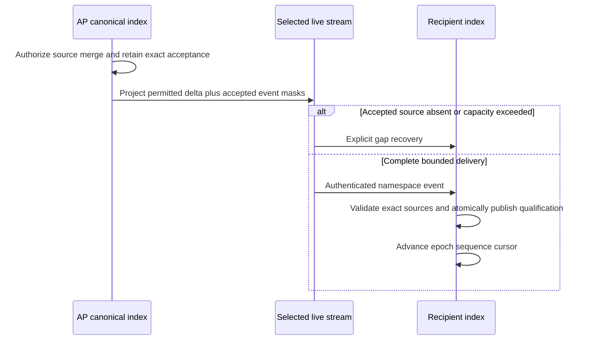

EOF, an unexpected epoch or forward sequence gap invalidates live readiness.
Persistent delivery uses actual changesets; snapshot pulls occur only at
initialization/join, reconnect or explicit gap recovery. No remote acknowledgment
belongs on the local rendering path.

## Live replication and authority

All operations use the existing authenticated AP connection. `SubscribeReplica`
opens one reliable volume subscription, bound to the current admitted session
and exact version, or to authenticated owner maintenance. `PublishReplica`
submits one actual committed database delta. An object birth contains all
initial fields in one source record within its named database. These are authorized persistent
publications, not best-effort session messages or unrestricted raw channels.

## Encrypted account records

`SubscribeAccount`, `SyncAccount` and `PublishAccount` use the authenticated
principal's account; none accepts an account ID, volume ID, invitation or grant.
They reuse the replica event codec, registry credits, checkpoint/gap mechanism,
kvdb clocks, merge protocol and backend cache. Their database identity is the
reserved index and their
policy revision is 1 (authenticated account scope, without volume ACLs). An
account source and a volume with the same bytes are distinct subscription scopes.
The same aggregate and per-account limits apply; no extra queue budget is added.
`SyncAccount` takes the ordinary `pull`/`push` direction. Its initial success
response starts kvdb transfer; its final data is`{"root":...}` for the transferred
snapshot on pull or durable merged state on push. `PublishAccount` takes one
bounded delta and returns the usual `PublicationAck`. Account publication never
confers a service database grant or access to plaintext blob keys.

`PutAccountDisplayName` stores a readable profile name under the authenticated
account ID. The request includes `name`, the account record's opaque 32-byte
`record_key` in canonical base58, its unsigned decimal `clock`, and its
original envelope as unpadded base64url `ciphertext`. AP checks the version
against the account's committed replica entry before storing the supplied
name. The name follows the account's 256-byte UTF-8 validation rules.
The authenticated client asserts the plaintext label and its source key. Clients
derive this key from `settings/display-name` using the private account lookup key.
Only a client with the recovery secret can verify the logical key and decrypt the
name. For updates from the same source, AP compares clocks numerically and breaks
ties by the original envelope bytes. Replaying an older version of that entry
leaves the newer name in place. An account can replace a mistaken source with a
different committed entry even when the new source's clock is lower. A successful
response has no data. Clients can publish an already-synchronized name when
they connect, including after upgrading a profile that has no pending account writes.

APs advertising `account-display-names.v1` support the authenticated
`get_account_display_names` operation. Its `account_ids` array contains 1–17
distinct canonical 16-byte account IDs. Any signed-in caller can look up an
exact ID in the connection's AP namespace. Success data is an array of
`{"account_id": "...", "display_name": "..."}` objects in request order. It
omits accounts without a published name and unknown IDs in the same way. The
response body is limited to 24 KiB. Names follow the same 256-byte UTF-8 rules
as publication and serve only as display labels.

The account kvdb's public hash key is BLAKE3 derive-key with context
`app.playbit.account.tree.v1` and the 16-byte account ID as input. This is a tree
hashing parameter, not an encryption key. Clients derive two 32-byte keys with
HKDF-SHA256: 16-byte account key as input, account ID as salt, and independent
info strings`app.playbit.account.encryption.v1` and`app.playbit.account.lookup.v1`.
An opaque kvdb key is HMAC-SHA256 of the logical record key using the lookup key.
AES-256-GCM record envelopes contain byte 1, a random 12-byte nonce, ciphertext,
and a 16-byte tag. Additional authenticated data is
`app.playbit.account.record.v1\0`, account ID, opaque 32-byte key, and originating
kvdb entry clock as 8 little-endian bytes, concatenated in that order.
Record plaintext is 1–49,152 bytes. Deletion must itself be an encrypted typed
record; a plain kvdb tombstone is rejected. The shared fixture and native/web
tamper tests pin these bytes. Account records include only explicitly shared
state: volume capabilities, original session invitations, session-scoped personal
consent and account settings. Device authentication seeds, pending AP operations,
local paths, current AP-authorized session adoption and local denials are not
copied as arbitrary metadata. Typed validation precedes exposing received state.

Seal a committed originating value once and retain its ciphertext and clock
through acknowledgment/retry; do not regenerate a nonce for a replay. Validate
the entire incoming delta before client mutation, including entries that LWW
would otherwise ignore. AP validates framing/size and opaque shape; it cannot
authenticate or decrypt the contents. Ordinary kvdb LWW preserves encrypted
entry clocks through service relay. The service can delay or withhold data; this
encryption does not prove freshness or availability. In particular, envelope
authentication covers entry clocks, not a delivery epoch or a sync frame's clock.

Native local mutations save the encrypted record, originating HLC and dirty
marker in the same profile transaction as the shared value. Only an explicitly
acknowledged account key with a successful vault revision can seal records;
earlier local state is seeded once after that boundary. Retrying a seed skips
already recorded values, so a concurrent newer local mutation wins. A publication
reader advances a 32-byte cursor, retaining one record at a time. It clears a dirty
marker only when the acknowledged clock and ciphertext still match. A newer local
write cannot disappear behind an old acknowledgment. Account change stamps wake
the existing committed-feed socket without another in-memory payload queue.
The native account tree uses the existing bounded replica cache, with a distinct
account key and a durable first-creation marker. A missing initialized account
file is an error; ordinary access never resets it. Outbox staging validates the
typed plaintext/key binding and compares originating clock then ciphertext bytes,
matching ordinary kvdb LWW. Older records cannot overwrite newer tree entries.
A retry extracts the committed entry from a read snapshot, preserving its clock
and ciphertext without another fsync or clock advance; replay does not wait for
a concurrent writer. A raced first stage rechecks under its write transaction.


The UTF-8 JSON plaintext uses a `kind` tag. Its current shared records are:

| Kind | Fields | Logical key |
|---|---|---|
| `volume` | `volume` (ordinary Volume), `credentials` (`database_key`, `blob_key`, each 32 byte values) | `volume/` + canonical volume ID |
| `invitation` | `invitation` (the seed and the original envelope contents: session, both volumes and their credentials) | `session/` + canonical session ID |
| `personal_volumes` | `session` (canonical session ID), `grants` (volume ID and boolean `write`) | `session-mounts/` + session |

Native credential bytes serialize as JSON integer arrays. Empty personal grants
mean explicit denial; absence means no decision. Current AP session adoption and
local denial stay outside these records. An authenticated ciphertext alone is not permission to install arbitrary profile keys.

Install the subscription before snapshot catch-up, apply queued deltas, then
consume the checkpoint. Full-sync reception retains only a read snapshot and
bounded discardable journal while waiting on transport. Durable merge and queue
insertion precede the acknowledgment; no account or volume lock spans a network
wait. A known lost acknowledged database produces failure and a stream gap,
never an empty replacement. Recovery snapshots
are initialization/recovery input, not a per-edit notification-and-fetch path.

## Commit and authority

Local mutation commits synchronously. While retaining its existing volume
operation guard, the store enqueues the actual committed delta without waiting
for AP. A feed epoch and checked global sequence identify that publication;
they are not recipient delivery cursors. Failed transactions publish nothing.
The bounded feed and projection allocations are in the internal performance contract.
Overflow and oversized transactions produce an explicit recovery boundary.

AP receives the complete bounded delta before acquiring transaction/authority
locks. It reuses the existing connection admission, exact-version provisioning,
volume/object permission, metadata validation and revocation checks. It merges
durably, then captures and projects applied entries to each authorized
recipient. Retained entry clocks and tombstones remain unchanged. The same
volume ordering boundary covers commit, policy checks and subscriber enqueue;
network writes never occur while holding it. No per-edit whole-database copy,
projection or pull is permitted.

A publication response acknowledges its durable merge, correlated by the
ordinary AP operation ID. Retrying the same delta cannot repeat a non-idempotent
effect: kvdb entry clocks resolve duplicates, and unchanged merges emit no new
data change. Remote acknowledgment does not delay local UI or local commits.

## Subscription order and initialization

One volume stream orders its database changes. New objects use one creation
event containing both catalog and initial application data, so a reader never
observes a catalog entry whose required data has not committed. AP allocates a new opaque epoch for each subscription and a
recipient-specific increasing sequence for delivered events. Filtering data
does not create holes. A client ignores already-applied sequences; an unexpected
epoch, forward gap or terminal event requires explicit recovery. Neither HLCs
nor database root hashes are delivery cursors.

Native hosts share `ap::replication::Cursor` through `ap-protocol`; it requires
no desktop engine, executor or transport. Construction validates the subscription
acknowledgment. `accept` checks shape, epoch, sequence and policy revision without
advancing state. `Ok(false)` means a duplicate; `Ok(true)` also includes terminal
`Gap`/`Revoked`, which the host must handle by stopping delivery. For accepted
nonterminal events, call `applied` only after successful durable apply or ordered
checkpoint handling. `record_applied` is the same boundary when a storage worker
consumed the original event buffer. Its scalar fields must come from that admitted
event. Neither method grants authority or replaces bootstrap/retirement rules.

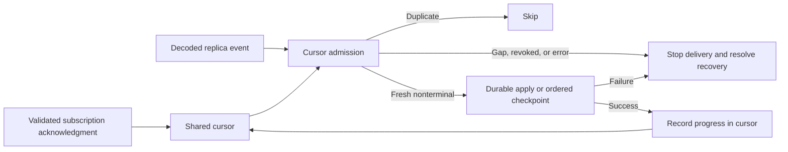

Install and authorize a subscription under the publication ordering boundary
before initialization/reconnect pull. Buffer subsequent authorized changes
within its byte budget while the ordinary pull supplies a consistent snapshot.
Duplicates between that snapshot and the queued changes merge idempotently.
After applying the snapshot, the client requests a checkpoint on the existing
subscription stream. AP enqueues `CaughtUp` after preceding publications under
the same ordering boundary. Apply queued changes through that marker before
reporting caught up. This closes the pull/subscription race without a new pull
for every publication.

An owner with a previously acknowledged Index can requalify its catalog and
ready entries from one authenticated AP cut while a named backing awaits its
first upload. An invited World reader can use the same partial capture. Their
volume-stream checkpoints require initialized Index and Revocations and order
events for the authorized stream. Each pending backing needs its own verified
snapshot before new data becomes readable. Existing rejected bytes remain
quarantined when permission is later granted. The client retries missing
snapshots through its bounded initialization schedule.

Before replacing a subscription, abort and join its receive task, then await
its admitted storage applies through the account's event-driven retirement
notifier. Canceling an async wait does not cancel a durable blocking write.
Do not begin a new bootstrap until the prior generation is inactive; retain its
dirty notice for the replacement. Registration rejects a still-active generation.

Queue saturation emits a terminal `Gap` and closes delivery; revocation emits
`Revoked`. A subscriber cannot remain apparently current after lost delivery.
Policy changes that expand or contract payload visibility also invalidate
delivery pending authoritative recovery.
AP prunes service-excluded payload under its existing policy. Clients retain
unsynchronized/downloaded data; current local admission and outbound projection
continue enforcing changed permissions. Revocation does not authorize erasure. Recheck authority before
enqueueing projected bytes; do not send private data to a broader session topic.

The driver belongs to the persistent local engine. Its notifications
wake local consumers and running guests with `DataChanged` after actual durable
merges. GUI lifetime and explicit `pb sync` cannot drive freshness. Pull remains
for initialization, reconnect or declared gap recovery; diagnostic sync is an
acknowledgment barrier.

## Atomic creation

Creation groups encode a four-byte little-endian metadata length followed by
the metadata delta and application delta, at most 64 KiB combined. One group
creates exactly one object: metadata contains its object/creator entries and
optionally database/3; application data contains its matching type marker and
initial fields. Schema/ACL changes and unrelated keys are forbidden. Validate
the complete group before acquiring authority or transaction locks. Writer
authorization uses current policy; application authorization uses prospective
policy built from effective LWW metadata winners, preserving newer ACLs and
creator attribution. Recipient validation does not impersonate the writer.

Keep metadata pending while validating both deltas, commit application data
first, verify its effective type marker, then commit metadata under the same
authority boundary. A failed second commit leaves hidden data and requires
recovery. On retry, if either part applies, relay both validated original
deltas with their original clocks as one inseparable event; otherwise relay
nothing. This exception to applied-entry capture prevents a successful retry
from exposing metadata without the data committed by its earlier attempt.
Projection either includes a complete readable creation or omits that creation;
it never synthesizes newer policy into an older delta. Single-database bootstrap
that introduces objects invalidates existing live subscriptions for recovery.
Cover schema, ACL/revocation, consent and received changes; a checkbox-only hook
is not complete synchronization.

Private volumes use the existing authorized encrypted peer path over AP.
A session with a bound Shared volume uses hosted replication. AP rejects
`PeerListen` and `PeerRequest` for that session before admitting the connection
or offering a transfer, so the hosted replica enforces current revocations.
Account state uses the same ordering, delta and recovery model with a canonical
client-encrypted account replica. Never replicate the mixed-secret local profile
wholesale. Preserve existing recovery bootstrap and explicit personal consent.


Acceptance: no steady-state pull in an initialized TODO edit stream; no remote
acknowledgment on local commit/render; GUI-closed and CLI-only progress; correct
ordering, duplicate, reconnect, overflow, revocation and partial-access behavior;
bounded memory/fanout and fair local input during stalled peers and bulk work.


Native account receipt authenticates and validates every record in a complete
frame before mutating the local account tree, including LWW losers. It projects
only that frame's keys into the profile, committing the observed origin/ciphertext
with the corresponding local state. Exact replay never acknowledges unsent local
intent. Startup/reconnect/gap reconciliation visits a pinned account snapshot to
repair a crash between tree commit and profile adoption; this catalog traversal
is not used for live edits. Credential preparation and immutable identity checks
share the existing recovery importer. Existing device session adoption/denial
remain local; session-scoped consent retains newer local intent and cannot admit
an unknown or foreign-owned volume. 

## Direct personal volume invitations

Discovery advertises `volume-invitations.v1` when AP can retain and deliver
account-addressed volume invitations. Owner operations require the authenticated
owner of the registered volume. A recipient watches its own inbox on the
existing connection. Direct volume sharing uses its own operations and requires
no session, app, invitation link or session possession proof.

1. The client registers a dedicated X25519 public encryption key with
   `RegisterVolumeInvitationKey`. The immutable account vault verifier must
   verify an Ed25519 signature over ASCII `app.playbit.volume-invitation.key.v1`,
   a zero byte, the raw 16-byte account ID, and the 32-byte public key.
2. The owner publishes the source ACL clock and sorted direct human recipients
   with `PutVolumeInvitationPolicy`. `ListVolumeInvitationRecipients` pages
   through prior deliveries, with at most 32 recipient/clock pairs per page.
   `GetVolumeInvitationKey` accepts a recipient in the current policy. An
   absent key returns null. An account-neutral `key_ready` wakes a subscribed
   owner to recheck missing recipients. The bounded AP interest filter can
   coalesce readiness and can cause an extra recheck.
3. `PutVolumeInvitation` carries the volume, recipient, original source clock
   and either a recipient-sealed envelope or a withdrawal. The envelope is
   unpadded base64url of at most 4096 bytes. The volume name, database key and
   blob key are inside it. AP checks membership and the precise policy version
   at commit. An equivalent same-generation offer keeps the existing encrypted
   bytes. A stale owner cannot restore a withdrawn recipient.
   The binary envelope begins with version byte 1 and a 32-byte encapsulated
   key, followed by RFC 9180 base-mode HPKE ciphertext. The suite is
   X25519/HKDF-SHA256/AES-128-GCM. HPKE info is the ASCII string
   `app.playbit.volume-invitation.envelope.v1`. Associated data concatenates
   the raw 16-byte owner, recipient and volume IDs, then the original ACL clock
   as a little-endian u64. Plaintext is JSON with `volume` and `credentials`.
4. `WatchVolumeInvitations` first returns a correlated service acknowledgment.
   Subsequent flags-zero service data frames carry a JSON `VolumeInvitationEvent`.
   The initial stream sends each current upsert or withdrawal and then `ready`.
   AP registers the watcher before reading this snapshot. Upserts, removals and
   readiness events continue on that stream. Clients apply each volume's clock,
   tolerating duplicates across the snapshot boundary. A terminal `gap` or
   disconnect requires a replacement subscription.

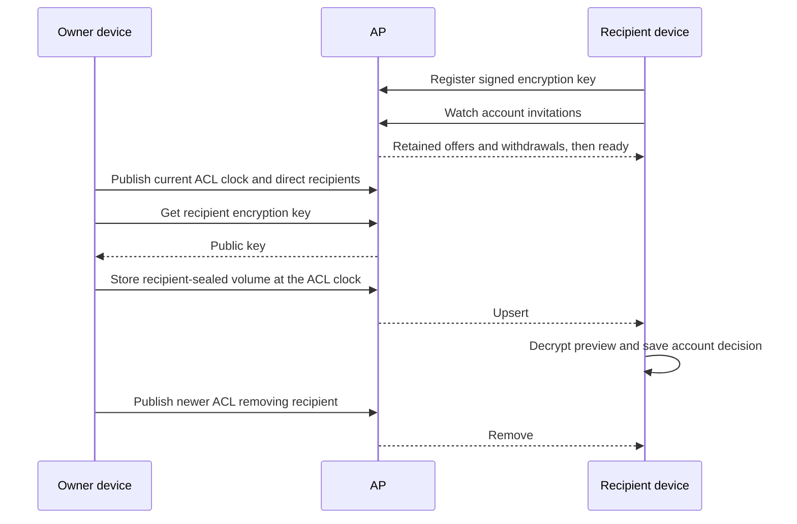

A hosted personal volume's current, individually named human grantee may use
ordinary unscoped catalog replication. AP checks current directory membership,
the registered owner and personal role, the hosted index's named human grant,
effective Read and revocation state. Event subscription installation and
directory withdrawal share the volume ordering guard. Withdrawal retires a
direct catalog subscription even when the hosted index is still catching up.
Entry ACLs control each projection. Maintenance and initial control database
provisioning remain owner operations.

For a private personal volume, the registered owner uses `VolumePeerListen`.
AP routes a request to an owner connection that successfully reconciled the
volume's currently committed ACL clock. The connection retains its revision
across listener setup and refreshes it on later grants. Recipients wait for a
current owner when all online owner devices hold older revisions. A policy
advance closes transfers and subscriptions admitted at the earlier revision,
including when the same recipient retains a different permission.
Private volume listeners have their own bounded per-account and global
allowances so active app sessions retain their routing capacity.
`VolumePeerRequest` and `VolumePeerSubscribe` admit the addressed recipient
under the current directory policy. AP relays only ciphertext to the owner's
authenticated connection. Direct `PeerEvent` records have empty session and
build IDs. A live subscription sets `live` to true, uses the Index/Pull
designation and keeps the authenticated duplex stream until a policy advance or
disconnection. The existing `PeerReply` binds the responder's connection and
request ID. The source checks the current data policy for each transfer.
After an unavailable peer returns, the recipient receives `peer_available`
on its inbox stream.

A direct peer pull identifies a database, a file version, or an append-log page
inside the encrypted stream. File bodies travel in bounded chunks. The receiver
checks the authorized version and digest before admitting the bytes to its
local cache. Append-log pages use the same source cut as the other backings in
the volume snapshot, including an empty log.

When a recipient explicitly synchronizes a private volume, its publisher drains
the committed local changes and sends a checkpoint on the live stream after
those deltas. The owner echoes the checkpoint after applying the preceding
deltas durably. A disconnected peer, a feed gap or a missed deadline fails
the checkpoint. Ordinary local edits continue without waiting for this exchange.

## Invitation envelopes and readiness

`RegisterSession` carries the creator's sealed invitation envelope (base64url,
≤4 KiB decoded) with the immutable session record. `ReadInvitation` returns
`{envelope, session}` to any principal presenting the session possession proof.
The returned session comes from AP's authenticated registration, independently
of the opaque envelope; the service never holds a key that opens it.
Native clients read it from the readiness observer
once a status other than `waiting_registration` arrives, and the CLI join path
reads it directly. Web clients do the same through the shared AP worker.

Possession of a link authenticates its encryption/signing keys, not its claimed
publisher. Before retaining a newly received invitation, native clients compare
its immutable session identity against this registration. `ResolveSession`
also returns the registered `session`, and native clients check it before using
resolution metadata, including peer-only bootstrap. Both native and web
clients compare `OpenSession`'s authenticated session with the exact candidate
before clearing denial evidence or adopting/running it. Immutable identity is
the session ID, full app identity, creator, root, optional Shared backing, update authority and selector
origin (Exact or the complete App identity); advancing a build does not change it.

Invitation payloads have exactly two capability shapes. Legacy invitations retain
`root` and `root_credentials` with no Shared field. Shared invitations carry only
`shared: {volume, credentials}`, whose volume must match the derived session
binding and belong to its creator. Mixed or partial shapes reject. The existing
4 KiB envelope and encryption/key-derivation contract stay unchanged.

After a signed-in participant opens the session, replica operations scoped to
that session and build can match the `session_participants` ACL subject on its
bound Shared volume. An unscoped request uses account and public grants. The
normal volume and entry ACLs govern reads and writes, including after a grant
is changed. AP uses the existing database credentials and replication protocol.

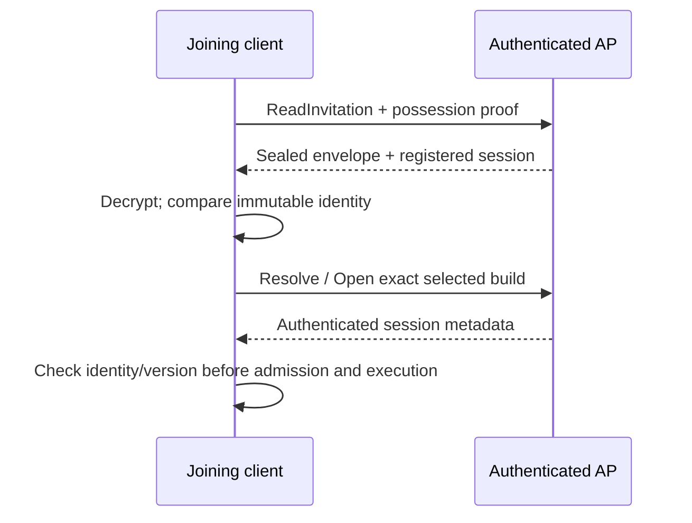

`WatchInvitation` authenticates possession against the AP principal, registers
before the initial session lookup, then sends an acknowledgment followed by
complete `InvitationStatus` frames (≤4 KiB). It grants no session admission.
The observer binds app/root dependencies before checking their
readiness. Registration, release/package changes, metadata/revocation writes,
bootstrap completion and peer arrival/departure wake affected observers. Repeated
identical states are coalesced. Clients do not poll or request a database pull
for these events. Joining independently rechecks provisioning and authorization.

Native `WatchInvitation` starts one selected local observer and returns cached
state immediately. `Status.invitation_status` carries its session and state;
the ordinary local change feed announces updates. A macOS link stays in memory
until the requesting desktop process receives the authenticated session details
and acknowledges them to the local engine. A new macOS launch drops any
unacknowledged preview, including one that resolved after the app quit.
`PauseInvitation` retires the observer and cancels only that invitation's
transfer. It saves the pause with the preview, in memory for an unresolved
macOS link.
`ResumeInvitation` clears pause and observes again; it does not join or choose
personal volumes. AP waits run on the existing network runtime. A new account
connection replaces the selected observer; stale/canceled tasks cannot publish
into its replacement. Web observation uses the shared AP worker and closes
its stream on cancellation or before app bootstrap. 

The AP reserves at most 128 operation-header readers and 128 account-private raw
routing streams across testing namespaces. Excess streams are reset without
admitting work. Raw routing retains at most 128 channels and 8 MiB of shared
queued frames; capacity exhaustion ends that routing stream. These credits are
separate from ordinary-operation and replica-subscription budgets, so stalled
header readers cannot consume ordinary interactive-operation credits.
Native QUIC endpoints use 512 KiB receive credit per stream and 2 MiB per
connection, and retain at most 2 MiB of unacknowledged send payload per connection. Frames and streamed
content larger than these windows are transferred incrementally.


The native local engine can opt into privileged integration fixtures with
`PLAYBIT_CHANNEL=testing` and `PLAYBIT_TESTING_CREDENTIALS`
pointing to a private, at-most-1-KiB JSON file (`key` and `namespace`, each a base58-encoded 16-byte value), together with a fresh custom `PLAYBIT_PROFILE`. Default Public and Testing
profiles reject these credentials. Ordinary support-user Testing needs no fixture
key. The integration profile stores no testing key in
the profile. A persistent namespace marker prevents ordinary-profile conversion,
namespace switching and fallback to ordinary account authentication. Binding runs
under the exclusive store lock before account metadata opens. DNS/TLS/testing HELLO run
in background account bootstrap after local engine readiness. This local setup
does not change the wire framing or server authorization rules above.


### Onboarding receipts

ONBOARDING is an authenticated request/acknowledgment on a separate stream, with
flags 0, empty source/destination, and exactly one milestone byte: credentials
saved (4), required recovery ready (5), profile initialized (6), or setup complete
(7). The server derives the account from the admitted authenticated principal;
the payload contains no account selector, names, recovery material, or app data.
A successful acknowledgment echoes the frame only after the durable receipt
commits. Unknown milestones are errors. Duplicate/delayed receipts never regress
progress; setup completion requires all four receipts. Clients persist pending
bits locally and retry after reconnect without waiting on the usable UI.

```mermaid
sequenceDiagram
    participant Engine
    participant Pending as Local pending milestones
    participant AP
    participant Records as Account records
    Engine->>Pending: Successful engine operation#59; persist bit
    Engine-->>Engine: Continue usable UI
    Pending->>AP: ONBOARDING milestone over authenticated stream
    AP->>Records: Atomic immutable milestone and pending analytics receipt
    Records-->>AP: Committed
    AP-->>Pending: Echo acknowledgment
    Pending->>Pending: Mark bit acknowledged
```

### User agreement

Authenticated `AGREEMENT` (type 8) frames have empty source and destination.
The body is the 32-byte SHA-256 digest of the exact archived agreement Markdown,
including its final newline. Flags 0 query the current agreement, and flags 1
record affirmative acceptance of revision 1. AP checks the digest and echoes it
in every successful reply. A query returns flags 0 for a missing receipt or 1
for a matching receipt. Acceptance returns 1 only after durable storage. Retries
preserve the first timestamp for that account and document.

Native clients store local assent under the account ID and agreement digest.
The bounded onboarding worker delivers any pending acceptance on completion or
reconnect. The next setup screen can appear as soon as the local write commits.
An acceptance awaiting upload survives a stale query and an application restart.
Explicit CLI sync uses this authenticated exchange before its first transfer.
With a pending local acceptance it submits the digest. Otherwise it queries the
receipt, including when the device has cached an earlier acknowledgment. Only
the positive reply for the current account and document admits the request.

```mermaid
sequenceDiagram
    participant UI as Desktop
    participant Local as Local engine/store
    participant AP as AP
    UI->>AP: Authenticate with REGISTER flags 0
    AP-->>Local: Authenticated account
    Local->>AP: AGREEMENT query with bundled digest
    AP-->>Local: Accepted or required, echo digest
    Local-->>UI: Required when receipt is missing
    UI->>UI: Show agreement#59; scroll to end
    UI->>Local: Accept exact document
    Local->>Local: Commit acceptance and pending receipt
    Local-->>UI: Continue to display name
    Local->>AP: Background acceptance with bundled digest
    AP-->>Local: Durable receipt acknowledgment with matching digest
```


## Public content by hash

`get_blob { operation_id, hash }` returns immutable bytes named by a canonical
base58 BLAKE3 hash. It needs no session ID, invitation proof, volume reference,
or session admission. The response header contains `content_length` and `hash`,
followed by ordinary transfer chunks and the final service response. Fetching
code or encrypted bytes never admits a session or grants decryption credentials.

Unauthenticated HTTP reads use `https://blob.playbit.app/{hash}`. Cloudflare
routes directly to S3's HTTPS REST endpoint, rewriting the path to `blobs/{hash}`;
AP carries no HTTP response bytes. Successful immutable objects are cacheable for
one year. Redirects and errors are not stored in the edge cache. Clients verify
the content hash before retaining bytes. S3 supplies Content-Length and its own
ETag, which is not the content hash. Anonymous missing-object requests can return
S3's 403 AccessDenied because bucket listing remains private; authenticated
`get_blob` distinguishes not-found from storage unavailability. AP reads retain
the ordinary bulk admission limits.

App bundles and encrypted volume blobs share the same content store and
`blobs/{hash}` backing-store keys. Volume receipts still attribute durable storage
to a volume, and upload authorization still resolves its current immutable
reference. Public reads return encrypted volume envelopes, never plaintext keys.

```mermaid
flowchart LR
    Session[Encrypted account session record and last known app name] -->|Session becomes known| Cache[Bounded client build fetcher]
    Cache -->|get_blob hash| AP[AP content store]
    HTTP[Unauthenticated GET blob.playbit.app/hash] --> Edge[Cloudflare immutable cache]
    Edge -->|Cache miss, HTTPS| Backing
    AP --> Disk[Verified local content cache]
    AP --> Backing[blobs/hash in durable object storage]
    Cache -->|Validate package and hash, commit bytes| Local[Local build cache]
    Local -->|Completion notification| Sidebar[Name and explicit build state]
```

An encrypted account invitation record also carries `app_name`, either a last
known package name or null. It is display metadata beside the saved session,
separate from the original immutable invitation and from permissions.
Native status exposes names by session ID and build states by build hash. Missing,
downloading, unreadable, invalid and download-failed states are distinct; failed
transfers carry their dependency error. Connected clients eagerly fetch missing
builds referenced by saved sessions without waiting for an open or volume bootstrap.
