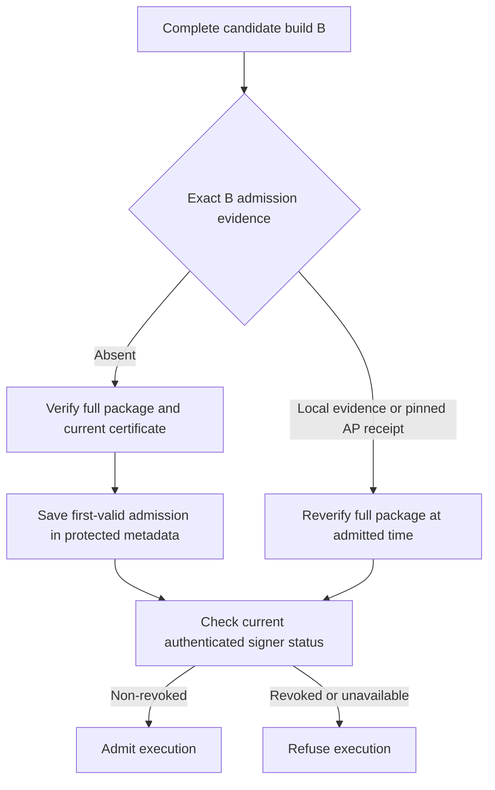
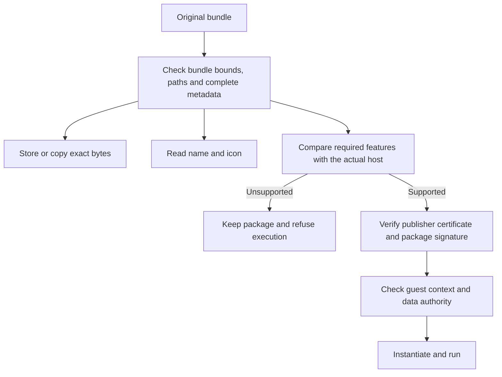

# Immutable app packages

`PBAPP` revision 1 is an indexed, immutable bundle. Validation and name/icon
display do not authorize execution. Its ID is the BLAKE3 hash of every original
byte. Readers, caches and copies keep those bytes; never reconstruct an existing
ID from only the metadata fields a reader understands.

## Bundle bytes and paths

All integers are unsigned little-endian. The 32-byte header contains the eight
magic bytes `PBAPP\0\0\0`, revision `u32` (1), entry count `u32`, index length
`u64`, and complete package length `u64`. Each index record contains path length
`u32`, reserved zero `u32`, payload offset `u64`, payload length `u64`, UTF-8 path,
and zero padding to eight-byte alignment. Entries sort strictly by path bytes;
payloads follow that order with zero padding to eight-byte alignment. There are
no trailing bytes or duplicate paths.

Size limits are 512 MiB total, 1 MiB index, 1,024 entries, 512-byte paths, 64 path
components, 255 bytes per component, 256 MiB ordinary resources, 64 MiB executable,
1 MiB icon, 384 KiB aggregate volume initializers (64 KiB per declared role),
256 KiB trace schematic and 16 KiB manifest.
Paths are relative and cannot contain empty, dot or parent components, NUL,
backslashes, or a file that is also a directory. Readers stream resource bodies
in chunks of at most 64 KiB and need not allocate optional resource contents.

Required core paths are `app/main.wasm`, `app/manifest.json` and
`app/volumes.json`. `app/icon`, `app/trace.json`, and `app/signature` are optional
for structural inspection. Execution requires `app/signature`. Unrecognized
core `app/` names are rejected. `app/extensions/<name>/<resource>` is explicitly
optional: names contain 1–64 lowercase ASCII letters, digits, dots, underscores
or hyphens; resources follow ordinary path rules. Readers copy unknown extension
content without interpreting it. It cannot grant permissions, create
seed data or alter executable semantics.

## Manifest and JSON encoding

The manifest requires string `app_id` and `name`. `required_host_features` is an
optional sorted, distinct array of at most 64 exact guest capability names;
absence means an empty list. Names use the guest ABI's 1–128-byte capability
grammar. `playbit.toml` accepts the same field. Extra properties are descriptive,
cannot change execution or authority, and stay in the original package. Execution
requirements belong in `required_host_features`; unknown names prevent execution.

Manifest and trace JSON use this independent canonical encoding:

- Objects have unique keys in ascending UTF-8 byte order at every depth.
- Arrays preserve order. Null, booleans and strings are allowed.
- Numbers are integers in `-2^63..2^64-1`, decimal without exponent, fraction,
  leading zeros or negative zero. Use strings for other numeric annotations.
- No insignificant whitespace or trailing bytes. Strings use UTF-8 directly,
  escaping quote and backslash, using `\b`, `\t`, `\n`, `\f`, `\r` for those
  controls and lowercase `\u00xx` for other U+0000–U+001F values. No slash escaping
  or Unicode normalization is performed.
- Nesting is at most 16 below the root; at most 8,192 JSON values are admitted.
  Byte limits are checked before parsing. Duplicate keys at any depth fail.

Apply these rules to all JSON, including unknown properties, independently of
Rust field order or omitted defaults. Missing and empty requirements both mean
none, but produce different package bytes and IDs.

Trace names keep their ordered executable IDs, kind, plane and limits. Check the
version and known required fields strictly. Viewers may ignore unknown descriptive
properties on schematics, names or stages, but keep raw bytes. A new trace kind
cannot be disguised as descriptive data.

`app/volumes.json` is a closed role map with keys `root`, `session`, `user`,
`user-session`, `local`, and `local-session`. Source projects provide the same
map in `playbit-volumes.json`. Each value uses the existing initialization schema
(`permissions`, `databases`, `blobs`), with at most 64 KiB and 64 seed objects per
role. Aggregate JSON limits also apply. Unknown roles, duplicate keys and unknown
declaration properties fail. Package metadata uses the canonical JSON rules above.

Missing roles declare no schemas or seed data. An omitted Root defaults to Public
Read only, with separate owner authority. An explicit publisher-controlled Root
may customize its ACL. Every other role requires an empty declared grants list:
the host supplies the scope's account/profile and session authority. The
package cannot select owners, identity, locality, service consent or other readers.
Forbidden grants reject the complete declaration before initialization.

Resolving or listing declarations does not materialize volumes. First authorized
use applies seeds once; reopen and code updates retain data and can establish
only compatible additive schemas. [Volume initialization](../../../docs/root-initialization.md)
describes the transactional seed machinery.

## Authenticated publisher

An app is identified by `(publisher account ID, effective app ID)`. Its publisher
comes from a verified certificate, never from the importing account, display name,
package digest or an unverified manifest annotation. Copies retain their original
bytes and publisher. A source build signs with the invoking account's certified
signer. Re-signing an existing signed package is rejected.

`app/signature` is exactly 249 bytes:

| Offset | Bytes | Meaning |
| --- | --- | --- |
| 0 | 8 | ASCII `PBSIG001`. |
| 8 | 169 | Publisher certificate described below. |
| 177 | 8 | Package signing epoch, Unix seconds u64LE. Source builds use the certificate's issued-at epoch for reproducible bytes. This is not a trusted build timestamp. |
| 185 | 64 | Ed25519 package signature. |

The certificate has exactly 169 bytes:

| Offset | Bytes | Meaning |
| --- | --- | --- |
| 0 | 1 | Revision 1. |
| 1 | 32 | Issuer Ed25519 public key. This selects a trusted issuer; embedding it does not establish trust. |
| 33 | 16 | Publisher's stable account ID. |
| 49 | 32 | Certified Ed25519 signing public key. |
| 81 | 8 | Issued-at Unix seconds u64LE. |
| 89 | 8 | Expiry Unix seconds u64LE, exclusive. |
| 97 | 8 | Signer revocation epoch u64LE, nonzero. |
| 105 | 64 | Issuer signature. |

The certificate signature covers ASCII
`app.playbit.publisher-certificate.v1` followed by one zero byte and the first
105 certificate bytes. Certificates require a nonzero account, nonzero issuance,
an expiry after issuance, and a lifetime of at most 365 days. Issuer and signer
keys must be valid, non-weak Ed25519 points. Verification uses strict Ed25519
verification, including canonical signatures.

Compute the package content digest by hashing ASCII
`app.playbit.signed-package-content.v1` followed by one zero byte and every
original package byte, replacing only bytes 185–248 of the signature payload
with zeroes. This covers the complete header/index, certificate, signing time,
identity, code, initializers, requirements, icons, unknown extensions and resources.
The package signature covers ASCII `app.playbit.package-signature.v1` followed by
one zero byte and that 32-byte BLAKE3 digest. The ordinary build ID continues to
hash all original package bytes, including the actual signature.

A host admits a certificate only with an independently trusted issuer and an
authenticated cached status for that issuer, publisher and signer. The status
must be non-revoked with an epoch at least as recent as the certificate's epoch.
Missing or duplicate status fails closed. The host preserves monotonic status
updates and permanent revocation; an older snapshot cannot restore a signer.

First admission requires the current time within the certificate's validity and
no earlier than the package signing time. The host records that first successful
admission in protected installation metadata, bound to the complete build hash,
issuer, publisher and signer. Reopening those exact bytes verifies the original
validity window at the recorded admission time; expiry alone cannot disable an
already admitted app. A different build still needs a currently valid certificate.
Current authenticated signer status remains decisive: known permanent revocation
also denies retained executable builds. Offline verification uses the last saved
status and cannot discover a newer revocation while disconnected.

An AP may provide a portable admission receipt only after authenticating all
package bytes while their certificate is current. The fixed 185-byte receipt is
revision `1`, issuer32, complete build hash32, publisher16, signer32, admission Unix
seconds u64LE8, then Ed25519 signature64. Its signature covers ASCII
`app.playbit.package-admission.v1`, a zero byte, and the preceding 121 bytes.
An independently pinned issuer and an exact candidate hash are required. Receipt
time cannot be in the future, must fall within the embedded certificate's validity,
and cannot precede package signing. A package's own signing timestamp never
establishes first admission. AP download headers and build identity responses carry
the receipt; public packages remain transferable between people and devices.

Display and byte-preserving retention may inspect unsigned packages. Such
inspection grants no app identity or execution authority. Signature verification
also grants no data access: root-owner build admission, ACLs and instance grants
remain separate checks.

## Automatic volume addresses

`AppIdentity::volume_id` derives 16-byte addresses using BLAKE3 derive-key context
`app.playbit.automatic-volume.id.v1`. Input bytes are role u8, publisher raw16,
effective app-ID length u8, its UTF-8 bytes, then the applicable fields below in
session/account/profile order. Local scopes prefix their principal's raw16 with
kind u8: 0 for an account, 1 for a persistent profile-local anonymous principal.
Missing, extra, zero or invalid identity inputs
fail. Take the first 16 digest bytes, then set bit 7 of byte 0 (`byte[0] |= 0x80`),
leaving 127 digest bits. Display addresses using canonical base58. The native
core retains app/role/principal bindings in protected profile metadata and keeps
automatic data local. Synchronization or remote hydration of these scopes is
explicitly unavailable until the encrypted replication implementation is added.
Existing ordinary volumes retain their separate supported sharing behavior.

| Role tag | Scope | Additional inputs |
| --- | --- | --- |
| 1 | Root / World | None. |
| 2 | Session / Shared | Session raw32. |
| 3 | User | Account raw16. |
| 4 | User-session | Session raw32, account raw16. |
| 5 | Local | Principal kind u8, principal raw16, profile raw16. |
| 6 | Local-session | Session raw32, principal kind u8, principal raw16, profile raw16. |

Addresses are public identifiers, not decryption keys or ownership proofs.
Anonymous principals can derive only local scopes. They never create a User,
User-session or AP account. Sign-in, sign-out and account switches retain the
original local bindings; adopting data under another principal requires explicit
authorized transfer rather than silently recomputing its binding.
The derivation is portable. Fixed vectors in [`identity.rs`](identity.rs) cover
all six roles and both local principal kinds.
Neither root overrides nor selected User volumes feed other scope derivations.
A namespace changes the effective app ID to `<app-id>.<namespace>` before signing.
Both components and the combined ID must follow the 64-byte app-ID grammar.
`pinball` with namespace `dev` is the same identity as explicit app ID
`pinball.dev`; there is no additional hidden environment dimension.

## Checks before execution

Native sessions pass requirements to runtime capability checks before code
execution. Browser execution for this app/scope contract is deferred. AP can
store, upload or display packages it cannot execute. Host and AP transport
feature names are separate.

These checks use the existing loading worker, with no added worker, polling or
remote startup dependency. Keep startup below 400 ms and input below 8 ms/next
frame. Tests check compatibility, not timing. A release must identify its supported
baseline; test samples alone do not declare one.
