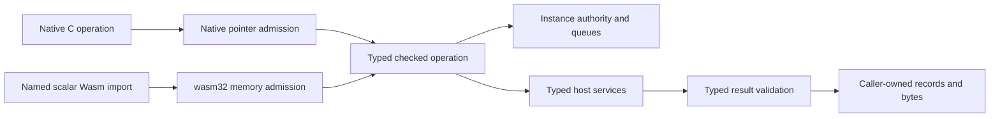

# Runtime contributor map

Start with one guest turn, not the test suite:

1. [`Runtime`](wasm/mod.rs) configures Wasmtime and compiles a guest. Native hosts
   use Cranelift; iOS uses the Pulley interpreter. On macOS compiled code is
   placed in `MAP_JIT` memory owned by [`jit_memory`](wasm/jit_memory.rs), so the
   hardened runtime accepts it with only the `allow-jit` entitlement.
   Compilation precedes admission to the VM owner thread.
2. [`GuestInstance`](wasm/guest.rs) owns the Wasmtime store and guest memory.
   Portable [`instance`](instance.rs) state owns one indexed capability table per guest thread,
   authority and bounded queues; the VM adapter separately owns its limiter
   and optional fuel. Engines are unmetered by default. An explicit positive
   local launch budget enables metering and resets before each `pb_main` call;
   exhaustion traps and halts that generation. `pump` calls `pb_main`; guest operations enter
   through the scalar syscall import in `wasm/operations`. There is no WASI or ambient I/O.
3. The [`Host` trait](host.rs) is the typed, VM-independent boundary to
   storage and asynchronous host operations. Its production implementation is in
   [`engine`](../engine/host.rs).
4. [`view`](view.rs) owns bounded semantic scene types, decoding and event-ID
   validation without VM dependencies. The runtime exports these types for host
   presentation; file authority is still checked by the syscall host.
5. [`ManagedGuest`](managed.rs) retains the accepted view/logs and handles
   replacement, including failed startup and stale notifications. The native
   [`local UI owner`](../ui/local_guest.rs) keeps an instance beside its renderer on one OS
   thread; AppKit does not schedule its execution.

The syscall ABI, authorization, execution-incarnation isolation, bounded work and
failed-replacement behavior are constraints on runtime changes. Changes to those
contracts need their callers and tests updated together. This map describes the
current implementation; it does not assign ownership or prescribe a replacement
engine or graphics backend.

The [shared capability table](../capability.rs) implements handle lookup,
rights, reuse, revocation and counted ownership. [Runtime capabilities](capabilities.rs)
defines the guest resource namespace.

## Operation modules

`syscall/` owns typed operation semantics: `control.rs`, `environment.rs`,
`object_ops.rs`, `file_ops.rs`, `handles.rs` and `authenticated_field.rs` perform
capability checks, input/result validation and state transitions. `data_validation.rs`
shares schema, projection, field/value and aggregate payload limits. `events.rs`
owns queue admission, peek and consumption; `files.rs` validates scene-bound file
authority. These modules depend on neither Wasmtime nor an encoded request envelope.

`native/` admits native C pointers and lifecycle context. `wasm/operations/`
lowers named scalar imports through checked wasm32 memory in `linear_memory/`.
Both admit outputs before effects or result consumption. Variable results use
caller-owned record arrays and byte storage. Begin/Take retains one snapshot
through short output and checks current read authority at delivery; a fresh
snapshot requires a distinct Begin. Packed scenes and operation-ready event payloads are separate data
formats. The public C declarations live in `playbit-api/include/playbit/sys/`;
Rust apps use the safe `playbit_api::Context` methods.

## What the tests establish

| Location | Responsibility |
| --- | --- |
| `wasm/tests.rs` | Our engine configuration, module admission and memory/fuel limits; small Wasm programs exercise both configured backends. |
| `view.rs::tests` | Semantic scene decoding, annotations, theme roles, and record/depth bounds without constructing a VM. |
| `wasm/wasm_atomics/tests.rs` | Our atomic-to-scalar rewrite for private single-threaded memory on Pulley. Native execution is the oracle: compare return values, memory and traps against rewritten execution. These are tests of our transformation, not an independent Wasmtime conformance suite. |
| `syscall/tests.rs` and `syscall/*_tests.rs` | Guest memory validation, capability scoping, asynchronous operation handles and generation isolation. WAT fixtures exercise the ABI; recording hosts make host effects observable. |
| `managed.rs::tests` | Replacement succeeds or retains the previous executable/view; old callbacks do not enter a new generation. |
| `tests/canvas.rs` | Public canvas encoding/decoding and input validation. |
| `engine` tests | Real storage, VM ownership, admission, session updates and replication integration. |

Run the runtime tests with `cargo test --locked -p playbit runtime::`. They do
not establish that the packaged application builds, launches or works through
native input. Follow [Building and testing](../../../docs/building.md) for the
contributor build and packaged checks. Keep regression tests tied to an observable
contract or a real failure; a larger test count is not a substitute for those journeys.
