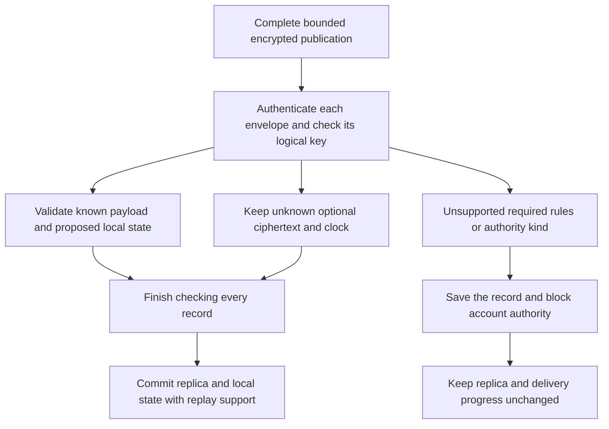

# Encrypted account records

Account records use ordinary kvdb replication. AP copies exact ciphertext and
originating clocks without decrypting, interpreting, re-encoding or filtering for
particular clients. This is the release-candidate format, not a shipped release.

## Encryption and record keys

The encrypted envelope is revision 1: one revision byte, a 12-byte random nonce,
AES-256-GCM ciphertext and a 16-byte tag. HKDF-SHA256 derives separate encryption
and lookup keys from the recovery secret with account ID as salt. Encryption,
lookup, AAD and tree-hash domains are unchanged in [account.rs](../account.rs).
AAD binds account ID, opaque tree key and originating clock. The tree key is
HMAC-SHA256 of the complete logical key.

The authenticated plaintext is a [PBR revision 1](../catalog/record.md) struct.
Its explicit logical key lets older clients verify HMAC identity for unknown
payloads. Known payload identity must match the header. Authenticate and check
the key before saving optional records or blocking unsupported account rules;
invalid ciphertext and substituted keys cannot create authority.

| Tag | Meaning |
| --- | --- |
| 1 | Permanent, exact kind name, 1–64 ASCII letters, digits, `.`, `_` or `-`. |
| 2 | Complete UTF-8 logical key, 1–511 bytes without ASCII controls. |
| 3 | Boolean: whether the record belongs to the account authority unit. |
| 4 | Exact required-read feature names. |
| 5 | Exact required-write feature names. |
| 6 | Binary payload bytes. Known payloads contain a complete PBR record. |

All six fields require both PBR requirement bits. Headers have at most 64 fields,
in increasing identity order, without duplicates. Unknown optional fields use at
most 4096 encoded bytes. Unknown required fields leave fixed identity readable
but block accepting account data.

Each feature list has at most 16 distinct, case-sensitive names, each 1–64
non-space printable ASCII bytes (`0x21`–`0x7e`), sorted by ASCII bytes. Names require
support; they never change known field meanings. Both supported lists are
initially empty. Account features are independent of AP operations, transport
algorithms and host syscall capabilities.

## Record kinds

| Kind | Logical key | Classification and payload fields |
| --- | --- | --- |
| `display_name` | `settings/display-name` | Independent presentation; variant 1, field 1 name. |
| `volume` | `volume/{volume ID}` | Mandatory account authority; variant 2, fields 1 volume, 2 credentials. |
| `volume_deleted` | `deleted-volume/{volume ID}` | Mandatory account authority; variant 3, field 1 volume ID. |
| `invitation` | `session/{session ID}` | Mandatory account authority; variant 4, fields 1 invitation, 2 app name. |
| `personal_volumes` | `session-mounts/{session ID}` | Mandatory account authority; variant 5, fields 1 session ID, 2 selected grants. |
| `hosted_volume` | `volume/{volume ID}` | Mandatory account authority; variant 6, fields 1 volume, 2 credentials, 3 World scope. Scope variant 1 has fields 1 app identity, 2 original build, 3 initialization fingerprint. |
| `hosted_invitation` | `session/{session ID}` | Mandatory account authority; variant 7, fields 1 invitation, 2 optional app name, 3 session scope. Scope variant 2 has fields 1 session ID, 2 creation build, 3 optional User override. Private scope data and credentials are excluded. |

Known authority classifications cannot change. Unknown optional kinds must use
`optional/{kind}/{nonempty suffix}`; they cannot overwrite or add conditions to
known credentials, consent, deletions or display names. Clients save these payload
bytes without interpreting or claiming to validate their schema. Invalid framing,
duplicate tags, invalid identities and excessive length still reject.

Keep unknown optional ciphertext and clocks through live delivery, bootstrap,
restart and reconciliation. These records grant no credentials, permissions or
consent and create no UI state. Advance a delivery receipt only after known
integrity/identity checks and required updates to local state succeed. Unsupported
required rules or unknown authority kinds reject the whole receipt before changing
the replica, local state or delivery progress.

## Blocking unsupported account rules

Unknown records must never silently restrict grants older clients still use.
Unsupported authority rules must also block saved grants and open sessions. After
authenticating unsupported rules, save a bounded local quarantine marker with the
first record's exact key, clock and ciphertext. Keep replica data, credentials,
sessions and pending publication intent, but pause account grants, capabilities
and dependent operations across restart.

Reconnect, compatible partial frames, recovery and backup writes cannot clear the
marker. No newer features or clear operation are supported. A future reader must
understand the rules and validate both the saved record and the appropriate
complete current account state before explicitly resolving it.

Native operations hold the consent read lock; quarantine takes its write lock
before saving the marker. Earlier operations finish first; later dispatch and
queued dependent work check the marker. Web metadata commits take the shared
account-authority Web Lock; quarantine takes it exclusively. Queued host mutations
and file publication recheck authority before local effects. Scalar guest dispatch
checks canonical slots and known operations before authority; cached mounts cannot
bypass quarantine. Presentation, scheduling and owner cleanup still work.
Publication queue heads, AP sends and close/update drains refuse paused authority,
keeping committed changes and pending intent. WebCrypto and network waits hold
none of these metadata locks.

## Payload fields, defaults and edits

Field tags are defined in [record/codec.rs](record/codec.rs). Volume and ID
payloads use their own codecs and field tags.

| Type | Permanent tag → field |
| --- | --- |
| Credentials | 1 database key; 2 blob key. |
| Personal selection | 1 volume ID; 2 write permission; 3 incarnation ID. |
| Invitation | 1 seed; 2 session; 3 root volume; 4 root credentials. |
| Session | 1 app; 2 ID; 3 selector; 4 resolved build ID; 5 root volume; 6 creator; 7 update authority. |
| App identity | 1 publisher; 2 app ID. |
| Build selector | Variant 1 exact build, variant 2 deployment; each has field 1 ID text. |
| Update authority | Variant 1 creator; variant 2 deployment; no fields. |

All current payload fields are required with both PBR requirement bits except
invitation app name. App name has always used tag 2 without requirement bits.
Missing or explicit null means `None`; a present name keeps its meaning and
validation. No other missing field has an implicit default. IDs, field tags,
kinds, classification and these meanings are never reused or reinterpreted after
publication.

Compare original authenticated plaintext with old and new known fields. Keep
unknown header and nested payload fields attached to their original fields.
Refuse changed sequences, maps or variants when unknown bytes cannot be safely
matched; never drop or move them. Unchanged state keeps its ciphertext and clock.
Never re-encrypt incoming records when copying or accepting them. Acknowledgments
match exact pending ciphertext and clock and cannot erase newer local decisions.

## Limits and existing development data

Plaintext is at most 48 KiB; envelope overhead is 29 bytes. The native decoder's
header/payload memory budget is 4 MiB per bounded pass, including unknown fields.
Delivery bounds frames and processes one record at a time. These limits do not
qualify startup or input latency. The web client writes only personal decisions;
compiled Rust validates all known incoming kinds before building local state.

Readers reject earlier development JSON plaintext. Clients do not automatically
convert or delete development account trees, profiles or ciphertext. The
crypto-only revision-1 sample tests encryption, not support for arbitrary plaintext. Whole-profile writer
checks and development-data transitions follow their own release rules.
