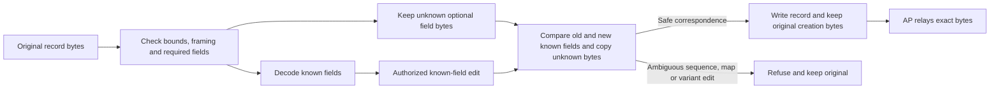

# Client record encoding

`catalog::record` reads and writes compact binary client records. These bytes
describe the release candidate; they do not declare a shipped supported release.
JSON is an API/debug view of these types and is not accepted as a stored record.
The enclosing database key family identifies the record type. A caller must not
decode a record under a different key family.

Each field has an explicit tag and length, so readers can skip unknown optional
fields and writers can copy their exact bytes. Tags do not depend on Rust field
order. The codec has no general serializer, dynamic schema registry or new
dependency. Physical kvdb, AP, package and local profile/observation formats are
separate.

## Framing and scalar values

Every complete record starts with bytes `50 42 52 01`: family `PBR`, revision 1.
The rest is one value. Its length comes from the enclosing record or length field;
trailing bytes reject. A value starts with its one-byte wire kind.
Multi-byte numbers and lengths are little-endian. Rust memory layout is never
serialized.

| Kind | Payload after the kind byte |
| --- | --- |
| 0 | Null, no payload. |
| 1 | Boolean, exactly one byte, 0 or 1. |
| 2 | Unsigned integer, exactly eight bytes. |
| 3 | Signed two's-complement integer, exactly eight bytes. |
| 4 | IEEE 754 binary64, exactly eight bytes, finite values only. Signed zero retains its bits. |
| 5 | UTF-8 text occupying the remaining extent, without a terminator. |
| 6 | Binary bytes occupying the remaining extent. IDs retain their exact 15/16 bytes and digests retain 32 bytes. |
| 7 | Sequence: repeated `u32 length` plus one value, in application order. |
| 8 | Struct: repeated `u16 tag` plus `u32 length` plus one value. |
| 9 | ID map: repeated 16-byte ID plus `u32 value length` plus one value. |
| 10 | Variant: `u16 discriminant` followed by a struct value containing its fields. |
| 11 | Packed entry IDs: consecutive 15-byte nonzero IDs; the payload length must divide exactly by 15. |

Lengths include the child's wire-kind byte and exclude the containing length or
tag. Zero-length children reject. Maps use strictly increasing binary ID order;
structs use strictly increasing field identities (the low 14 tag bits). Duplicates
reject. Sequences keep their order. Readers also check causal context order,
schema identity, authorization and value cardinality.

An optional value is null or its ordinary value representation. Current source
structs require every declared field, including explicit nulls for absent options.
A missing existing field rejects. Session tag8 is an optional Shared volume ID;
its absence means the existing root-backed or local-only session. Invitation
tags3/4 keep their original raw Root volume/credential bytes; a Shared invitation
omits both and instead requires tag5 containing a typed Shared volume/credential
pair. Unknown required tags refuse interpretation. Future optional fields must explicitly define
their absent default; zero, empty and null meanings never change. Unknown variants
or wire kinds in an interpreted value reject.

## Field tags and requirements

The low 14 bits of a struct tag are its permanent field number, from 1 through
16383. The two high bits are requirements:

| Bit | Meaning for a reader unfamiliar with the field identity |
| --- | --- |
| `0x8000` | Required for reading; refuse use of the record and dependent effects. |
| `0x4000` | Required for writing; refuse edits and loading the record into a writable replica. |
| Neither | Optional; skip interpretation and preserve the complete original field bytes. |

Current fields require both bits; writers cannot remove either. `record::read`
checks read requirements; `record::decode` checks both to load writable replicas.
This does not provide a read-only product mode. Bits require the exact field
meaning, not an AP feature, host capability or product version. Unknown framing
or revision rejects before typed decoding. Wider rules need their owner's
explicit feature declaration; optional fields cannot silently change authority.

Unknown optional fields use at most 4096 encoded bytes per struct. Records are
at most 4 MiB; index facts are at most 64 KiB. Containers have at most 4096
elements; memory accounting and unknown-field preservation stop at depth 16.
Individual record, query and result-building limits can be smaller. Charge raw
bytes, containers and unknown-field expansion before allocating typed values; encoded size is not
decoded memory size.

## Tags for each type

Tags are defined in [record/types.rs](record/types.rs) and private fact/record
modules. Never derive them from Rust field order or serializer traversal, or
reuse a removed tag or discriminant. Each row has its own type's tags.

| Type | Tag → field |
| --- | --- |
| Volume | 1 id; 2 name; 3 owner; 4 share_key_with_service; 5 personal. |
| Acl | 1 grants. |
| Grant | 1 subject; 2 permissions. |
| Schema | 1 types. |
| TypeDeclaration | 1 name; 2 deprecated; 3 fields. |
| FieldDeclaration | 1 name; 2 value_type; 3 repeated; 4 deprecated. |
| EditStamp | 1 clock; 2 device_id. |
| FieldCell | 1 stamp; 2 values. |
| ObjectFields | 1 object_id; 2 type_id; 3 fields. |
| Namespace Origin | 1 installation; 2 label. |
| Namespace Birth | 1 creation_context; 2 parent; 3 automatic; 4 deletions; 5 departures; 6 observed. |
| Namespace CreationContext | 1 observed. |
| EntryInfo | 1 namespace; 2 origin; 3 initial_permissions; 4 created_revision; 5 name; 6 kind; 7 protocol. |
| EntryRevision | 1 revision; 2 creation; 3 origin_clock; 4 origin; 5 observed; 6 change. |
| Object Creation | 1 creator; 2 stamp; 3 record. |
| Object Field | 1 creation; 2 cell. |
| Schema Fact | 1 creation; 2 declaration. |
| Local Location index | 1 parent; 2 name. |

| Variant type | Discriminants and payload fields |
| --- | --- |
| Permission | 1 Read; 2 Write; 3 Append; 4 ManagePermissions. |
| DatabaseProtocol | 1 Kvdb; 2 BlobLog. |
| Principal | 1 Human; 2 Service. Both carry ID in field 1. |
| Subject | 1 Public; 2 Principal with principal in field 1. |
| EntryAcl | 1 Inherit; 2 Replace with ACL in field 1. |
| ValueType | 1 Text; 2 Boolean; 3 Integer; 4 Float; 5 Bytes; 6 File; 7 Reference with type ID in field 1. |
| EntryKind | 1 Directory; 2 KvDb; 3 ObjectDb with schema in field 1; 4 Blob with 1 len_bytes, 2 digest, 3 encrypted_key, 4 published_at_micros. |
| EntryChange | 1 Created with info in field 1; 2 Name with name in field 1; 3 Move with 1 parent, 2 name; 4 Delete; 5 Content with kind in field 1; 6 Schema with declaration in field 1. |
| Value | 1 Text; 2 Boolean; 3 Integer; 4 Float; 5 Bytes, each in field 1; 6 File with 1 volume_id, 2 entry_id; 7 Reference with 1 volume_id, 2 database_id, 3 object_id. |
| Schema Declaration | 1 Type with name in field 1; 2 Field with 1 name, 2 value_type, 3 repeated; 3 Deprecated. |

Unit variants have an empty struct payload. An empty sequence and null are
different: `FieldCell.values = None` is a tombstone, while `Some([])` is an empty
repeated value.

## Hashes and edits

Volume marker byte string `3` rejects earlier development JSON. Installing the
codec never deletes or converts profiles or replicas. Keep unsupported volumes
intact; explicit development transitions, whole-profile checks and supported
migrations follow their own contracts.

Entry creation hashes bind the entry hash domain, entry ID, origin clock and
original bytes. Object creation hashes bind their domain, origin clock and
original bytes. Domains are unchanged; unknown optional fields also affect these
hashes. Never normalize a creation or hash only its known fields. Validate the
original framing and known rules, without requiring a match to re-encoded known
fields.

Writers compare original bytes with old and new known fields, keeping unknown
fields at every level. A changed sequence, map or variant with unknown data needs
proof of which old and new items match; otherwise refuse. Unchanged containers keep
exact bytes. Object edits write separate field facts, leaving creation unchanged.
Unknown fields also survive an initial cell's first overlay. Abort the transaction
on any edit error; never commit a partial edit. Remote validation and conflict
handling still check authority and dependencies.

[record/tests.rs](record/tests.rs) uses fixed samples and invalid inputs, beyond
tests using only the current writer and reader. A supported baseline also needs
original bytes, previously compiled guests and native/web/AP interoperability
tests.
