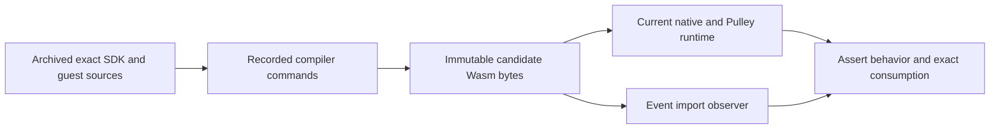

# Guest ABI v1 release candidate

These compiled C/Rust programs test the `playbit.syscall/1` release candidate.
They do not declare that a supported release has shipped. The sources come from
the working tree recorded in the exact source archive; the manifest identifies
its base revision without claiming the edits exist in that commit, and records
source hashes, compiler versions, build commands and binary hashes.

The six C/Rust pairs cover asynchronous mutation, variable results, schemas,
queries, creation/copy/selection and authenticated field metadata. Runtime tests
execute these programs on native and Pulley hosts, checking input ownership,
readiness, output counts/content and exact result consumption. Browser tests run
the saved SDK event consumer with optional, mandatory, input and completion events.

This candidate uses positive 63-bit capability handles (low 32-bit slot, high
31-bit generation) and signed 64-bit syscall results. Single-handle operations
return handles directly. It supersedes the unreleased first candidate. No saved
guest binary is rebuilt during its ordinary regression test. Current-SDK probes
remain separate in `build-wasm-probe.sh`.



## Regression checks

From the repository root, with the usual build prerequisites prepared:

```sh
export SCCACHE_SERVER_UDS="$PWD/_sccache.sock"
cargo test --locked -p playbit --lib frozen_v1_rc2
node --test playbit/platform/web/src/guest-events-frozen.test.mjs
python3 playbit/tests/fixtures/guest-abi-rc2/reproduce.py
```

Regression tests must use these checked-in binaries even after the SDK changes;
they must not substitute outputs from `target/wasm-lowering`. Other Cargo tests
may still compile programs with the current SDK. iOS runs the Pulley backend. These programs test the guest ABI; profiles, packages, AP, UI and
performance need separate release checks.

## Reproduction

Python 3.12+, Rust 1.99.0 (`b940084d7`, LLVM 23.1.1) with the
`wasm32-unknown-unknown` standard library, and LLVM Clang/LLD 22.1.5 are required.
The manifest records the full compiler version output from arm64 macOS. Put those
compiler executables on `PATH`, then run:

```sh
python3 playbit/tests/fixtures/guest-abi-rc2/reproduce.py --rebuild
```

The tool first checks the pinned manifest, every artifact and the compact source
archive. It verifies archived source bytes, builds the recorded commands in a
fresh temporary directory and compares all 13 outputs byte for byte. It never
writes to this directory or uses today's SDK sources. `tar -tzf` and
`tar -xOf` can inspect individual paths in `sources.tar.gz`.

Keep this candidate's bytes, sources, manifest and pinned digests immutable.
A later candidate belongs in a new directory with its own source and build
records; updating the SDK is not a reason to refresh these files. Compatibility baseline
changes require human review.
