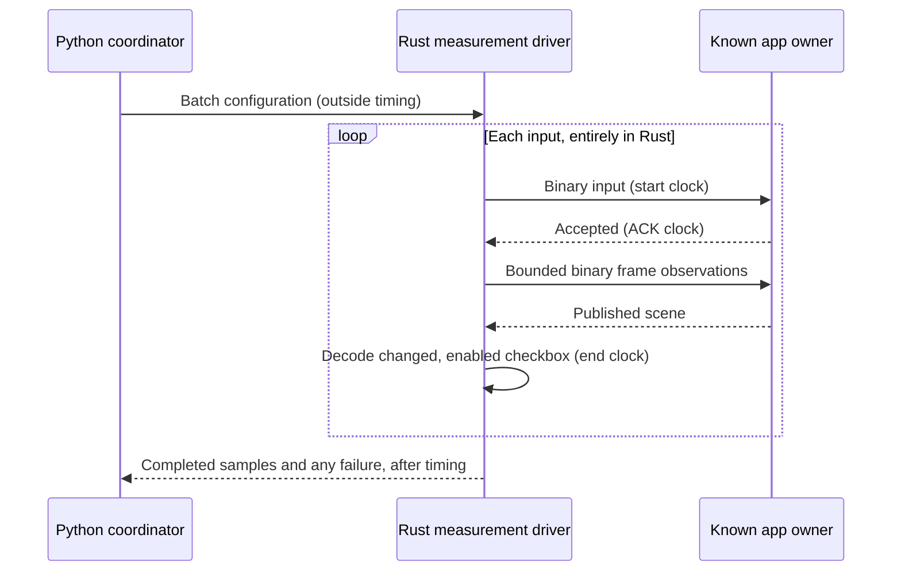

# Local performance diagnostics

CI runs correctness and resource-bound tests only. All benchmark commands in
this document are for explicit local/reference-device runs, never shared CI VMs.
No diagnostic timing cohort runs on CI. Standalone UIKit model tests require
`--benchmark` to enable timing; their default mode checks correctness once per
fixture without collecting timing samples.

Browser account tests also default to correctness only. To explicitly collect
their timing cohorts on a reference device, build optimized Wasm and run:

```sh
sh playbit/platform/web/build.sh release
node playbit/platform/web/tests/account-store.mjs target/wasm32-unknown-unknown/release/playbit.wasm --benchmark
node scripts/check-browser-account-outbox.mjs --benchmark
```

The module worker can be run manually with
`postMessage({benchmark:true,samples:1000})`; `{}` runs only the correctness cases.
CI omits `--benchmark`, retains the small/maximum fixtures and state-transition
assertions, and does not collect latency distributions.

For the Mac volume glyph, use an optimized reference-device build:

```sh
cargo test --locked --release -p playbit benchmark_volume_asset_load -- --ignored --nocapture
```

This measures file read, cache admission, task delivery and uncached PNG decode;
it does not measure first-visible artwork or physical presentation. Observe the
actual packaged four-volume experience separately.

For source-watcher capacity release on Mac:

```sh
cargo test --release --locked -p playbit watch::tests
cargo test --release --locked -p playbit benchmark_lease_retirement -- --ignored --nocapture
```

The benchmark measures 1,000 explicit unlock/close operations while a duplicated
file descriptor remains open, and verifies immediate slot reuse. Lease creation,
filesystem notification delivery, compilation and reload are outside this timing
boundary. The ordinary regression has no performance assertion and runs in CI.

For the packaged MCP transport, use an isolated profile and optimized binaries:

```sh
cargo test --release --locked -p playbit
cargo test --release --locked -p playbit benchmark_ready_framing -- --ignored --nocapture
python3 scripts/benchmark-mcp.py /path/to/Playbit.app/Contents/MacOS/playbit-mcp /path/to/isolated-profile
python3 scripts/benchmark-mcp.py /path/to/Playbit.app/Contents/MacOS/playbit-mcp /path/to/isolated-profile --clients 4
```

The script performs 1,000 read-only status operations per client. It measures
Python encoding, stdio transport, local IPC/engine work and complete response
decoding, including client scheduling when concurrent. It reports each client,
aggregate p50/p90/p99/max, fixture counts and binary hash. Process-cold first
requests are reported separately and excluded from warm percentiles; they do
not establish startup p99 or the macOS GUI startup gate. MCP may start the
packaged local engine, which stays running after the script exits. Keep that
fixture isolated and stop only its engine after qualification. Long-poll
cancellation, remote operations, maximum decoded payloads, GUI readiness and
physical presentation require separate qualification.

Engine change-wait admission, fifth-wait rejection, read-only coexistence,
disconnect credit reclamation and stale cursors run in the actual client
admission/IPC tests. GUI log waits address a known app instance through
`pb logs SESSION --instance ID`; they use a separate bounded owner endpoint.
The combined engine-scene/MCP log-wait timing matrix is removed. Concurrent
packaged waiter timing remains deferred and unqualified.

For maximum-size MCP JSON memory qualification on an optimized installation:

```sh
python3 scripts/qualify-mcp-memory.py /path/to/Playbit.app/Contents/MacOS/playbit-mcp /path/to/fresh-output --repeats 1000
python3 scripts/qualify-mcp-memory.py /path/to/Playbit.app/Contents/MacOS/playbit-mcp /path/to/another-fresh-output --repeats 1000 --concurrent-calls
```

This driver owns a fresh isolated service/profile and stops it after the check.
It sends exact 4 MiB requests with dense arrays, many keys, strings, invalid
operations and oversized typed data syscalls, then checks follow-up discovery. Invalid
operations use an absent profile and must leave it absent. Separate same-user
synthetic IPC endpoints exercise exact 4 MiB dense/escaped responses; they qualify
the codec boundary, not real service output or native UI. Results identify each
endpoint explicitly. The OS `wait4` lifetime peak RSS is measured after each
client exits (bytes on macOS, KiB converted to bytes on Linux). Endpoint RSS and
peak physical footprint are not substituted for this measurement. The 128 MiB
allocation must hold across repetitions, including retained allocator pages.
All samples include first-request/process-launch effects; no startup acceptance
claim is made. The reported pipe round trip includes Python and service work.
The four-client mode shares one real service, sends 1,000 maximum input requests
per client and verifies a later small status call. It reports the sum of individual
OS peak RSS values, a conservative upper bound on simultaneous client RSS.
The maximum-message codec and
reclamation allocation is 100 ms p99; normal warm status retains its 1 ms budget.
There is no CI timing cohort. See the MCP framing/service tests for protocol and
maximum escaped-response correctness.

For desktop control typography on Mac, run sequentially with release optimization:

```sh
cargo test --locked --release -p gpui --no-default-features --features font-kit --lib tracking_tests
cargo test --locked --release -p gpui --no-default-features --features font-kit --lib benchmark_control_ -- --ignored --nocapture --test-threads=1
```

These use the actual Core Text renderer and bundled Inter font. Shaping measures
1,000 unique and repeated ASCII, combining-mark and emoji strings at 128 bytes/
4 KiB, with zero and 0.22px tracking. Truncation measures the same cohorts at half
the shaped width and verifies the returned text fits when painted. It includes
shaping to select/verify the cut; output validation is outside timing. The tests
also exercise zero/narrow/full widths, mixed fonts, right-to-left text, grapheme
boundaries and narrow→intrinsic→wide resizing. Compare all cohorts, retain failed
runs and maxima, and keep physical input/render/display qualification separate.

For retained desktop input properties:

```sh
cargo test --locked --release -p playbit benchmark_placeholder_update -- --ignored --nocapture
```

This measures only comparison/replacement of an existing editor's placeholder:
1,000 unchanged and changed values at 128 bytes and 4 KiB, reporting p50/p99/max
against 20µs p99. It excludes shaping, guest execution, IPC and presentation.
The accompanying regression checks that the property update preserves the draft,
selection and pending revision. Also exercise a real source update in the packaged
app: keep its window open, change the placeholder, complete any required access
review, and check the visible text and accessibility description. Verify stored
TODOs, an unsubmitted draft and selection separately; the setter test cannot prove
that a replacement VM preserves transient guest state.

For Mac session artwork, run these sequentially on the reference device:

```sh
cargo test --locked --release -p playbit benchmark_display_names -- --ignored --nocapture
cargo test --locked --release -p playbit benchmark_icon_decode -- --ignored --nocapture
cargo test --locked --release -p playbit benchmark_icon_load -- --ignored --nocapture
```

Each icon case has 1,000 samples. Decode uses a simple SVG and 24/256/512-pixel
PNGs; file loading seeks past 1 MiB of Wasm and ignores another 1 MiB resource in
each of four bundles. These are warm-file diagnostics, not cold storage or UI
qualification. Enable the running profile with `pb trace start` and compare
`ui.session_icon.read`, `.decode`, `.load`, `.apply`, `ui.management.sidebar`
and CPU scene completion. The one-job loader does not poll; cache hits add no
decode. Check real SVG/PNG colors, selected/unselected rows, missing/unsupported
artwork, accessibility and keyboard activation, and an icon-changing session
update. Run actual TODO input during loading and report how many timed inputs
overlap decoding; an idle cache or a screenshot cannot establish that gate.

Build optimized artifacts with `sh playbit/platform/macos/package.sh release` and the
real fixture with `cargo rustc --locked -p todo --lib --crate-type cdylib --release --target wasm32-unknown-unknown`.
Run sequentially on an otherwise quiescent reference machine:

```sh
python3 scripts/benchmark-local.py --app target/release/Playbit.app --rows 32 --samples 1000
python3 scripts/benchmark-local.py --app target/release/Playbit.app --rows 32 --samples 1000
```

Repeat for 1 and 64 rows and with `--sessions 4`. Each run creates a private
temporary profile, verifies outbound IP is denied, uses the packaged engine
and CLI, and prints its evidence path. It retains raw samples and failures.
Never point this fixture at an existing account profile. The current fixture
setup follows the current CLI contract and must change with that contract.

Add `--idle-seconds 300` to observe a five-minute quiet interval after fixture
setup. The native C17 counter helper measures CPU, wakeups, RSS, footprint and
disk I/O before/after the interval and workload. It converts Mach CPU ticks to
nanoseconds and checks that conversion against the process CPU clock before
each run, following Apple's [resource-counter measurement](https://github.com/apple-oss-distributions/xnu/blob/main/tests/recount/recount_perf_tests.c).
Peak footprint covers process lifetime, including setup; endpoint RSS snapshots
are not peak RSS. Neither counter reports allocation count. Keep those limits
visible when assessing the resource gate. Completed batches and native failures
retain their raw samples. Interrupting a helper before it reports loses that
batch's in-memory samples; an uncertain accepted input is never replayed.

The Rust driver runs a complete batch against one known GUI instance. Each
sample starts immediately before its binary input exchange, records the input
acknowledgment, and ends after binary frame reads and native scene decoding
observe the changed, enabled checkbox. A bounded 1 ms read-observation interval
remains part of this diagnostic. Python starts each batch and exports its
results afterward; JSON encoding, helper stdio and Python scheduling are outside
every sample. Neither boundary establishes physical input, scene adoption or
display presentation. Each GUI instance uses an independent root and retains its
known instance/generation; uncertain mutations and launches are never replayed.



Every observed toggle is checked against the actual decoder and durable Objects
query. Engine readiness is measured separately from app startup. Native resource
counters retain engine and GUI lifetime peak footprint; allocation counts and
continuous peak RSS remain unqualified.

Tracing is an independent event recording facility. Start recording one running
instance with `pb trace start INSTANCE`, inspect it with `pb trace tail INSTANCE`
and stop with `pb trace stop INSTANCE`. Omitting the instance selects the profile.
Recording off/on comparisons must use matching optimized artifacts and workloads.
The [trace architecture](../playbit/trace/README.md) documents bounded transport,
loss and retention. A tail does not certify causal coverage or UI latency. The
former viewer, capture certifier and their qualification scripts are removed.

Renderer text measurement regressions run against the actual GPUI layout and
native text system. The vendored renderer is an explicit workspace member so
its test dependencies are locked; ordinary default-member tests remain unchanged.
Run its library suite separately from application workspace tests:

```sh
cargo test --locked -p gpui --no-default-features --features font-kit --lib
```

The suite checks constrained→intrinsic→wide sizing, original styled runs after
truncation, Unicode, equal-length truncation, wrapping, and multiline text.
These tests do not replace packaged session-switch/resize/IME checks or actual
input/render measurements. CI runs this library suite explicitly, excluding
upstream renderer examples from the application workspace test command.

To isolate a slow log snapshot without changing its production path, run:

```sh
cargo test --locked --release -p playbit benchmark_log_ -- --ignored --nocapture --test-threads=1
```

`benchmark_log_snapshot_and_encoding` measures the real node snapshot through
bounded reply preparation and enforces the ordinary/maximal snapshot budgets.
`benchmark_log_encoding_parts` separately measures copying retained strings,
ordinary serde JSON encoding, and bounded output encoding for 32×128-byte,
256×256-byte, and 256×256-control-byte fixtures. It reports all 1,000 samples'
p50/p99/max summaries and serializer write counts. The unbounded `Vec` comparison
is diagnostic only; production retains its admission limits. The component
measurements include output destruction and do not add up to the end-to-end
measurement. Neither benchmark measures socket delivery, UI or presentation.
Run without another benchmark or compiler active; retain hardware/build details
and hosted failures separately from local results.

## Shared volume rename

Run `PLAYBIT_QUALIFY_PERF=1 cargo test --locked --release -p playbit volume_label_transaction_workload -- --nocapture`.
This measures complete local durable renames, with no network or GUI: six
1,000-operation cohorts, 32/256-byte Unicode names, 32 TODO rows and 1/32/256 grants.
Reports p50/p99/max and metadata size; enforces the 2ms p99 allocation only in
qualification mode. Ordinary CI runs eight operations per cohort as a regression
check; its timing output does not qualify reference hardware. Debug builds are
rejected in qualification mode. Measure AP delivery, concurrent local input and
native displayed names separately; this benchmark cannot establish those gates.

Run `PLAYBIT_QUALIFY_PERF=1 cargo test --locked --release -p playbit benchmark_volume_name_listing -- --ignored --nocapture`
for 1,000 current-name listings at 1/32/256 volumes. It includes the first read
and compares the existing profile scan with the current listing path. The DB1
name is projected into that existing catalog with a durable repair marker;
both profile commits are included in the rename benchmark above. Startup fault
tests cover interruption on either side of the DB1 commit and the 256-marker cap.

Run `python3 scripts/benchmark-local.py --app target/release/Playbit.app --sessions 4 --rows 32 --samples 1000 --renames`
with an optimized TODO artifact already built. Four independent guest instances
each receive 1,000 checkbox inputs while 1,000 256-byte Unicode renames affect the
first root. Raw samples and binary hashes stay in an external temporary directory.
The checker requires overlapping producers, correct returned names and unchanged
row identities/data. Input ACK measures the known GUI control exchange; committed
scene observation separately includes binary reads, 1 ms observation intervals,
and native decoding within the Rust batch. JSON and Python are outside timing.
Neither qualifies physical
presentation or cross-process per-input commit trace correlation. Inspect `renames`,
`all_producers_overlap_ms`, resource snapshots and the trace alongside input
results. Run the same command without `--renames` as the concurrent-input baseline.
AP provisioning carries immutable identity and database credentials only; its
retry must not depend on a mutable name. Private held-AP tests verify that rename
and input return before remote storage is released and queued publication succeeds.
